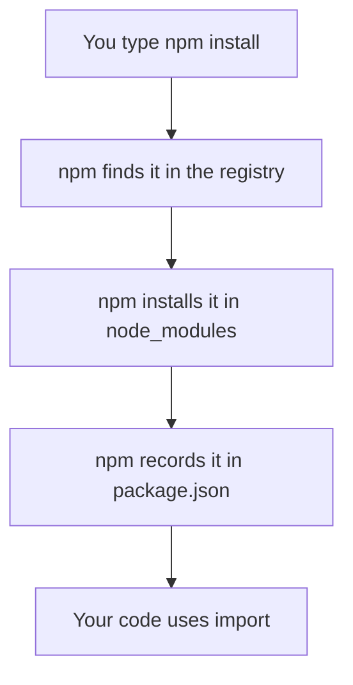

> **In one sentence:** A package is shared code that you can install in your project with a package manager, such as npm, instead of writing it yourself.

## Why should I care?

Programmers share code with each other. npm's documentation says developers "from every continent" use npm to "share and borrow packages". If someone has already shared code for a job, you can install it, call its [[functions|functions]], and not write that part yourself.

A package is also code written by someone else, and your program runs it. So this page also shows what you can check first.

## Analogy

In [[what-is-programming|What is Programming]], your program was a recipe. A package is like a cookbook written by someone else.

- The **registry** is a public library of cookbooks.
- The **package manager** is a courier who brings the book you name.
- `node_modules` is the shelf in your kitchen.
- **Installing** puts the book on that shelf. **Importing** lets your recipe use a recipe from it.

**Where the analogy breaks down:** a printed cookbook does nothing until a cook follows it. A package is code. Depending on your npm version and settings, some of that code can run during installation.

## How it actually works

### The words

- A **project** is a folder holding your program's files.
- A **package** is, in npm's words, "a file or directory that is described by a `package.json` file". (A directory is a folder.)
- A **dependency** is a package that your project needs in order to work.
- A **registry** is the shared collection. npm calls its registry "a large public database of JavaScript software".
- A **package manager** is a program that installs packages for you.

npm is "the standard package manager for Node.js". Node.js runs JavaScript outside the browser. The Node.js installer also installs npm. A later topic covers Node.js.

### Installing a package

You can read this page without running anything. In a terminal, in your project's folder, you would type this [[command-line|command]]:

```
npm install camelcase
```

The `camelcase` package changes text like `first name` into the lower camel case style that you met for variable names.

npm then does three things:

1. It installs the package, and "any packages that it depends on".
2. It puts them in a folder named `node_modules`, inside your project.
3. It records them. `package.json` lists the package you asked for and which versions you accept. `package-lock.json` records the exact version of everything installed, so later installs give the same result.

The list in `package.json` looks like this. It is written in JSON, a format for data, and it is not code that runs. Your version number may be newer.

```json
{
  "dependencies": {
    "camelcase": "^10.0.0"
  }
}
```



### Using it with import

One way to connect a package to your code is the word `import`. You can read this example without doing it.

```js
// A file named greet.mjs, in the project's folder.
// Bring in the function that the package offers.
import camelCase from "camelcase";

// Call it like a function you wrote yourself.
console.log(camelCase("first name")); // shows firstName
```

The `"camelcase"` in quotes is the package. The `camelCase` before `from` is the name you chose for its function in this file. To run the file, you would type `node greet.mjs` in the terminal. `console.log` then shows `firstName` there.

The ending `.mjs` tells Node.js that this file may use `import`. (This is simplified: other ways to load a package exist, and browsers need extra setup.)

### Version numbers

Semantic Versioning is a set of rules for version numbers, and npm follows it. Under these rules, a version number has three parts, such as `1.4.2`. A **breaking change** is a change that can stop old code from working.

| Part | Example | What it says |
|---|---|---|
| First (major) | 1.4.2 → 2.0.0 | Breaking changes |
| Middle (minor) | 1.0.3 → 1.1.0 | New features, and old code still works |
| Last (patch) | 1.0.0 → 1.0.1 | Bug fixes, and old code still works |

When one part goes up, the parts to its right go back to 0.

The `^` in `^10.0.0` means "Compatible with" that version. When you run `npm update`, npm can install a newer 10 version, such as `10.2.0`. It will not install `11.0.0`. Until then, `package-lock.json` keeps your versions the same.

These meanings are promises made by people. For a version starting with 0, Semantic Versioning says "Anything MAY change at any time."

### Other languages

In the Python language, pip installs packages: `python -m pip install` followed by a name (on Windows, `py -m pip install`). The Go language manages dependencies as modules, and `go get` adds one.

### The trust risk

Your program runs a package's code, so harmful code in a package can harm you.

Packages can include **install scripts**, which are programs for setup. Older npm versions ran these automatically for dependencies. In npm 12, "Dependency install scripts are blocked by default", unless your project allows them. The rest of a package's code still runs once your program uses it, so the trust risk stays.

Two kinds of trouble to know:

- **A similar name.** npm warns that attackers may register a name close to a popular package, so that people mistype it. This is called typosquatting. npm says it can detect these and block them. Check the spelling anyway.
- **A trusted package changes.** A **maintainer** is a person who looks after a package. In 2018, an attacker pretended to be one and took over a package named `event-stream`. Its version 3.3.6 added a harmful dependency. That code targeted an app named Copay.

Here is what you can do:

- Check the exact spelling of the name.
- Compare packages on npm's website. It can sort results by "download counts, most dependents, and last published date". These do not prove safety.
- Allow a package's install scripts only if you trust that package.

npm also helps: it scans packages for known harmful content, and it removes harmful content that users report.

## How it came to be

Isaac Z. Schlueter started npm in 2009, and its first really usable version came in early 2010. In March 2020, GitHub agreed to buy npm's company.

## 🧪 Try it in your browser

You will only read a web page. Install nothing. This page shows a package for Python. `requests` helps a Python program send web requests, the messages that ask a server for something.

1. Open [pypi.org/project/requests](https://pypi.org/project/requests/), on PyPI, the Python Package Index.
   **What you should see:** the name `requests` with a version number, and a line that says `pip install requests`. The numbers change over time.
2. Find **Release history**, at the side or further down, and click it.
   **What you should see:** a list of version numbers with dates. Which part changed between versions? **Check your answer:** from `2.34.0` to `2.34.1`, the last part changed. An entry with `dev` is a version made partway through development. Python's rules also allow other forms.
3. Go back and look for the word **maintainers**.
   **What you should see:** how many maintainers the package has, and their account names.

The wording and layout may change, and may differ on a phone.

**What you learned:** PyPI's page for a package shows its name, install command, versions and maintainers. You can check these before you install.

## Common misunderstandings

- **"`npm install camelcase` installs it for my whole computer."** No. This form puts the package in your project's `node_modules` folder. A global form with `-g` also exists.
- **"If a package is in the registry, it must be safe."** No. npm scans packages, but the `event-stream` case still happened.

## Recap

- A package manager such as npm installs shared code from a registry into your project, and `import` brings it into your code.
- A dependency is a package your project needs. A Semantic Versioning number has three parts: major, minor and patch.
- Installing a package means trusting its authors, so check the name first.

## Sources

- npm Docs, About npm: https://docs.npmjs.com/about-npm
- npm Docs, About packages and modules: https://docs.npmjs.com/about-packages-and-modules
- npm Docs, npm install: https://docs.npmjs.com/cli/v12/commands/npm-install
- npm Docs, npm install-scripts: https://docs.npmjs.com/cli/v12/commands/npm-install-scripts/
- npm Docs, npm update: https://docs.npmjs.com/cli/v12/commands/npm-update
- npm Docs, package.json: https://docs.npmjs.com/cli/v12/configuring-npm/package-json
- npm Docs, package-lock.json: https://docs.npmjs.com/cli/v12/configuring-npm/package-lock-json
- npm Docs, Scripts: https://docs.npmjs.com/cli/v12/using-npm/scripts
- npm Docs, About semantic versioning: https://docs.npmjs.com/about-semantic-versioning
- npm Docs, Threats and mitigations: https://docs.npmjs.com/threats-and-mitigations
- npm Docs, Searching for and choosing packages to download: https://docs.npmjs.com/searching-for-and-choosing-packages-to-download
- npm Docs, Downloading and installing Node.js and npm: https://docs.npmjs.com/downloading-and-installing-node-js-and-npm
- Semantic Versioning 2.0.0: https://semver.org/
- Node.js, An introduction to the npm package manager: https://nodejs.org/en/learn/getting-started/an-introduction-to-the-npm-package-manager
- Node.js, Introduction to Node.js: https://nodejs.org/en/learn/getting-started/introduction-to-nodejs
- Node.js, Output to the command line: https://nodejs.org/en/learn/command-line/output-to-the-command-line-using-nodejs
- Node.js documentation, Modules, Packages: https://nodejs.org/api/packages.html
- MDN Web Docs, import: https://developer.mozilla.org/en-US/docs/Web/JavaScript/Reference/Statements/import
- MDN Web Docs, JSON (glossary): https://developer.mozilla.org/en-US/docs/Glossary/JSON
- camelcase (package source code and README): https://github.com/sindresorhus/camelcase
- npm Blog, Details about the event-stream incident: https://blog.npmjs.org/post/180565383195/details-about-the-event-stream-incident
- npm Blog, npm, Inc. and scalenpm: https://blog.npmjs.org/post/97261727560/npm-inc-and-scalenpm
- Increment, Interview with Isaac Z. Schlueter, CEO of npm: https://increment.com/development/interview-with-isaac-z-schlueter-ceo-of-npm/
- GitHub Changelog, Upcoming breaking changes for npm v12: https://github.blog/changelog/2026-06-09-upcoming-breaking-changes-for-npm-v12/
- GitHub Blog, npm is joining GitHub: https://github.blog/news-insights/company-news/npm-is-joining-github/
- pip documentation, Getting Started: https://pip.pypa.io/en/stable/getting-started/
- Python Packaging User Guide, Version specifiers: https://packaging.python.org/en/latest/specifications/version-specifiers/
- Go documentation, Managing dependencies: https://go.dev/doc/modules/managing-dependencies
- PyPI, requests: https://pypi.org/project/requests/
