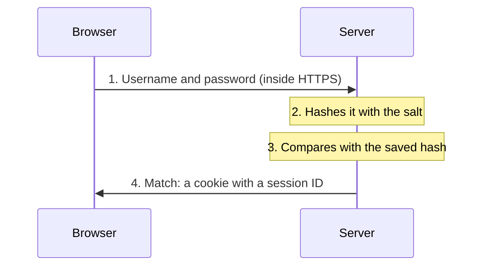

> **In one sentence:** When you log in, your password travels to the website inside HTTPS; a well-built website keeps only a scrambled "hash" of it, and checks you by comparing hashes.

## Why should I care?

You log in many times a day: to email, games, school or shopping websites. Each time, you type a **username** (the name the website knows you by) and a **password** (a secret word or phrase that only you should know). Together, they open your **account**: your own space on that website.

If someone else learns your password, they can open your account too. Knowing what happens after you press "Sign in" explains the usual safety advice.

## Analogy

Think of a fingerprint. Two fingerprints can show whether they come from the same finger. But a fingerprint cannot tell you what the person looks like.

A well-built website treats your password, the "finger", the same way. It does not keep the password, only a kind of "fingerprint" of it. When you log in, it makes a fingerprint of what you typed and checks whether the two match.

**Where the analogy breaks down:** a real fingerprint grows on a finger. A password's "fingerprint" is calculated with mathematics, and anyone with the same formula can calculate it. So an attacker can try guesses: calculate the fingerprint of each guess and look for a match. That is why a guessable password is weak, even when it is stored this way.

## How it actually works

### Step 1: the password travels inside HTTPS

When you press "Sign in", your browser sends your username and password to the server. In [[https]] you learned that HTTPS encrypts the messages on the way. MDN, a website that documents how the web works, says login forms "should be served over HTTPS".

### Step 2: the website keeps a hash, not the password

A **hash function** is a calculation that turns any text into a code of a fixed length, called a **hash**. MDN says a hash used for security must be "one-way": from the hash, you should not be able to work out the original text.

This is the difference from encryption. In HTTPS, encrypted messages can be turned back with the key. OWASP, a nonprofit foundation that works "to improve the security of software", says a hash is different: it is "impossible to 'decrypt' a hash".

So, when you create an account, a well-built website hashes your password and saves only the hash. OWASP says passwords should be hashed "rather than encrypted or stored in plaintext" (plaintext means readable text).

Before hashing, the website adds a **salt**: OWASP describes it as a random piece of text, different for each user. NIST, part of the US government, writes guidelines for logging in to government systems. They say the salt and the hash are both saved for each password. Because of the salt, two people with the same password get different hashes, so attackers must "crack hashes one at a time", OWASP says.

### Step 3: the website compares hashes

When you log in, the server takes your saved salt, adds it to what you typed, and hashes the result. If it matches the saved hash, the password was right. So the server sees your password for a moment, but a well-built website does not keep it.

Then, MDN explains, the server answers with a **cookie** (a small piece of data your browser keeps and sends back). It holds a **session ID**: a code that tells the server your browser is signed in. You met cookies in [[cookies-and-privacy]].

OWASP says that even if an attacker steals the hashed password, "they cannot use it to log in". But attackers can still guess: they hash a guess and compare it with the stolen hash. A short or common password is found quickly. The UK's National Cyber Security Centre (NCSC) warns that weak passwords can be "cracked" (worked out) "in seconds".

### Why reusing a password is risky

Attackers sometimes steal data from websites, and stolen passwords can end up online.

OWASP describes **credential stuffing** ("credentials" are login details): attackers take stolen usernames and passwords and try them on other websites. It works because "many users will re-use the same password". The NCSC says that if one of your accounts is broken into, an attacker "can try the same password on your other accounts".

So use a different password for every account. The NCSC says this matters most for your email: someone who gets into your email could "reset all your other account passwords".

### What makes a password strong

- **Long.** CISA, a US government security agency, says "at least 16 characters—longer is stronger!" A **character** is one letter, digit, symbol or space. NIST's 2025 guidelines require at least 15 characters when a password is the only check at login.
- **Random.** The NCSC suggests combining **three random words**. CISA suggests a **passphrase**: a phrase of "4 – 7 unrelated words".
- **Unique.** One password per account.

### Password managers

Remembering many long, different passwords is hard. A **password manager** is a program that "generates, stores and even fills in all your passwords", CISA says. The NCSC says one "might be built into your browser already". You then need to remember only one strong password: the one for the password manager. The NCSC says to protect it with [[two-step-verification]] too: an extra step that keeps attackers out even if they know your password.

## How it came to be

MIT News says Fernando Corbató led the development of the Compatible Time-Sharing System (CTSS) at MIT. It was "first demonstrated in 1961". Users wanted to keep their own files private, so CTSS "introduced the idea of having people create individual accounts with personal passwords". MIT News says it is "widely credited" as the first computer system to use passwords.

## 🧪 Try it in your browser

These steps work on a computer or a phone. Never type a real password here.

1. Open MDN's page about password boxes: [developer.mozilla.org/en-US/docs/Web/HTML/Reference/Elements/input/password](https://developer.mozilla.org/en-US/docs/Web/HTML/Reference/Elements/input/password).
2. Near the top is an example. Next to its code, it shows a small form with a **Password** box.
3. Click in that box (not in the code), and type three made-up words, such as `cloud spoon river`.
4. **What you should see:** each letter appears as a dot (•) or a star (*), depending on your browser and device.

Those dots only hide your password from people looking at your screen. They are not encryption: HTTPS protects the password on its way to the server.

## Common misunderstandings

- **"Symbols matter more than length."** NIST's guidelines say systems must not force a mix of character types. The NCSC says a longer password is harder to crack. If a website asks for symbols, follow its rules there.
- **"I must change my password every few months."** NIST's guidelines say systems must not ask for regular changes. They must ask for a change if there is evidence that the password was stolen.

## Recap

- Your password travels inside HTTPS. A well-built website saves only a salted hash, and checks you by comparing hashes.
- If one website leaks your password, attackers try it on other websites. Use a different password for every account.
- Make passwords long, such as several random words, and let a password manager remember them.

## Sources

- NIST SP 800-63B-4, Digital Identity Guidelines: Authentication and Authenticator Management: https://pages.nist.gov/800-63-4/sp800-63b.html
- NIST CSRC, SP 800-63B-4 publication details: https://csrc.nist.gov/pubs/sp/800/63/b/4/final
- NIST, About NIST: https://www.nist.gov/about-nist
- OWASP, About the OWASP Foundation: https://owasp.org/about/
- OWASP Cheat Sheet Series, Password Storage Cheat Sheet: https://cheatsheetseries.owasp.org/cheatsheets/Password_Storage_Cheat_Sheet.html
- OWASP, Credential stuffing: https://community.owasp.org/attacks/Credential_stuffing
- MDN Web Docs, Hash function (glossary): https://developer.mozilla.org/en-US/docs/Glossary/Hash_function
- MDN Web Docs, `<input type="password">`: https://developer.mozilla.org/en-US/docs/Web/HTML/Reference/Elements/input/password
- MDN Web Docs, Using HTTP cookies: https://developer.mozilla.org/en-US/docs/Web/HTTP/Guides/Cookies
- NCSC, Three random words: https://www.ncsc.gov.uk/collection/top-tips-for-staying-secure-online/three-random-words
- NCSC, Use a strong and separate password for your email: https://www.ncsc.gov.uk/collection/top-tips-for-staying-secure-online/use-a-strong-and-separate-password-for-email
- NCSC, Managing your passwords: https://www.ncsc.gov.uk/collection/top-tips-for-staying-secure-online/password-managers
- CISA, Use Strong Passwords: https://www.cisa.gov/secure-our-world/use-strong-passwords
- CISA, About CISA: https://www.cisa.gov/about
- NCSC, Turn on 2-step verification (2SV): https://www.ncsc.gov.uk/collection/top-tips-for-staying-secure-online/activate-2-step-verification-on-your-email
- MDN Web Docs, Decryption (glossary): https://developer.mozilla.org/en-US/docs/Glossary/Decryption
- MDN Web Docs, Plaintext (glossary): https://developer.mozilla.org/en-US/docs/Glossary/Plaintext
- MIT News, Professor Emeritus Fernando Corbató, MIT computing pioneer, dies at 93: https://news.mit.edu/2019/mit-professor-emeritus-fernando-corby-corbato-computing-pioneer-dies-0715
- Wikipedia, Password: https://en.wikipedia.org/wiki/Password
