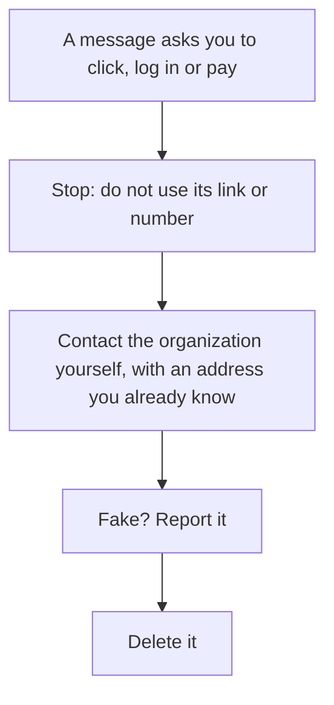

> **In one sentence:** Phishing is a trick in which criminals send a message that pretends to come from someone you trust, so that you click a link, give away a password or personal information, or send money.

## Why should I care?

You may have seen a message like this: "There is a problem with your account. Log in within 24 hours or it will be closed." It looks like it comes from your bank, but it may be a scam. (A **scam** is a trick to take your money or your information.)

The UK's National Cyber Security Centre (NCSC) says: "'Phishing' is when criminals use scam emails, text messages or phone calls to trick their victims." The US Federal Trade Commission (FTC) says scammers use [[email]] or text messages to try to steal passwords and account numbers.

## Analogy

Imagine someone knocks on your door wearing a delivery uniform. They say there is a problem with your parcel, and you must pay a fee right now. The uniform looks real, but it can be copied. The safe move: close the door and call the delivery company yourself, with a number you already know. A phishing message is the person in that fake uniform: its logo and friendly words can be copied.

**Where the analogy breaks down:** online, a fake page can be a perfect copy. The US Cybersecurity and Infrastructure Security Agency (CISA) says fake sites "may look identical to a legitimate site". But the web gives you one clue that a uniform does not: the **domain name** in the address. The next section shows you how to read it.

## How it actually works

### Find the real domain name

In [[url]], you saw the parts of a web address. In [[domain-name]], you saw that a domain name is read from right to left, and that the name people register is usually a second-level domain, like `wikipedia.org`. MDN says the owner of a domain can create subdomains: the owner of `mozilla.org` can make `developer.mozilla.org`.

So, to see whose website you are on:

1. Find the domain name: the part after `https://` and before the next `/`.
2. Read it from right to left. Take the ending (the top-level domain, like `com`) and the label to its left.
3. Those two together are the **registered name**. If it is not the name you expect, you are not where you think.

The names below are reserved for examples (RFC 2606), so none belongs to a real company or scammer. Pretend that your bank is `example.com`:

| Address | Registered name | Your bank? |
|---|---|---|
| `https://www.example.com/account` | `example.com` | Yes |
| `https://example.com.example.net/login` | `example.net` | **No** |
| `https://example.net/example.com/login` | `example.net` | **No** |

In the second address, the owner of `example.net` made a subdomain called `example.com.example.net`. In the third, `example.com` comes after the first single `/`, so it is only part of the path. Both pages belong to the owner of `example.net`.

(This is simplified: some endings have two parts, like `co.uk`, and some addresses use rarer forms.)

Also check the spelling, letter by letter. CISA's example of a fake is "amaz**a**n.com".

### The words of a link can lie

In [[html]], you saw that a link is an `<a>` element. Its `href` attribute holds the address it goes to. The text between `<a ...>` and `</a>` is what you see. These two are separate. A scammer can show any text, even a correct-looking address, and point the link somewhere else.

On a computer, CISA suggests that you **hover** over a link: point at it without clicking, and the real address appears. If it does not match the link's text, the link may be fake.

### The padlock does not mean "honest"

In [[https]], you saw that HTTPS protects the connection and proves which domain name you reached, not that its owner is honest. In 2019, the FBI warned that more and more phishing sites have certificates too. It advised people not to trust a website only because of the lock icon or "https". In 2023, Chrome's team announced they would replace Chrome's lock with another icon, because people thought the lock meant a page was trustworthy.

### The signs in the message

The NCSC lists signs to look for:

- **Authority:** "Is the message claiming to be from someone official?"
- **Urgency:** you must act fast, "such as 'within 24 hours' or 'immediately'".
- **Emotion:** "Does the message make you panic, fearful, hopeful or curious?"
- **Scarcity:** it offers something rare, "like concert tickets, money or a cure for medical conditions".

CISA adds one more sign: a request "to send personal and financial information".

### What to do

1. **Do not use the link or phone number in the message.** The NCSC says: "use the details from their official website."
2. **Go there yourself.** Type the address you already know. The FTC says: use "a phone number or website you know is real".
3. **Report it.** CISA says you can use the "report spam" button in your email program. Some countries also have an official place to report, such as ReportFraud.ftc.gov in the US and the NCSC's reporting pages in the UK.
4. **Delete it.** CISA says: "Don't reply or click on any attachment or link, including any 'unsubscribe' link."

**Already typed a password on a fake page?** CISA says: "Immediately change any passwords you might have revealed." You will learn more in [[passwords]].

## How it came to be

You do not need to remember this. In the mid-1990s, scammers stole passwords from people on America Online (AOL). The author of one program for this, AOHell, wrote that from January 1995 it stole passwords and credit card numbers automatically.

## 🧪 Try it in your browser

You will make a harmless link whose text lies, typed into the address bar as in [[html]]. You need a computer with Chrome, Edge or Firefox.

1. Open a new tab. Type or paste this line in the address bar and press `Enter`:
   `data:text/html,<a href="https://example.net/">https://example.com/</a>`
   **What you should see:** one link that says `https://example.com/`. (Got search results? Check that the line starts with `data:text/html,`.)
2. Point at the link with the mouse, without clicking.
   **What you should see:** your browser shows the real address, `https://example.net/`.
3. Right-click the link (on a Mac, you can also hold `Control` and click) and choose **Inspect**. (Some versions of Firefox call it **Inspect Element**.)
   **What you should see:** [[browser-devtools|DevTools]] (the browser's built-in tools for looking inside a page) opens and shows the page's code, with this line in it: `<a href="https://example.net/">https://example.com/</a>`. Close DevTools with the **X** at the top of the DevTools panel (not the X on the tab).
4. Click the link.
   **What you should see:** a page called **Example Domain**, and `example.net` in the address bar.

## Common misunderstandings

- **"The padlock means the site is safe."** No. It means the connection is encrypted; scam sites can have one too.
- **"If the address contains the company's name, it is the company."** No. Only the registered name, read from the right, counts.

## Recap

- Phishing messages pretend to come from someone you trust, to get a click, a password or money.
- To see whose website you are on, read the domain name from the right. A padlock does not prove honesty.
- Never use the link in a suspicious message: go to the site yourself, then report and delete the message.

## Sources

- FTC, How To Recognize and Avoid Phishing Scams: https://consumer.ftc.gov/articles/how-recognize-and-avoid-phishing-scams
- CISA, Recognize and Report Phishing: https://www.cisa.gov/secure-our-world/recognize-and-report-phishing
- CISA, Avoiding Social Engineering and Phishing Attacks: https://www.cisa.gov/news-events/news/avoiding-social-engineering-and-phishing-attacks
- NCSC, Phishing: Spot and report scam emails, texts, websites and calls: https://www.ncsc.gov.uk/collection/phishing-scams
- NCSC, Spotting scam messages: https://www.ncsc.gov.uk/collection/phishing-scams/spot-scams
- NIST CSRC Glossary, phishing: https://csrc.nist.gov/glossary/term/phishing
- FBI IC3, Cyber Actors Exploit 'Secure' Websites in Phishing Campaigns (2019): https://www.ic3.gov/PSA/2019/PSA190610
- Chromium Blog, An update on the lock icon (2023): https://blog.chromium.org/2023/05/an-update-on-lock-icon.html
- K. Rekouche, Early Phishing (2011): https://arxiv.org/abs/1106.4692
- Microsoft Learn, How to protect against phishing attacks: https://learn.microsoft.com/en-us/defender-endpoint/malware/phishing
- MDN Web Docs, What is a URL?: https://developer.mozilla.org/en-US/docs/Learn_web_development/Howto/Web_mechanics/What_is_a_URL
- MDN Web Docs, Transport Layer Security (TLS): https://developer.mozilla.org/en-US/docs/Web/Security/Transport_Layer_Security
- Apple Support, Right-click on Mac: https://support.apple.com/guide/mac-help/right-click-mh35853/mac
- MDN Web Docs, What is a domain name?: https://developer.mozilla.org/en-US/docs/Learn_web_development/Howto/Web_mechanics/What_is_a_domain_name
- MDN Web Docs, Creating links: https://developer.mozilla.org/en-US/docs/Learn_web_development/Core/Structuring_content/Creating_links
- MDN Web Docs, data: URLs: https://developer.mozilla.org/en-US/docs/Web/URI/Reference/Schemes/data
- Mozilla Security Blog, Blocking Top-Level Navigations to data URLs for Firefox 59: https://blog.mozilla.org/security/2017/11/27/blocking-top-level-navigations-data-urls-firefox-59/
- RFC 2606, Reserved Top Level DNS Names: https://www.rfc-editor.org/rfc/rfc2606
- Public Suffix List: https://publicsuffix.org/
- Example Domain (example.net): https://example.net/
- Chrome for Developers, Get started viewing and changing the DOM: https://developer.chrome.com/docs/devtools/dom
- Microsoft Edge DevTools, Overview of DevTools: https://learn.microsoft.com/en-us/microsoft-edge/devtools/overview
- Firefox DevTools User Docs, Open the Inspector: https://firefox-source-docs.mozilla.org/devtools-user/page_inspector/how_to/open_the_inspector/index.html
