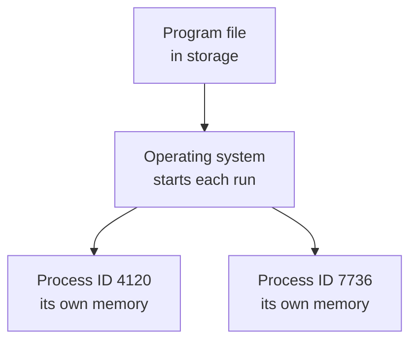

> **In one sentence:** A process is a program's instructions being run, with its own memory and ID number, kept apart from other processes by the operating system.

## Why should I care?

A program you write usually runs as one or more processes. A web page runs inside the browser's processes. A program's data sits in the memory of its process, apart from other programs. When the process ends, that memory is handed back.

In [[ram|Memory (RAM)]], you may have opened a list of your browser's running parts. Firefox calls that list the **Process Manager**. Its release notes say it helps you "quickly identify processes" that use too much of the computer, such as its memory or [[cpu|CPU]] time.

## Analogy

Go back to the kitchen from [[operating-system|Operating Systems]]. The cook is the CPU, the table is RAM, and a manager (the operating system) gives each order its own part of the table.

A **recipe** is like a program: instructions that do nothing until someone follows them. An **order** being cooked is like a process: the recipe in use, with its own number and its own space on the table. If two people order the same dish, there is one recipe and two orders.

**Where the analogy breaks down:** on a real table, food can slide from one order's space into another's. The operating system keeps each process's space apart. Also, a running process can start other processes, which a kitchen order cannot do.

## How it actually works

### Program and process

A **program** is the code: a set of instructions, typically in a file in storage. In that file, the instructions do nothing.

A **process** is "a running program", says a Cornell University course: those instructions being run. The operating system sets aside an area of RAM, copies the instructions in, and directs the CPU to start.

Opening several copies of one program often gives you more than one process.

(The ID numbers in this diagram are invented examples.)

A running process can also ask the operating system to start more processes. Microsoft calls the new one a **child process**, and the one that created it the **parent process**. So one program can use several.

### Each process has its own memory

RAM is a row of cells with numbered addresses. A process does not use those numbers directly. It uses **virtual addresses**, and the computer translates them to real locations in RAM. The virtual addresses a process can use are called its **address space**. Microsoft's documentation says the address space of each process is private: other processes cannot access it "unless it is shared".

Sharing takes deliberate steps. For example, one process creates a named area of shared memory, and a second process opens it by that name. (Special tools, such as debuggers, which find faults in programs, can read another process's memory if the system gives them permission.)

When a process ends, the operating system takes its area of RAM back, to be used again.

### Taking turns on the CPU

Stanford's course describes a "round robin" (taking turns in a circle): the CPU "runs a few instructions from each program". The switches are so fast that processes appear to run at the same time.

(This is simplified. Microsoft says a computer with several processors (or cores) can truly do as many things at once as it has processors.)

### The process ID

Two processes can come from the same program file, so the file's name cannot tell them apart. Each process has a **process ID** (also called a **PID**): a whole number from the operating system. It is given when the process is created. It identifies that process, and no other, until the process ends.

### Browsers use several processes

"Modern browsers like Chromium use multiple operating system processes", says the Chromium documentation. Chromium is the software that Chrome and Microsoft Edge are built on.

- Chromium calls its main process the **browser process**. It runs the buttons and menus you use, and manages the others.
- Chromium calls the ones that handle web pages **renderer processes**.
- Firefox's main process is its **parent process**. It starts and manages its child processes.

Separate processes limit the damage when a renderer process crashes (stops suddenly because of a fault) or hangs (stops responding). The cost is some extra memory for each process.

Chromium's design document says, "In general, each new window or tab opens in a new process". But a page and a window it opens can share one process, and so can other tabs when there are too many processes.

## How it came to be

A Harvey Mudd College computer science course dates **multiprogrammed** systems to the early 1960s: take several programs "and run them all at once". The reason then, it says, was "to keep the computer busy". Sharing one computer among several running programs is the situation this page describes.

For browsers, Chromium's design document describes web browsers around 2006. One bug in certain parts of a browser could "bring down the entire browser and all of the currently running tabs".

## 🧪 Try it in your browser

You need a computer with a keyboard.

**Safety rule:** only look. Do not click **End process**, **Kill process** or any other button in the list: it can stop or close your tabs.

1. Open two or three tabs with different web pages.
2. Press `Shift` + `Esc`. A list opens.
   - If nothing happens in Chrome or Edge (for example on some Mac computers), open the browser's main menu, then **More tools**, then **Task manager** (in Edge: **Browser Task Manager**).
   - If nothing happens in Firefox, open a new tab, type `about:processes` in the address bar, and press `Enter`.
3. Find the process IDs:
   - **Chrome and Edge:** look for a column called **Process ID**.
   - **Firefox:** look for the number in round brackets after a process name, as in `Shared Web Process (12345)` or `example.com (12345)`. Some rows have other notes in the brackets too. Those rows count.
   - If you cannot find the column or the numbers, skip step 4.
4. Count the different ID numbers, not the rows. Rows that belong to one process can share an ID.
5. Close the list's window, or its tab.

**What you should see:** a list with several rows. Some rows name your tabs. Other rows have technical names, and you can ignore them. If you found the IDs, there is more than one.

**What this shows:** your browser is one program, running as several processes.

**On a phone:** these steps are for a computer. Instead, ask yourself: what do the recipe and the two orders stand for?

## Common misunderstandings

- **"A program and a process are the same thing."** No. The program is the stored instructions. A process is a running program. One program can have several processes.
- **"Every tab always has its own process."** Not always. Chromium's design document says, "Sometimes it is necessary or desirable to share the renderer process between tabs or windows."

## Recap

- A program is stored instructions. A process is those instructions being run, in memory.
- The operating system gives each process its own memory and a process ID, and shares the CPU among processes.
- Browsers use several processes, which can limit the damage from a crash, at some cost in memory.

## Sources

- Wikipedia, Process (computing) (general background reference): https://en.wikipedia.org/wiki/Process_(computing)
- Stanford CS101, Running and Operating Systems: https://web.stanford.edu/class/cs101/software-1.html
- Microsoft Learn, About Processes and Threads: https://learn.microsoft.com/en-us/windows/win32/procthread/about-processes-and-threads
- Microsoft Learn, Child Processes: https://learn.microsoft.com/en-us/windows/win32/procthread/child-processes
- Microsoft Learn, CreateProcessA function: https://learn.microsoft.com/en-us/windows/win32/api/processthreadsapi/nf-processthreadsapi-createprocessa
- Microsoft Learn, Processor Groups: https://learn.microsoft.com/en-us/windows/win32/procthread/processor-groups
- Microsoft Learn, Process Handles and Identifiers: https://learn.microsoft.com/en-us/windows/win32/procthread/process-handles-and-identifiers
- Microsoft Learn, Virtual Address Space: https://learn.microsoft.com/en-us/windows/win32/memory/virtual-address-space
- Microsoft Learn, Creating Named Shared Memory: https://learn.microsoft.com/en-us/windows/win32/memory/creating-named-shared-memory
- Microsoft Learn, ReadProcessMemory function: https://learn.microsoft.com/en-us/windows/win32/api/memoryapi/nf-memoryapi-readprocessmemory
- Microsoft Learn, Debugging Functions: https://learn.microsoft.com/en-us/windows/win32/debug/debugging-functions
- Microsoft Learn, Process Security and Access Rights: https://learn.microsoft.com/en-us/windows/win32/procthread/process-security-and-access-rights
- Linux manual pages, credentials(7): https://man7.org/linux/man-pages/man7/credentials.7.html
- Cornell University CS 4410, Processes: https://www.cs.cornell.edu/courses/cs4410/2018su/lectures/lec03-processes.html
- CS 3750 lecture notes, Chapter Three: Processes (cs.csustan.edu): https://www.cs.csustan.edu/~john/Classes/CS3750/Notes/Chap03/03_Processes.html
- Harvey Mudd College CS 134, Operating systems history: https://www.cs.hmc.edu/courses/2024/fall/cs134/lessons/w01/l02/os-history/
- Chromium docs, Process Model and Site Isolation: https://chromium.googlesource.com/chromium/src/+/main/docs/process_model_and_site_isolation.md
- Chromium design documents, Multi-process Architecture: https://www.chromium.org/developers/design-documents/multi-process-architecture/
- Microsoft Edge, What is Chromium?: https://www.microsoft.com/en-us/edge/learning-center/what-is-chromium-how-does-it-enhance-your-browser
- Firefox Source Docs, Process Model: https://firefox-source-docs.mozilla.org/dom/ipc/process_model.html
- Firefox source code, Process Manager page text: https://searchfox.org/firefox-main/source/toolkit/locales/en-US/toolkit/about/aboutProcesses.ftl
- Firefox source code, Process Manager page script: https://searchfox.org/firefox-main/source/toolkit/components/aboutprocesses/content/aboutProcesses.js
- Firefox 108.0 release notes: https://www.firefox.com/en-US/firefox/108.0/releasenotes/
- Chrome for Developers, Fix memory problems: https://developer.chrome.com/docs/devtools/memory-problems
- Google Chrome Help, Chrome keyboard shortcuts: https://support.google.com/chrome/answer/157179
- Chromium source, task_manager_columns.h: https://chromium.googlesource.com/chromium/src.git/+/main/chrome/browser/ui/task_manager/task_manager_columns.h
- Chromium source, tab_contents_task.cc: https://chromium.googlesource.com/chromium/src/+/main/chrome/browser/task_manager/providers/web_contents/tab_contents_task.cc
- Microsoft Edge Developer documentation, Monitor memory use in realtime (Browser Task Manager): https://learn.microsoft.com/en-us/microsoft-edge/devtools/memory-problems/microsoft-edge-browser-task-manager
- Microsoft Edge Learning Center, How to use Edge Task Manager: https://www.microsoft.com/en-us/edge/learning-center/how-to-use-edge-task-manager
