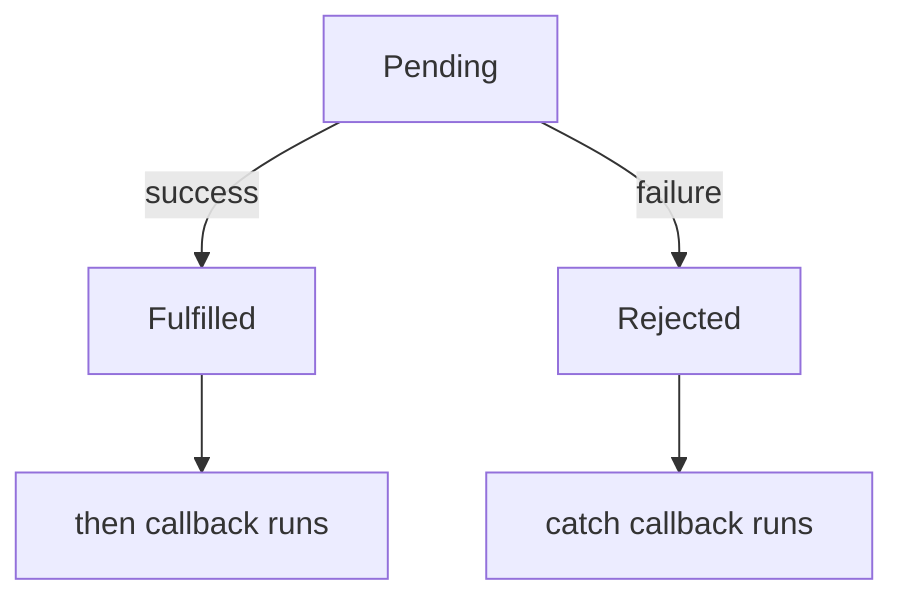

> **In one sentence:** A promise is an object that represents the later success or failure of work that may take time. You attach code to it with .then and .catch, or wait for it inside an async function with await.

## Why should I care?

In [[asynchronous-code|Asynchronous Code]], you met `fetch`, which starts a request over the network. Your code carried on without the answer. So what does `fetch` give back?

MDN Web Docs, a website that documents web technologies, says a function like this does not return the final value immediately. It "returns a *promise* to supply the value at some point in the future."

## Analogy

You leave a broken phone at a repair shop and get a paper ticket. Then you go and do other things. The ticket is the promise: it represents the phone. While the repair goes on, the ticket is pending. If the repair works, it is fulfilled, and you get the phone. If it fails, it is rejected, and you get the reason.

**Where the analogy breaks down:** with a ticket, you must go and ask. With a promise, you give it functions, and they are called for you. A function you add after the work has finished is still called, if it is for that result.

## How it actually works

### Three states

An **operation** here means a piece of work that finishes later, such as a request. MDN says a promise is in one of three states:

- **Pending:** the first state. The operation has not finished.
- **Fulfilled:** the operation succeeded. The promise now holds a value.
- **Rejected:** the operation failed. The promise now holds a reason, such as an error.

A promise that is fulfilled or rejected is called **settled**.



### `.then` and `.catch`

A **method** is a function that belongs to an object, and you usually call it with a dot. A promise has `.then`, which takes a [[callbacks|callback]] that receives the value. It also has `.catch`, which takes a callback that receives the reason. (`.then` can also take a second callback, left out here.)

```js
// Ask for the page you are on. fetch gives back a promise immediately.
const request = fetch(location.href);
console.log(request); // shows the promise, still pending

request
  // This runs when the promise is fulfilled. It receives the response.
  .then((response) => {
    console.log("Status: " + response.status);
  })
  // This runs if something before it failed. It receives the error.
  .catch((error) => {
    console.log("Problem: " + error.message);
  });

console.log("I did not wait");
```

This shows the promise, `I did not wait`, then a status such as `Status: 200`.

`location.href` is the web address of the page you are on, so `fetch(location.href)` asks for that page.

A line can start with a dot. It continues the code before it.

The value here is `response`, an object that contains the server's response. Its `status` is a **status code**, a number about the result. MDN gives `200` for success and `404` when the thing could not be found.

`.then` gives back a new promise, and `.catch` is attached to that one. The new promise also rejects if `request` rejects, or if the `.then` callback throws an error. So this one `.catch` receives both. You met `throw` in [[errors|Errors]].

Why not plain callbacks? MDN says a callback inside a callback gives "successively more nested levels of code", with errors handled at every level. A chain of `.then` calls avoids that nesting, and one `.catch` at the end can handle every failure.

In the [[event-loop|event loop]], this whole program is one job. A promise callback waits until that job has ended, so `I did not wait` comes first. (This is simplified. Promise callbacks use a separate queue, the microtask queue, which this page does not explain.)

### `async` and `await`

Put `async` before `function`, and you can use `await` inside that function.

```js
async function getStatus() {
  try {
    // Pause this function until the promise is settled.
    const response = await fetch(location.href);
    console.log("Status: " + response.status);
  } catch (error) {
    // A rejected promise makes await throw, so catch receives the error.
    console.log("Problem: " + error.message);
  }
}

console.log("First");
getStatus();
console.log("Second");
```

This shows `First`, `Second`, then a status such as `Status: 200`. Here is why:

1. `await` pauses this function, and the program goes back to the code that called it.
2. Other code runs. Here, that is the line that shows `Second`.
3. When the promise settles, a job on the microtask queue continues the function from the `await` line.

If the promise is fulfilled, `await` gives you its value. If it is rejected, `await` throws the reason, so `try` and `catch` work.

`async` and `await` build on promises. MDN says you will "probably use `async` functions a lot where you might otherwise use promise chains".

In a normal script, `await` works only inside an `async` function. (MDN says it also works outside functions in a module, a special kind of script. Edge's console allows that too. The steps below do not rely on either.)

An `async` function always gives back a promise. A returned value fulfills that promise. (Returning another promise is a special case, left out here.) A thrown error that nothing catches rejects it. So `notebookCost` below is `async` even though it does not wait for anything: you can use `.then` and `.catch` on what it gives back.

```js
async function notebookCost(count) {
  if (count < 1) {
    throw new Error("Count must be at least 1");
  }
  return count * 4;
}

notebookCost(3).then((cost) => console.log(cost)); // shows 12
notebookCost(0).catch((error) => console.log("Problem: " + error.message));
// shows Problem: Count must be at least 1
```

## How it came to be

Wikipedia lists promises in the 6th edition of ECMAScript, JavaScript's standard. Ecma, which publishes the standard, dates that edition June 2015. Wikipedia lists `async` and `await` under later editions.

## 🧪 Try it in your browser

You need a computer with Chrome, Edge or Firefox.

**Safety rule:** only type code in the console that you understand or that comes from a source you trust. Never paste anything a stranger sends you. The lines below show text in the console, define functions, and use `fetch` to ask for the page you are on.

1. Open [example.com](https://example.com).
   **What you should see:** a short page.
2. Open the **console**:
   - **Windows:** press `Ctrl` + `Shift` + `J` (in Firefox: `Ctrl` + `Shift` + `K`)
   - **Mac:** press `Cmd` + `Option` + `J` (in Firefox: `Cmd` + `Option` + `K`)
3. Click the line where you can type, below any messages. **Type** this line yourself (some browsers may block pasting at first), then press `Enter`. The browser may show suggestions, and the line may look different while you type. Keep typing.

   ```
   const request = fetch(location.href); console.log(request); request.then((response) => console.log("Status: " + response.status)).catch((error) => console.log("Problem: " + error.message))
   ```

   **What you should see:** the word `Promise`. It may also show `pending`, which means the request has not finished. Then you see a status such as `Status: 200`. If the request failed, you see `Problem:` and a message instead. The console may also show the promise that this line gives back. That is normal.
4. Define an `async` function and call it with 0, so its promise is rejected. Type this line and press `Enter`:

   ```
   async function notebookCost(count) { if (count < 1) { throw new Error("Count must be at least 1"); } return count * 4; } notebookCost(0).catch((error) => console.log("Problem: " + error.message))
   ```

   **What you should see:** `Problem: Count must be at least 1`. This promise was rejected before `.catch` was attached, and your callback still runs. The console may also show the promise that this line gives back.
5. Define a function that uses `await`, then watch the order. Type this line and press `Enter`:

   ```
   async function getStatus() { try { const response = await fetch(location.href); console.log("Status: " + response.status); } catch (error) { console.log("Problem: " + error.message); } } console.log("First"); getStatus(); console.log("Second")
   ```

   **What you should see:** `First`, then `Second`, then a line that starts with `Status:` or `Problem:`. The console may also show `undefined`.

**If something goes wrong:** for an error message, look for a typo. If `Enter` gives a new line and no answer, a bracket is probably still open. In both cases, reload the page, delete anything left on the typing line, and start again from step 3.

## Common misunderstandings

- **"A `404` rejects the promise from `fetch`."** No. A `404` is an answer from the server, so the promise is fulfilled. Here, fulfilled means an answer came, not that the answer was good. Check `response.status` yourself. The promise rejects when the request fails, for example, a network error that stops the request from being sent.
- **"`await` freezes the whole page."** No. It pauses only its own `async` function. Other code can run during the pause.

## Recap

- A promise represents a result still to come. It is pending, then fulfilled or rejected.
- `.then` handles success and `.catch` handles failure. `fetch` returns a promise.
- `await` pauses an `async` function until a promise is settled, and `try` and `catch` handle a rejection.

## Sources

- MDN Web Docs, Promise: https://developer.mozilla.org/en-US/docs/Web/JavaScript/Reference/Global_Objects/Promise
- MDN Web Docs, Using promises: https://developer.mozilla.org/en-US/docs/Web/JavaScript/Guide/Using_promises
- MDN Web Docs, How to use promises: https://developer.mozilla.org/en-US/docs/Learn_web_development/Extensions/Async_JS/Promises
- MDN Web Docs, Promise.prototype.then(): https://developer.mozilla.org/en-US/docs/Web/JavaScript/Reference/Global_Objects/Promise/then
- MDN Web Docs, Promise.prototype.catch(): https://developer.mozilla.org/en-US/docs/Web/JavaScript/Reference/Global_Objects/Promise/catch
- MDN Web Docs, Window.fetch(): https://developer.mozilla.org/en-US/docs/Web/API/Window/fetch
- MDN Web Docs, Response.status: https://developer.mozilla.org/en-US/docs/Web/API/Response/status
- MDN Web Docs, Window.location: https://developer.mozilla.org/en-US/docs/Web/API/Window/location
- MDN Web Docs, Location.href: https://developer.mozilla.org/en-US/docs/Web/API/Location/href
- MDN Web Docs, async function: https://developer.mozilla.org/en-US/docs/Web/JavaScript/Reference/Statements/async_function
- MDN Web Docs, await: https://developer.mozilla.org/en-US/docs/Web/JavaScript/Reference/Operators/await
- MDN Web Docs, Using microtasks in JavaScript: https://developer.mozilla.org/en-US/docs/Web/API/HTML_DOM_API/Microtask_guide
- MDN Web Docs, Method (glossary): https://developer.mozilla.org/en-US/docs/Glossary/Method
- MDN Web Docs, Working with objects: https://developer.mozilla.org/en-US/docs/Web/JavaScript/Guide/Working_with_objects
- MDN Web Docs, Lexical grammar: https://developer.mozilla.org/en-US/docs/Web/JavaScript/Reference/Lexical_grammar
- MDN Web Docs, eval(): https://developer.mozilla.org/en-US/docs/Web/JavaScript/Reference/Global_Objects/eval
- MDN Web Docs, console.log(): https://developer.mozilla.org/en-US/docs/Web/API/console/log_static
- MDN Web Docs, About MDN: https://developer.mozilla.org/en-US/about
- Ecma International, ECMA-262: https://ecma-international.org/publications-and-standards/standards/ecma-262/
- Wikipedia, ECMAScript version history: https://en.wikipedia.org/wiki/ECMAScript_version_history
- Example Domain: https://example.com
- Chrome for Developers, Open Chrome DevTools: https://developer.chrome.com/docs/devtools/open
- Microsoft Edge DevTools, Keyboard shortcuts: https://learn.microsoft.com/en-us/microsoft-edge/devtools/shortcuts/
- Microsoft Edge DevTools, Run JavaScript in the Console: https://learn.microsoft.com/en-us/microsoft-edge/devtools/console/console-javascript
- Firefox DevTools User Docs, The JavaScript input interpreter: https://firefox-source-docs.mozilla.org/devtools-user/web_console/the_command_line_interpreter/index.html
- Firefox DevTools User Docs, Web Console: https://firefox-source-docs.mozilla.org/devtools-user/web_console/index.html
- Chrome for Developers, What are self-XSS attacks?: https://developer.chrome.com/blog/self-xss
