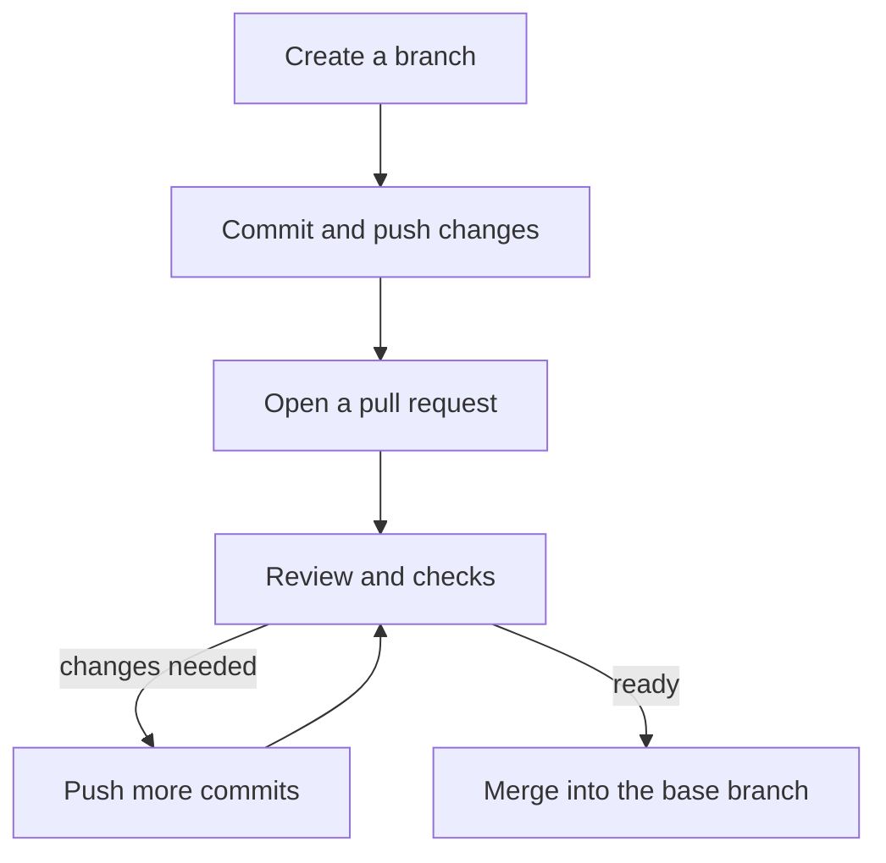

> **In one sentence:** A pull request is a proposal, on a site such as GitHub, to merge the changes on one branch into another branch, so that other people can review them first.

## Why should I care?

In [[branches-and-merging|Branches and Merging]], you saw how to make a branch and merge it back. In [[remote-repositories|Remote Repositories and GitHub]], you saw how commits are pushed to a remote repository, such as one on GitHub.

Other people may want to see a change before it is merged. GitHub says a pull request lets you "discuss and review changes before merging them".

## Analogy

Think of a writer who gives a draft to a newspaper editor. The editor marks lines that need work. The writer fixes them. When the editor is happy, the article goes into the paper. Your branch is the draft, the base branch is the paper, and a reviewer is the editor.

**Where the analogy breaks down:** programs can check a pull request too, not only people. And you do not hand in a new copy after each fix: each commit you push appears in the same pull request.

## How it actually works

### What a pull request is

GitHub's documentation says: "Pull requests are proposals to merge code changes into a project." You ask someone to "review and pull in your contribution": to take your changes into their branch.

A pull request names two branches:

- The **base branch** is the branch you merge into. Unless you choose another, it is the default branch, which GitHub names `main` in new repositories.
- The **head branch**, also called the "compare branch", holds your changes. It is not **HEAD**, which Pro Git calls "a pointer to the local branch you’re currently on".

A pull request shows a **diff**: the changes made on your branch since it split off from the base branch, or "what a pull request introduces".

### The usual steps

GitHub describes one way of working, called **GitHub flow**:

1. Create a branch.
2. Make changes, commit them, and push the branch to GitHub.
3. Open a pull request, with a title and a description of the changes.
4. Reviewers comment and checks run. You can push more commits, and the pull request updates automatically.
5. Someone with permission merges it. Your changes then appear on the base branch.
6. Delete your branch. The work is not lost: its changes are now on the base branch.

To merge, that person uses a button such as **Merge pull request**. One choice, **Create a merge commit**, makes a merge commit. There are other ways too.

GitHub warns about conflicts "that must be resolved before merging". You can make a commit that resolves them, or discuss them in the pull request. A pull request can also be **closed** without merging. Its branch stays, unless someone deletes it.

### Reviews

GitHub says: "Anyone with read access can review and comment on proposed changes". Read access is permission to see the repository. A reviewer can comment on the whole pull request, or "on specific lines".

A review ends with one of three decisions:

| Decision | What it means |
|---|---|
| Comment | General feedback, without approving or asking for changes. |
| Approve | The changes are ready to merge. |
| Request changes | The author should deal with the feedback before merging. |

GitHub says that "some repositories require an approving review before pull requests can be merged." Without such a rule, GitHub says **Request changes** "will not prevent merging".

### Checks

**Checks** are automated tests and other checks that programs run, not people. For example, the project's [[testing|tests]] can run after you push a commit. Failed checks show on the pull request, which "helps you catch errors before merging". A repository may require checks to pass first.

### Forks: when you cannot change the repository

To create a branch in a repository on GitHub, you need **write access**: permission to change it. Without it, "you can fork the repository first."

A **fork** "is a personal copy of another user's repository that lives on your account" on GitHub. Changing it does not affect "the original upstream repository", the one you forked. A **clone** is a copy "that lives on your computer". So, as in the Pro Git book:

1. Fork the project on GitHub.
2. Clone your fork. Git names it `origin`, "the default name Git gives to the server you cloned from".
3. Make a branch, commit, and push the branch to your fork.
4. Open a pull request from that branch to the upstream repository.

GitHub says: "A branch is part of one repository. A fork is a separate repository". Forking is "popular with [[open-source|open-source]] projects".

## How it came to be

Git's own command `git request-pull` makes "a request asking your upstream project to pull changes". It prints the request as text, while a GitHub pull request is a web page.

Wikipedia's article on distributed version control explains the name: "The contributor requests that the project maintainer *pull* the source code change, hence the name "pull request"." A maintainer is a person who can accept or reject changes to a project.

It adds that a pull request is "also known as a merge request". That is GitLab's name. Like GitHub, GitLab is a website and program for building and sharing software. Its merge requests "provide a central location for your team to review code, have discussions, and track code changes."

## 🧪 Try it in your browser

No account is needed: "Public repositories are accessible to everyone on the internet." The example is `github/docs`, GitHub's own documentation.

1. Open this address: [github.com/github/docs/pulls?q=is:pr+is:merged+-author:docs-bot](https://github.com/github/docs/pulls?q=is%3Apr+is%3Amerged+-author%3Adocs-bot).
   **What you should see:** a list of merged pull requests (`is:pr is:merged`). `-author:docs-bot` leaves out those opened by the account `docs-bot`.
2. Click the title of one pull request in the list.
   **What you should see:** tabs such as **Conversation**, **Commits**, **Checks** and **Files changed**. Some may be missing, and there may be others.
3. Look at the **Conversation** tab.
   **What you should see:** what GitHub calls "the description, timeline, comments, and reviews". The timeline is the list of events.
4. Click the **Commits** tab.
   **What you should see:** "how the pull request branch changed over time".
5. Click the **Files changed** tab.
   **What you should see:** the diff. In GitHub's Hello World picture, removed lines are red and added lines green.

The page may look different. Do not click buttons that change anything.

## Common misunderstandings

- **"A pull request is the same as `git pull`."** No. `git pull` is a command that brings changes from a remote repository into your own copy. A pull request asks someone to pull your changes into their branch.
- **"Opening a pull request changes the main branch."** No. Nothing reaches the base branch until someone merges the pull request.

## Recap

- A pull request asks to merge your branch into a base branch, and shows the changes your branch makes.
- Reviewers comment, approve or request changes, and checks such as tests run. Then someone with permission merges.
- If you cannot change a repository, fork it and open a pull request from your fork.

## Sources

- GitHub Docs, Pull requests: https://docs.github.com/en/pull-requests/reference/pull-requests
- GitHub Docs, Pull request reviews: https://docs.github.com/en/pull-requests/reference/pull-request-reviews
- GitHub Docs, Branches: https://docs.github.com/en/pull-requests/reference/branches
- GitHub Docs, Forks: https://docs.github.com/en/pull-requests/reference/forks
- GitHub Docs, Status checks: https://docs.github.com/en/pull-requests/reference/status-checks
- GitHub Docs, Creating a pull request: https://docs.github.com/en/pull-requests/how-tos/create-pull-requests/creating-a-pull-request
- GitHub Docs, Merging a pull request: https://docs.github.com/en/pull-requests/how-tos/merge-and-close-pull-requests/merging-a-pull-request
- GitHub Docs, GitHub flow: https://docs.github.com/en/get-started/using-github/github-flow
- GitHub Docs, Hello World: https://docs.github.com/en/get-started/start-your-journey/hello-world
- GitHub Docs, About repositories: https://docs.github.com/en/repositories/creating-and-managing-repositories/about-repositories
- GitHub Docs, Searching issues and pull requests: https://docs.github.com/en/search-github/searching-on-github/searching-issues-and-pull-requests
- Pro Git book, GitHub, Contributing to a Project: https://git-scm.com/book/en/v2/GitHub-Contributing-to-a-Project
- Git documentation, git-request-pull: https://git-scm.com/docs/git-request-pull
- GitLab Docs, Merge requests: https://docs.gitlab.com/user/project/merge_requests/
- Wikipedia, Distributed version control: https://en.wikipedia.org/wiki/Distributed_version_control
- Wikipedia, GitLab: https://en.wikipedia.org/wiki/GitLab
- Wikipedia, Forge (software): https://en.wikipedia.org/wiki/Forge_(software)
- GitHub, pull requests of the github/docs repository (merged, without docs-bot): https://github.com/github/docs/pulls?q=is%3Apr+is%3Amerged+-author%3Adocs-bot
- GitHub Docs, GitHub glossary: https://docs.github.com/en/get-started/learning-about-github/github-glossary
- GitHub Docs, Reviewing proposed changes in a pull request: https://docs.github.com/en/pull-requests/how-tos/review-pull-requests/reviewing-proposed-changes-in-a-pull-request
- GitHub Docs, Closing a pull request: https://docs.github.com/en/pull-requests/how-tos/merge-and-close-pull-requests/closing-a-pull-request
- Pro Git book, Git Branching, Branches in a Nutshell: https://git-scm.com/book/en/v2/Git-Branching-Branches-in-a-Nutshell
- Git documentation, git-pull: https://git-scm.com/docs/git-pull
- Pro Git book, Git Basics, Working with Remotes: https://git-scm.com/book/en/v2/Git-Basics-Working-with-Remotes
