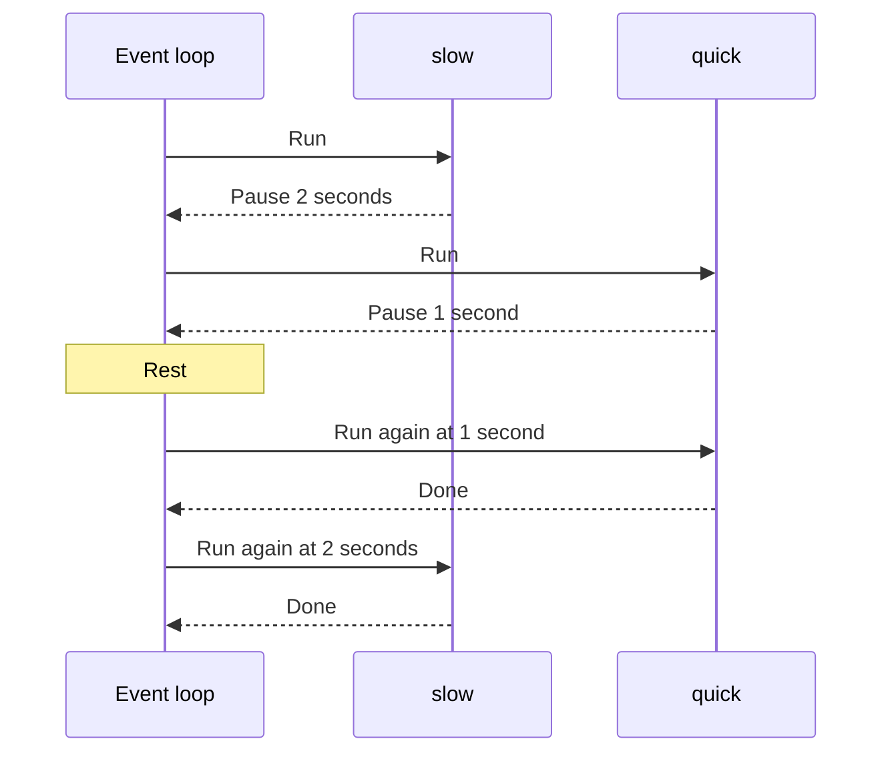

> **In one sentence:** Python's asyncio module lets tasks take turns on one event loop, and your program starts that loop itself.

## Why should I care?

In [[event-loop|The Event Loop]], a browser ran JavaScript one job at a time. You never started that loop. The HTML Standard requires browsers to use event loops.

A [[python|Python]] program can also have slow work to wait for, such as an answer from a server. The Python documentation describes **asyncio** as "a library to write concurrent code using the async/await syntax". Here, concurrent means that several pieces of work are in progress and take turns.

Each example below shows what it prints, so you only need to read it.

## Analogy

Go back to the post office counter from The Event Loop: one worker, and a queue of people. Change two things.

First, this counter is closed until you open it. Second, a person who must wait for a form steps aside by choice. The worker then serves the next person. When the form is ready, that person joins the queue again.

The worker is the event loop. Each person is a task. Stepping aside is `await`, and opening the counter is `asyncio.run`.

**Where the analogy breaks down:** a real person can step aside at any moment. A task can step aside only at an `await`.

## How it actually works

### A first program

```python
import asyncio  # load the asyncio module, so that you can use it

# async def defines a coroutine function.
async def main():
    print("hello")
    await asyncio.sleep(1)  # pause here for about 1 second
    print("world")

asyncio.run(main())  # start an event loop, and run main in it
```

This shows `hello`, and about one second later, `world`.

Here is the Python you need to read it:

- `#` starts a comment, which runs to the end of the line.
- `import asyncio` loads a module, which is a file of Python definitions and statements. Python comes with a library of them. Afterwards, `asyncio.run` means `run` from `asyncio`.
- `def` starts a function definition, like `function` in JavaScript.
- Python has no `{}` around a function's body. The first line ends with a colon, and the body lines must be indented, which means moved to the right.
- `print` writes a value, like `console.log`.

### `async def` and `await`

`async def` defines a **coroutine function**. It does not run its body when you call it. The documentation says: "Calling it creates and returns a coroutine object."

A **coroutine** is that object: the function's work, ready to start. It can pause, and later carry on from where it paused.

`await` pauses a coroutine until the thing it waits for, called an **awaitable**, is finished. In the programs on this page, `await` can only go inside `async def`.

`asyncio.sleep(1)` gives an awaitable that takes about one second. It always pauses the current task, so other tasks can run.

### You start the loop

This is the main difference from a browser. `asyncio.run` runs a coroutine in an event loop and gives back its result. It creates a new event loop, and closes that loop at the end.

In `asyncio.run(main())`, calling `main()` only makes a coroutine. `asyncio.run` receives that coroutine and runs it. Without `asyncio.run`, the coroutine in this program does not run:

```python
import asyncio

async def main():
    print("hello")

main()  # creates a coroutine object, but does not run the body
```

This never prints `hello`. Python shows a warning that includes this text:

```
RuntimeWarning: coroutine 'main' was never awaited
```

### Tasks

Roughly, the documentation describes a **task** as a coroutine tied to an event loop. `asyncio.create_task` turns a coroutine into a task and schedules it, so the loop will run it soon.

A task is not the same as a job in The Event Loop, because a job runs to its end. A task can pause and let another task run. Between two pauses, though, it runs like a job: no other task can run in that thread during that time.

The next program uses `work`, a coroutine function with two parameters. In Python, `=` assigns a value to a variable. `+` joins strings, and `return` gives back a value, as in JavaScript.

```python
import asyncio

async def work(name, seconds):
    print("Start " + name)
    await asyncio.sleep(seconds)  # other tasks can run during this pause
    print("Done " + name)
    return name

async def main():
    task = asyncio.create_task(work("quick", 1))  # schedule the task
    print("Task created")
    result = await task  # pause main, and wait for the task's result
    print(result)

asyncio.run(main())
```

This shows:

```
Task created
Start quick
Done quick
quick
```

The task did not start at the `create_task` line. It started once `main` paused.

(This is simplified. Awaiting a coroutine directly, with no task, does not let other tasks run by itself. They can run only if that coroutine reaches a real pause, such as `asyncio.sleep`, inside it. Awaiting a task does let them run.)

### `asyncio.gather`

`asyncio.gather` makes each coroutine you give it into a task. It then gives back all the results together.

```python
import asyncio

async def work(name, seconds):
    print("Start " + name)
    await asyncio.sleep(seconds)
    print("Done " + name)
    return name

async def main():
    # Make both into tasks, and wait until both have finished.
    results = await asyncio.gather(work("slow", 2), work("quick", 1))
    print(results)

asyncio.run(main())
```

This shows:

```
Start slow
Start quick
Done quick
Done slow
['slow', 'quick']
```

`main` is a task too, because `asyncio.run` makes it one. During `gather`, `main` stays paused until both other tasks have finished. Then it prints the results. The diagram leaves `main` out.



The two pauses overlap, so the whole program takes about two seconds, not three. Who watches the timers, with no browser here? Python's event loop does that waiting. It keeps track of the time, and it rests while no task can run. It comes back when there is more work, for example when a timer ends.

The last line is a **list**: comma-separated values between square brackets. `print` shows a string on its own without quote marks. A list shows each string with quote marks, here single quotes. The list's order is the order you passed the coroutines, not the order they finished.

### A pause without `await` stops everything

`time.sleep` comes from another module, `time`. It pauses the whole thread that called it. The event loop runs in that thread, so the loop stops too.

```python
import asyncio
import time

async def work(name):
    print("Start " + name)
    time.sleep(1)  # no await: the whole thread stops for about 1 second
    print("Done " + name)

async def main():
    await asyncio.gather(work("A"), work("B"))

asyncio.run(main())
```

This shows `Start A`, `Done A`, `Start B`, `Done B`. It takes about two seconds, because the tasks never took turns. A long calculation does the same: other tasks are delayed until it ends.

## How it came to be

The asyncio module arrived in Python 3.4, released on March 16, 2014. It was defined in a document called PEP 3156, written by Guido van Rossum, who also led the implementation.

Python 3.5, released on September 13, 2015, added the `async` and `await` syntax for coroutines. Python 3.7, released on June 27, 2018, added `asyncio.run`, contributed by Yury Selivanov.

Other event loops exist. The Python 3.4 notes say asyncio makes it easier for "other event loop implementations" to work with the library of modules that comes with Python. This page also leaves out errors in tasks.

## 🧪 Try it in your browser

This is a reading exercise, so you do not run any code here. You need only a browser and paper. You install nothing.

1. Read this program.

   ```python
   import asyncio

   async def work(name, seconds):
       print("Start " + name)
       await asyncio.sleep(seconds)
       print("Done " + name)
       return name

   async def main():
       results = await asyncio.gather(work("A", 3), work("B", 1), work("C", 2))
       print(results)

   asyncio.run(main())
   ```

2. Before you read on, write on paper the seven lines it prints, in order. Then write how long it takes in total.

3. Compare your lines with the answer.

   **Answer:**

   ```
   Start A
   Start B
   Start C
   Done B
   Done C
   Done A
   ['A', 'B', 'C']
   ```

   It takes about three seconds, the length of the longest pause. `B` finishes first, but the list still starts with `A`.

4. Open [the documentation for `asyncio.gather`](https://docs.python.org/3/library/asyncio-task.html#asyncio.gather).

   **What you should see:** the page opens at `asyncio.gather`. Read only as far as this sentence, near the start of that section, and then stop: "The order of result values corresponds to the order of awaitables in *aws*." On that page, *aws* is the name for the things you pass in. This sentence explains the order of your list.

## Common misunderstandings

- **"`await` stops the whole program."** No. It pauses one coroutine. During a real pause, such as `asyncio.sleep`, other tasks can run.
- **"asyncio runs my tasks at the same moment."** Not in the programs on this page. Their waits overlap, but the tasks run one at a time, in one thread.

## Recap

- `async def` defines a coroutine function. Calling it only creates a coroutine, and `await` pauses a coroutine.
- A browser gives a page its event loop. In Python, `asyncio.run` creates one, runs your coroutine in it, and closes it.
- Tasks take turns only when they pause. `asyncio.gather` runs several as tasks, and `time.sleep` stops them all.

## Sources

- Python documentation, asyncio, Asynchronous I/O: https://docs.python.org/3/library/asyncio.html
- Python documentation, Coroutines and Tasks: https://docs.python.org/3/library/asyncio-task.html
- Python documentation, asyncio Runners: https://docs.python.org/3/library/asyncio-runner.html
- Python documentation, asyncio Event Loop: https://docs.python.org/3/library/asyncio-eventloop.html
- Python documentation, Developing with asyncio: https://docs.python.org/3/library/asyncio-dev.html
- Python documentation, A Conceptual Overview of asyncio: https://docs.python.org/3/howto/a-conceptual-overview-of-asyncio.html
- Python documentation, Glossary: https://docs.python.org/3/glossary.html
- Python Language Reference, Expressions (Await expression): https://docs.python.org/3/reference/expressions.html
- Python Tutorial, An Informal Introduction to Python: https://docs.python.org/3/tutorial/introduction.html
- Python Tutorial, More Control Flow Tools: https://docs.python.org/3/tutorial/controlflow.html
- Python Tutorial, Modules: https://docs.python.org/3/tutorial/modules.html
- Python documentation, time, time.sleep: https://docs.python.org/3/library/time.html
- What's New In Python 3.4: https://docs.python.org/3/whatsnew/3.4.html
- What's New In Python 3.5: https://docs.python.org/3/whatsnew/3.5.html
- What's New In Python 3.7: https://docs.python.org/3/whatsnew/3.7.html
- WHATWG HTML Standard, Web application APIs (Event loops): https://html.spec.whatwg.org/multipage/webappapis.html
- MDN Web Docs, User agent (glossary): https://developer.mozilla.org/en-US/docs/Glossary/User_agent
- MDN Web Docs, JavaScript execution model: https://developer.mozilla.org/en-US/docs/Web/JavaScript/Reference/Execution_model
- MDN Web Docs, Functions (JavaScript guide): https://developer.mozilla.org/en-US/docs/Web/JavaScript/Guide/Functions
- MDN Web Docs, console.log(): https://developer.mozilla.org/en-US/docs/Web/API/console/log_static
- MDN Web Docs, Addition (+): https://developer.mozilla.org/en-US/docs/Web/JavaScript/Reference/Operators/Addition
