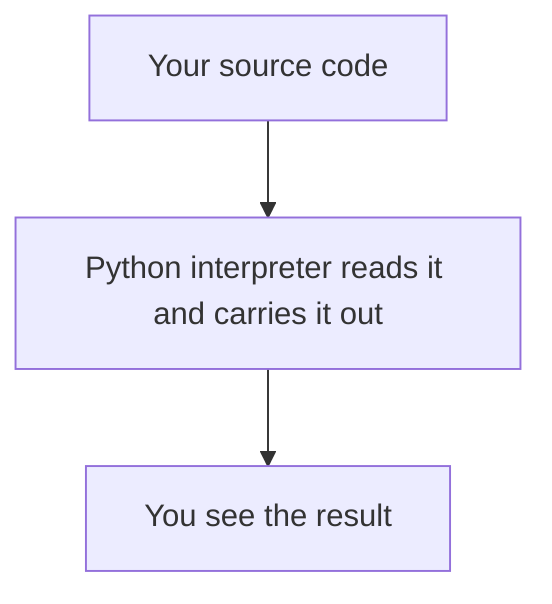

> **In one sentence:** Python is a general-purpose programming language, created by Guido van Rossum, that can run your source code directly with its interpreter.

## Why should I care?

The Python website calls Python "a superb language for teaching programming, both at the introductory level and in more advanced courses".

Python's documentation calls it a "high-level general-purpose programming language". General-purpose means it is not made for only one kind of work. The website's examples include web and internet development, and scientific computing.

## Analogy

In [[programming-languages|Programming Languages]], you met two translators for a letter. One translates the whole letter first. The other stands next to the reader and reads your letter aloud, one sentence at a time. Python is closer to the second translator. One difference: Python reads the file first, and a syntax error found then stops it before line 1 runs. There is no separate translated letter you need to run.

**Where the analogy breaks down:** a person can guess past a small mistake. Python shows an error message instead.

## How it actually works

### What Python looks like

Here is a tiny Python program:

```python
# Add two numbers and show the result.
print(2 + 3)

# Show some text. The quote marks are not shown.
print("Hello, world!")
```

It shows this:

```
5
Hello, world!
```

A line that starts with `#` is a **comment**: a note for people. Python does not run it. `print()` writes the value inside its brackets. `print()` shows text without its quote marks.

### How Python runs it

The documentation calls Python "an interpreted language". This means you can run source code directly. You do not first create an **executable**, a ready-to-run program file. You give your file to the Python interpreter, and it reads and carries out the code.

(This is simplified. Inside, Python first turns your code into **bytecode**, an internal form of your program, and then runs that. You do not do this as a separate step.)



The documentation says interpreted languages typically have a shorter cycle of writing and fixing code (the steps you repeat until a program works) than compiled ones. It also says their programs "generally also run more slowly".

## How it came to be

**Guido van Rossum** created Python in the Netherlands, "as a successor of a language called ABC". In his own account, he started during the Christmas holidays of 1989. In February 1991, a little over a year later, he posted it to Usenet, a worldwide discussion system on computers. Another official page gives the date as "the early 1990s".

The non-profit **Python Software Foundation**, formed in 2001, holds the copyright on Python versions 2.1 and newer.

## 🧪 Try it in your browser

The Python website has a **console** in one of its pages: a place where you type Python code and see the result. It is not your browser's own console. You install nothing. You need a computer with a keyboard.

**Safety rule:** only type code in a console that you understand or that comes from a source you trust. Never paste anything a stranger sends you.

1. In Chrome, Edge or Firefox, open [python.org/shell](https://www.python.org/shell/).

   **What you should see:** a console on the page. It shows a version number, then a line that mentions help and copyright, then the prompt `>>>`. The prompt means Python is waiting for your next line. Do not type the `>>>`. If no prompt appears, you can read the official [tutorial](https://docs.python.org/3/tutorial/introduction.html) instead. It shows the first line below and its result.
2. Click inside the console. Type this line, then press `Enter`:

   ```
   2 + 2
   ```

   **What you should see:** `4`. In a console, Python writes each result for you.
3. Type this line and press `Enter`:

   ```
   print(2 + 3)
   ```

   **What you should see:** `5`. When Python runs a program from a file, it does not write results for you. That is why the program above uses `print()`.
4. Type this line and press `Enter`:

   ```
   print("Hello, world!")
   ```

   **What you should see:** `Hello, world!` without the quote marks.
5. Close the tab.

If you make a typo, you may see an error message. Type the line again.

**On a phone:** read steps 2 to 4, and say what you expect each line to show.

## Common misunderstandings

- **"Python is named after the snake."** No. Python's tutorial says the language is named after the BBC show "Monty Python's Flying Circus" and "has nothing to do with reptiles".
- **"You must pay to use Python for work."** No. Its license makes it "freely usable and distributable, even for commercial use". The FAQ's condition is that you leave the copyrights in, and display them in any documentation about Python you produce.

## Recap

- Python is a general-purpose programming language, created by Guido van Rossum.
- You can run Python source code directly, without first creating an executable.
- In a console, Python writes each result for you. A program in a file uses `print()`.

## Sources

- Python documentation, General Python FAQ: https://docs.python.org/3/faq/general.html
- Python documentation, History and License: https://docs.python.org/3/license.html
- Python documentation, Glossary: https://docs.python.org/3/glossary.html
- Python Language Reference, Execution model: https://docs.python.org/3/reference/executionmodel.html
- Python Language Reference, Simple statements: https://docs.python.org/3/reference/simple_stmts.html
- Python Tutorial, Using the Python Interpreter: https://docs.python.org/3/tutorial/interpreter.html
- Python Tutorial, An Informal Introduction to Python: https://docs.python.org/3/tutorial/introduction.html
- Python Tutorial, Errors and Exceptions: https://docs.python.org/3/tutorial/errors.html
- Python Tutorial, introduction page: https://docs.python.org/3/tutorial/index.html
- Python.org, About: https://www.python.org/about/
- Python.org, Applications for Python: https://www.python.org/about/apps/
- Python.org, online console: https://www.python.org/shell/
- Python.org, the console itself: https://console.python.org/python-dot-org-console/
- Python documentation, Built-in Exceptions: https://docs.python.org/3/library/exceptions.html
- Python Tutorial, Whetting Your Appetite: https://docs.python.org/3/tutorial/appetite.html
- Wikipedia, Usenet: https://en.wikipedia.org/wiki/Usenet
