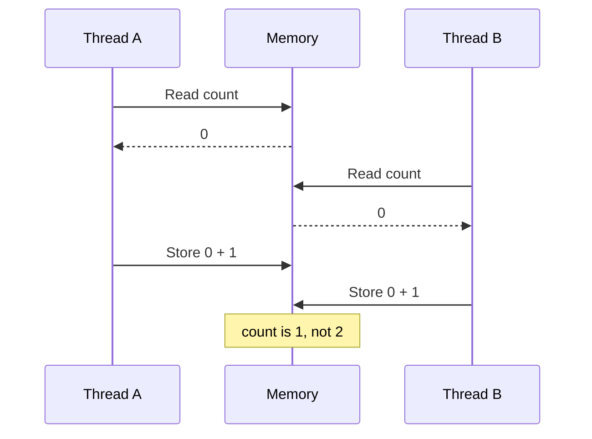

> **In one sentence:** A race condition is when a program's result depends on timing it does not control, so the same code can sometimes give a wrong answer.

## Why should I care?

Imagine a shop with one ticket left. Two people buy it at nearly the same moment, and both get it.

[[threads|Threads]] share memory, and may take turns or run at the same moment. Callbacks in [[asynchronous-code|Asynchronous Code]] run later. Both can leave a gap where other code changes your data.

## Analogy

In the kitchen from Threads, one order has two parts, rice and sauce. Each part is a thread, and both need the last onion.

The cook works on the rice and sees one onion. Before the cook takes it, the manager moves the cook to the sauce. The sauce part also sees one onion, and uses it. Back at the rice, the plan needs an onion that is gone.

**Where the analogy breaks down:** a real cook would notice and think again. A thread looks again only if its code says so.

## How it actually works

### Timing you do not control

Wikipedia describes a race condition as the condition of a system whose behavior "is dependent on the sequence or timing of uncontrollable events". The sources here do not explain the name. Picturing two threads racing to the same data may help.

This page calls two forms the lost update and check-then-act.

### The lost update

Two threads each add 1 to a shared number called `count`. It starts at 0, so you expect 2.

Oracle's tutorial for the Java programming language shows adding 1 as three steps: read the current value, add 1 to it, and store the result.

Another thread can run between those steps. With several processors, Microsoft says, threads really do run at the same time. A core, which Stanford's course calls "a semi-independent CPU", counts as one here. So the steps can also overlap. Here is one order:



Both read 0, so both store 1. One update is lost. Wikipedia's example ends the same way: "the final value is 1 instead of the expected result of 2". If one thread finishes before the other starts, the answer is 2.

Web Workers avoid this exact case. MDN Web Docs, a website that documents web technologies, says that main and worker code "never get direct access to each other's variables", and can share data only in very specific cases.

### Check-then-act

Here the code looks at something, then acts on it. CWE, a list of software weaknesses, names the danger: "the resource's state can change between the check and the use".

This example needs no second thread. MDN says a running JavaScript function "will run entirely before any other code runs". So the gap comes from slow work, here a timer. The stock is a value in a [[lists-and-dictionaries|dictionary]].

```js
// One ticket is left. The shop keeps its stock in a dictionary.
const stock = { tickets: 1 };

function buy(name) {
  // Check: is a ticket left?
  if (stock.tickets > 0) {
    // Slow work: a stand-in for waiting on a payment server.
    setTimeout(() => {
      // Act: take a ticket. The check above may be out of date by now.
      stock.tickets = stock.tickets - 1;
      console.log(name + " got a ticket. Left: " + stock.tickets);
    }, 1000);
  } else {
    console.log(name + " found no ticket");
  }
}

buy("Mira");
buy("Sam");
```

This shows:

```
Mira got a ticket. Left: 0
Sam got a ticket. Left: -1
```

The order is:

1. Mira checks, and sees 1.
2. Sam checks, and sees 1.
3. Mira acts.
4. Sam acts.

Each call to `buy` ends after starting its timer, before the timer's code runs.

### The same gap with `await`

An **async function** starts with the word `async`. Inside it, `await` pauses the function until a promise, an object for a later result, has its result. (This is simplified. [[promises|Promises]] explains `await`.) MDN says `await` "never blocks the main thread". The code that called the function carries on, so this wait does not freeze the page.

So an async function can pause at `await`, unlike the function above. The code between two `await`s still runs without interruption.

```js
const stock = { tickets: 1 };

async function buy(name) {
  if (stock.tickets > 0) {               // check
    await fetch("https://example.com/"); // the gap
    stock.tickets = stock.tickets - 1;   // act
    console.log(name + " got a ticket. Left: " + stock.tickets);
  }
}

buy("Mira");
buy("Sam");
```

If both requests succeed, both calls take a ticket, so one line ends with `Left: -1`. The names can come in either order, because either answer can arrive first.

ESLint, a tool that finds problems in JavaScript code, describes a lost update here too: if code reads a value, waits, then stores a result based on what it read, a change made during the wait "will be lost".

### Which fix works where

In single-threaded code, moving the check and the act together, with no gap, fixes it. Threads that share changing data need a lock or a similar tool, because another thread can run between any two steps.

**Close the gap.** Take the ticket before the slow work. No other code can run between the check and the act.

```js
const stock = { tickets: 1 };

function buy(name) {
  if (stock.tickets > 0) {
    // Check and act together, with no wait between them.
    stock.tickets = stock.tickets - 1;
    setTimeout(() => {
      console.log(name + " got a ticket. Left: " + stock.tickets);
    }, 1000);
  } else {
    console.log(name + " found no ticket");
  }
}

buy("Mira");
buy("Sam");
```

This shows `Sam found no ticket` first, because that line runs immediately. Mira's line waits for her timer.

**Use a lock.** A **lock** is a marker that one thread can hold at a time. Oracle says a thread takes the lock, uses the data, then releases it. Meanwhile, a thread that tries to take it waits.

With a lock around the three steps, thread B waits until thread A has stored 1. So B reads 1 and stores 2. Oracle also shows a counter type that prevents this interference without a lock.

## How it came to be

Wikipedia says the term "was in use by 1954", for example in David A. Huffman's doctoral thesis.

Wikipedia says race conditions were among the flaws in the Therac-25, a radiation therapy machine. A paper on it reports six known accidents with massive overdoses, deaths and serious injuries. It describes one error: the software could miss an operator's fast edit of the prescription data.

## 🧪 Try it in your browser

You need a computer with Chrome, Edge or Firefox.

**Safety rule:** only type code in the console that you understand or that comes from a source you trust. Never paste anything a stranger sends you. The lines below only create values and functions, start timers and show text.

1. Open [example.com](https://example.com/).
   **What you should see:** a short page.
2. Open the **console**:
   - **Windows:** press `Ctrl` + `Shift` + `J` (in Firefox: `Ctrl` + `Shift` + `K`)
   - **Mac:** press `Cmd` + `Option` + `J` (in Firefox: `Cmd` + `Option` + `K`)
3. Click the line where you can type. **Type** this as one line (some browsers may block pasting at first), then press `Enter`. The browser may show suggestions, and the line may look different while you type. Keep typing.

   ```
   const stock = { tickets: 1 }; function buy(name) { if (stock.tickets > 0) { setTimeout(() => { stock.tickets = stock.tickets - 1; console.log(name + " got a ticket. Left: " + stock.tickets) }, 1000) } else { console.log(name + " found no ticket") } } buy("Mira"); buy("Sam")
   ```

   **What you should see:** the console may show `undefined`. That is normal. About a second later: `Mira got a ticket. Left: 0`, then `Sam got a ticket. Left: -1`.
4. Now Sam comes two seconds later. New names avoid a clash with step 3. Type this, then press `Enter`:

   ```
   const stock2 = { tickets: 1 }; function buy2(name) { if (stock2.tickets > 0) { setTimeout(() => { stock2.tickets = stock2.tickets - 1; console.log(name + " got a ticket. Left: " + stock2.tickets) }, 1000) } else { console.log(name + " found no ticket") } } setTimeout(() => buy2("Sam"), 2000); buy2("Mira")
   ```

   **What you should see:** the console may show `undefined`. About a second later: `Mira got a ticket. Left: 0`. About a second after that: `Sam found no ticket`. Sam's check came after Mira's act, so it saw 0.

**What this showed:** apart from the names, only Sam's timing changed, and the result changed too.

**If something goes wrong:** look for a typo. If `Enter` gives a new line and no answer, a bracket is probably still open. Then reload the page, delete anything left on the typing line, and start again from step 3.

## Common misunderstandings

- **"JavaScript in a page has one main thread, so it has no race conditions."** No. The ticket code above used no second thread.
- **"It worked when I ran it, so there is no race condition."** Not proof. The lost update is right in some orders and wrong in others.

## Recap

- A race condition means the result depends on timing the program does not control.
- A callback or `await` can leave a gap where other code runs, without a second thread.
- In single-threaded code, close the gap. With threads sharing changing data, use a lock or a similar tool.

## Sources

- Wikipedia, Race condition: https://en.wikipedia.org/wiki/Race_condition
- Oracle, The Java Tutorials, Thread Interference: https://docs.oracle.com/javase/tutorial/essential/concurrency/interfere.html
- Oracle, The Java Tutorials, Intrinsic Locks and Synchronization: https://docs.oracle.com/javase/tutorial/essential/concurrency/locksync.html
- Microsoft Learn, About Processes and Threads: https://learn.microsoft.com/en-us/windows/win32/procthread/about-processes-and-threads
- Stanford CS101, Computer Hardware: https://web.stanford.edu/class/cs101/hardware-1.html
- Microsoft Learn, Multitasking: https://learn.microsoft.com/en-us/windows/win32/procthread/multitasking
- CWE-367, Time-of-check Time-of-use (TOCTOU) Race Condition: https://cwe.mitre.org/data/definitions/367.html
- About CWE: https://cwe.mitre.org/about/index.html
- Oracle, The Java Tutorials, Atomic Variables: https://docs.oracle.com/javase/tutorial/essential/concurrency/atomicvars.html
- Nancy Leveson and Clark S. Turner, An Investigation of the Therac-25 Accidents, part 1: https://web.mit.edu/6.033/2004/wwwdocs/papers/Therac_1.html
- Nancy Leveson and Clark S. Turner, An Investigation of the Therac-25 Accidents, part 2: https://web.mit.edu/6.033/2004/wwwdocs/papers/Therac_2.html
- MDN Web Docs, await: https://developer.mozilla.org/en-US/docs/Web/JavaScript/Reference/Operators/await
- MDN Web Docs, JavaScript execution model: https://developer.mozilla.org/en-US/docs/Web/JavaScript/Reference/Execution_model
- MDN Web Docs, Introducing workers: https://developer.mozilla.org/en-US/docs/Learn_web_development/Extensions/Async_JS/Introducing_workers
- MDN Web Docs, Window.setTimeout(): https://developer.mozilla.org/en-US/docs/Web/API/Window/setTimeout
- WHATWG HTML Standard, Timers: https://html.spec.whatwg.org/multipage/timers-and-user-prompts.html
- MDN Web Docs, async function: https://developer.mozilla.org/en-US/docs/Web/JavaScript/Reference/Statements/async_function
- MDN Web Docs, Promise: https://developer.mozilla.org/en-US/docs/Web/JavaScript/Reference/Global_Objects/Promise
- MDN Web Docs, Window.fetch(): https://developer.mozilla.org/en-US/docs/Web/API/Window/fetch
- ESLint, require-atomic-updates: https://eslint.org/docs/latest/rules/require-atomic-updates
- ESLint home page: https://eslint.org/
- MDN Web Docs, console.log(): https://developer.mozilla.org/en-US/docs/Web/API/console/log_static
- MDN Web Docs, eval(): https://developer.mozilla.org/en-US/docs/Web/JavaScript/Reference/Global_Objects/eval
- MDN Web Docs, About MDN: https://developer.mozilla.org/en-US/about
- Example Domain: https://example.com/
- Chrome for Developers, Open Chrome DevTools: https://developer.chrome.com/docs/devtools/open
- Chrome for Developers, What are self-XSS attacks?: https://developer.chrome.com/blog/self-xss
- Microsoft Edge DevTools, Keyboard shortcuts: https://learn.microsoft.com/en-us/microsoft-edge/devtools/shortcuts/
- Microsoft Edge DevTools, Run JavaScript in the Console: https://learn.microsoft.com/en-us/microsoft-edge/devtools/console/console-javascript
- Firefox DevTools User Docs, Web Console: https://firefox-source-docs.mozilla.org/devtools-user/web_console/index.html
- Firefox DevTools User Docs, The JavaScript input interpreter: https://firefox-source-docs.mozilla.org/devtools-user/web_console/the_command_line_interpreter/index.html
