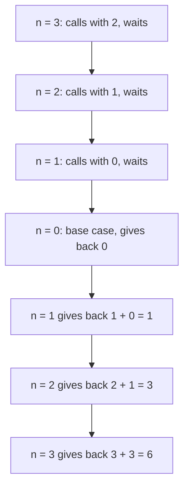

> **In one sentence:** Recursion is when a function calls itself to solve a smaller part of a problem, until a base case tells it to stop.

## Why should I care?

A folder on a computer can hold files and other folders, which can hold more. Wikipedia says that going through all of them "is very similar to" going through a **tree**. A tree is a structure where parts hold other parts.

MDN says that getting all the parts of a tree "is easier via recursion".

## Analogy

You stand in a long line and want to know your place. You cannot see the front, so you ask the person in front, who asks the person in front of them, and so on.

The person at the front knows: "I am 1." Each person then adds 1 and answers the person behind. Each waits for an answer before giving their own. (This is a different problem from the sum below, with the same pattern.)

**Where the analogy breaks down:** in a real line, each asker is a different person. In recursion, every call runs the same function, with its own values. And a real line always has a front. A function with no "front" fills the computer's room for waiting calls (the call stack, explained below).

## How it actually works

### A function that calls itself

In [[functions|Functions]], functions called other functions. A function can also call itself: MDN calls this a **recursive function**, and each such call a **recursive call**. It needs two parts:

- The **base case**: a problem so small that the function answers it directly, with no new call.
- The **recursive case**: every other problem. The function calls itself with a smaller problem, then uses that answer.

Example: add up the whole numbers from 1 to a number n. The sum of 1 to 3 is 3 plus (the sum of 1 to 2), and so on. When n is 0, there is nothing to add, so the sum is 0. That is the base case.

The examples come in [[javascript|JavaScript]], [[python|Python]] and [[go-language|Go]]. You only need to read one tab.

<!-- tabs -->

### JavaScript

```js
// Adds up the whole numbers from 1 to n.
function sumTo(n) {
  if (n === 0) {
    return 0; // base case: nothing left to add
  }
  return n + sumTo(n - 1); // recursive case: a smaller problem
}

console.log(sumTo(3));   // shows 6
console.log(sumTo(100)); // shows 5050
```

This shows:

```
6
5050
```

`===` checks whether two values are equal. Inside `sumTo`, the last line calls `sumTo` again with a number 1 smaller. When `n` is 0, `return 0` runs and no new call is made.

### Python

```python
# Adds up the whole numbers from 1 to n.
def sum_to(n):
    if n == 0:
        return 0  # base case: nothing left to add
    return n + sum_to(n - 1)  # recursive case: a smaller problem

print(sum_to(3))    # shows 6
print(sum_to(100))  # shows 5050
```

This shows:

```
6
5050
```

The word `def` starts a function definition. The lines below it are the body, and they are indented (moved to the right). `if` starts a condition. The `if` line ends with a colon. `==` checks whether two values are equal.

Inside `sum_to`, the last line calls `sum_to` again, with a number 1 smaller. When `n` reaches 0, `return 0` runs, and no new call is made.

### Go

```go
package main

import "fmt"

// Adds up the whole numbers from 1 to n.
func sumTo(n int) int {
	if n == 0 {
		return 0 // base case: nothing left to add
	}
	return n + sumTo(n - 1) // recursive case: a smaller problem
}

func main() {
	fmt.Println(sumTo(3))   // shows 6
	fmt.Println(sumTo(100)) // shows 5050
}
```

This shows:

```
6
5050
```

The word `func` starts a function definition. `int` is a type for whole numbers. The parameter `n` is an `int`, and the `int` after the brackets says that `sumTo` gives back an `int`. `==` checks whether two values are equal. Go starts the program by calling `main`, and `fmt.Println` shows a value.

Inside `sumTo`, the last line calls `sumTo` again, with a number 1 smaller. When `n` reaches 0, `return 0` runs, and no new call is made.

<!-- /tabs -->

### Each call waits for the one it made

A call that makes a recursive call needs that answer before it can finish. So it waits, and it keeps its own value of `n`.

The computer keeps track of waiting calls in the **call stack**. As MDN describes it, when a function is called, it is added to the stack. A call it makes is added on top. When a call finishes, it is taken off, and the call below carries on from where it stopped.

Here is the sum of 1 to 3, step by step:



### With no base case

Without a base case, no call finishes, so waiting calls pile up on the stack. MDN says that when the stack takes more room than it was given, a "stack overflow" error happens. In all three examples below, the program stops with an error message.

<!-- tabs -->

### JavaScript

```js
// No base case: this function never stops calling itself.
function forever(n) {
  return forever(n + 1);
}

forever(0); // the program stops with an error
```

The program stops with an error message. MDN calls this error "too much recursion" or "Maximum call stack size exceeded". It says the error can happen when "a function is missing a base case".

MDN lists it as a `RangeError` in Chrome and Safari, and an `InternalError` in Firefox, with different messages.

### Python

```python
# No base case: this function never stops calling itself.
def forever(n):
    return forever(n + 1)

forever(0)  # the program stops with an error
```

The program stops with an error message that includes the word `RecursionError`.

Python has a **recursion limit**: the maximum depth of its stack, which means how many calls can wait on it at once. Python's documentation says it raises (produces) a `RecursionError` when that limit is passed.

To see the limit, use `sys`. It is a module (a unit that you load into Python with `import`), and Python's tutorial says it "is built into every Python interpreter". In a program, write `import sys` first. Then `print(sys.getrecursionlimit())` shows the current limit, a whole number.

### Go

```go
package main

// No base case: this function never stops calling itself.
func forever(n int) int {
	return forever(n + 1)
}

func main() {
	forever(0) // the program stops with an error
}
```

The program stops with an error message about the stack, then ends.

Go's FAQ (common questions) says Go uses "resizable, bounded stacks". Resizable means the stack grows when it needs more room. Bounded means it has a limit. Go's `runtime/debug` documentation says that when a stack grows past that limit, "the program crashes". Go's `runtime` documentation says that such a failure prints a report, called a stack trace, by default, and then the program exits. (This is simplified.)

<!-- /tabs -->

### Recursion and loops

MDN says that "in some ways", recursion is like a loop. Both run the same code many times. Both need a condition to stop, as in [[loops|Loops]]. In recursion, that condition is the base case.

MDN adds that any recursive solution can be rewritten without recursion, "but the logic is often much more complex".

So, for simple repeating, such as the sum of 1 to n, a loop saves work. Wikipedia says a loop avoids "the overhead of function calls and call stack management": the extra work of making calls and keeping the stack. For problems made of smaller copies of themselves, such as folders, recursion is often easier.

## How it came to be

Lisp is a family of programming languages. John McCarthy began developing Lisp in 1958, at MIT (the Massachusetts Institute of Technology). In April 1960, McCarthy published its design in a paper titled "Recursive Functions of Symbolic Expressions and Their Computation by Machine, Part I".

ALGOL 60, a language also from 1960, was one of the first languages whose functions could call themselves. Wikipedia says recursion was added to it very late, against the wishes of some of the committee that designed it.

## 🧪 Try it in your browser

These steps use JavaScript, the language the browser's console runs. In it, `function` starts a definition, and `return` gives a value back. `if` runs code only when a condition is true, and `===` checks whether two values are equal. `undefined` means no value to show. `sumTo` is the function from the examples above (`sum_to` in Python). You need a computer with Chrome, Edge or Firefox.

**Safety rule:** only type code in the console that you understand or that comes from a source you trust. Never paste anything a stranger sends you. The lines below define and call two functions. The last one stops with an error message.

1. Open [example.com](https://example.com/).
   **What you should see:** a short page of text.
2. Open the **console**:
   - **Windows:** press `Ctrl` + `Shift` + `J` (in Firefox: `Ctrl` + `Shift` + `K`)
   - **Mac:** press `Cmd` + `Option` + `J` (in Firefox: `Cmd` + `Option` + `K`)
3. Click the line where you can type, below any messages. **Type** this line yourself (some browsers may block pasting at first), then press `Enter`.

   ```
   function sumTo(n) { if (n === 0) { return 0 } return n + sumTo(n - 1) }
   ```

   **What you should see:** the console may show `undefined`. That is normal: the function is defined, not called. The browser may show suggestions, and the line may look different while you type. Keep typing. If `Enter` gives a new line and no answer, a bracket is probably still open. Reload the page and start again from step 3.
4. Call it:

   ```
   sumTo(3)
   ```

   **What you should see:** `6`, which is 3 + 2 + 1 + 0.
5. Define a function with no base case, and call it:

   ```
   function forever(n) { return forever(n + 1) }; forever(0)
   ```

   **What you should see:** an error message. Its words depend on your browser: MDN lists "Maximum call stack size exceeded" and "too much recursion".

If you see an error message at another step, look for a typo, reload the page and start again from step 3.

**On a phone:** work out what `sumTo(4)` gives. The answer is 4 + 3 + 2 + 1 + 0 = 10.

## Common misunderstandings

- **"A recursive call starts the function over, and the first call is gone."** No. The first call waits, then carries on from where it stopped, with its own values.
- **"With no base case, recursion runs forever, like an endless loop."** No. The waiting calls fill the stack's limited room. In this page's examples, in JavaScript, Python and Go, the program then stops with an error message.

## Recap

- A recursive function calls itself with a smaller problem, until it reaches a base case.
- Each call waits for the call it made, on the call stack, with its own values.
- Without a base case, this page's examples run out of stack room and stop with an error message.

## Sources

- MDN Web Docs, Recursion (glossary): https://developer.mozilla.org/en-US/docs/Glossary/Recursion
- MDN Web Docs, Functions (JavaScript guide): https://developer.mozilla.org/en-US/docs/Web/JavaScript/Guide/Functions
- MDN Web Docs, Call stack (glossary): https://developer.mozilla.org/en-US/docs/Glossary/Call_stack
- MDN Web Docs, InternalError: too much recursion: https://developer.mozilla.org/en-US/docs/Web/JavaScript/Reference/Errors/Too_much_recursion
- MDN Web Docs, return: https://developer.mozilla.org/en-US/docs/Web/JavaScript/Reference/Statements/return
- MDN Web Docs, if...else: https://developer.mozilla.org/en-US/docs/Web/JavaScript/Reference/Statements/if...else
- MDN Web Docs, Strict equality (===): https://developer.mozilla.org/en-US/docs/Web/JavaScript/Reference/Operators/Strict_equality
- MDN Web Docs, console.log(): https://developer.mozilla.org/en-US/docs/Web/API/console/log_static
- MDN Web Docs, eval(): https://developer.mozilla.org/en-US/docs/Web/JavaScript/Reference/Global_Objects/eval
- Python Tutorial, More Control Flow Tools: https://docs.python.org/3/tutorial/controlflow.html
- Python Language Reference, Expressions: https://docs.python.org/3/reference/expressions.html
- Python documentation, sys (system-specific parameters and functions): https://docs.python.org/3/library/sys.html
- Python documentation, Glossary: https://docs.python.org/3/glossary.html
- Python Tutorial, Errors and Exceptions: https://docs.python.org/3/tutorial/errors.html
- MDN Web Docs, throw: https://developer.mozilla.org/en-US/docs/Web/JavaScript/Reference/Statements/throw
- Python Tutorial, Modules: https://docs.python.org/3/tutorial/modules.html
- Python Language Reference, Compound statements: https://docs.python.org/3/reference/compound_stmts.html
- Python documentation, Built-in Exceptions: https://docs.python.org/3/library/exceptions.html
- The Go Programming Language Specification: https://go.dev/ref/spec
- Go Packages, fmt: https://pkg.go.dev/fmt
- Go, Frequently Asked Questions (FAQ): https://go.dev/doc/faq
- Go Packages, runtime: https://pkg.go.dev/runtime
- Go Packages, runtime/debug: https://pkg.go.dev/runtime/debug
- Wikipedia, Recursion (computer science): https://en.wikipedia.org/wiki/Recursion_(computer_science)
- Wikipedia, Lisp (programming language): https://en.wikipedia.org/wiki/Lisp_(programming_language)
- John McCarthy, Recursive Functions of Symbolic Expressions and Their Computation by Machine (Part I): https://www-formal.stanford.edu/jmc/recursive.html
- Wikipedia, ALGOL 60: https://en.wikipedia.org/wiki/ALGOL_60
- Example Domain: https://example.com/
- Chrome for Developers, Open Chrome DevTools: https://developer.chrome.com/docs/devtools/open
- Microsoft Edge DevTools, Keyboard shortcuts: https://learn.microsoft.com/en-us/microsoft-edge/devtools/shortcuts/
- Microsoft Edge DevTools, Run JavaScript in the Console: https://learn.microsoft.com/en-us/microsoft-edge/devtools/console/console-javascript
- Firefox DevTools User Docs, Web Console: https://firefox-source-docs.mozilla.org/devtools-user/web_console/index.html
- Firefox DevTools User Docs, The JavaScript input interpreter: https://firefox-source-docs.mozilla.org/devtools-user/web_console/the_command_line_interpreter/index.html
- Chrome for Developers, What are self-XSS attacks?: https://developer.chrome.com/blog/self-xss
