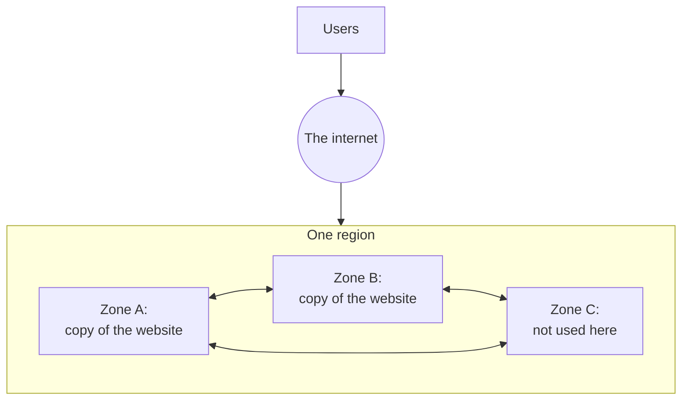

> **In one sentence:** At AWS, a region is a place in the world with several groups of data centers, called availability zones; each zone has its own power, cooling and network, so a service spread across zones can keep running when one zone fails.

## Why should I care?

In [[cloud-computing]] you met AWS's codes, such as `us-east-1` and `eu-west-1`. Each code names a **region**: a real place with real buildings.

Where your things live matters for speed, for laws, and when something breaks.

## Analogy

Think of a **bank with several branches in one city**. Each branch has its own building and its own power. If one branch closes because of a power cut, customers go to another one.

A region is like the city. Each availability zone is like one branch.

**Where the analogy breaks down:** a customer can walk to any branch. A service in the cloud cannot move by itself. Some cloud services spread across zones for you. With others, you have to set them up in more than one zone **before** the problem happens.

## How it actually works

Several cloud companies use this idea. This page uses Amazon Web Services (AWS) as the example.

### A region: a place with several data centers

AWS describes a region as "a physical location around the world where we cluster [[data-centers-and-energy|data centers]]".

### An availability zone: a group of data centers

AWS defines it like this: "An Availability Zone (AZ) is one or more discrete data centers with redundant power, networking, and connectivity in an AWS Region."

**Discrete** means separate. **Redundant** means there is more than one, so a backup can take over. "Networking, and connectivity" means links to other computers and the internet. AWS says each zone "has independent power, cooling, and physical security". **Physical security** means keeping unwanted people out of the buildings. AWS's documentation says each region "has at least three Availability Zones".

AWS says zones are "many kilometers" apart, "although all are within 100 km (60 miles) of each other". AWS's guide on failures says this distance helps stop one fire, flood or earthquake from hitting two zones.

But the zones are also close. **Latency** is "the network time it takes for a requested resource to reach its destination", MDN says. Between zones, AWS's guide gives "single-digit millisecond latency": less than 10 thousandths of a second.

### Spreading a service across zones

Why does this matter? Because one zone can fail. AWS's guide on failures says a program that uses several zones is "better isolated and protected from issues that impact a single Availability Zone's physical infrastructure": its buildings, power and machines. If it is set up correctly, it can "remain operational even if one Availability Zone experiences failures".

So a company can run copies of its website in two zones, as in the diagram. If one zone has an outage (stops working), the other copy keeps running.

Some services do this for you. DynamoDB is an AWS database: a service that stores data. AWS says that by default it "automatically replicates your data across three Availability Zones": it keeps copies in three zones.

Google Cloud also has regions made of zones.

### AWS's names for zones

A zone's code is the region's code plus a letter. AWS's example: `us-east-2a`, `us-east-2b` and `us-east-2c` are the zones in the `us-east-2` region.

These letters can mislead. An **AWS account** is a customer's account with AWS. AWS says that for accounts made before November 2025, in its oldest regions, "the `us-east-1a` Availability Zone for your account might not be the same physical location as it is in another account". So each zone also has an **AZ ID**, such as `euw1-az1`, which "is the same physical location in every AWS account".

### Choosing a region

AWS's pages point to four things to think about:

1. **Distance and speed.** AWS's documentation says you can lower latency "when you select a Region that is close to the majority of your users".
2. **Laws.** AWS's documentation mentions choosing a place "to meet legal requirements". AWS's privacy page says: "You choose the AWS Region(s) in which your content is stored."
3. **Price.** AWS's cost guide says "resource pricing is different in each Region".
4. **Services.** AWS says to "select a Region that has the AWS services and features that you need".

### A whole region can have trouble

Microsoft, which runs the Azure cloud, says its zones "don't protect against a full-region outage". On October 19 and 20, 2025, AWS had a "service disruption" in its N. Virginia (`us-east-1`) region. A hidden fault in an automatic system caused errors in DynamoDB. AWS services "with dependencies on DynamoDB" had trouble too. The whole event lasted from 11:48 PM on October 19 to 2:20 PM on October 20. That is Pacific Daylight Time, summer time in the US Pacific Time Zone (California, for example).

AWS designs its regions to be separate, so that a failure usually stays in one region. But its guide notes "a few exceptions". In October 2025, some customers had trouble signing in to AWS even in other regions. They "experienced errors when trying to log into the AWS Management Console in regions outside of the N. Virginia (us-east-1) Region". (The console is AWS's website for its services.)

For important services, Microsoft advises: "consider a solution that is *both* multiregion and multi-zone". That means copies in more than one region.

## How it came to be

On March 26, 2008, AWS announced availability zones for Amazon EC2, its service for renting computing power. AWS said each zone had "its own reliable, physically independent infrastructure".

On December 10, 2008, AWS announced a European region for EC2, with "two Availability Zones". It said this could help customers "achieve lower latency" and "meet EU data storage requirements when required".

## 🧪 Try it in your browser

This only reads a public AWS page, on a computer or a phone. The page may look different.

1. Open `https://docs.aws.amazon.com/global-infrastructure/latest/regions/aws-availability-zones.html`.
2. Read the first sentence under the title. It says how many zones each region has at least.
3. In the list of topics near the top, click **Europe**, or scroll down to that heading. In Chrome or Edge on Windows, you can also press `Ctrl` + `F` (Chrome on a Mac: `Command` + `F`) and type `eu-west-1`.
4. In the table, find the rows whose **Region** is `eu-west-1`.

**What you should see:** in November 2026, there were three rows: `euw1-az1`, `euw1-az2` and `euw1-az3`. Their **Geography** is Ireland. Close the tab when you are done.

## Common misunderstandings

- **"A region is one big data center."** No. At AWS, a region has several zones, and each zone is one or more data centers.
- **"The cloud copies my service to every zone automatically."** Not always. Some services do it for you. For others, AWS says your service stays running when a zone fails "if architected correctly": if it is set up in several zones.

## Recap

- At AWS, a region is a place with several availability zones. Each zone is one or more data centers with its own power, cooling and network.
- Running a service in several zones lets it keep working when one zone fails. Zones do not protect against every problem in a region.
- Choose a region by distance to your users, laws about where data is kept, price and the services you need.

## Sources

- AWS, Regions and Availability Zones: https://aws.amazon.com/about-aws/global-infrastructure/regions_az/
- AWS documentation, AWS Availability Zones: https://docs.aws.amazon.com/global-infrastructure/latest/regions/aws-availability-zones.html
- AWS documentation, AWS Regions: https://docs.aws.amazon.com/global-infrastructure/latest/regions/aws-regions.html
- AWS whitepaper, AWS Fault Isolation Boundaries, Availability Zones: https://docs.aws.amazon.com/whitepapers/latest/aws-fault-isolation-boundaries/availability-zones.html
- AWS whitepaper, AWS Fault Isolation Boundaries, Regions: https://docs.aws.amazon.com/whitepapers/latest/aws-fault-isolation-boundaries/regions.html
- AWS, Data Privacy FAQ: https://aws.amazon.com/compliance/data-privacy-faq/
- AWS, Summary of the Amazon DynamoDB Service Disruption in the Northern Virginia (US-EAST-1) Region: https://aws.amazon.com/message/101925/
- AWS What's New, Announcing Amazon EC2 (beta), 2006: https://aws.amazon.com/about-aws/whats-new/2006/08/24/announcing-amazon-elastic-compute-cloud-amazon-ec2---beta/
- AWS What's New, Announcing Elastic IP Addresses and Availability Zones for Amazon EC2, 2008: https://aws.amazon.com/about-aws/whats-new/2008/03/26/announcing-elastic-ip-addresses-and-availability-zones-for-amazon-ec2
- AWS What's New, Amazon EC2 Crosses the Atlantic, 2008: https://aws.amazon.com/about-aws/whats-new/2008/12/10/amazon-ec2-crosses-the-atlantic
- Google Cloud documentation, Regions and zones: https://docs.cloud.google.com/compute/docs/regions-zones
- Microsoft Learn, What are Azure availability zones?: https://learn.microsoft.com/en-us/azure/reliability/availability-zones-overview
- MDN Web Docs, Latency (glossary): https://developer.mozilla.org/en-US/docs/Glossary/Latency
- Wikipedia, Redundancy (engineering) (general background reference): https://en.wikipedia.org/wiki/Redundancy_(engineering)
- AWS documentation, What is Amazon DynamoDB?: https://docs.aws.amazon.com/amazondynamodb/latest/developerguide/Introduction.html
- Google Chrome Help, Search within a webpage: https://support.google.com/chrome/answer/95440
- Microsoft Support, Microsoft Edge keyboard shortcuts: https://support.microsoft.com/en-us/help/4531783/microsoft-edge-keyboard-shortcuts
- Wikipedia, Pacific Time Zone (general background reference): https://en.wikipedia.org/wiki/Pacific_Time_Zone
- AWS Well-Architected, COST07-BP02 Choose Regions based on cost: https://docs.aws.amazon.com/wellarchitected/latest/cost-optimization-pillar/cost_pricing_model_region_cost.html
- AWS documentation, What is the AWS Management Console?: https://docs.aws.amazon.com/awsconsolehelpdocs/latest/gsg/what-is.html
- Wiktionary, discrete (general background reference): https://en.wiktionary.org/wiki/discrete
- Wikipedia, Physical security (general background reference): https://en.wikipedia.org/wiki/Physical_security
