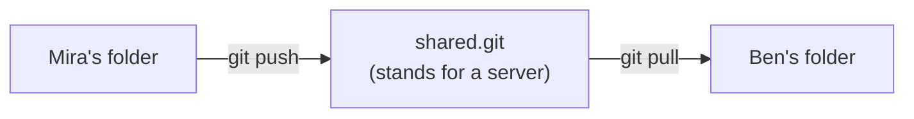

> **In one sentence:** A remote repository is a copy of your Git repository kept somewhere else, usually on a server, that you copy with git clone, send commits to with git push and get new commits from with git pull.

## Why should I care?

In [[git|Git]], you learned that a repository holds your project and its history of commits. A commit is a saved snapshot of your whole project at one moment. So far, that repository is only on your computer. If the computer breaks, there is no other copy, and nobody else can work on it. A remote repository helps with both, and is one way to share [[open-source]] code.

## Analogy

Think of a family that keeps a book of its family tree. Grandmother keeps one copy at her house. Each relative has a full photocopy at home.

- A new relative photocopies the whole book. That is like **cloning**.
- You add a page to your copy, then to grandmother's copy. That is like **pushing**.
- You copy a cousin's new pages from grandmother's copy. That is like **pulling**.

**Where the analogy breaks down:** Git copies the work for you, usually over a network. If someone added pages to grandmother's copy since you last copied it, Git refuses your push until you combine their pages with yours. And the shared copy is not special to Git: every copy holds the full history.

## How it actually works

### A remote is another copy

Git's glossary defines a **remote repository** as "a repository which is used to track the same project but resides somewhere else". It is usually on a server, the program that answers requests in [[client-and-server]]. But Pro Git adds: "Remote repositories can be on your local machine."

Git is **distributed**: Pro Git says each copy holds the whole repository, "including its full history".

Below, lines that start with `$` are commands; you would not type the `$`. You only need to read them: Git does not need to be installed for this page.

### Cloning: getting your own copy

To **clone** means to copy a remote repository to your computer. Here is the command, typed in the terminal (the [[command-line]]), and what Git printed:

```
$ git clone https://github.com/octocat/Spoon-Knife
Cloning into 'Spoon-Knife'...
remote: Enumerating objects: 16, done.
remote: Total 16 (delta 0), reused 0 (delta 0), pack-reused 16 (from 1)
Receiving objects: 100% (16/16), done.
Resolving deltas: 100% (3/3), done.
```

The address is where the remote repository is. Spoon-Knife is a practice repository from GitHub's documentation. `Cloning into 'Spoon-Knife'...` names the new folder. The other lines report progress; you can ignore their details.

Pro Git says "every version of every file for the history of the project" comes down. Git also remembers the address, under the name **origin**: "the default name Git gives to the server you cloned from". Later, `git push` and `git pull` use `origin` when you give no address.

### Pushing and pulling

Pro Git describes "the preferred method for collaborating": a shared repository that two people "both have access to, and push to and pull from".

Below is a practice setup on one computer. The shared copy, the folder `shared.git`, is a bare copy of Spoon-Knife. Pro Git calls this a **bare repository**: "a Git repository that has no working directory". Pro Git says it "is only used as a collaboration point", so nobody edits files in it. Two clones of it, the folders `mira` and `ben`, stand for two people. On a real team, it would be on a server, such as GitHub.

Sending your new commits to a remote is called **pushing**. In a new example, Mira commits a new file, `hello.txt`, the same way as on the Git page. Then she pushes:

```
$ git push
To C:/.../shared.git
   d0dd1f6..3e7f7c7  main -> main
```

`git push` sends to `origin`, because Mira gave no address. The folder's path is shortened at `...`. `d0dd1f6` and `3e7f7c7` are the short IDs of the old and the new latest commit. In `main -> main`, the left name is on Mira's computer and the right one on the remote.

`main` is a branch name, like `master` on the Git page. It came from Spoon-Knife. GitHub names the first branch of a new repository `main` by default.

Ben gets Mira's commit with **git pull**:

```
$ git pull
From C:/.../shared
   d0dd1f6..3e7f7c7  main       -> origin/main
Updating d0dd1f6..3e7f7c7
Fast-forward
 hello.txt | 1 +
 1 file changed, 1 insertion(+)
 create mode 100644 hello.txt
```

The Git reference says: "First, git pull runs git fetch", which downloads new commits. "Then it integrates" them into Ben's work. Line by line:

- `main -> origin/main`: `origin/main` is Ben's record of where `main` is on the remote. Pro Git calls such names "references to the state of remote branches".
- `Updating d0dd1f6..3e7f7c7`: Ben's `main` moves from the old commit to the new one.
- `Fast-forward`: Ben had no new commits of his own. Pro Git says Git then moves the branch forward, "because there is no divergent work to merge together".
- The last lines name the new file, now in Ben's folder. You can ignore `create mode 100644`.

A plain `git fetch` "only downloads the data", without changing your files.



A push can be refused. Pro Git says it needs "write access": permission to change the remote. Also, suppose the remote branch has commits that your work does not have yet. The Git reference says Git then refuses your push by default, "to prevent such loss of history". First get their work and combine it with yours, for example with `git pull`. Then push.

## How GitHub does it

GitHub's documentation says GitHub "builds on Git by hosting your Git projects, called repositories". GitHub gives each repository a web page, and offers, among other things:

- **Issues**, which GitHub says "track ideas, feedback, tasks, or bugs" (mistakes in a program).
- **Pull requests**, for proposed changes. The next page explains them.
- **Public or private.** GitHub says: "Public repositories are accessible to everyone on the internet." Private ones "are only accessible to you, people you explicitly share access with". Some members of an **organization** (a shared GitHub account for a group) may also see the organization's private repositories.

Pro Git says a server should normally ask you to prove who you are before it accepts a push.

## How it came to be

Wikipedia says GitHub "was launched in April 2008 by Tom Preston-Werner, Chris Wanstrath, P. J. Hyett, and Scott Chacon". On June 4, 2018, Microsoft announced its intent to buy GitHub for US$7.5 billion.

## 🧪 Try it in your browser

You will look at a public repository on GitHub. Only read the page. Do not click buttons that ask you to sign in, such as **Fork** or **Star**.

1. In Chrome, Edge or Firefox, open `https://github.com/octocat/Spoon-Knife`. The page may look different.
2. Find the list of files: `README.md`, `index.html` and `styles.css`. The page also shows the text of `README.md`, starting with "Well hello there!".
3. Above the list of files, click the **Code** button (not the **Code** tab near the top). GitHub's documentation gives this step for finding the clone address.
4. **What you should see:** under **HTTPS**, an address that starts with `https://github.com/octocat/Spoon-Knife`. You would give it to `git clone`. GitHub's documentation shows such addresses ending in `.git`. The box also offers other kinds, such as SSH; you do not need them.
5. Close the tab when you are done.

## Common misunderstandings

- **"Cloning gives me only the latest files."** No. GitHub says a clone includes "all versions of every file and folder for the project".
- **"`git push` sends my work to everyone."** No. It sends your commits to one remote. Other people's copies change only when those people pull or fetch.

## Recap

- A remote repository is a copy of the project somewhere else, usually on a server. Cloning names it `origin`.
- `git clone` copies it with the full history, `git push` sends your commits, and `git pull` gets new ones.
- GitHub hosts Git repositories, with a web page, issues and pull requests. They can be public or private.

## Sources

- Pro Git book, 2.5 Git Basics, Working with Remotes: https://git-scm.com/book/en/v2/Git-Basics-Working-with-Remotes
- Pro Git book, 2.1 Git Basics, Getting a Git Repository: https://git-scm.com/book/en/v2/Git-Basics-Getting-a-Git-Repository
- Pro Git book, 1.1 Getting Started, About Version Control: https://git-scm.com/book/en/v2/Getting-Started-About-Version-Control
- Pro Git book, 4.1 Git on the Server, The Protocols: https://git-scm.com/book/en/v2/Git-on-the-Server-The-Protocols
- Pro Git book, 4.2 Git on the Server, Getting Git on a Server: https://git-scm.com/book/en/v2/Git-on-the-Server-Getting-Git-on-a-Server
- Git reference, gitglossary: https://git-scm.com/docs/gitglossary
- Git reference, git-clone: https://git-scm.com/docs/git-clone
- Git reference, git-push: https://git-scm.com/docs/git-push
- Git reference, git-pull: https://git-scm.com/docs/git-pull
- GitHub Docs, About GitHub and Git: https://docs.github.com/en/get-started/start-your-journey/about-github-and-git
- GitHub Docs, About repositories: https://docs.github.com/en/repositories/creating-and-managing-repositories/about-repositories
- GitHub Docs, Cloning a repository: https://docs.github.com/en/repositories/creating-and-managing-repositories/cloning-a-repository
- GitHub Docs, About issues: https://docs.github.com/en/issues/tracking-your-work-with-issues/learning-about-issues/about-issues
- GitHub Docs, Fork a repository: https://docs.github.com/en/pull-requests/collaborating-with-pull-requests/working-with-forks/fork-a-repo
- GitHub, octocat/Spoon-Knife (example repository): https://github.com/octocat/Spoon-Knife
- Pro Git book, 3.2 Git Branching, Basic Branching and Merging: https://git-scm.com/book/en/v2/Git-Branching-Basic-Branching-and-Merging
- Pro Git book, 3.5 Git Branching, Remote Branches: https://git-scm.com/book/en/v2/Git-Branching-Remote-Branches
- GitHub Docs, About branches: https://docs.github.com/en/pull-requests/collaborating-with-pull-requests/proposing-changes-to-your-work-with-pull-requests/about-branches
- GitHub Docs, About remote repositories: https://docs.github.com/en/get-started/git-basics/about-remote-repositories
- GitHub Docs, About organizations: https://docs.github.com/en/organizations/collaborating-with-groups-in-organizations/about-organizations
- Wikipedia, GitHub (history): https://en.wikipedia.org/wiki/GitHub
