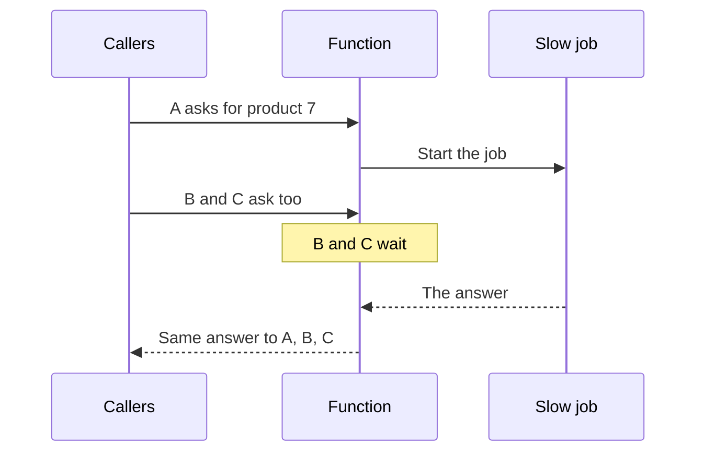

> **In one sentence:** Request coalescing means that when many requests for the same thing arrive before the first answer is back, the slow job runs only once, and all of them share its answer.

## Why should I care?

A **function** is a block of code that other code can make run. Imagine a function on your [[server]] that asks another computer for a product's details. Now 100 visitors open the same product page at the same time. Each visit runs your function, so the same slow work happens 100 times.

[[caching|Caches]] have this problem too. Fastly, which runs caches, warns that the expiry of a very popular file can cause "an immediate flood of requests" to the server.

## Analogy

Imagine the clerk from Caching, this time with an empty shelf. Here, the clerk is your function, and each customer is a piece of code that calls it. A helper's trip to the storeroom is the slow job. Ten customers arrive within a minute, and all ask for the same item.

A careless clerk sends a new helper for each customer. A clever clerk sends one helper, and says to each new customer: **"Someone has already gone to get that. Please wait."** When the helper returns, everyone gets their item.

**Where the analogy breaks down:** one real item can go to only one customer. An answer in a program can be shared.

## How it actually works

### The idea

To **call** a function means to make it run, and the code that does this is the **caller**. A job is **in flight** when it has started but its answer has not come back yet. To coalesce means to join together into one whole. Your function keeps a list of the jobs in flight:

1. On each call, look in the list. Is a job for this same thing already in flight?
2. If yes, do not start another one. Wait for that job, and share its answer.
3. If no, start the job, and write it in the list.
4. When the job finishes, remove it from the list. Everyone waiting gets the answer.

Step 4 makes this different from a cache. In this simple form, nothing is saved, so a later call starts a new job.



Here it is in three languages. Each program asks for product 7 three times at once, counts the jobs, and prints `3 answers from 1 job`. You do not need to run them. Follow the comments (after `//` or `#`), and look for the four steps. The "slow job" only waits for a tenth of a second.

### In Node.js

**Node.js** is a program that runs [[javascript|JavaScript]] outside the browser, for example on a server. Its code is often **asynchronous**: it starts a slow job, and can still respond to other things while that job runs.

A **promise** is a value in JavaScript that stands for an answer that has not arrived yet. Many callers can be given the same promise, and all get its answer.

```js
const inFlight = new Map(); // the list of jobs in flight
let jobs = 0;

// The slow job. "await" means: pause this function here,
// and let other code run until the wait is over.
async function loadProduct(id) {
  jobs++;
  await new Promise((done) => setTimeout(done, 100));
  return `product ${id}`;
}

function getProduct(id) {
  // Steps 1 and 2: already in flight? Give this caller the same promise.
  if (inFlight.has(id)) return inFlight.get(id);

  // Step 3: start the job, and write it in the list.
  // Step 4: "finally" removes it from the list when it finishes.
  const job = loadProduct(id).finally(() => inFlight.delete(id));
  inFlight.set(id, job);
  return job;
}

// Three callers at once. "then" runs when all the answers have arrived.
Promise.all([getProduct(7), getProduct(7), getProduct(7)]).then((answers) => {
  console.log(`${answers.length} answers from ${jobs} job`);
});
```

### In Python

Python has a part called `asyncio` for asynchronous code. A **task** is its name for a job that has been handed over to run. The steps are the same, with `in_flight` as the list.

```python
import asyncio

in_flight = {}  # the list of jobs in flight
jobs = 0

# The slow job. "await" means: pause here, and let other tasks run.
async def load_product(product_id):
    global jobs
    jobs += 1
    await asyncio.sleep(0.1)
    return f"product {product_id}"

def get_product(product_id):
    # Steps 1 and 2: already in flight? Give this caller the same task.
    if product_id in in_flight:
        return in_flight[product_id]

    # Step 3: start the job, and write it in the list.
    # Step 4: the "done callback" removes it from the list when it finishes.
    job = asyncio.create_task(load_product(product_id))
    job.add_done_callback(lambda _: in_flight.pop(product_id))
    in_flight[product_id] = job
    return job

# Three callers at once. "gather" waits until all the answers have arrived.
# (A real program needs more: here, cancelling one waiting caller cancels
# the job for all of them. Python's asyncio.shield can prevent that.)
async def main():
    answers = await asyncio.gather(get_product(7), get_product(7), get_product(7))
    print(f"{len(answers)} answers from {jobs} job")

asyncio.run(main())
```

### In Go

In the Go programming language, a **goroutine** is a function running at the same time as others. A package (ready-made code) called `singleflight` does all four steps for you.

```go
package main

import (
	"fmt"
	"sync"
	"sync/atomic"
	"time"

	"golang.org/x/sync/singleflight"
)

var group singleflight.Group // keeps the list of jobs in flight
var jobs atomic.Int64

// The slow job.
func loadProduct(id string) (any, error) {
	jobs.Add(1)
	time.Sleep(100 * time.Millisecond)
	return "product " + id, nil
}

func getProduct(id string) (any, error) {
	// Steps 1 to 4: Do runs the job, unless one for this id is in flight.
	// Then this caller waits, and receives the same answer.
	answer, err, _ := group.Do(id, func() (any, error) {
		return loadProduct(id)
	})
	return answer, err
}

// Three callers at once, each in its own goroutine.
// "wg.Wait" waits until all the answers have arrived.
func main() {
	answers := make([]any, 3)
	var wg sync.WaitGroup
	for i := range answers {
		wg.Add(1)
		go func() {
			defer wg.Done()
			answers[i], _ = getProduct("7")
		}()
	}
	wg.Wait()
	fmt.Printf("%d answers from %d job\n", len(answers), jobs.Load())
}
```

### Why a package helps in Go

There is a danger between steps 1 and 3: two callers might both find nothing in the list, and both start the job.

The Node.js and Python programs are safe. In Node.js, an `await` pauses only the function it is in. In Python, it pauses only the task it is in. The function that checks and writes the list has no `await`, so it finishes those steps before any other caller can run. Node.js runs JavaScript in a single thread (doing one thing at a time). Python's event loop, the part of `asyncio` that runs the tasks, "runs one Task at a time". If you put an `await` between steps 1 and 3, the danger comes back.

Goroutines can run on several threads, so two can reach the list at the same moment. The `singleflight` package makes sure "only one execution is in-flight for a given key at a time". (Here, the key is the `id`.)

Some Python and Node.js programs also use threads, which this page does not cover.

### The same idea in caches

A shared cache can do the same thing when a popular copy is missing. It sends one request to the server, and the others wait. You may also see these names:

- **Request collapsing:** Fastly's name. RFC 9111, the HTTP caching standard from June 2022, says "collapse requests".
- **Collapsed forwarding:** a setting in Squid, a cache program.
- **In-flight request deduplication:** used by the HTTPower package.

### When to be careful

- **Failures are shared too.** If the job fails, every waiting caller gets the same failure. The next call starts a new job.
- **Private answers.** A private answer must not be shared between people. So the `id` you look up must include everything that changes the answer. That may be the user, or the country if prices vary.
- **Long waits.** A slow job makes everyone wait. Fastly warns that if a cache cannot share an answer, each waiting request must go to the server alone, one after another.
- **One program only.** A second running copy of your program has its own list and its own job.

## How it came to be

The nginx web server added a setting for this, `proxy_cache_lock`, in December 2011, so the idea in caches is at least that old.

## 🧪 Try it in your browser

Type a tiny version of the same idea in the **console**, as in the JavaScript topic. It keeps one job instead of a list. You need a computer with a keyboard.

**Safety rule:** only type console code from a source you trust. This code only asks for the page you have open.

1. In Chrome, Edge or Firefox, open `https://example.com`.
2. Open the console: `Ctrl` + `Shift` + `J` on Windows (in Firefox: `Ctrl` + `Shift` + `K`), or `Cmd` + `Option` + `J` on Mac (in Firefox: `Cmd` + `Option` + `K`).
3. Click the empty line at the bottom. Your browser may block pasting, so type each line below. The browser may add brackets or show suggestions. Keep typing, check that the line looks exactly like the one below, and press `Enter` at its end.

```
var jobs = 0; var job = null
```

```
function ask() { if (!job) { jobs++; job = fetch(location.href).finally(() => job = null) } return job }
```

```
Promise.all([ask(), ask(), ask()]).then(a => console.log(a.length + " answers from " + jobs + " job"))
```

**What you should see:** after the last line, the message `3 answers from 1 job`. You can ignore other lines, such as `undefined`. If you see a red error, check your typing and try again.

**Now run the last line again:** press the up arrow key, then `Enter`. You should see `3 answers from 2 job`. The count is a running total. The three new calls shared one new job, because the first had finished.

## Common misunderstandings

- **"This is the same as caching."** No. A cache saves an answer for **later** calls. Coalescing combines calls that are waiting **now**.
- **"Some callers get thrown away."** No. The extra callers wait and share the answer. The extra jobs never start.

## Recap

- When many callers ask for the same thing at once, only the first starts the job. The others wait for it.
- All of them share that one answer.
- Caches do this too, under other names, such as request collapsing.

## Sources

- Fastly Documentation, Request collapsing: https://www.fastly.com/documentation/guides/concepts/edge-state/cache/request-collapsing/
- RFC 9111, HTTP Caching (June 2022): https://www.rfc-editor.org/rfc/rfc9111
- nginx documentation, ngx_http_proxy_module (proxy_cache_lock): https://nginx.org/en/docs/http/ngx_http_proxy_module.html
- nginx, Changes in version 1.1.12 (26 December 2011): https://nginx.org/en/CHANGES-1.2
- Squid configuration, collapsed_forwarding: https://www.squid-cache.org/Doc/config/collapsed_forwarding/
- HTTPower documentation, Dedup: https://httpower.hexdocs.pm/HTTPower.Middleware.Dedup.md
- Wiktionary, coalesce: https://en.wiktionary.org/wiki/coalesce
- Node.js, About Node.js: https://nodejs.org/en/about
- Node.js, Overview of Blocking vs Non-Blocking: https://nodejs.org/en/learn/asynchronous-work/overview-of-blocking-vs-non-blocking
- MDN Web Docs, Introducing asynchronous JavaScript: https://developer.mozilla.org/en-US/docs/Learn_web_development/Extensions/Async_JS/Introducing
- MDN Web Docs, Promise: https://developer.mozilla.org/en-US/docs/Web/JavaScript/Reference/Global_Objects/Promise
- MDN Web Docs, Promise.all(): https://developer.mozilla.org/en-US/docs/Web/JavaScript/Reference/Global_Objects/Promise/all
- MDN Web Docs, Promise.prototype.finally(): https://developer.mozilla.org/en-US/docs/Web/JavaScript/Reference/Global_Objects/Promise/finally
- MDN Web Docs, JavaScript execution model: https://developer.mozilla.org/en-US/docs/Web/JavaScript/Reference/Execution_model
- MDN Web Docs, Window.fetch(): https://developer.mozilla.org/en-US/docs/Web/API/Window/fetch
- Python documentation, Coroutines and Tasks: https://docs.python.org/3/library/asyncio-task.html
- Go packages, singleflight: https://pkg.go.dev/golang.org/x/sync/singleflight
- The Go Programming Language, Effective Go: https://go.dev/doc/effective_go
- Chrome for Developers, Open Chrome DevTools: https://developer.chrome.com/docs/devtools/open
- Microsoft Edge DevTools, Keyboard shortcuts: https://learn.microsoft.com/en-us/microsoft-edge/devtools/shortcuts/
- Firefox DevTools User Docs, Web Console: https://firefox-source-docs.mozilla.org/devtools-user/web_console/index.html
- Chrome for Developers, What are self-XSS attacks?: https://developer.chrome.com/blog/self-xss
- Node.js, Introduction to Node.js: https://nodejs.org/en/learn/getting-started/introduction-to-nodejs
- MDN Web Docs, Function (glossary): https://developer.mozilla.org/en-US/docs/Glossary/Function
- Varnish Software book, Why Varnish: https://docs.varnish-software.com/book/cdn/why-varnish/
- MDN Web Docs, await: https://developer.mozilla.org/en-US/docs/Web/JavaScript/Reference/Operators/await
- Chrome for Developers, Keyboard shortcuts: https://developer.chrome.com/docs/devtools/shortcuts
- Firefox DevTools User Docs, All keyboard shortcuts: https://firefox-source-docs.mozilla.org/devtools-user/keyboard_shortcuts/index.html
- Node.js, Worker threads: https://nodejs.org/api/worker_threads.html
- nginx, home page: https://nginx.org/en/
- MDN Web Docs, Window.location: https://developer.mozilla.org/en-US/docs/Web/API/Window/location
- MDN Web Docs, Location.href: https://developer.mozilla.org/en-US/docs/Web/API/Location/href
