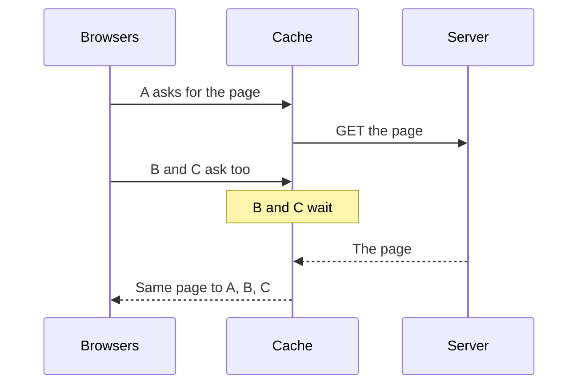

> **In one sentence:** Request coalescing means that when many requests for the same thing arrive before the first answer is back, only one request goes to the server, and all of them share its answer.

## Why should I care?

In [[caching]], you saw that a cache saves a server a lot of work. But the cache has nothing to send right away when a popular copy has expired, or was never saved. Many people may ask for the same thing at the same time, and each request can make the server do the same work again.

Fastly, which runs caches, warns that the expiry of a very popular file can cause "an immediate flood of requests". Request coalescing protects against this.

## Analogy

Imagine the **clerk and the shelf** from [[caching]]. The clerk is the cache, the customers are browsers, and the storeroom is the server. The shelf is empty. Ten customers arrive within a minute, and all ask for the same item.

A careless clerk sends a new helper to the storeroom for each customer: ten trips for one kind of item. A clever clerk sends one helper, and says to each new customer: **"Someone has already gone to get that. Please wait."** When the helper returns, everyone gets their item.

**Where the analogy breaks down:** one real item can go to only one customer. One answer from a server can be copied, so everyone can get the same answer.

## How it actually works

People say a request is **in flight** when it has been sent, but its answer has not come back yet. Without coalescing, a shared cache sends a new request to the server for each miss, even when an identical request is already in flight.

With coalescing, the shared cache does this:

1. The first request for a page is a miss, so the cache sends it to the server.
2. More requests for the same page arrive while the first is in flight. The cache does not send them on. They wait.
3. The answer comes back. The cache saves it, and uses it to answer everyone who was waiting.

Waiting can have a cost. Fastly says that, because requests are queued (put in a line to wait), "in some situations it can slow down response times to end users".



Fastly says correct use of collapsing "will substantially reduce and smooth out traffic to origin servers": fewer requests, and fewer sudden jumps.

### One idea, many names

People use several names for this idea:

- **Request coalescing:** to coalesce means to join together into one whole.
- **Request collapsing:** the name Fastly uses.
- **Collapsing requests:** the wording in the HTTP caching standard, RFC 9111. It says a cache can "combine multiple incoming requests into a single forward request upon a cache miss". (A forward request is one the cache sends on to the server.)
- **Collapsed forwarding:** the name of this setting in Squid, a cache program. (Its documentation lists the setting up to version 7.)
- **In-flight deduplication:** HTTPower, a package (ready-made code) for the Elixir programming language, uses this name. Deduplication means removing copies, and here the copies are requests in flight.

### Not only in caches

Programs can do this too, for any slow job. For the Go programming language, there is a package called `singleflight`. Its documentation says that a second request for a job already running "waits for the original to complete and receives the same results".

### When it does not work

- **Answers for one person.** If the answer is private (`Cache-Control: private`, from [[caching]]), it must not be shared with the others who are waiting. Fastly says their requests must then each be handled separately.
- **Answers the cache cannot store.** In Fastly's system, the next request in the queue then goes to the server, and the others wait again. In some cases, this can create waits of "several minutes".
- **Waiting too long.** In the nginx web server, a request that waits too long is sent on to the server anyway. In Fastly's system, a long wait can end in an error.

In nginx, the setting `proxy_cache_lock` does request coalescing for new cache entries, and it is off unless someone turns it on.

## How it came to be

The nginx web server added `proxy_cache_lock` in version 1.1.12, in December 2011, so the idea was in use by then. The HTTP caching standard from June 2022 also describes it.

## 🧪 Try it in your browser

You will type a tiny version of coalescing, and see three calls share one job. This short program runs in your browser and shows only the idea. It is not a shared cache. You will use the **console**, as in [[browser-devtools]]. You need a computer with a keyboard for this.

**Safety rule:** only type code in the console that you understand or that comes from a source you trust. The code here is safe: it only asks for the page you already have open, and it shows a message.

You do not need to understand the code. You only need to read the result.

1. In Chrome, Edge or Firefox, open `https://example.com`.
2. Open the console: `Ctrl` + `Shift` + `J` on Windows (in Firefox: `Ctrl` + `Shift` + `K`), or `Cmd` + `Option` + `J` on Mac (in Firefox: `Cmd` + `Option` + `K`).
3. Click on the empty line after the last message. Type each line below, and press `Enter` after it. A long line may wrap on your screen: press `Enter` only at its end. The browser may add a bracket or a quote mark by itself while you type. Make sure the line still looks exactly like the one below. Typing is better than pasting, because Chrome may block pasting in the console.

```
var jobs = 0; var job = null
```

```
function ask() { if (!job) { jobs++; job = fetch(location.href).finally(() => job = null) } return job }
```

```
Promise.all([ask(), ask(), ask()]).then(a => console.log(a.length + " answers from " + jobs + " job"))
```

**What you should see:** after the last line, the message `3 answers from 1 job`. The browser may also show other lines, such as `undefined` or a line with the word `Promise`. You can ignore them. If you see a red error message, nothing is broken: check your typing and try again. If you run the last line again, the number of jobs goes up by one. That is a new job, because the first one has finished. The words "2 job" are not a mistake in your typing.

**What happened:** your code asked for the answer three times. The first time started a job, which asks for this page. (The browser may answer from a saved copy. That does not change the result.) The other two found a job in flight, so they shared it.

## Common misunderstandings

- **"This is the same as caching."** No. A cache saves an answer for **later** requests. Coalescing combines requests that are waiting **now**, before any answer has been saved.
- **"Some people's requests get thrown away."** No. The extra requests wait and share the answer. Only the extra trips to the server are removed. A request can still fail, for example if the wait is too long.
- **"Any two requests can be combined."** No. They must ask for the same thing, and the answer must be safe to share.

## Recap

- When many requests for the same thing are in flight at once, coalescing sends only one to the server.
- All the waiting requests share that one answer, so the server does the work once.
- It has other names, such as request collapsing, collapsed forwarding and in-flight deduplication.

## Sources

- RFC 9111, HTTP Caching (June 2022): https://www.rfc-editor.org/rfc/rfc9111
- Fastly Documentation, Request collapsing: https://www.fastly.com/documentation/guides/concepts/edge-state/cache/request-collapsing/
- nginx documentation, ngx_http_proxy_module (proxy_cache_lock): https://nginx.org/en/docs/http/ngx_http_proxy_module.html
- nginx, Changes in version 1.1.12 (26 December 2011): https://nginx.org/en/CHANGES-1.2
- Go packages, singleflight: https://pkg.go.dev/golang.org/x/sync/singleflight
- bunny.net blog, Introducing Lock-Free Origin Request Coalescing To Reduce TTFB by Up To 90%: https://bunny.net/blog/introducing-lock-free-request-coalescing-lower-ttfb-by-90-percent
- MDN Web Docs, Promise.all(): https://developer.mozilla.org/en-US/docs/Web/JavaScript/Reference/Global_Objects/Promise/all
- Chrome for Developers, Open Chrome DevTools: https://developer.chrome.com/docs/devtools/open
- Microsoft Edge DevTools, Keyboard shortcuts: https://learn.microsoft.com/en-us/microsoft-edge/devtools/shortcuts/
- Firefox DevTools User Docs, Web Console: https://firefox-source-docs.mozilla.org/devtools-user/web_console/index.html
- Chrome for Developers, What are self-XSS attacks?: https://developer.chrome.com/blog/self-xss
- Squid configuration, collapsed_forwarding: https://www.squid-cache.org/Doc/config/collapsed_forwarding/
- Wiktionary, coalesce: https://en.wiktionary.org/wiki/coalesce
- HTTPower documentation, Dedup: https://httpower.hexdocs.pm/HTTPower.Middleware.Dedup.md
- MDN Web Docs, Window.fetch(): https://developer.mozilla.org/en-US/docs/Web/API/Window/fetch
- MDN Web Docs, Promise.prototype.finally(): https://developer.mozilla.org/en-US/docs/Web/JavaScript/Reference/Global_Objects/Promise/finally
- Wiktionary, deduplication: https://en.wiktionary.org/wiki/deduplication
- nginx, home page: https://nginx.org/en/
- MDN Web Docs, Request.cache: https://developer.mozilla.org/en-US/docs/Web/API/Request/cache
- Hex, httpower package: https://hex.pm/packages/httpower
