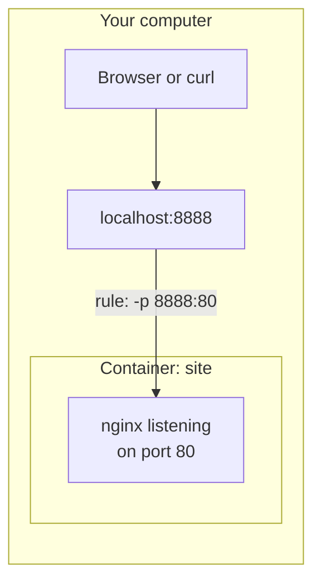

> **In one sentence:** The docker run command makes and starts a container from an image, downloading the image first if needed, and its -p option publishes a port; other commands list containers, show their logs, stop them and remove them.

## Why should I care?

In [[containers|Containers]], you learned that a container is made from an image. This page shows how to start one, reach it and clean it up, with commands typed on the [[command-line|command line]].

The commands below were run on a computer with Docker. You only need to read them; Docker does not need to be installed. Lines that start with $ are commands; you would not type the $. The other lines are what Docker printed.

## Analogy

Think of an office building with a reception desk. Each worker inside has a desk phone with an extension number. Outside callers cannot dial a desk directly. The receptionist must first get a rule: "calls to number 8888 go to the desk with extension 80."

A container is like a closed office, and its program waits for calls on its own port inside. Docker is the receptionist, and 8888 is a number on your computer.

**Where the analogy breaks down:** a receptionist can add a new rule at any time. Docker's guide says you set the rule "when the container is created, and you can't add it to one that already exists".

## How it actually works

### Client and daemon

Docker Engine, the Docker program, works as a client and a server. The **daemon**, `dockerd`, keeps running and "creates and manages" images and containers. The **client** is the `docker` command you type, which passes your command to the daemon.

### Your first container: hello-world

`docker run` "runs a command in a new container, pulling the image if needed and starting the container", says Docker's reference. `hello-world` is the name of an image on Docker Hub.

```
$ docker run hello-world
Unable to find image 'hello-world:latest' locally
latest: Pulling from library/hello-world
…
Status: Downloaded newer image for hello-world:latest

Hello from Docker!
This message shows that your installation appears to be working correctly.

To generate this message, Docker took the following steps:
 1. The Docker client contacted the Docker daemon.
 2. The Docker daemon pulled the "hello-world" image from the Docker Hub.
    (amd64)
 3. The Docker daemon created a new container from that image which runs the
    executable that produces the output you are currently reading.
 4. The Docker daemon streamed that output to the Docker client, which sent it
    to your terminal.
…
```

First, Docker downloads the image, which was not on the computer. `latest` is the **tag** Docker adds when you do not choose one. The rest is text that the program inside prints, describing what happened. You can ignore words such as `(amd64)`, `executable` and `streamed`.

### A server in the background

**nginx** is "a web server", says its Docker Hub page. A web server is a program that sends files, such as web pages, back to a browser that asks for them.

```
$ docker run -d --name site nginx
Unable to find image 'nginx:latest' locally
latest: Pulling from library/nginx
…
Status: Downloaded newer image for nginx:latest
89fc2c0ae255c9bf37e07a005cb7ab0ec0b677e3e6cf8370f661fccabac5dd57
```

- `-d` (detached) runs the container "in background and print container ID". The last line is that ID. Without `-d`, the program's output shows in your terminal until you press `Ctrl` + `C`.
- `--name site` gives the container a name to use in later commands. Without a name, Docker makes one up.
- `nginx` is the image. Docker downloaded it, as with hello-world.

### Seeing what runs: docker ps and docker logs

`docker ps` lists running containers. (Another container on the test computer is not shown. You can ignore the COMMAND column.)

```
$ docker ps
CONTAINER ID   IMAGE     COMMAND                  CREATED                  STATUS                  PORTS     NAMES
89fc2c0ae255   nginx     "/docker-entrypoint.…"   Less than a second ago   Up Less than a second   80/tcp    site
…
```

A **port** is a number that identifies a program for network messages. nginx **listens** on port 80: it waits for messages there. The PORTS column says `80/tcp`, with no arrow (you can ignore `/tcp`). Docker's guide says this means the port "is open inside the container and connected to nothing outside it". Docker says other containers on the same Docker network can still reach it.

`docker logs site` shows what the program has printed:

```
$ docker logs site
/docker-entrypoint.sh: /docker-entrypoint.d/ is not empty, will attempt to perform configuration
…
2026/11/28 11:51:58 [notice] 1#1: start worker process 48
```

### Publishing a port

Docker's guide says a container "has its own network, separate from your machine's". So its port 80 and your computer's port 80 are two different things. To reach the container from your computer, you **publish** the port with `-p`. Docker calls this "a rule that forwards traffic" (incoming network messages) "from a port on your machine to a port inside the container".

`localhost` is a name that "refers to the current computer". `curl` is "a tool for transferring data from or to a server using URLs". It prints what it receives. In Windows PowerShell, type `curl.exe` instead of `curl`. Before publishing, nothing answered (you can ignore the numbers in the error):

```
$ curl http://localhost:8888
curl: (7) Failed to connect to localhost port 8888 after 2255 ms: Couldn't connect to server
```

A rule can be added only when a container is created. So the first container was removed. `docker rm -f` "stops a container and removes it in one go", says Docker's guide. Then a new one started with a rule:

```
$ docker rm -f site
site
$ docker run -d --name site -p 8888:80 nginx
730e688f1e2ffc9f01238bc7b12e2753e060718878a91f55eba5b853ee51c902
$ docker ps
CONTAINER ID   IMAGE     COMMAND                  CREATED                  STATUS                  PORTS                                     NAMES
730e688f1e2f   nginx     "/docker-entrypoint.…"   Less than a second ago   Up Less than a second   0.0.0.0:8888->80/tcp, [::]:8888->80/tcp   site
…
```

`-p 8888:80` reads as `HOST_PORT:CONTAINER_PORT`. The left number is the port on your computer. The left number can differ, if no other program on your computer uses that port. The right number is the port nginx listens on inside. The new container has a new ID.

The arrow in PORTS shows the rule. `0.0.0.0` and `[::]` mean all of your computer's network addresses: Docker's guide calls `[::]` "the same rule for IPv6". Now curl gets nginx's welcome page:

```
$ curl http://localhost:8888
<!DOCTYPE html>
<html>
<head>
<title>Welcome to nginx!</title>
…
```

The `:8888` in the address means "connect to port 8888". Without it, an address that starts with `http://` uses port 80.



Docker warns that "Publishing container ports is insecure by default". With the default rule, other computers on your network can reach it too. `127.0.0.1` is "the standard address for IPv4 loopback": an address that means this computer, like `localhost`. With `-p 127.0.0.1:8888:80`, only your computer can reach the port.

### Stopping and removing

- `docker stop` asks the container's main program to end, and forces it to end after a waiting time.
- `docker ps -a` shows all containers. Without `-a`, `docker ps` "only shows running containers by default".
- `docker rm` removes a stopped container. It refuses a running one unless you add `-f`.

Some columns are cut in the `docker ps -a` output.

```
$ docker stop site
site
$ docker ps -a
CONTAINER ID   IMAGE         …   STATUS                              …   NAMES
730e688f1e2f   nginx         …   Exited (0) Less than a second ago   …   site
86529d7a643c   hello-world   …   Exited (0) 15 seconds ago           …   interesting_pare
…
$ docker rm site
site
```

The number in `Exited (0)` is the program's exit code, and Docker treats a non-zero code as an error. So 0 means it ended without an error. The hello-world container got a made-up name, `interesting_pare`.

Each container gets "its own thin writable layer on top of the image", where everything its program writes lands. So running a container never changes the image. A stopped container keeps its changes, and `docker start` runs it again. Removing it deletes the container and that layer. Those changes are gone unless you kept them outside the container.

## How it came to be

Wikipedia says "Docker debuted to the public in Santa Clara at PyCon in 2013".

## 🧪 Try it in your browser

Docker's guide has practice terminals. You need no account.

1. In Chrome, Edge or Firefox, open `https://docs.docker.com/learn/content/run-your-first-container/`. The heading is **Run your first container**. The page may look different.
2. Near the top, the guide says the terminals "are simulated". You can "click through them to see what each command does and what it prints".
3. Find **Step 2: Start a container**. Its terminal shows `docker run -d --name todo todo-app`, then `docker ps` and `docker logs`. Further down, a `curl` command fails.
4. Find **Step 3: Publish a port**. Its terminal removes the old container with `docker rm -f todo`, then starts a new one with `-p 3000:3000`. Here, both numbers happen to be 3000.

**What you should see:** commands like those on this page, for a to-do app. In Step 3, the PORTS column shows an arrow, and `curl` gets an answer.

## Common misunderstandings

- **"The container's port is open on my computer."** No. Until you publish it with `-p`, you cannot reach it through your computer's own ports, such as `localhost:8888`.
- **"docker stop deletes the container."** No. A stopped container still shows in `docker ps -a`. `docker rm` deletes it.

## Recap

- `docker run` makes and starts a new container from an image, downloading the image first if needed. `-d` runs it in the background, and `--name` names it.
- Your computer's ports lead into a container only after you publish one with `-p HOST_PORT:CONTAINER_PORT`.
- `docker ps -a` lists containers and `docker logs` shows their output. `docker stop` stops one, and `docker rm` deletes it with its changes.

## Sources

- Docker Learn, Run your first container: https://docs.docker.com/learn/content/run-your-first-container/
- Docker Docs, docker container run (reference): https://docs.docker.com/reference/cli/docker/container/run/
- Docker Docs, docker container ls (reference): https://docs.docker.com/reference/cli/docker/container/ls/
- Docker Docs, docker container logs (reference): https://docs.docker.com/reference/cli/docker/container/logs/
- Docker Docs, docker container stop (reference): https://docs.docker.com/reference/cli/docker/container/stop/
- Docker Docs, docker container rm (reference): https://docs.docker.com/reference/cli/docker/container/rm/
- Docker Docs, Port publishing and mapping: https://docs.docker.com/engine/network/port-publishing/
- Docker Docs, Docker Engine: https://docs.docker.com/engine/
- Docker Hub, hello-world (Docker Official Image): https://hub.docker.com/_/hello-world
- Docker Hub, nginx (Docker Official Image): https://hub.docker.com/_/nginx
- MDN Web Docs, What is a web server?: https://developer.mozilla.org/en-US/docs/Learn_web_development/Howto/Web_mechanics/What_is_a_web_server
- curl, man page: https://curl.se/docs/manpage.html
- Microsoft Learn, curl on Windows: https://learn.microsoft.com/en-us/windows/curl/
- Wikipedia, Localhost: https://en.wikipedia.org/wiki/Localhost
- Wikipedia, Port (computer networking): https://en.wikipedia.org/wiki/Port_(computer_networking)
- Wikipedia, Docker (software): https://en.wikipedia.org/wiki/Docker_(software)
