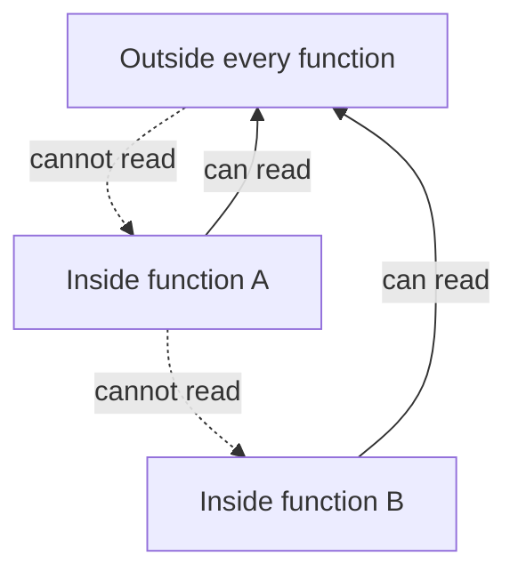

> **In one sentence:** A variable's scope is the part of the code where you can use it, and it depends on where the variable was created.

## Why should I care?

In [[functions|Functions]], you saw that a variable created inside a function cannot be used outside it. That rule has a name: **scope**. Scope is the part of the code where a name, such as a variable's name, can be used. Wikipedia puts it as the part of a program where a name "is valid".

Use a variable outside its scope, and your program fails. In Python, and in JavaScript in Chrome, Edge and Firefox, it stops with an error that says the name is "not defined". In Go, the program does not start at all. So scope is one thing to check when you meet these errors.

## Analogy

Think of an office building. A notice board in the hallway can be read by everyone in the building. Each office also has its own notice board, which only people inside that office can read. People in an office can step out and read the hallway board too.

Two boards can hold a note with the same title, such as "Lunch time". Inside an office, people follow their own office's note.

**Where the analogy breaks down:** a person in the hallway can walk into an office and read its board. Code outside a function can never read the function's variables. Also, the analogy covers reading. Of the three languages on this page, only in Python does giving a hallway note a new value from inside a function need an extra word, `global`.

## How it actually works

The examples come in [[javascript|JavaScript]], [[python|Python]] and [[go-language|Go]]. You only need to read one tab. Each example is a separate program.

### Local: made inside a function

A variable created inside a function is a **local variable**. Its scope is that function, so code outside the function cannot use it.

<!-- tabs -->

### JavaScript

```js
function makeTea() {
  const drink = "tea"; // drink exists only inside makeTea
  console.log(drink);  // shows tea
}

makeTea();
console.log(drink);    // error: drink is not defined
```

This shows `tea`. Then the program stops with an error message, a `ReferenceError`. In Chrome, Edge and Firefox, it says `drink is not defined`. Other browsers may word it differently.

### Python

```python
def make_tea():
    drink = "tea"  # drink exists only inside make_tea
    print(drink)   # shows tea

make_tea()
print(drink)       # error: drink does not exist here
```

The word `def` starts a function definition, and the indented lines below it are its body. `print` shows a value.

This shows `tea`. Then the program stops with an error message. Its last line names the kind of error, `NameError`. Python's documentation says the message includes the name that could not be found, here `drink`.

### Go

```go
package main

import "fmt"

func makeTea() {
	drink := "tea" // drink exists only inside makeTea
	fmt.Println(drink)
}

func main() {
	makeTea()
	fmt.Println(drink) // not allowed: drink does not exist here
}
```

The word `func` starts a function definition, and `:=` creates a new variable with a value. Go starts the program by calling `main`. `fmt.Println` shows a value.

This shows nothing. The `go run` command runs a Go program, but first it compiles it: it translates it into another form the computer can run. Here the compiler, the tool that does this, reports an error. So the program never starts.

Go's documentation shows this kind of error as `undefined:` followed by the name, here `drink`.

<!-- /tabs -->

### Global: made outside every function

A variable can also be created outside every function. Code inside functions can then read it. MDN, which documents JavaScript, calls this a **global variable**: one that is "visible from all other scopes".

<!-- tabs -->

### JavaScript

```js
let visits = 0; // created outside every function

function addVisit() {
  visits = visits + 1; // code inside a function can change it
}

addVisit();
addVisit();
console.log(visits); // shows 2
```

This shows `2`. Each call to `addVisit` changed the same `visits`.

### Python

```python
visits = 0  # created outside every function

def add_visit():
    global visits  # use the global visits, not a new local one
    visits = visits + 1

add_visit()
add_visit()
print(visits)  # shows 2
```

This shows `2`. Each call to `add_visit` changed the same `visits`.

A function can read a global variable without any extra word. To give it a new value, the function needs the `global` line. Python's FAQ explains this rule. Without that line, the assignment makes `visits` local to the whole function. So the right side, `visits + 1`, reads a local `visits` that has no value yet. The program stops with an error message that names `UnboundLocalError`. The FAQ adds that requiring `global` for assigned variables "provides a bar against unintended side-effects". In plain words, it protects against changes you did not mean to make.

### Go

```go
package main

import "fmt"

var visits = 0 // created outside every function

func addVisit() {
	visits = visits + 1 // code inside a function can change it
}

func main() {
	addVisit()
	addVisit()
	fmt.Println(visits) // shows 2
}
```

This shows `2`. Each call to `addVisit` changed the same `visits`.

Outside a function, `:=` is not allowed, so the word `var` creates the variable. A **package** is a group of Go files that belong together, here the package `main`. Go's specification says that a variable created outside every function can be used in the whole package. It calls this scope the **package block**. This block has no `{` and `}`. The specification counts it as a block anyway.

<!-- /tabs -->

So why not make every variable global? Wikipedia says global variables "are frequently considered bad practice, at least in some languages". The reasons it gives are "name collisions and unintentional masking, together with poor modularity". Modularity means organizing a program's code into independent parts. A name collision is when the same variable name is used for different things. Masking is explained next.



### The same name inside and outside

A function can create a local variable with the same name as a global one. They are two separate variables. Once the local one exists, the name inside the function means the local one. Wikipedia calls this **variable shadowing**, a kind of masking: the inner name hides the outer one.

<!-- tabs -->

### JavaScript

```js
const color = "blue"; // created outside every function

function paint() {
  const color = "red"; // a new, separate color, only inside paint
  console.log(color);  // shows red
}

paint();
console.log(color);    // shows blue
```

This shows `red`, then `blue`. The `color` inside `paint` did not change the one outside.

### Python

```python
color = "blue"  # created outside every function

def paint():
    color = "red"  # a new, separate color, only inside paint
    print(color)   # shows red

paint()
print(color)       # shows blue
```

This shows `red`, then `blue`. With no `global` line, the assignment inside `paint` creates a new local `color`. It does not change the one outside. Unlike `visits = visits + 1`, the line `color = "red"` reads nothing first, so it works.

### Go

```go
package main

import "fmt"

var color = "blue" // created outside every function

func paint() {
	color := "red"     // a new, separate color, only inside paint
	fmt.Println(color) // shows red
}

func main() {
	paint()
	fmt.Println(color) // shows blue
}
```

This shows `red`, then `blue`. The `:=` inside `paint` creates a new `color`. It does not change the one outside. With `=` in its place, the line would give a new value to the `color` outside, and the program would show `red` twice.

<!-- /tabs -->

### Blocks

In [[conditions|Conditions]], a **block** was the code that runs together under an `if`. Whether a block makes its own scope depends on the language.

<!-- tabs -->

### JavaScript

```js
const hour = 9;

if (hour < 12) {
  let message = "Good morning"; // message exists only in this block
  console.log(message);         // shows Good morning
}

console.log(message);           // error: message is not defined
```

This shows `Good morning`. Then the program stops with an error message that says `message is not defined`.

MDN says `let` and `const` variables are "scoped to blocks as well as functions". So a block, the code between `{` and `}`, makes its own scope for them.

JavaScript also has an older word for creating variables, `var`. MDN says blocks do not limit `var` variables. This page uses only `let` and `const`.

### Python

```python
hour = 9

if hour < 12:
    message = "Good morning"  # this does not make a new scope

print(message)  # shows Good morning
```

This shows `Good morning`. In Python, the indented lines under an `if` or a `for` do not make a new scope. Python's reference lists the kinds of code that count as a block with its own scope. A function body is on the list, and `if` and `for` are not.

So `message` can be used after the `if`. But it exists only if that line ran. With `hour = 15`, the condition is false, `message` is never created, and the last line stops with a `NameError`.

### Go

```go
package main

import "fmt"

func main() {
	hour := 9

	if hour < 12 {
		message := "Good morning" // message exists only in this block
		fmt.Println(message)
	}

	fmt.Println(message) // not allowed: message does not exist here
}
```

This shows nothing. The compiler reports an error, `undefined:` followed by `message`, and the program never starts.

Go's specification says the scope of a variable created inside a function "ends at the end of the innermost containing block". A block is the code between `{` and `}`. The specification adds that each `if` and each `for` counts as being in its own block.

<!-- /tabs -->

## How it came to be

Wikipedia says that block scope "began with ALGOL 60", a programming language. ALGOL 60 was discussed at a meeting in Paris, held "from January 11 to 16, 1960".

Its revised report says: "Every block automatically introduces a new level of nomenclature." In plain words, each block gets its own set of names. What a name created in a block stands for "has no existence outside it".

## 🧪 Try it in your browser

These steps use JavaScript, because the browser's console runs JavaScript. In it, `function` starts a function definition, and `return` gives a value back. `let` creates a variable. `if (true)` runs its block, because its condition is always true. `console.log` shows a value. You need a computer with Chrome, Edge or Firefox.

**Safety rule:** only type code in the console that you understand or that comes from a source you trust. Never paste anything a stranger sends you. The lines below define and call one function, run one block, and show values or error messages in the console.

1. Open [example.com](https://example.com/).
   **What you should see:** a short page. It says the domain is for use in documentation examples.
2. Open the **console**:
   - **Windows:** press `Ctrl` + `Shift` + `J` (in Firefox: `Ctrl` + `Shift` + `K`)
   - **Mac:** press `Cmd` + `Option` + `J` (in Firefox: `Cmd` + `Option` + `K`)
3. Click the line where you can type, below any messages. In each step below, **type** the line yourself (some browsers may block pasting at first), then press `Enter`. The browser may show suggestions, and the line may look different while you type. Keep typing.

   ```
   function makeNote() { let note = "inside"; return note }
   ```

   **What you should see:** no result of its own. The console may also show `undefined`. That is normal: the function is defined, not called. If `Enter` gives a new line and no answer, a bracket is probably still open. Reload the page and start again from step 3.
4. Call the function:

   ```
   makeNote()
   ```

   **What you should see:** the word inside, the value the function gave back.
5. Try to use the local variable from outside the function:

   ```
   note
   ```

   **What you should see:** an error message that says `note is not defined`. This error is expected: `note` exists only inside `makeNote`.
6. Create a variable inside a block. In JavaScript, a variable made with `let` inside `{` and `}` stays inside that block. In Python, a variable made under an `if` would still exist after it.

   ```
   if (true) { let box = "in the block"; console.log(box) }
   ```

   **What you should see:** `in the block`, from `console.log`. The console may also show `undefined`.
7. Try to use it after the block:

   ```
   box
   ```

   **What you should see:** an error message that says `box is not defined`. This error is expected too.

**If something goes wrong:** if you see an error message at step 3, 4 or 6, look for a typo. Then reload the page and start again from step 3.

## Common misunderstandings

- **"Two variables with the same name are always the same variable."** No. A variable created inside a function is separate from one with the same name outside it. In this page's examples, giving the inner one a value leaves the outer one as it was.
- **"Every language makes a new scope for each block."** No. In Go, and for JavaScript's `let` and `const`, a block makes its own scope. In Python, an `if` or `for` does not.

## Recap

- Scope is the part of the code where a variable can be used. Using a variable outside its scope gives an error.
- A variable created inside a function is local to it. A global variable, created outside every function, can be read inside functions. But Wikipedia says global variables are frequently considered bad practice, at least in some languages.
- An inner variable with the same name hides the outer one. Whether a block makes its own scope depends on the language.

## Sources

- MDN Web Docs, Scope (glossary): https://developer.mozilla.org/en-US/docs/Glossary/Scope
- MDN Web Docs, let: https://developer.mozilla.org/en-US/docs/Web/JavaScript/Reference/Statements/let
- MDN Web Docs, const: https://developer.mozilla.org/en-US/docs/Web/JavaScript/Reference/Statements/const
- MDN Web Docs, Global variable (glossary): https://developer.mozilla.org/en-US/docs/Glossary/Global_variable
- MDN Web Docs, ReferenceError: "x" is not defined: https://developer.mozilla.org/en-US/docs/Web/JavaScript/Reference/Errors/Not_defined
- MDN Web Docs, function: https://developer.mozilla.org/en-US/docs/Web/JavaScript/Reference/Statements/function
- MDN Web Docs, return: https://developer.mozilla.org/en-US/docs/Web/JavaScript/Reference/Statements/return
- MDN Web Docs, if...else: https://developer.mozilla.org/en-US/docs/Web/JavaScript/Reference/Statements/if...else
- MDN Web Docs, console.log(): https://developer.mozilla.org/en-US/docs/Web/API/console/log_static
- MDN Web Docs, eval(): https://developer.mozilla.org/en-US/docs/Web/JavaScript/Reference/Global_Objects/eval
- Python Tutorial, Classes (Python Scopes and Namespaces): https://docs.python.org/3/tutorial/classes.html
- Python Tutorial, More Control Flow Tools: https://docs.python.org/3/tutorial/controlflow.html
- Python Language Reference, Execution model: https://docs.python.org/3/reference/executionmodel.html
- Python Language Reference, Simple statements: https://docs.python.org/3/reference/simple_stmts.html
- Python documentation, Programming FAQ: https://docs.python.org/3/faq/programming.html
- Python documentation, Built-in Exceptions: https://docs.python.org/3/library/exceptions.html
- Python Tutorial, Errors and Exceptions: https://docs.python.org/3/tutorial/errors.html
- The Go Programming Language Specification: https://go.dev/ref/spec
- Go Packages, fmt: https://pkg.go.dev/fmt
- Gopls, Diagnostics: https://go.dev/gopls/features/diagnostics
- Go Packages, Command go: https://pkg.go.dev/cmd/go
- Wikipedia, V8 (JavaScript engine): https://en.wikipedia.org/wiki/V8_(JavaScript_engine)
- Python Tutorial, An Informal Introduction to Python: https://docs.python.org/3/tutorial/introduction.html
- Wikipedia, Naming collision: https://en.wikipedia.org/wiki/Naming_collision
- MDN Web Docs, Compile (glossary): https://developer.mozilla.org/en-US/docs/Glossary/Compile
- Wikipedia, Modular programming: https://en.wikipedia.org/wiki/Modular_programming
- Firefox DevTools User Docs, The JavaScript input interpreter: https://firefox-source-docs.mozilla.org/devtools-user/web_console/the_command_line_interpreter/index.html
- Wikipedia, Scope (computer science): https://en.wikipedia.org/wiki/Scope_(computer_science)
- Revised Report on the Algorithmic Language Algol 60: https://www.masswerk.at/algol60/report.htm
- Example Domain: https://example.com/
- Chrome for Developers, Open Chrome DevTools: https://developer.chrome.com/docs/devtools/open
- Microsoft Edge DevTools, Keyboard shortcuts: https://learn.microsoft.com/en-us/microsoft-edge/devtools/shortcuts/
- Microsoft Edge DevTools, Run JavaScript in the Console: https://learn.microsoft.com/en-us/microsoft-edge/devtools/console/console-javascript
- Firefox DevTools User Docs, Web Console: https://firefox-source-docs.mozilla.org/devtools-user/web_console/index.html
- Chrome for Developers, What are self-XSS attacks?: https://developer.chrome.com/blog/self-xss
