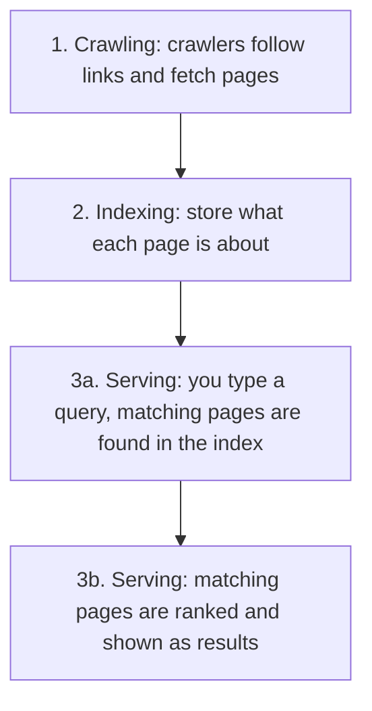

> **In one sentence:** A search engine finds web pages ahead of time with programs called crawlers, stores what each page is about in a huge index, and when you search, picks and sorts the matching pages from that index.

## Why should I care?

You type a few words into a search engine, and in a moment you get a list of pages from all over the [[world-wide-web|World Wide Web]].

But the search engine does not visit the whole web when you press `Enter`. Most of the work was done before you asked.

This page follows Google's own description. Other search engines have their own ways of working.

## Analogy

Think of the **index at the back of a book**. It lists words, and for each word, the pages where it appears. To find a topic, you do not read the whole book. You look it up in the index.

Google itself says its index is "like the index in the back of a book - with an entry for every word seen on every webpage we index."

**Where the analogy breaks down:** a book's index is made once, for one book that does not change. A search engine's index covers a huge number of pages that keep changing, so programs keep updating it. Also, a book's index only tells you where a word is. A search engine also **sorts** the pages, and tries to put the most useful first.

## How it actually works

Google describes its search engine as working in three stages: **crawling**, **indexing** and **serving search results**. It also says that "not all pages make it through each stage": some pages stop at one stage and never reach the next.

### 1. Crawling: finding and fetching pages

A **crawler** is a program that visits web pages automatically. Google's crawler is called **Googlebot**. Google says it is "also known as a crawler, robot, bot, or spider".

Google says: "There isn't a central registry of all web pages." So Google must keep looking for new and updated pages. One way is to follow links: when a known page links to a new page, the crawler learns that the new page exists.

Every page lives on a [[server]]. The crawler acts as a client: it sends a request to that server, which sends the page back, as it would to your browser.

### 2. Indexing: understanding and storing

After a page is crawled, Google "tries to understand what the page is about". (A program does not understand like a person. Here it means that Google's programs analyze the words, pictures and videos on the page.) Then it stores this information in the **Google index**, which Google calls "a large database". (A **database** is a storage system for organized data, which makes the data easier to search.)

Google says its index "covers hundreds of billions of webpages and is well over 100,000,000 [[data-size-units|gigabytes]] in size." But it also says: "Indexing isn't guaranteed". Not every page that Google crawls and analyzes is stored in the index.

### 3. Serving results: your search

The words you type into a search engine are called a **query**. When you send one, Google says its computers "search the index for matching pages". They do not search the live web.

Then the matches are **ranked**: put in order. Google says it tries to return "the highest quality and most relevant" results. Its ranking looks at many clues, which Google calls **signals**, such as the words of your query. (This is a different meaning of "signal" from an electrical signal.) It can also use your location, language and device. Google's example: a search for "bicycle repair shops" shows different results to a person in Paris than to a person in Hong Kong.

(This is simplified. Each stage has many more steps.)

### Ads in the results

Some results are **ads**: a business paid to show them. Google says its ads are "clearly labeled" and that "for most searches, we show no ads at all." In October 2025, Google announced that ads made of text are grouped under a label that says **"Sponsored results"**. Other ads, such as ads for products, have labels that also start with "Sponsored".

Google also says it "doesn't accept payment to rank pages higher". Paying for an ad buys a place in the ad section, not a better place in the normal results.

## How it came to be

Google's story "begins in 1995 at Stanford University", where Larry (Lawrence) Page and Sergey Brin met. In 1998, they described Google in a paper. Their prototype, a first working version, had a database of "at least 24 million pages". In August 1998, the company Google Inc. was officially started.

## 🧪 Try it in your browser

You will ask a search engine for results from only one website. This changes nothing on your computer, and you need no account. It works in Chrome, Edge and Firefox, and on a phone.

1. Open [www.google.com](https://www.google.com). Google may show its page in your language. That is fine. If a box with a message appears first, close it with one of its buttons: for this exercise, either choice is fine.
2. In the search box, type `site:info.cern.ch` and press `Enter`. There is no space after the colon. (On a phone, check that the keyboard did not add one.) `site:` is a **search operator**: a special word that changes how the search works. It asks only for results from one website, here the one at the [[domain-name|domain name]] `info.cern.ch`.
3. **What you should see:** a list of results. Near each result's title is its address. Google calls it the "visible URL", and says it has "two parts: domain and breadcrumb". Here, every domain part is `info.cern.ch`. That is the home of the first website, which you met in [[world-wide-web|The World Wide Web]].
4. Optional: search for something people buy, such as `running shoes`. **What you might see:** a few results under a label that starts with **"Sponsored"**. Those are ads. For many searches there are no ads at all.

Google warns that `site:` does not always show every page it has indexed. So the number of results is not the number of pages on that website.

## Common misunderstandings

- **"If a page is not in the results, it does not exist."** Not true. Google says its crawler does not crawl every page it discovers, and not every page is indexed. Google also suggests protecting a page with a password as one way to keep it out of its results.
- **"The first result must be true."** No. Ranking is done by programs that look for relevant, high-quality pages. In 1998, Google's founders wrote that on the web "anyone can publish anything they want." A high place means the programs judged the page a good match, not that it is correct. Check who wrote it.

## Recap

- A search engine works in three stages: crawling (fetching pages), indexing (storing what each page is about), and serving results.
- When you search, you search the index, not the live web. The index does not hold every page.
- Ads are labeled "Sponsored". A high place in the results is not proof that a page is true.

## Sources

- Google Search Central, In-depth guide to how Google Search works: https://developers.google.com/search/docs/fundamentals/how-search-works
- Google Search, Organizing information: https://www.google.com/intl/en_us/search/howsearchworks/how-search-works/organizing-information/
- Google Search, Ranking results: https://www.google.com/intl/en_us/search/howsearchworks/how-search-works/ranking-results/
- Google Search, Showing ads related to your search: https://www.google.com/intl/en_us/search/howsearchworks/our-approach/ads-on-search/
- Google Search Central, Googlebot: https://developers.google.com/search/docs/crawling-indexing/googlebot
- Google Search Central, Introduction to robots.txt: https://developers.google.com/search/docs/crawling-indexing/robots/intro
- MDN Web Docs, Database (glossary): https://developer.mozilla.org/en-US/docs/Glossary/Database
- Google Search Central, site: search operator: https://developers.google.com/search/docs/monitor-debug/search-operators/all-search-site
- Google blog, Sponsored results label (2025): https://blog.google/products/ads-commerce/google-search-sponsored-results-label/
- Sergey Brin and Lawrence Page, The Anatomy of a Large-Scale Hypertextual Web Search Engine (1998): https://research.google/pubs/the-anatomy-of-a-large-scale-hypertextual-web-search-engine/
- Google, Our story: https://about.google/our-story/
- CERN, info.cern.ch: https://info.cern.ch/
- Google Search Central, Visual elements gallery: https://developers.google.com/search/docs/appearance/visual-elements-gallery
