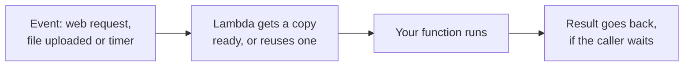

> **In one sentence:** A serverless function is a function you give to a cloud provider, which runs it on its own servers each time an event happens, such as a web request; for AWS Lambda Event Functions, you pay for each request and for running time, priced by the memory you choose.

## Why should I care?

In [[server|Server]], you met server computers. Someone must set up and look after each one. With serverless functions, you write a [[functions|function]], and a cloud company runs it when needed. Amazon Web Services (AWS) says its service, Lambda, lets you "run code without provisioning or managing servers". To **provision** means to set up.

## Analogy

Think of **calling a taxi** instead of owning a car. You do not buy or repair it. It comes when you call, and you pay per trip.

**Where the analogy breaks down:** one taxi makes one trip at a time, but AWS says Lambda "is designed to run many instances of your functions in parallel": many copies at once. Also, each run has a time limit.

## How it actually works

### "Serverless" still uses servers

Wikipedia says: "*Serverless* is a misnomer in the sense that servers are still used by cloud service providers to execute code for developers." A misnomer is a wrong name. A **cloud provider** is a company that offers [[cloud-computing|cloud computing]]: AWS calls it "the on-demand delivery of IT resources over the Internet". AWS says that "The cloud provider manages the server resources your application runs on."

### A function that waits for an event

An **event** is something that happens. A **trigger** connects your function to where events come from. Three examples:

- **A web request.** A **function URL** is a web address for one function, which you can call "by using a web browser".
- **A file uploaded.** For example, a file added to [[object-storage|Amazon S3]], AWS's "object storage service".
- **A timer.** AWS's scheduler service can call your function on "recurring patterns", or once at a chosen time.

Then Lambda runs your function. AWS says "Data about the event that caused the function to run is passed directly to the handler": the function Lambda calls.



### Copies when needed, none when idle (unused)

Each copy of your function runs in an **execution environment**. AWS says Lambda "creates and destroys execution environments in response to traffic": to the requests coming in.

AWS's general serverless page says that "if there's no usage, the environment can scale to zero": no copies. Lambda keeps a finished copy "for some time" in case another request comes.

### Paying for use

AWS says "Lambda Event Functions are priced per request and execution duration". And "Duration cost depends on the amount of memory you allocate to your function." AWS's general serverless page says "You pay nothing for idle resources", but Lambda has exceptions. An option called Provisioned Concurrency, which keeps copies ready in advance, is billed "for the period of time you configure it". Also, "You may incur additional charges if your Lambda function utilizes other AWS services or transfers data."

AWS stops some loops, where a function keeps calling itself, but "When another AWS service such as Amazon DynamoDB forms part of the loop, Lambda can't currently detect and stop it." A function URL can also let "any user" call it, if set up that way. No spending limit applies unless you set one (see [[cloud-costs|Paying for the Cloud]]).

### Limits

Each function has a **timeout**: the longest one call can run. In November 2026, AWS said the default is "3 seconds", and you can raise it "up to a maximum value of 1,800 seconds (30 minutes)", except in a few special setups.

AWS also says "You should not assume that the execution environment will persist indefinitely". A value saved in one run may be gone in the next.

### The first request can be slower

A new copy needs time to start: AWS says Lambda "downloads your code, starts the environment", and runs setup code. About this **cold start**, AWS says: "You are charged for this time, and it adds latency", a delay.

## How AWS does it

This page describes the original kind of **AWS Lambda** function, which AWS now calls an **Event Function**. AWS also offers other kinds, such as Web Functions, that work and are priced differently.

- **Handler:** "the method in your function code that processes events" (a method is a kind of function). There is only one per function.
- **Runtime:** "a language-specific environment" that passes events and answers between Lambda and your function. AWS provides runtimes "for Java, Python, Node.js, .NET, and Ruby": programming languages and tools.
- **Packaging:** you send your code as a .zip file or as a container image. A [[containers|container]] packs a program with what it needs to run.

### A tiny handler

AWS's examples pass an event written in **JSON**, which MDN (a website that documents web technologies) calls "a data-interchange format": a way to write data for programs to pass around. Each line inside the curly brackets is a name and a value, such as the name `"item"` and the value `"Wireless Headphones"`. AWS's example event, for an order:

```json
{
    "order_id": "12345",
    "amount": 199.99,
    "item": "Wireless Headphones"
}
```

AWS says the event's "exact format" depends on "the service that's invoking your function". The handlers below, adapted from AWS's examples, expect this order event. You only need to read one tab.

<!-- tabs -->

### JavaScript

This uses Lambda's [[nodejs|Node.js]] runtime. Node.js runs JavaScript "outside of the browser".

```js
// Lambda calls this function for each event.
export const handler = (event) => {
  // event holds the data about what happened.
  const item = event.item;
  // The returned value goes back to whoever called the function.
  return "Received an order for " + item;
};
```

- `(event) => { ... }` is an **arrow function**, a shorter way to write a function, with the parameter `event`.
- `const handler =` stores that function in a variable named `handler`, created with `const`.
- `export` lets code outside this file use `handler`, so Lambda can find it.
- AWS says Lambda converts the JSON event "to an object" (a set of named values) before passing it in. `event.item` reads the value named `item` in it.
- With the example event, the function returns `Received an order for Wireless Headphones`.

In the function's settings, you name it `index.handler`: `handler` in the JavaScript file `index.mjs`.

### Python

```python
# Lambda calls this function for each event.
def lambda_handler(event, context):
    # event holds the data about what happened.
    item = event["item"]
    # The returned value goes back to whoever called the function.
    return "Received an order for " + item
```

- The handler has two parameters, because AWS says it "must take two arguments". The first, `event`, holds the event. The second, `context`, holds information about this call.
- Lambda turns a JSON object event into a Python **dictionary**: a set of "key: value" pairs. `event["item"]` reads the value whose key is `"item"`.
- With the example event, the function returns `Received an order for Wireless Headphones`.

In the function's settings, you name it `lambda_function.lambda_handler`: the function `lambda_handler` in the file `lambda_function.py`.

<!-- /tabs -->

## How it came to be

On November 13, 2014, AWS announced Lambda as "a compute service that runs your code in response to events".

## 🧪 Try it in your browser

You will look at a public AWS page, with no account. On a phone, scroll the tables sideways. The page may look different.

1. In Chrome, Edge or Firefox, open `https://docs.aws.amazon.com/lambda/latest/dg/gettingstarted-limits.html`. The heading is "Lambda quotas" (quotas: limits).
2. Scroll past the first table, **Compute and storage**. Under the next heading, **Function configuration, deployment, and execution**, find the row **Function timeout**.

   **What you should see:** in November 2026, the row started with "1,800 seconds (30 minutes)". This is the highest timeout for most functions. Close the tab when you are done.

## Common misunderstandings

- **"Serverless means there are no servers."** No. The cloud provider runs the servers for you.
- **"Serverless costs nothing when nobody uses it."** Not always. Some options, such as Provisioned Concurrency, cost money for as long as they are set up.

## Recap

- Serverless code still runs on servers, but the cloud provider runs and looks after them.
- Your function runs when an event happens, in many copies at once if needed, up to a limit. Lambda Event Functions charge per request and for running time.
- In a Lambda Event Function, the handler is the function Lambda calls. Each call has a time limit, and a new copy starts slower (a cold start).

## Sources

- AWS, What is serverless computing?: https://aws.amazon.com/what-is/serverless-computing/
- AWS, Serverless on AWS: https://aws.amazon.com/serverless/
- AWS, What is cloud computing?: https://aws.amazon.com/what-is-cloud-computing/
- Wikipedia, Serverless computing (general background reference): https://en.wikipedia.org/wiki/Serverless_computing
- AWS documentation, What is AWS Lambda?: https://docs.aws.amazon.com/lambda/latest/dg/welcome.html
- AWS documentation, How Lambda works: https://docs.aws.amazon.com/lambda/latest/dg/concepts-basics.html
- AWS documentation, Understanding the Lambda execution environment lifecycle: https://docs.aws.amazon.com/lambda/latest/dg/lambda-runtime-environment.html
- AWS documentation, Lambda quotas: https://docs.aws.amazon.com/lambda/latest/dg/gettingstarted-limits.html
- AWS documentation, Configure Lambda Event Function timeout: https://docs.aws.amazon.com/lambda/latest/dg/configuration-timeout.html
- MDN Web Docs, Functions (JavaScript guide): https://developer.mozilla.org/en-US/docs/Web/JavaScript/Guide/Functions
- AWS documentation, Use Lambda recursive loop detection to prevent infinite loops: https://docs.aws.amazon.com/lambda/latest/dg/invocation-recursion.html
- AWS Account Management, Create a spend limit in AWS Settings: https://docs.aws.amazon.com/accounts/latest/reference/create-spend-limit.html
- MDN Web Docs, Object (glossary): https://developer.mozilla.org/en-US/docs/Glossary/Object
- AWS documentation, Lambda Event Function runtimes: https://docs.aws.amazon.com/lambda/latest/dg/lambda-runtimes.html
- AWS documentation, Define Lambda Event Function handler in Node.js: https://docs.aws.amazon.com/lambda/latest/dg/nodejs-handler.html
- AWS documentation, Define Lambda Event Function handler in Python: https://docs.aws.amazon.com/lambda/latest/dg/python-handler.html
- AWS documentation, Invoke a Lambda Event Function on a schedule: https://docs.aws.amazon.com/lambda/latest/dg/with-eventbridge-scheduler.html
- AWS documentation, Creating and managing Lambda function URLs: https://docs.aws.amazon.com/lambda/latest/dg/urls-configuration.html
- Amazon S3 User Guide, What is Amazon S3?: https://docs.aws.amazon.com/AmazonS3/latest/userguide/Welcome.html
- AWS, AWS Lambda pricing: https://aws.amazon.com/lambda/pricing/
- AWS, AWS Lambda FAQs: https://aws.amazon.com/lambda/faqs/
- AWS What's New, Introducing AWS Lambda (November 13, 2014): https://aws.amazon.com/about-aws/whats-new/2014/11/13/introducing-aws-lambda/
- MDN Web Docs, JSON (glossary): https://developer.mozilla.org/en-US/docs/Glossary/JSON
- MDN Web Docs, About MDN: https://developer.mozilla.org/en-US/about
- MDN Web Docs, export: https://developer.mozilla.org/en-US/docs/Web/JavaScript/Reference/Statements/export
- MDN Web Docs, Arrow function expressions: https://developer.mozilla.org/en-US/docs/Web/JavaScript/Reference/Functions/Arrow_functions
- Node.js, Introduction to Node.js: https://nodejs.org/en/learn/getting-started/introduction-to-nodejs
- Python Tutorial, Data Structures (Dictionaries): https://docs.python.org/3/tutorial/datastructures.html
