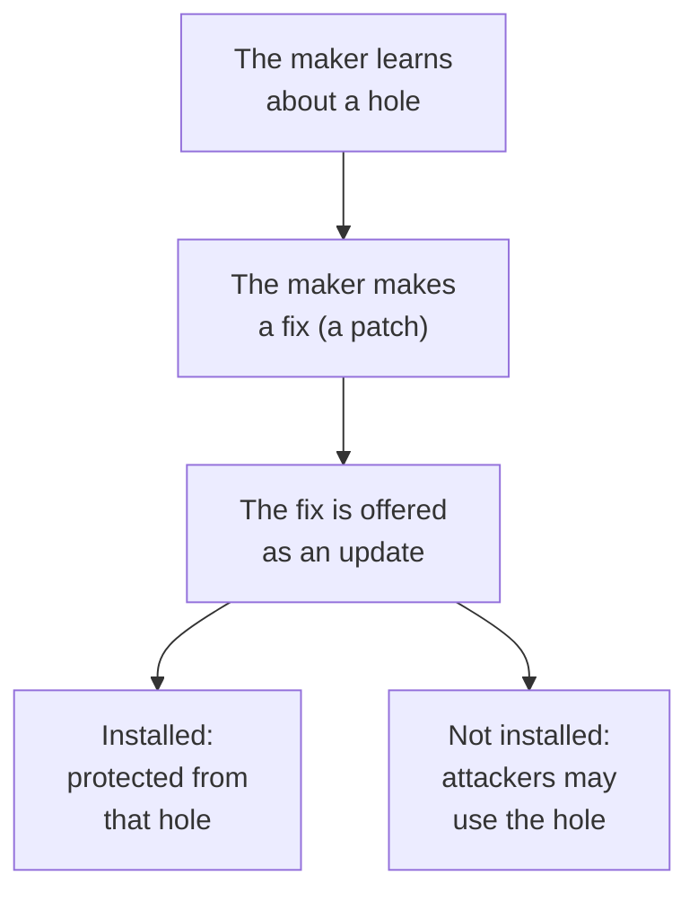

> **In one sentence:** Makers fix security holes in their programs with updates, but an update protects you only after it is installed, so turn on automatic updates and get updates only from official places.

## Why should I care?

Your phone or computer has probably asked you to "update" or "restart to update".

The UK's National Cyber Security Centre (NCSC) says: "If you receive a prompt to update your device (or apps), don't ignore it." In [[malware]] you saw one reason: harmful programs can get in through holes in old software.

## Analogy

Imagine the lock on your front door has a hidden weakness. The lock maker finds out, and sends a free repair part to every owner by mail. The repair only protects your home after you put it in. If the part sits unopened in a drawer, your door stays weak.

**Where the analogy breaks down:** a thief must come to your door. Some malware can reach a device over the internet, with no one at the door: the US Cybersecurity and Infrastructure Security Agency (CISA) says a worm "can spread without human interaction". And unlike a repair part, a software update can arrive and install itself, if automatic updates are on.

## How it actually works

### Programs have mistakes

[[software|Programs]] are written by people, and people make mistakes. A mistake in a program is called a **bug**: a defect in the software. Some bugs make a program slow: CISA mentions "performance bugs".

### Some mistakes are security holes

Some bugs are more dangerous. The US National Institute of Standards and Technology (NIST) defines a **software vulnerability** as "a security flaw, glitch, or weakness found in software code that could be exploited by an attacker". A flaw or a glitch is a fault. **Exploited** means used to do harm. In this page, we call a vulnerability a **security hole**, or a hole.

CISA says: "New vulnerabilities are continually emerging."

### Makers publish fixes

The company or group that makes a program is its **maker** (CISA calls it the "vendor"). A **patch** is a fix. CISA describes patches as updates that deal with security vulnerabilities. It says that when makers learn about holes in their programs, they often release patches to fix them.

An **update** is a new version of a program from its maker. A patch reaches you as an update.

### Attackers use holes that are not yet fixed on your device

A fix protects only the devices where it is installed. CISA warns: "Attackers may target vulnerabilities for months or even years after updates are available."

### Turn on automatic updates

Many programs can update themselves. The NCSC says: "turn on 'automatic updates' in your device's settings, if available. This will mean you do not have to remember to apply updates." Your browser may already do this: Microsoft says that "by default, Microsoft Edge automatically updates when you restart your browser".

### Get updates only from official places

Attackers sometimes pretend to send an update. CISA says: "Do not trust a link in an email message". It advises: "Always visit vendor sites directly rather than clicking on advertisements or email links." So let the program update itself, or go to the maker's own website. For apps, the NCSC advises: "only use trusted app stores".

### When updates stop: end of support

CISA calls a program that no longer gets updates **end-of-life** software. New holes in it stay open. CISA warns that using it "can allow an attacker to exploit security vulnerabilities". The NCSC adds that "older devices will eventually stop receiving updates".

For example, Windows is Microsoft's operating system for computers. Microsoft says "Windows 10 has reached the end of support on October 14, 2025", and security updates are "no longer provided". Home users who sign up for its Extended Security Updates plan can be protected until October 12, 2027.

## How it came to be

On March 14, 2017, Microsoft released a security update for a hole in Windows. On Friday, May 12, 2017, a harmful program called WannaCry was released worldwide. CISA says early reports showed that the attackers got in through that same hole. CISA cited reports of "tens of thousands of infections in over 150 countries".

The UK's National Audit Office (NAO) studied how WannaCry hit the NHS, England's health service. The NAO says WannaCry "encrypts data on infected computers and demands a ransom payment": it was ransomware. **Encrypts** here means scrambles, so you cannot read your own files.

The NAO reported what NHS Digital told it: the infected organisations "had unpatched, or unsupported Windows operating systems". So at that time, the fix existed but was not installed, or the system no longer got fixes. (NHS Digital also said that another kind of protection, facing the internet, would have worked, even without the update.)

## 🧪 Try it in your browser

Your browser's "About" page shows its version and whether an update is waiting.

**Safety rule:** only look. You do not need to click any button. The page may check for an update by itself: Google says "Chrome will check for updates when you're on this page".

1. Open the About page:
   - **Chrome:** at the top right, click the menu with three dots (**More**). Click **Help**, then **About Google Chrome**.
   - **Edge:** at the top right, click the menu with three dots (**Settings and more**). Click **Help and feedback**, then **About Microsoft Edge**.
   - **Firefox:** at the top right, click the menu button (when you point at it, it says **Open application menu**). Click **Help and Report** (in some versions it is called **Help**), then **About Firefox**.
2. Look at what the page says.

**What you should see:**

- A **version number**: a series of numbers with dots, near the browser's name.
- A message about updates. Edge may say **Microsoft Edge is up to date**. Firefox may show **Checking for updates…**, then **Firefox is up to date**. In Chrome, Google's help page says that if there is no **Relaunch** button, "you're on the latest version".
- If an update is waiting, you may see a button such as **Relaunch** (Chrome), **Restart** (Edge) or **Restart to update Firefox**. You can click it now or later: it restarts the browser. Google says Chrome "saves your opened tabs and windows and reopens them".

**What happened:** this page is part of the browser itself, made by its maker. That is the safe place to check for updates, not a link in an email or an advertisement.

## Common misunderstandings

- **"Updates only add new features, so I can skip them."** No. The NCSC says updates "include protection from viruses and other kinds of malware". Skipping them can leave known holes open.
- **"My old computer still works, so it is still safe."** It may work, but if it is end-of-life, it gets no fixes for new holes. CISA recommends that users "retire all EOL products" (EOL means end-of-life).

## Recap

- Programs have bugs. Some bugs are security holes (vulnerabilities) that attackers can use.
- Makers fix holes with patches, sent as updates. A fix protects you only after it is installed, so turn on automatic updates.
- Get updates only from official places: the program itself, its maker's website, or a trusted app store. When a program reaches end of support, it gets no more fixes.

## Sources

- CISA, Understanding Patches and Software Updates: https://www.cisa.gov/news-events/news/understanding-patches-and-software-updates
- NCSC, Install the latest software and app updates: https://www.ncsc.gov.uk/collection/top-tips-for-staying-secure-online/install-the-latest-software-and-app-updates
- NIST Glossary, software vulnerability: https://csrc.nist.gov/glossary/term/software_vulnerability
- Wikipedia, Software bug (general background reference): https://en.wikipedia.org/wiki/Software_bug
- CISA, Virus Basics: https://www.cisa.gov/news-events/news/virus-basics
- Microsoft Support, Windows 10 support has ended on October 14, 2025: https://support.microsoft.com/en-us/windows/windows-10-support-has-ended-on-october-14-2025-2ca8b313-1946-43d3-b55c-2b95b107f281
- CISA, Indicators Associated With WannaCry Ransomware: https://www.cisa.gov/news-events/alerts/2017/05/12/indicators-associated-wannacry-ransomware
- UK National Audit Office, Investigation: WannaCry cyber attack and the NHS: https://www.nao.org.uk/reports/investigation-wannacry-cyber-attack-and-the-nhs/
- NCSC, Guidance for communities at high risk of digital surveillance: https://www.ncsc.gov.uk/news/ncsc-partners-share-guidance-for-communities-at-high-risk-of-digital-surveillance
- Google Chrome Help, Update Google Chrome: https://support.google.com/chrome/answer/95414?hl=en
- Microsoft Support, Microsoft Edge update settings: https://support.microsoft.com/en-us/topic/microsoft-edge-update-settings-af8aaca2-1b69-4870-94fe-18822dbb7ef1
- Firefox source code (release), appmenu.ftl: https://searchfox.org/firefox-release/source/browser/locales/en-US/browser/appmenu.ftl
- Firefox source code (ESR 140), appmenu.ftl: https://searchfox.org/firefox-esr140/source/browser/locales/en-US/browser/appmenu.ftl
- Firefox source code (release), aboutDialog.ftl: https://searchfox.org/firefox-release/source/browser/locales/en-US/browser/aboutDialog.ftl
