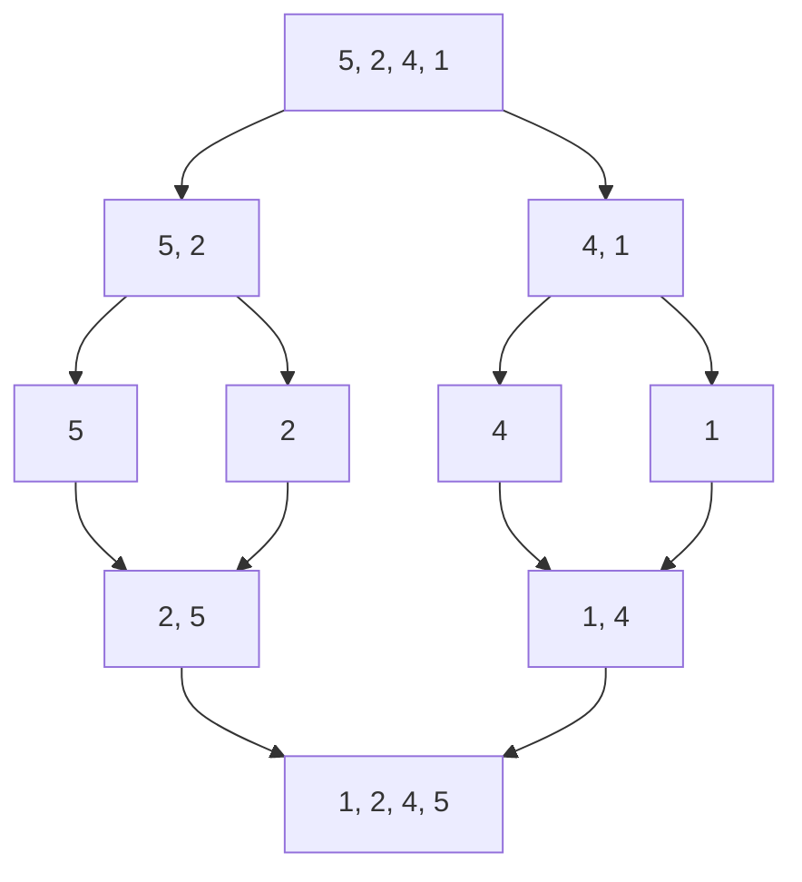

> **In one sentence:** A sorting algorithm is a list of steps that puts items in order. Insertion sort is short to write but needs many steps on long lists. Merge sort splits the list in halves and needs far fewer.

## Why should I care?

In [[algorithms|Algorithms]], binary search found a number with very few checks. But Wikipedia says it finds a value "within a sorted array". So someone must sort the list first.

Each language on the Algorithms page comes with a sort. This page looks inside.

## Analogy

Think of sorting the playing cards in your hand. You take one card at a time and slide it into its place among the sorted ones. Wikipedia says that when people sort the cards in a bridge hand (bridge is a card game), most use a method "similar to insertion sort".

**Where the analogy breaks down:** you see your whole hand and slide a card in with one move. A program compares two items at a time, and moves bigger items one place right, one by one.

## How it actually works

### Insertion sort

Wikipedia says insertion sort "builds the final sorted array (or list) one item at a time":

1. The first item on its own counts as sorted.
2. Take the next item. While the item to its left is bigger, move that bigger item one place to the right. This page calls each of these a **move**.
3. Put the item in the gap. Repeat from step 2 until no items are left.

On the list 5, 2, 4, 1, 3:

| Round | Item to place | List after the round | Moves |
|---|---|---|---|
| 1 | 2 | 2, 5, 4, 1, 3 | 1 |
| 2 | 4 | 2, 4, 5, 1, 3 | 1 |
| 3 | 1 | 1, 2, 4, 5, 3 | 3 |
| 4 | 3 | 1, 2, 3, 4, 5 | 2 |

That is 7 moves. The code below does the same and counts the moves, in [[javascript|JavaScript]], [[python|Python]] and [[go-language|Go]]. You only need to read one tab.

<!-- tabs -->

### JavaScript

`item` keeps a copy first, because a bigger item moving right writes over its place.

```js
// Sorts the array items, smallest first, and counts the moves.
function insertionSort(items) {
  let moves = 0;
  // Start at index 1: the first item alone counts as sorted.
  for (let i = 1; i < items.length; i++) {
    // Keep a copy: a bigger item moving right will write over it.
    const item = items[i];
    let j = i - 1; // Start with the item to its left.
    // Move each bigger item one place to the right.
    while (j >= 0 && items[j] > item) {
      items[j + 1] = items[j];
      j = j - 1;
      moves = moves + 1;
    }
    items[j + 1] = item;   // Put the item in the gap.
  }
  return moves;
}

const numbers = [5, 2, 4, 1, 3];
const moves = insertionSort(numbers);
console.log(numbers); // Shows the list: 1, 2, 3, 4, 5
console.log(moves);   // Shows: 7
console.log(insertionSort([1, 2, 3, 4, 5])); // Shows: 0
console.log(insertionSort([5, 4, 3, 2, 1])); // Shows: 10
```

The inner loop stops when `j` reaches -1 or when the item to the left is not bigger. MDN says a function's changes to an array it was given are "visible outside the function", so `numbers` ends up sorted.

### Python

`def` starts a function. `range(1, len(items))` gives each index from 1 to the last one. `item` keeps a copy first, because a bigger item moving right writes over its place. `and` checks its right side only when its left side is true. So `items[j]` is never read when `j` is -1, which in Python would mean the last item.

```python
# Sorts the list items, smallest first, and counts the moves.
def insertion_sort(items):
    moves = 0
    # Start at index 1: the first item alone counts as sorted.
    for i in range(1, len(items)):
        # Keep a copy: a bigger item moving right will write over it.
        item = items[i]
        j = i - 1  # Start with the item to its left.
        # Move each bigger item one place to the right.
        while j >= 0 and items[j] > item:
            items[j + 1] = items[j]
            j = j - 1
            moves = moves + 1
        items[j + 1] = item  # Put the item in the gap.
    return moves

numbers = [5, 2, 4, 1, 3]
moves = insertion_sort(numbers)
print(numbers)  # Shows: [1, 2, 3, 4, 5]
print(moves)    # Shows: 7
print(insertion_sort([1, 2, 3, 4, 5]))  # Shows: 0
print(insertion_sort([5, 4, 3, 2, 1]))  # Shows: 10
```

Python's tutorial says that if a function changes a list it was given, the code that called the function "will see any changes". So `numbers` is sorted after the call.

### Go

`func insertionSort(items []int) int` takes a slice of whole numbers (`[]int`) and gives back a whole number (`int`). A `for` with only a condition repeats while the condition is true. `item` keeps a copy first, because a bigger item moving right writes over its place. `&&` checks its right side only when its left side is true, so the code never reads index -1, which would stop a Go program with an error. `package main`, `import "fmt"` and `func main()` start the program, and `fmt.Println` shows a value.

```go
package main

import "fmt"

// Sorts the slice items, smallest first, and counts the moves.
func insertionSort(items []int) int {
	moves := 0
	// Start at index 1: the first item alone counts as sorted.
	for i := 1; i < len(items); i++ {
		// Keep a copy: a bigger item moving right will write over it.
		item := items[i]
		j := i - 1 // Start with the item to its left.
		// Move each bigger item one place to the right.
		for j >= 0 && items[j] > item {
			items[j+1] = items[j]
			j = j - 1
			moves = moves + 1
		}
		items[j+1] = item // Put the item in the gap.
	}
	return moves
}

func main() {
	numbers := []int{5, 2, 4, 1, 3}
	moves := insertionSort(numbers)
	fmt.Println(numbers)                             // Shows: [1 2 3 4 5]
	fmt.Println(moves)                               // Shows: 7
	fmt.Println(insertionSort([]int{1, 2, 3, 4, 5})) // Shows: 0
	fmt.Println(insertionSort([]int{5, 4, 3, 2, 1})) // Shows: 10
}
```

Effective Go says that when a function changes the items of a slice it was given, the changes "will be visible to the caller". So `numbers` is sorted after the call.

<!-- /tabs -->

### Why insertion sort is O(n²)

[[big-o|Big O]] describes how the number of steps grows as the list grows, most often in the worst case.

The worst case is a list in reverse order (Wikipedia: "the simplest worst case"). Then the second item makes 1 move, the third 2, and so on. Allen B. Downey's book *Think Data Structures* adds these up: 1 + 2 + … + (n − 1).

| Items (n) | Moves, reverse order |
|---|---|
| 5 | 10 |
| 10 | 45 |
| 1,000 | 499,500 |

The sum is about half of n × n. Big O drops constant factors such as this half, and smaller parts (Wikipedia: "omitting constant factors and lower order terms"), so insertion sort is O(n²).

On a sorted list, there are 0 moves, but each item after the first is still compared once with the item to its left. Robert Sedgewick and Kevin Wayne's book *Algorithms* gives this best case as "N-1 compares" (N is the number of items), with no items moved. So in the best case, the steps grow like n: O(n).

### Merge sort

Merge sort uses [[recursion|recursion]]. Sedgewick and Wayne describe it: "divide it into two halves, sort the two halves (recursively), and then merge the results." The base case: Wikipedia says "a list of one element is considered sorted".

**Merging** combines two sorted lists into one. Compare the first item of each list, and move the smaller one to the result. Repeat. When one list is empty, add the rest of the other.



### Why merge sort is O(n log n)

In the diagram, the top two rows of arrows halve 4 items twice. The bottom two rows merge them back in two rounds, and each round handles all 4 items. Downey counts it this way too: "On every level we have a total of n elements", and merging them is linear.

So there are about log n rounds, the number of halvings, and each takes about n steps. The total, n times log n, is written O(n log n).

1,000 items can be halved about 10 times, so n log n is about 10,000. Insertion sort's n × n is 1,000,000. These numbers show growth, not exact counts.

### What the built-in sorts use

- **Python:** its documentation names "The Timsort algorithm used in Python". Since version 3.11, its changelog says, list sorting "uses the merge-ordering strategy" of Powersort, which Wikipedia says "builds on Timsort" and "belongs to the family of merge sort algorithms".
- **JavaScript in Chrome:** V8 is the program in Chrome that runs JavaScript. In 2018, with V8 v7.0 and Chrome 70, it switched to Timsort, which its blog calls a "Mergesort variant": a changed version of merge sort. V8's source code now names a "merge sort variant called PowerSort".
- **Go:** the Go 1.19 release notes say the `sort` package's algorithm "has been rewritten to use pattern-defeating quicksort", another sorting algorithm. In Go's source code, `slices.Sort` calls `pdqsortOrdered`, which a comment says is "based on pattern-defeating quicksort".

## How it came to be

Wikipedia says merge sort "was invented by John von Neumann in 1945".

## 🧪 Try it in your browser

These steps use JavaScript, because the browser's console runs it.

- `function` starts a function, and `return` gives a value back. `let` and `const` create variables. `for` and `while` repeat a block.
- `items[j]` reads the item at index `j`, and `.length` gives the number of items. `&&` means "and". `;` separates commands.
- `console.log()` shows values in order.

You need a computer with Chrome, Edge or Firefox.

**Safety rule:** only type code in the console that you understand or that comes from a source you trust. Never paste anything a stranger sends you. The line below defines a function, sorts three lists, and shows numbers.

1. Open [example.com](https://example.com).
   **What you should see:** a short page of text.
2. Open the **console**:
   - **Windows:** press `Ctrl` + `Shift` + `J` (in Firefox: `Ctrl` + `Shift` + `K`)
   - **Mac:** press `Cmd` + `Option` + `J` (in Firefox: `Cmd` + `Option` + `K`)
3. Click the line where you can type, below any messages. **Type** the line below yourself (some browsers may block pasting at first), then press `Enter`. The browser may show suggestions, and the line may look different while you type. Keep typing. The line is the insertion sort from above:

   ```
   function insertionSort(items) { let moves = 0; for (let i = 1; i < items.length; i++) { const item = items[i]; let j = i - 1; while (j >= 0 && items[j] > item) { items[j + 1] = items[j]; j = j - 1; moves = moves + 1; } items[j + 1] = item; } return moves; } console.log(insertionSort([1, 2, 3, 4, 5]), insertionSort([5, 4, 3, 2, 1]), insertionSort([10, 9, 8, 7, 6, 5, 4, 3, 2, 1]));
   ```

   Type carefully: the line is long.

   **What you should see:** `0`, `10` and `45`, in that order, in one message. The console may also show `undefined`.

If you see an error message, look for a typo. Then click your browser's reload button and start again from step 3.


## Common misunderstandings

- **"Merge sort is always the better choice."** No. On a sorted list, insertion sort is linear. Wikipedia says it is "Efficient for (quite) small data sets": small amounts of data.
- **"Twice the items means twice the steps."** Not for insertion sort: in reverse order, 5 items need 10 moves, and 10 items need 45.

## Recap

- Insertion sort places one item at a time, moving bigger items right. It is O(n²).
- Merge sort halves the list down to single items, then merges sorted parts. It is O(n log n).
- The built-in sorts of Python and Chrome are both based on merge sort.

## Sources

- Wikipedia, Contract bridge: https://en.wikipedia.org/wiki/Contract_bridge
- Wikipedia, Big O notation: https://en.wikipedia.org/wiki/Big_O_notation
- Wikipedia, Time complexity: https://en.wikipedia.org/wiki/Time_complexity
- Wikipedia, Binary search: https://en.wikipedia.org/wiki/Binary_search
- Wikipedia, Insertion sort: https://en.wikipedia.org/wiki/Insertion_sort
- Wikipedia, Merge sort: https://en.wikipedia.org/wiki/Merge_sort
- Wikipedia, Merge algorithm: https://en.wikipedia.org/wiki/Merge_algorithm
- Sedgewick and Wayne, Algorithms, 4th Edition, 2.1 Elementary Sorts: https://algs4.cs.princeton.edu/21elementary/
- Sedgewick and Wayne, Algorithms, 4th Edition, 2.2 Mergesort: https://algs4.cs.princeton.edu/22mergesort/
- Allen B. Downey, Think Data Structures (LibreTexts), 17.1 Insertion sort: https://eng.libretexts.org/Bookshelves/Computer_Science/Programming_Languages/Think_Data_Structures_-_Algorithms_and_Information_Retrieval_in_Java_(Downey)/17%3A_Sorting/17.01%3A_Insertion_sort
- Allen B. Downey, Think Data Structures (LibreTexts), 17.3 Analysis of merge sort: https://eng.libretexts.org/Bookshelves/Computer_Science/Programming_Languages/Think_Data_Structures_-_Algorithms_and_Information_Retrieval_in_Java_(Downey)/17%3A_Sorting/17.03%3A_Analysis_of_merge_sort
- Python documentation, Sorting Techniques: https://docs.python.org/3/howto/sorting.html
- V8 blog, Getting things sorted in V8: https://v8.dev/blog/array-sort
- V8 JavaScript engine (home page): https://v8.dev/
- Go source code, slices/sort.go: https://go.dev/src/slices/sort.go
- Go 1.19 Release Notes: https://go.dev/doc/go1.19
- MDN Web Docs, Functions (JavaScript guide): https://developer.mozilla.org/en-US/docs/Web/JavaScript/Guide/Functions
- Python Tutorial, More Control Flow Tools: https://docs.python.org/3/tutorial/controlflow.html
- Python Tutorial, An Informal Introduction to Python: https://docs.python.org/3/tutorial/introduction.html
- Python Language Reference, Expressions: https://docs.python.org/3/reference/expressions.html
- The Go Programming Language Specification: https://go.dev/ref/spec
- Effective Go: https://go.dev/doc/effective_go
- Wikipedia, Powersort: https://en.wikipedia.org/wiki/Powersort
- Python documentation, Changelog (Python 3.11.0 alpha 1): https://docs.python.org/3/whatsnew/changelog.html
- V8 source code, third_party/v8/builtins/array-sort.tq: https://raw.githubusercontent.com/v8/v8/main/third_party/v8/builtins/array-sort.tq
- Go source code, slices/zsortordered.go: https://go.dev/src/slices/zsortordered.go
- MDN Web Docs, function: https://developer.mozilla.org/en-US/docs/Web/JavaScript/Reference/Statements/function
- MDN Web Docs, return: https://developer.mozilla.org/en-US/docs/Web/JavaScript/Reference/Statements/return
- MDN Web Docs, let: https://developer.mozilla.org/en-US/docs/Web/JavaScript/Reference/Statements/let
- MDN Web Docs, const: https://developer.mozilla.org/en-US/docs/Web/JavaScript/Reference/Statements/const
- MDN Web Docs, for: https://developer.mozilla.org/en-US/docs/Web/JavaScript/Reference/Statements/for
- MDN Web Docs, while: https://developer.mozilla.org/en-US/docs/Web/JavaScript/Reference/Statements/while
- MDN Web Docs, Indexed collections: https://developer.mozilla.org/en-US/docs/Web/JavaScript/Guide/Indexed_collections
- MDN Web Docs, Array: length: https://developer.mozilla.org/en-US/docs/Web/JavaScript/Reference/Global_Objects/Array/length
- MDN Web Docs, Logical AND (&&): https://developer.mozilla.org/en-US/docs/Web/JavaScript/Reference/Operators/Logical_AND
- MDN Web Docs, Grammar and types: https://developer.mozilla.org/en-US/docs/Web/JavaScript/Guide/Grammar_and_types
- MDN Web Docs, console.log(): https://developer.mozilla.org/en-US/docs/Web/API/console/log_static
- MDN Web Docs, eval(): https://developer.mozilla.org/en-US/docs/Web/JavaScript/Reference/Global_Objects/eval
- Microsoft Edge DevTools, Run JavaScript in the Console: https://learn.microsoft.com/en-us/microsoft-edge/devtools/console/console-javascript
- Chrome for Developers, Open Chrome DevTools: https://developer.chrome.com/docs/devtools/open
- Microsoft Edge DevTools, Keyboard shortcuts: https://learn.microsoft.com/en-us/microsoft-edge/devtools/shortcuts/
- Firefox DevTools User Docs, Web Console: https://firefox-source-docs.mozilla.org/devtools-user/web_console/index.html
- Chrome for Developers, What are self-XSS attacks?: https://developer.chrome.com/blog/self-xss
- Example Domain: https://example.com
