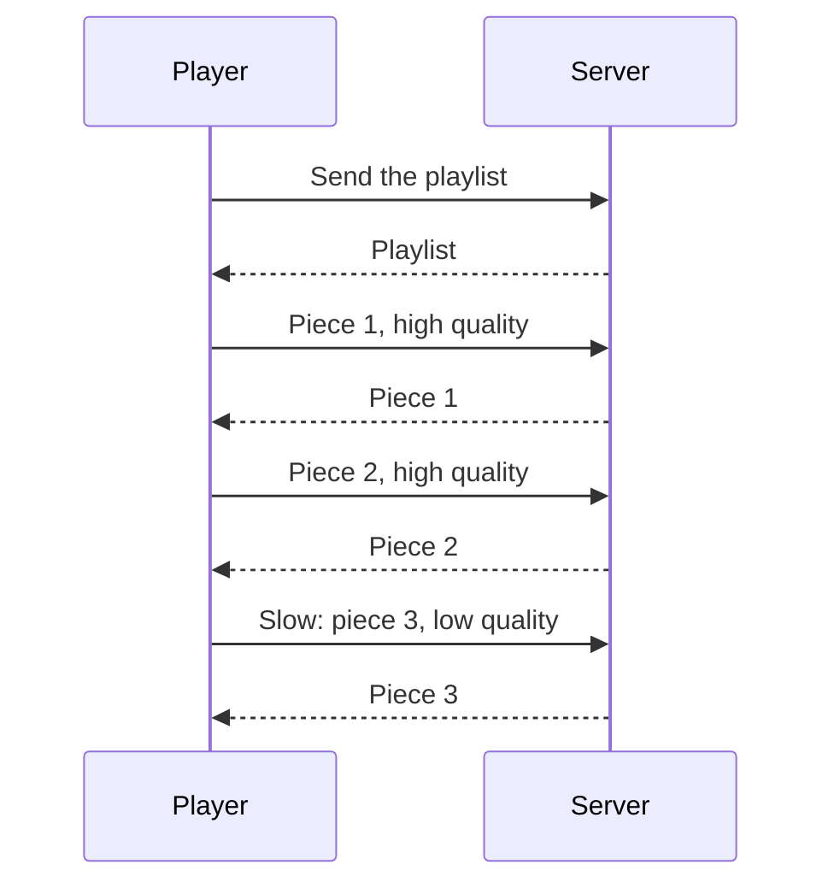

> **In one sentence:** Streaming means a video or song starts playing while it is still arriving; with adaptive streaming, it is cut into short pieces at several qualities, and your player asks a server for each next piece in a quality that fits your connection.

## Why should I care?

When you watch a film online or play music in an app, you do not wait for the whole file. It starts after a moment and keeps arriving while you watch or listen. That is **streaming**.

You may also have seen a video stop for a moment, or turn blurry and then sharp again. This page explains why.

## Analogy

Imagine a friend sends you a long book by mail, **one short chapter at a time**. You start reading chapter 1 as soon as it arrives, while the next chapters are on their way. You keep a few unread chapters on your table. Your table is like the player's **buffer**. If the mail is slow and your table is empty, you must stop and wait.

**Where the analogy breaks down:** your friend sends chapters without being asked, but a streaming player **asks** for every piece. And a friend cannot send a "smaller" chapter when the mail is slow. A streaming player can ask for a lower-quality version of the next piece.

## How it actually works

### Downloading versus streaming

When you **download** a file, you get the entire file before you use it. When you **stream** it, the data is sent from a [[server]] to your device, and it plays while it is still being delivered.

In [[video-as-numbers]], you saw that video needs a huge number of bytes. With streaming, you do not wait for all of them.

Music is streamed too. MDN Web Docs, a reference for web developers, describes streaming for "audio or video".

### Short pieces

For adaptive streaming, a video is cut into short pieces. MDN calls them **chunks** or **segments**. Apple's rules for its own streaming format say each segment should be about **6 seconds** long.

The same video is stored **several times, at different qualities**. Each quality has its own **bit rate**: how many bits it needs for each second of video. A higher quality needs more bits per second, so it uses more data.

A short file, called a **playlist**, lists where all the pieces are and the bit rate of each quality. The player reads the playlist first. (This is a file for the player, not a list of songs that you choose.)

Each piece travels from the server to you as many small [[packets]], like any other data on the internet.

### Adaptive streaming: the player chooses

Your player (the app, or the browser) asks the server for one piece after another, and it can choose a quality each time. If your connection is fast, it asks for a sharp version. If your connection becomes slow, it asks for a lower-quality version, which needs fewer bytes.

This is called **adaptive streaming**. MDN says that in adaptive streaming, the quality of the stream "can change in real-time in reaction to the user's available bandwidth". (**Bandwidth** here means how much data your connection can carry each second.) That is why a video sometimes turns blurry for a moment.

### Buffering

The player keeps some pieces that have arrived but are not played yet. This store is called the **buffer**. It keeps the video playing when one piece is late.

If the buffer runs empty, the video must stop. MDN describes this moment as: "Playback has stopped because of a temporary lack of data." People call this **buffering**: the player waits for more pieces.

### Copies close to you

Streaming services can use a **CDN** (content delivery network). MDN describes a CDN as "a group of servers spread out over many locations" that store copies of the same data. Your request can be answered by a server that is closer to you, and MDN says distance affects how long data takes to arrive.

(This is simplified. Real players and services use many more methods.)

### How much data does it use?

Netflix's help page says how much data its video can use **per hour**, on one device:

| Quality setting | Up to, per hour |
|---|---|
| Low (basic) | 0.3 GB |
| Medium (standard) | 0.7 GB |
| High, standard definition | 1 GB |
| High, high definition | 3 GB |
| High, ultra high definition (4K) | 7 GB |

(GB means gigabytes; see [[data-size-units]].) Other services have their own numbers, and numbers can change.

## How it came to be

MDN names two main formats for adaptive streaming: **HLS** and **MPEG-DASH**. HLS (HTTP Live Streaming) was made by Apple. Its first draft was posted in **2009**. In **August 2017**, it was published as RFC 8216, a public technical document by R. Pantos of Apple (as editor) and W. May. Both formats send the pieces with [[http|HTTP]], the same rules that web pages use. MDN says MPEG-DASH works with ordinary web servers, and that nothing special is needed on the server.

## 🧪 Try it in your browser

You will watch your browser ask a server for a video. You need a computer, not a phone. These steps only look; they change nothing.

1. In Chrome, Edge or Firefox, open MDN's page about the video element: `https://developer.mozilla.org/en-US/docs/Web/HTML/Reference/Elements/video`. Near the top, there is a small example video.
2. Open the **developer tools**:
   - **Windows:** press `F12` or `Ctrl` + `Shift` + `I`. If `F12` does nothing, try the other keys.
   - **Mac:** press `Cmd` + `Option` + `I`.
3. At the top of the panel, click **Network**. (In Edge, if you do not see it, click the **More tools** button first.)
4. Near the top of the Network panel, find a row of words such as **All**, **CSS** and **JS**. Click **Media** in that row. Now only video and sound requests are shown.
5. Reload the page with the browser's reload button. Then press the play button on the example video. Rows may appear before or after you press play.

**What you should see:** one or more rows for the video file. Its name starts with `flower`. The **Status** column shows a number. If it is `206`, the server answered a request for **part** of the file. MDN says `206 Partial Content` answers a request for part of a file, and that such requests are useful for media players. Another number, such as `200`, is fine too.

**What happened:** your browser's video player asked a server for the video. This small example is one file. A streaming service's player keeps asking in the same way, for one piece after another. Close the tab when you are done.

## Common misunderstandings

- **"Streaming means the video is not downloaded."** It is downloaded, piece by piece, while you watch.
- **"Buffering means the video is broken."** No. The player is waiting for the next pieces.
- **"A blurry moment means the video file is bad."** The player may have chosen a lower quality because your connection was slow.

## Recap

- Streaming plays a video or song while it is still arriving, before the whole file is there.
- With adaptive streaming, the video is cut into short pieces at several qualities. The player asks for each next piece in a quality that fits your connection.
- The buffer holds pieces that are not played yet. When it runs empty, the video stops and waits: that is buffering.

## Sources

- MDN Web Docs, Audio and video delivery: https://developer.mozilla.org/en-US/docs/Web/Media/Guides/Audio_and_video_delivery
- MDN Web Docs, Setting up adaptive streaming media sources: https://developer.mozilla.org/en-US/docs/Web/Media/Guides/Audio_and_video_delivery/Setting_up_adaptive_streaming_media_sources
- MDN Web Docs, Media Source Extensions API: https://developer.mozilla.org/en-US/docs/Web/API/Media_Source_Extensions_API
- RFC 8216, HTTP Live Streaming: https://www.rfc-editor.org/rfc/rfc8216
- Apple Developer, HLS Authoring Specification for Apple Devices: https://developer.apple.com/documentation/http-live-streaming/hls-authoring-specification-for-apple-devices
- MDN Web Docs, CDN (glossary): https://developer.mozilla.org/en-US/docs/Glossary/CDN
- Netflix, Announcing the Netflix Open Connect Network: https://about.netflix.com/en/news/announcing-the-netflix-open-connect-network
- Netflix Help Center, How to control how much data Netflix uses: https://help.netflix.com/en/node/87
- MDN Web Docs, The Video Embed element: https://developer.mozilla.org/en-US/docs/Web/HTML/Reference/Elements/video
- MDN Web Docs, HTTP range requests: https://developer.mozilla.org/en-US/docs/Web/HTTP/Guides/Range_requests
- MDN Web Docs, 206 Partial Content: https://developer.mozilla.org/en-US/docs/Web/HTTP/Reference/Status/206
- Wikipedia, Streaming media (general background reference): https://en.wikipedia.org/wiki/Streaming_media
- Chrome for Developers, Open Chrome DevTools: https://developer.chrome.com/docs/devtools/open
- Chrome for Developers, Network features reference: https://developer.chrome.com/docs/devtools/network/reference
- Microsoft Edge DevTools, Keyboard shortcuts: https://learn.microsoft.com/en-us/microsoft-edge/devtools/shortcuts/
- Microsoft Edge DevTools, Inspect network activity: https://learn.microsoft.com/en-us/microsoft-edge/devtools/network/
- Microsoft Edge DevTools, Network features reference: https://learn.microsoft.com/en-us/microsoft-edge/devtools/network/reference
- Firefox DevTools User Docs: https://firefox-source-docs.mozilla.org/devtools-user/index.html
- Firefox DevTools User Docs, Network request list: https://firefox-source-docs.mozilla.org/devtools-user/network_monitor/request_list/index.html
- Firefox source, Network Monitor text labels (netmonitor.properties): https://raw.githubusercontent.com/mozilla-firefox/firefox/main/devtools/client/locales/en-US/netmonitor.properties
