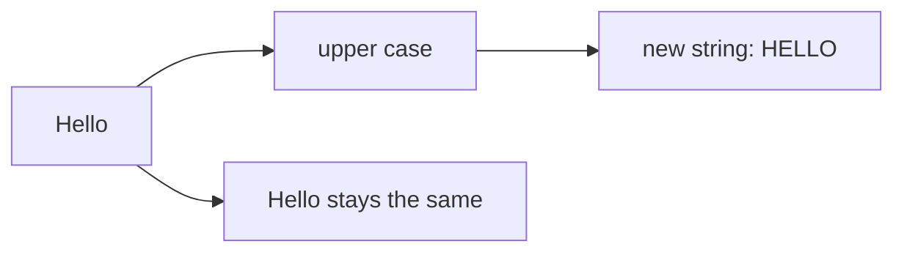

> **In one sentence:** A string is a piece of text in your code, and you can join it, measure it, search it, cut parts out of it and put values into it.

## Why should I care?

In [[variables|Variables]], you met strings: text inside quote marks, such as `"Mira"`. A string can hold anything written as text: a name typed into a form, a message on the screen, a web address.

Programs do things with that text. They join a greeting and a name, search for a word, or show it in capital letters. Many of the tools on this page are [[functions|functions]] that work on text.

## Analogy

Think of a name bracelet: letter beads on a thread, in a row. Each bead holds one letter. You can count the beads, and you can point at one bead by its place in the row.

A string is like that row of beads. Each bead is one **character**: a letter, a digit, a sign such as `!`, or a space.

**Where the analogy breaks down:** you can untie a real bracelet and swap one bead. In the three languages on this page, you cannot change a string after it is made. You make a new string instead, and the old one stays as it was.

## How it actually works

### Text in quote marks

A **string** is a sequence of characters. In code, quote marks show where the text starts and ends.

Each character is stored as a number. [[text-as-numbers|Text as Numbers]] explains how.

### Join, measure, pick one character

Each character has a **position**, also called an **index**. Positions count from 0, not from 1. So in `"Hello"`, `H` is at position 0, and `o` is at position 4.

*Diagram: the five characters of Hello, with the position of each one under it, from 0 to 4.*

```
character:   H   e   l   l   o
position:    0   1   2   3   4
```

The examples are in [[javascript|JavaScript]], [[python|Python]] and [[go-language|Go]]. You only need to read one tab.

<!-- tabs -->

### JavaScript

```js
// A string: text inside quote marks.
const word = "Hello";
const name = "Mira";

// + joins strings into one string.
console.log(word + ", " + name); // Shows: Hello, Mira

// .length is the number of characters.
console.log(word.length); // Shows: 5

// Square brackets get one character. Positions count from 0.
console.log(word[0]); // Shows: H
console.log(word[4]); // Shows: o
```

Joining strings is called **concatenation**. Double quotes `"` and single quotes `'` work the same in JavaScript.

`.length` counts the characters of `"Hello"`. (This is simplified: `.length` counts small storage units, not characters. Some characters, such as many emoji, count as more than 1. MDN Web Docs, a website that documents web technologies, gives `"😄".length` as 2.)

### Python

```python
# A string: text inside quote marks.
word = "Hello"
name = "Mira"

# + joins strings into one string.
print(word + ", " + name)  # Shows: Hello, Mira

# len() gives the number of characters.
print(len(word))  # Shows: 5

# Square brackets get one character. Positions count from 0.
print(word[0])  # Shows: H
print(word[4])  # Shows: o
```

Joining strings is called **concatenation**. You can use double quotes `"` or single quotes `'`: Python treats them the same.

`len()` is a function that Python provides. It gives the length of a string. One character is a string too: `word[0]` is a string of length 1.

### Go

```go
package main

import "fmt"

func main() {
	// A string: text inside double quote marks.
	word := "Hello"
	name := "Mira"

	// + joins strings into one string.
	fmt.Println(word + ", " + name) // Shows: Hello, Mira

	// len counts bytes. Each letter here takes one byte.
	fmt.Println(len(word)) // Shows: 5

	// Square brackets with one position give a byte: a number.
	fmt.Println(word[0]) // Shows: 72

	// A slice from position 0 up to 1 gives a string.
	fmt.Println(word[0:1]) // Shows: H

	// Nine characters, but 13 bytes.
	fmt.Println(len("Hello, 世界")) // Shows: 13
}
```

Joining strings is called **concatenation**. In this example, each string is inside double quotes `"`.

Go stores a string as a row of **bytes**. A byte is a small number, from 0 to 255. `len` counts bytes, not characters. Text written between quote marks in Go code is stored as UTF-8, a set of rules for turning characters into bytes. In UTF-8, each English letter takes one byte. So `len(word)` is 5.

`word[0]` gives the byte at position 0, so Go shows the number 72. That is the number that stores `H` in UTF-8. To get `H` as text, take a **slice**: `word[0:1]` is the part from position 0 up to, but not including, position 1.

Other characters can take more than one byte. `"Hello, 世界"` has nine characters (the space counts as one), but `len` gives 13. Go's own documentation shows this example. Text as Numbers explains why some characters need more bytes.

<!-- /tabs -->

### Everyday work with text

Next: capital letters, finding text inside a string, and taking out a part. Each gives back a new string, or an answer: true or false. The original string does not change.

You can also put values, such as a name or a number, into a string. Each language has its own way.

<!-- tabs -->

### JavaScript

```js
const word = "Hello";

// toUpperCase gives back a new string in capital letters.
console.log(word.toUpperCase()); // Shows: HELLO
console.log(word);               // Shows: Hello (unchanged)

// includes answers: is this text inside the string?
console.log(word.includes("ell")); // Shows: true

// slice gives the characters from position 1 up to, not including, 4.
console.log(word.slice(1, 4)); // Shows: ell

// A template literal, in backticks, puts values into text.
const name = "Mira";
const age = 30;
console.log(`${name} is ${age} years old.`); // Shows: Mira is 30 years old.
```

`toUpperCase` is a function that belongs to the string. Such a function is called a **method**. You call it with a dot, its name and round brackets.

A **template literal** is a string between backticks `` ` ``. Inside it, `${...}` puts the value of the code between the curly brackets into the text.

### Python

```python
word = "Hello"

# upper() gives back a new string in capital letters.
print(word.upper())  # Shows: HELLO
print(word)          # Shows: Hello (unchanged)

# in answers: is this text inside the string?
print("ell" in word)  # Shows: True

# A slice: from position 1 up to, not including, 4.
print(word[1:4])  # Shows: ell

# An f-string puts values into text.
name = "Mira"
age = 30
print(f"{name} is {age} years old.")  # Shows: Mira is 30 years old.
```

`upper` is a function that belongs to the string. Such a function is called a **method**. You call it with a dot, its name and round brackets. It gives back a copy of the string in capital letters.

Here, `in` asks a yes-or-no question: is this text inside the string? It gives `True` or `False`, with a capital letter. (This is a different use from `in` after `for` in a loop.)

A **slice**, such as `word[1:4]`, takes out a part. The first position is included and the last is left out.

An **f-string** starts with `f` before the quote mark. Inside it, `{...}` puts the value of the code between the curly brackets into the text.

### Go

```go
package main

import (
	"fmt"
	"strings"
)

func main() {
	word := "Hello"

	// strings.ToUpper gives back the text in capital letters.
	fmt.Println(strings.ToUpper(word)) // Shows: HELLO
	fmt.Println(word)                  // Shows: Hello (unchanged)

	// strings.Contains answers: is this text inside the string?
	fmt.Println(strings.Contains(word, "ell")) // Shows: true

	// A slice: from position 1 up to, not including, 4.
	fmt.Println(word[1:4]) // Shows: ell

	// fmt.Sprintf puts values into text, and gives back a string.
	name := "Mira"
	age := 30
	text := fmt.Sprintf("%s is %d years old.", name, age)
	fmt.Println(text) // Shows: Mira is 30 years old.
}
```

The round brackets after `import` bring in two packages. A package is a named group of Go code. The package `strings` has functions for working with strings. You pass the string as an argument, as in `strings.ToUpper(word)`.

`fmt.Sprintf` takes a pattern and the values to put in it. In the pattern, `%s` is replaced by a string, and `%d` by a whole number. It gives back the finished string, and `fmt.Println` shows it.

The slice `word[1:4]` gives bytes 1, 2 and 3. For English letters, those are the characters `ell`.

<!-- /tabs -->

### A string cannot be changed

In all three languages, a string cannot be changed after it is made. The programming word for this is **immutable**. So you cannot replace the character at one position.

A variable is different. As in Variables, you can give a variable a new value, and that value can be a new string.

<!-- tabs -->

### JavaScript

```js
let word = "Hello";

// Try to replace the character at position 0.
word[0] = "J";
console.log(word); // Shows: Hello (the string did not change)

// Make a new string, and give it to the variable.
word = "J" + word.slice(1, 5);
console.log(word); // Shows: Jello
```

`word[0] = "J"` does not succeed, and here JavaScript gives no message. In strict mode, a stricter setting of JavaScript, it stops with an error message instead.

`let` makes a variable that can get a new value: here, a new string. `word.slice(1, 5)` stops before position 5, one past the last, so it gives `ello`.

### Python

```python
word = "Hello"

# Make a new string, and give it to the variable.
word = "J" + word[1:5]
print(word)  # Shows: Jello

# Try to replace the character at position 0.
word[0] = "J"  # This line stops with an error message.
```

`word[1:5]` goes up to, not including, position 5, one past the last position. So it gives `ello`.

The last line stops the program with an error message that names `TypeError`. Python's tutorial says: "If you need a different string, you should create a new one".

### Go

```go
package main

import "fmt"

func main() {
	word := "Hello"

	// Not allowed: word[0] = 74
	// The compiler refuses that line, so the program would not run.

	// Make a new string, and give it to the variable.
	word = "J" + word[1:5]
	fmt.Println(word) // Shows: Jello
}
```

In `word[0] = 74`, 74 is the byte that stores `J`. Go does not allow a byte of a string to be replaced, so the compiler, which translates Go code before it runs, reports an error. Here, that line is inside a comment, so the rest of the program can run.

`word[1:5]` goes up to, not including, position 5, one past the last position. So it gives `ello`.

Plain `=` gives an existing variable a new value. Here, that value is a new string.

<!-- /tabs -->

Upper case works the same way: it makes a new string.



## How it came to be

People used the word "string" for things in a row long before computers. Wikipedia reports that in the 19th century, workers who prepared type for printing called a length of printed type a "string".

For computers, Wikipedia reports that Jean E. Sammet called COMIT, from the 1950s, "the first realistic string handling and pattern matching language".

The ways to put values into text on this page are newer. JavaScript's template literals are in the 6th edition of ECMAScript, the standard that defines JavaScript, from June 2015. Python's f-strings were proposed in PEP 498, written by Eric V. Smith in 2015, for Python 3.6. A PEP (Python Enhancement Proposal) is a design document for Python.

## 🧪 Try it in your browser

These steps use JavaScript, because the browser's console runs it. In `"Hello".length`, the dot and the name read something that belongs to the string. With round brackets, as in `.toUpperCase()`, they do something with the string. `let` creates a variable, and `console.log` shows a value. You need a computer with Chrome, Edge or Firefox.

**Safety rule:** only type code in the console that you understand or that comes from a source you trust. Never paste anything a stranger sends you. The lines below measure, search, cut and copy strings, create one variable, and show the results.

1. Open [example.com](https://example.com).
   **What you should see:** a short page of text.
2. Open the **console**:
   - **Windows:** press `Ctrl` + `Shift` + `J` (in Firefox: `Ctrl` + `Shift` + `K`)
   - **Mac:** press `Cmd` + `Option` + `J` (in Firefox: `Cmd` + `Option` + `K`)
3. Click the line where you can type, below any messages. In each step below, **type** the line yourself (some browsers may block pasting at first), then press `Enter`. The browser may show suggestions, and the line may look different while you type. Keep typing.

   ```
   "Hello".length
   ```

   **What you should see:** `5`, the number of characters.
4. Get the character at position 0:

   ```
   "Hello"[0]
   ```

   **What you should see:** the letter H.
5. Make a capital-letter copy:

   ```
   "Hello".toUpperCase()
   ```

   **What you should see:** the word HELLO, in capital letters.
6. Search for some text:

   ```
   "Hello".includes("ell")
   ```

   **What you should see:** `true`.
7. Take out a part, from position 1 up to, not including, position 4:

   ```
   "Hello".slice(1, 4)
   ```

   **What you should see:** the letters ell.
8. Put a value into text. The first and last characters are backticks (`` ` ``), not quote marks:

   ```
   `2 + 3 = ${2 + 3}`
   ```

   **What you should see:** the text 2 + 3 = 5. The code inside `${...}` was worked out first.
9. Check that the original string does not change. Semicolons (`;`) let you put several instructions on one line:

   ```
   let word = "Hello"; word.toUpperCase(); console.log(word)
   ```

   **What you should see:** `Hello`, from `console.log`. The upper-case copy did not change `word`. The console may also show `undefined`, because `console.log` gives back no value.

If you see an error message at any step, look for a typo. If that fails, reload the page and start again from step 3.

## Common misunderstandings

- **"The first character is at position 1."** No. In JavaScript, Python and Go, positions count from 0.
- **"Making a string upper case changes the string."** No. In all three languages, a string cannot be changed. You get a new string, and the original stays the same.
- **"The length is always the number of letters you see."** Not always. MDN explains that many emoji are made of several emoji joined together. In all three languages, such an emoji can count as more than 1.

## Recap

- A string is a sequence of characters. Each character has a position, and positions count from 0.
- You can join strings, measure them, search them, take out a part, and put values into them.
- A string cannot be changed: operations such as upper case give back a new string. A variable can still be given a new string.

## Sources

- MDN Web Docs, Handling text — strings in JavaScript: https://developer.mozilla.org/en-US/docs/Learn_web_development/Core/Scripting/Strings
- MDN Web Docs, Useful string methods: https://developer.mozilla.org/en-US/docs/Learn_web_development/Core/Scripting/Useful_string_methods
- MDN Web Docs, String: https://developer.mozilla.org/en-US/docs/Web/JavaScript/Reference/Global_Objects/String
- MDN Web Docs, String: length: https://developer.mozilla.org/en-US/docs/Web/JavaScript/Reference/Global_Objects/String/length
- MDN Web Docs, String.prototype.toUpperCase(): https://developer.mozilla.org/en-US/docs/Web/JavaScript/Reference/Global_Objects/String/toUpperCase
- MDN Web Docs, String.prototype.includes(): https://developer.mozilla.org/en-US/docs/Web/JavaScript/Reference/Global_Objects/String/includes
- MDN Web Docs, String.prototype.slice(): https://developer.mozilla.org/en-US/docs/Web/JavaScript/Reference/Global_Objects/String/slice
- MDN Web Docs, Template literals: https://developer.mozilla.org/en-US/docs/Web/JavaScript/Reference/Template_literals
- MDN Web Docs, Method (glossary): https://developer.mozilla.org/en-US/docs/Glossary/Method
- MDN Web Docs, console.log(): https://developer.mozilla.org/en-US/docs/Web/API/console/log_static
- MDN Web Docs, let: https://developer.mozilla.org/en-US/docs/Web/JavaScript/Reference/Statements/let
- MDN Web Docs, eval(): https://developer.mozilla.org/en-US/docs/Web/JavaScript/Reference/Global_Objects/eval
- Ecma International, ECMAScript 2015 Language Specification (6th edition, June 2015): https://262.ecma-international.org/6.0/
- Python Tutorial, An Informal Introduction to Python: https://docs.python.org/3/tutorial/introduction.html
- Python Tutorial, More Control Flow Tools: https://docs.python.org/3/tutorial/controlflow.html
- Python Tutorial, Input and Output: https://docs.python.org/3/tutorial/inputoutput.html
- Python documentation, Built-in Types: https://docs.python.org/3/library/stdtypes.html
- PEP 498, Literal String Interpolation: https://peps.python.org/pep-0498/
- The Go Programming Language Specification: https://go.dev/ref/spec
- The Go Blog, Strings, bytes, runes and characters in Go: https://go.dev/blog/strings
- Go Packages, strings: https://pkg.go.dev/strings
- Go Packages, fmt: https://pkg.go.dev/fmt
- Go Packages, unicode/utf8: https://pkg.go.dev/unicode/utf8
- Wikipedia, String (computer science): https://en.wikipedia.org/wiki/String_(computer_science)
- Wikipedia, Character (computing): https://en.wikipedia.org/wiki/Character_(computing)
- Wikipedia, ASCII: https://en.wikipedia.org/wiki/ASCII
- RFC 3629, UTF-8, a transformation format of ISO 10646: https://www.rfc-editor.org/rfc/rfc3629
- MDN Web Docs, About MDN: https://developer.mozilla.org/en-US/about
- Microsoft Edge DevTools, Run JavaScript in the Console: https://learn.microsoft.com/en-us/microsoft-edge/devtools/console/console-javascript
- Chrome for Developers, Open Chrome DevTools: https://developer.chrome.com/docs/devtools/open
- Firefox DevTools User Docs, Web Console: https://firefox-source-docs.mozilla.org/devtools-user/web_console/index.html
- Chrome for Developers, What are self-XSS attacks?: https://developer.chrome.com/blog/self-xss
- Example Domain: https://example.com
- MDN Web Docs, JavaScript data types and data structures: https://developer.mozilla.org/en-US/docs/Web/JavaScript/Guide/Data_structures
- MDN Web Docs, Strict mode: https://developer.mozilla.org/en-US/docs/Web/JavaScript/Reference/Strict_mode
- MDN Web Docs, Grammar and types: https://developer.mozilla.org/en-US/docs/Web/JavaScript/Guide/Grammar_and_types
- Python Language Reference, Expressions: https://docs.python.org/3/reference/expressions.html
- Python Language Reference, Compound statements: https://docs.python.org/3/reference/compound_stmts.html
- PEP 1, PEP Purpose and Guidelines: https://peps.python.org/pep-0001/
- Go Packages, internal/types/errors: https://pkg.go.dev/internal/types/errors
