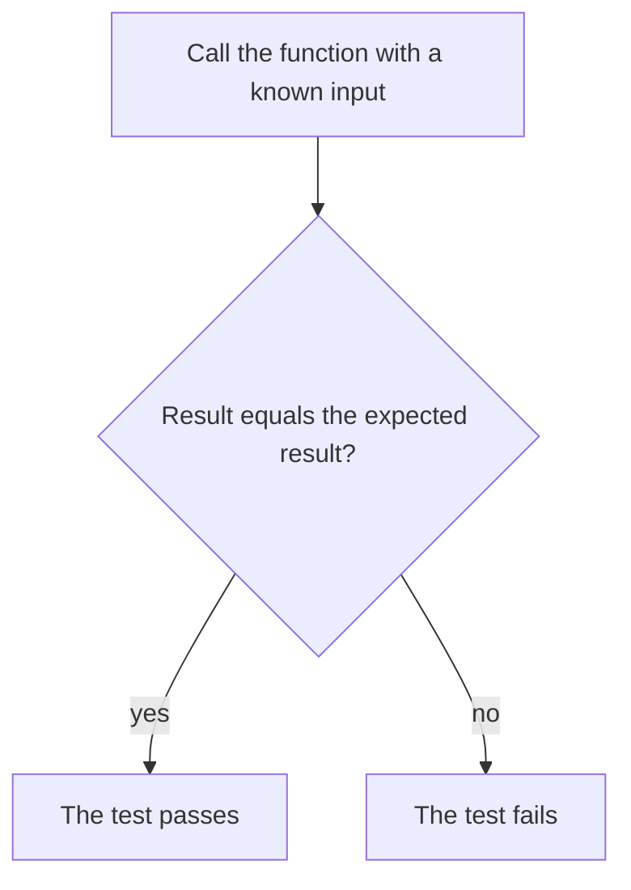
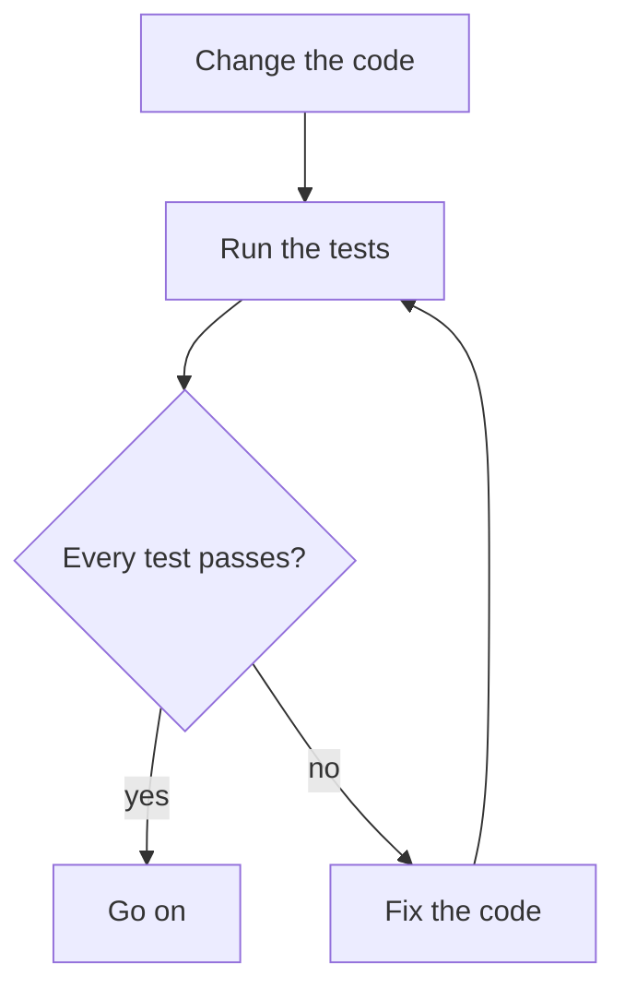

> **In one sentence:** A test is code that runs your code with a known input and checks that the result is the one you expected.

## Why should I care?

In [[errors|Errors]], a logic error gave a wrong answer with no message. To find one, you compare the result with the answer you expected. A **test** is code that does this comparison for you, as often as you like.

Go's tutorial on testing gives one reason to write tests: "Testing your code during development can expose bugs that find their way in as you make changes."

## Analogy

Think of a teacher with an answer key, which holds the right answer to each question. The teacher compares each student's answer with the key.

A test is one line on the key. The question is a known input, such as 3. The key's answer is the result you expect. Your code is the student.

**Where the analogy breaks down:** a teacher may accept an answer that is nearly right, or guess what the student meant. A test does not: the result must match. Also, a test checks only the inputs it uses. Wikipedia's article on software testing says testing "cannot find all bugs".

## How it actually works

### What a test is

A test has three parts:

1. a known input,
2. the result you expect for that input,
3. a check that compares the real result with the expected one.

If they match, the test **passes**. If not, it **fails**.

An **automated test** is a test that a program runs for you. A **unit test** checks one small piece of code, such as one [[functions|function]], on its own. Python's documentation says a **test case**, one test, "checks for a specific response to a particular set of inputs".

A **test runner** runs your tests and shows the results.



### A unit test of one small function

Each notebook costs 4 coins, so the function below should give 12 for 3 notebooks.

You run tests from a **terminal**, as in [[command-line|The Command Line]]. MDN Web Docs, a website that documents web technologies, calls the terminal a text interface for running text-based programs.

You do not need to run these examples now: reading the output is enough, and the Try-it below needs nothing installed. To run them later, install Node.js, Python or Go. Their official websites explain how: nodejs.org, python.org and go.dev.

Each example uses its language's own testing tool. You only need to read one tab.

<!-- tabs -->

### JavaScript

This uses [[nodejs|Node.js]], a program that runs JavaScript outside the browser. Node.js includes a test runner.

```js
// A file named cost.test.mjs.
// Bring in the test runner and the checks.
import test from "node:test";
import assert from "node:assert";

// The function to test.
function notebookCost(count) {
  return count * 4;
}

// One test: a name, and a function that runs the check.
test("3 notebooks cost 12", function () {
  // Check: is notebookCost(3) exactly 12?
  assert.strictEqual(notebookCost(3), 12);
});
```

`import` brings in code that Node.js provides, and the ending `.mjs` allows `import`.

`test` takes two arguments: a name for the test, and a function that holds the check. `assert.strictEqual` checks that two values are strictly equal. If they are not, it throws an error. A test whose function throws an error fails.

Node.js added this test runner in version 18.0.0. Its documentation says that in version 20.0.0, "The test runner is now stable."

To run it, type this in the terminal, in the file's folder:

```
node --test
```

`node --test` finds test files by their names, such as names ending in `.test.mjs`. Output from one run, with Node.js 24:

```
✔ 3 notebooks cost 12 (0.4753ms)
ℹ tests 1
ℹ suites 0
ℹ pass 1
ℹ fail 0
...
```

The `...` marks lines left out. Look for the name of your test, and the words `pass` and `fail`, each with a number.

### Python

This uses `unittest`, a module that comes with Python. A **module** is "a file containing Python definitions and statements", and you bring it in with `import`.

```python
# A file named test_cost.py.
# Bring in Python's own testing module.
import unittest

# The function to test.
def notebook_cost(count):
    return count * 4

# A group of tests.
class TestNotebookCost(unittest.TestCase):
    # One test. Its name must start with test.
    def test_three_notebooks(self):
        # Check: is notebook_cost(3) equal to 12?
        self.assertEqual(notebook_cost(3), 12)
```

`class` makes a group. With `unittest.TestCase` in its brackets, the group becomes tests that `unittest` can run. A function inside a class is called a **method**. Each method whose name starts with `test` is one test. `self` is the method's first parameter. Python fills it in for you when the test runs, and you call checks on it, such as `self.assertEqual`. (This is simplified. Classes do more than group tests.)

`self.assertEqual` checks that its two values are equal. If they are not, the test fails.

To run it, type this in the terminal, in the file's folder:

```
python -m unittest -v test_cost.py
```

On Windows, `py` in place of `python` also works: Python's Windows guide says `py` "matches the behaviour of `python`". `-m unittest` tells Python to run the `unittest` module, and `-v` asks for more detail. It runs the tests in `test_cost.py`. Here is the output from one run, with Python 3.11:

```
test_three_notebooks (test_cost.TestNotebookCost.test_three_notebooks) ... ok

----------------------------------------------------------------------
Ran 1 test in 0.000s

OK
```

Look for the name of your test with the word `ok`, the number of tests, and the word `OK`.

### Go

This uses Go's `testing` package and the command `go test`. A Go package is a group of files in the same folder. Here it is the package `cost`, in two files. It has no `main` function: `go test` builds the package together with its `_test.go` files and runs the tests.

```go
// A file named cost.go.
package cost

// The function to test.
func notebookCost(count int) int {
	return count * 4
}
```

```go
// A file named cost_test.go, in the same folder.
package cost

// Bring in Go's own testing package.
import "testing"

// One test. Its name must start with Test.
func TestNotebookCost(t *testing.T) {
	got := notebookCost(3)
	// Check: is the result 12?
	if got != 12 {
		t.Error("notebookCost(3) should be 12, but got", got)
	}
}
```

A file name ending in `_test.go` tells `go test` that the file holds tests. `go test` runs each function whose name starts with `Test`.

`t` is the parameter that each test receives. Its type is `*testing.T`. (The `*` marks a pointer, which this page leaves out.) `:=` creates a variable, and `!=` means "is not equal to". `t.Error` marks the test as failed and prints your words, followed by the value.

To run it, type these in the terminal, in the folder. The first command creates a file named `go.mod`. The Go tutorial says this file tracks your code's dependencies: other code that your code uses. A **module** is a group of related Go packages that are shared together. `example/cost` is the module path, a name you choose. The tutorial says it must be a download address only if you publish the module.

```
go mod init example/cost
go test
```

Here is the output of `go test` from one run, with Go 1.25:

```
PASS
ok  	example/cost	1.635s
```

Look for the words `PASS` and `ok`.

<!-- /tabs -->

### What a failing test looks like

Now suppose someone changes the multiplication to an addition by mistake. For 3 notebooks, the function now gives 3 + 4, which is 7. No error message shows this logic error. Run the tests again.

<!-- tabs -->

### JavaScript

The line in the function now reads `return count + 4;`. Run `node --test` again. Here is part of the output from one run:

```
✖ 3 notebooks cost 12 (0.8982ms)
ℹ tests 1
ℹ suites 0
ℹ pass 0
ℹ fail 1
...
✖ failing tests:
...
  AssertionError [ERR_ASSERTION]: Expected values to be strictly equal:

  7 !== 12
...
```

The `...` marks lines left out. Look for the word `fail` with a number above 0, and the name of the failing test. `AssertionError` is the error that `assert.strictEqual` threw. `7 !== 12` shows the real result, then the expected one: `!==` means "is not strictly equal to".

### Python

The line in the function now reads `return count + 4`. Run `python -m unittest -v test_cost.py` again. Here is part of the output from one run:

```
test_three_notebooks (test_cost.TestNotebookCost.test_three_notebooks) ... FAIL

======================================================================
FAIL: test_three_notebooks (test_cost.TestNotebookCost.test_three_notebooks)
----------------------------------------------------------------------
...
AssertionError: 7 != 12

----------------------------------------------------------------------
Ran 1 test in 0.001s

FAILED (failures=1)
```

The `...` marks lines left out. Look for the word `FAIL` and the name of the failing test. When a check fails, `unittest` raises an exception: here an `AssertionError`. `7 != 12` shows the real result, then the expected one: `!=` means "not equal".

### Go

The line in `cost.go` now reads `return count + 4`. Run `go test` again. Here is part of the output from one run:

```
--- FAIL: TestNotebookCost (0.00s)
    cost_test.go:12: notebookCost(3) should be 12, but got 7
FAIL
...
FAIL	example/cost	1.497s
```

The `...` marks a line left out. Look for the word `FAIL` and the name of the failing test. Go's documentation says `go test` "prints a final 'FAIL' status if any package test has failed". The second line gives the file, the line number, and your message from `t.Error`.

<!-- /tabs -->

### Run the tests again after every change

The same test passed before the mistake and failed after it. Fix the line and run the tests again: the test passes.

Wikipedia's article on unit testing says that formally defined test cases, tests written down exactly, "allow the same tests to be run repeatedly against successive versions of the software".



## How it came to be

Wikipedia's article on unit testing reports that in 1964, in a project named Mercury, "individual units developed by different programmers underwent "unit tests" before being integrated together". That means each part was tested before the parts were put together.

## 🧪 Try it in your browser

These steps use JavaScript, because your browser's console runs JavaScript. Here, `function` defines a function, and `return` gives a value back. `===` checks whether two values are equal and gives true or false. `console.assert` takes a check, called an assertion, and some words. MDN says it "writes an error message to the console if the assertion is false. If the assertion is true, nothing happens." Your words become part of that message.

You need a computer with Chrome, Edge or Firefox.

**Safety rule:** only type code in the console that you understand or that comes from a source you trust. Never paste anything a stranger sends you. The lines below only define a function and check its result.

1. Open [example.com](https://example.com).
   **What you should see:** a short page of text.
2. Open the **console**:
   - **Windows:** press `Ctrl` + `Shift` + `J` (in Firefox: `Ctrl` + `Shift` + `K`)
   - **Mac:** press `Cmd` + `Option` + `J` (in Firefox: `Cmd` + `Option` + `K`)
3. Click the line where you can type, below any messages. **Type** this line yourself (some browsers may block pasting at first), then press `Enter`. The browser may show suggestions, and the line may look different while you type. Keep typing.

   ```
   function notebookCost(count) { return count * 4; } console.assert(notebookCost(3) === 12, "3 notebooks should cost 12")
   ```

   **What you should see:** no message from the check, because the check is true. The console may also show `undefined`. That is normal.
4. This line makes the same mistake as before: `+` in place of `*`. Type it and press `Enter`:

   ```
   function notebookCost(count) { return count + 4; } console.assert(notebookCost(3) === 12, "3 notebooks should cost 12")
   ```

   **What you should see:** an error message that includes your words, 3 notebooks should cost 12. The console may also show `undefined`.
5. Fix the mistake and check again. Type this line and press `Enter`:

   ```
   function notebookCost(count) { return count * 4; } console.assert(notebookCost(3) === 12, "3 notebooks should cost 12")
   ```

   **What you should see:** no message from the check. The console may also show `undefined`.

Each line defines the function again, so no step depends on an earlier one. If you see an unexpected error message, look for a typo. Reload the page, delete anything left on the typing line, and start again from step 3.

## Common misunderstandings

- **"If all my tests pass, my code has no bugs."** No. A test checks only the inputs it uses. Testing "cannot find all bugs".
- **"A test is something you run once."** No. You can run the same tests after every change, to catch new mistakes.

## Recap

- A test runs your code with a known input and checks the result against the one you expected.
- A passing test shows that the result matched for that input. A failing test tells you which test failed.
- Run your tests again after every change, with the tool your language provides.

## Sources

- Node.js documentation, Test runner: https://nodejs.org/api/test.html
- Node.js documentation, Assert: https://nodejs.org/api/assert.html
- Node.js documentation, Modules: ECMAScript modules: https://nodejs.org/api/esm.html
- Node.js, Introduction to Node.js: https://nodejs.org/en/learn/getting-started/introduction-to-nodejs
- Python documentation, unittest, Unit testing framework: https://docs.python.org/3/library/unittest.html
- Python documentation, Glossary: https://docs.python.org/3/glossary.html
- Python documentation, Command line and environment: https://docs.python.org/3/using/cmdline.html
- Go Tutorial, Add a test: https://go.dev/doc/tutorial/add-a-test
- Go Tutorial, Create a Go module: https://go.dev/doc/tutorial/create-module
- Go, How to Write Go Code: https://go.dev/doc/code
- The Go Programming Language Specification: https://go.dev/ref/spec
- Go Packages, testing: https://pkg.go.dev/testing
- Go Packages, Command go: https://pkg.go.dev/cmd/go
- Wikipedia, Unit testing: https://en.wikipedia.org/wiki/Unit_testing
- Wikipedia, Software testing: https://en.wikipedia.org/wiki/Software_testing
- MDN Web Docs, Command line crash course: https://developer.mozilla.org/en-US/docs/Learn_web_development/Getting_started/Environment_setup/Command_line
- MDN Web Docs, console.assert(): https://developer.mozilla.org/en-US/docs/Web/API/console/assert_static
- MDN Web Docs, Strict equality (===): https://developer.mozilla.org/en-US/docs/Web/JavaScript/Reference/Operators/Strict_equality
- MDN Web Docs, eval(): https://developer.mozilla.org/en-US/docs/Web/JavaScript/Reference/Global_Objects/eval
- MDN Web Docs, About MDN: https://developer.mozilla.org/en-US/about
- Microsoft Edge DevTools, Run JavaScript in the Console: https://learn.microsoft.com/en-us/microsoft-edge/devtools/console/console-javascript
- Chrome for Developers, Open Chrome DevTools: https://developer.chrome.com/docs/devtools/open
- Microsoft Edge DevTools, Keyboard shortcuts: https://learn.microsoft.com/en-us/microsoft-edge/devtools/shortcuts/
- Firefox DevTools User Docs, Web Console: https://firefox-source-docs.mozilla.org/devtools-user/web_console/index.html
- Chrome for Developers, What are self-XSS attacks?: https://developer.chrome.com/blog/self-xss
- Example Domain: https://example.com
- Node.js, Download Node.js: https://nodejs.org/en/download
- Python Tutorial, Modules: https://docs.python.org/3/tutorial/modules.html
- Python documentation, Using Python on Windows: https://docs.python.org/3/using/windows.html
- Python documentation, Built-in Types: https://docs.python.org/3/library/stdtypes.html
- Python.org, Download Python: https://www.python.org/downloads/
- Go, Download and install: https://go.dev/doc/install
- MDN Web Docs, Strict inequality (!==): https://developer.mozilla.org/en-US/docs/Web/JavaScript/Reference/Operators/Strict_inequality
