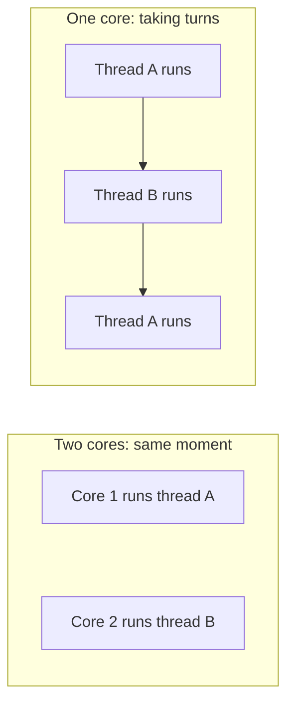

> **In one sentence:** A thread is a sequence of instructions inside a process: threads share its memory, and they run at the same moment only with enough CPU cores, otherwise they take turns.

## Why should I care?

In [[asynchronous-code|Asynchronous Code]], you saw that a long calculation can block a page. Threads are one answer.

This page's title says "at once". That is true only when the computer has enough [[cpu|CPU]] cores. Without them, threads take turns, so quickly that they only appear to run together.

## Analogy

In the kitchen from [[processes|Processes]], an order is a process, and the manager is the [[operating-system|operating system]]. Here, one cook is one CPU core.

One order can need two parts: the rice and the sauce. Each part is like a **thread**, with its own place in the recipe. Both use the food on that order's part of the table.

With one cook, the manager decides when the cook moves between them. Only one part moves forward at any moment. Two cooks can move both forward together.

**Where the analogy breaks down:** real cooks can see each other and avoid getting in the way. Threads do not, unless the programmer adds code to coordinate them.

## How it actually works

### What a thread is

MDN Web Docs, a website that documents web technologies, says: "A thread is a sequence of instructions that a program follows."

Microsoft's Windows documentation says a process starts with one thread and can create more.

Microsoft says a thread has its own "set of machine registers". The program counter from the topic CPU is a register, and it marks the next instruction. So each thread keeps its own place.

### Threads share memory

Each process has its own address space: the memory addresses it can use. Other processes cannot reach it unless it is shared. Microsoft says all threads of a process share its address space. So one thread can read a value that another wrote.

MDN warns that threads sharing data can "change it independently and unexpectedly", which "can cause bugs that are hard to find".

### Taking turns, or truly at the same moment

Oracle's threads guide defines two words:

- **Concurrency** is when at least two threads are "making progress". This "can include time-slicing", which is taking turns.
- **Parallelism** is when at least two threads are "executing simultaneously".

Windows gives each thread a **time slice**: a short turn on a core. Microsoft says the length depends on the operating system and the processor, and gives about 20 milliseconds as the size. So "multiple threads appear to be executing at the same time".

With several cores, this becomes true. A core is "a semi-independent CPU", says Stanford's course, so it counts as a processor here. Microsoft says the system "can simultaneously execute as many threads as there are processors". Other threads take turns. (This is simplified: the topic CPU explains logical processors.)



### Threads in JavaScript

MDN says a page's **main thread** is the one the browser uses to "handle user events, render and paint the display". It also runs most of the page's code, so a slow script there can freeze the page.

A **Web Worker** runs code in a separate thread. MDN calls these "background threads". Here is code for one:

```js
// This code runs in the worker's own thread.
onmessage = (event) => {
  // event.data holds the message: how many milliseconds to stay busy.
  const end = Date.now() + event.data;
  while (Date.now() < end) {
    // Nothing to do here. The loop keeps this thread busy.
  }
  // Send a message back to the main thread.
  postMessage(event.data);
};
```

`onmessage` is a name the browser provides inside a worker, so it needs no `let`. Code stored in it runs when a message arrives. `postMessage` sends to the main thread. On the main thread, `worker.postMessage` and `worker.onmessage` do the opposite.

Web Workers break the sharing rule above. MDN says the two sides "never get direct access to each other's variables", and can share data only "in very specific cases". Their messages are normally copied.

### Why the page does not freeze

The worker's work runs in another thread, so the main thread stays free to respond. MDN says workers avoid "blocking the user interface thread", which is the main thread. On one core, the operating system gives the two threads turns, so the main thread still gets its turn.

### Threads and asynchronous code

During a `fetch`, the wait is for the server, and the browser does the waiting. MDN says the program "can still process other things like user input".

A long calculation in your own code is different. MDN says that wrapping it in a promise, an object for a later result, "does not move those calculations to another thread, so it still blocks the main thread". A Web Worker is one way to avoid that.

## How it came to be

Wikipedia says a 1966 source credits Victor A. Vyssotsky with the term "thread". Threads "made an early appearance" as "tasks" in IBM's OS/360, an operating system, in 1967.

## 🧪 Try it in your browser

You need a computer with Chrome, Edge or Firefox.

**Safety rule:** only type code in the console that you understand or that comes from a source you trust. Never paste anything a stranger sends you. The lines below only create a worker, keep it busy and show text in the console.

1. Open [example.com](https://example.com/).
   **What you should see:** a short page.
2. Open the **console**:
   - **Windows:** press `Ctrl` + `Shift` + `J` (in Firefox: `Ctrl` + `Shift` + `K`)
   - **Mac:** press `Cmd` + `Option` + `J` (in Firefox: `Cmd` + `Option` + `K`)
3. Click the line where you can type. **Type** this line yourself (some browsers may block pasting at first), then press `Enter`. It stores the worker's code as text. The browser may show suggestions, and the line may look different while you type. Keep typing.

   ```
   const code = "onmessage = (event) => { const end = Date.now() + event.data; while (Date.now() < end) { } postMessage(event.data) }"
   ```

   **What you should see:** the console may show `undefined`. That is normal.
4. Create the worker. Type the capital letters exactly, then press `Enter`:

   ```
   const worker = new Worker(URL.createObjectURL(new Blob([code], { type: "text/javascript" })))
   ```

   You only need to read this line, not learn it. It is one way to give a worker its code in a single line.
   **What you should see:** the console may show `undefined`.
5. Tell the main thread what to do with the worker's reply. Type this and press `Enter`:

   ```
   worker.onmessage = (event) => console.log("The worker was busy for " + event.data + " milliseconds")
   ```

   **What you should see:** the console shows the function you stored, in the browser's own form.
6. Ask the worker to stay busy for 20 seconds. Type this and press `Enter`:

   ```
   worker.postMessage(20000); console.log("The main thread carries on")
   ```

   **What you should see:** `The main thread carries on`. The console may also show `undefined`.
7. Before step 8's line appears, type this and press `Enter`:

   ```
   1 + 1
   ```

   **What you should see:** `2`.
8. Wait.
   **What you should see:** `The worker was busy for 20000 milliseconds`, about 20 seconds after step 6.

**What this showed:** if `2` came before step 8's line, the main thread answered you while the worker's thread was busy. On one core they took turns, so this does not prove they ran at the same moment.

**If something goes wrong:** look for a typo. If `Enter` gives a new line and no answer, a bracket is probably still open. If step 8's line never appears, check the line in step 3. Then reload the page and start again from step 3.

## Common misunderstandings

- **"Threads always run at the same moment."** No. Without enough cores, they take turns.
- **"More threads always make a program faster."** No. Microsoft warns that "system performance can decrease if there are too many threads".

## Recap

- A thread is a sequence of instructions in a process. A process's threads share its memory.
- Concurrency can mean taking turns. Parallelism means running at the same moment, which needs enough cores.
- A Web Worker runs JavaScript in another thread and exchanges messages with the main thread.

## Sources

- MDN Web Docs, Introducing asynchronous JavaScript: https://developer.mozilla.org/en-US/docs/Learn_web_development/Extensions/Async_JS/Introducing
- MDN Web Docs, Introducing workers: https://developer.mozilla.org/en-US/docs/Learn_web_development/Extensions/Async_JS/Introducing_workers
- MDN Web Docs, Using Web Workers: https://developer.mozilla.org/en-US/docs/Web/API/Web_Workers_API/Using_web_workers
- MDN Web Docs, Thread (glossary): https://developer.mozilla.org/en-US/docs/Glossary/Thread
- MDN Web Docs, JavaScript execution model: https://developer.mozilla.org/en-US/docs/Web/JavaScript/Reference/Execution_model
- MDN Web Docs, Date.now(): https://developer.mozilla.org/en-US/docs/Web/JavaScript/Reference/Global_Objects/Date/now
- MDN Web Docs, Assignment (=): https://developer.mozilla.org/en-US/docs/Web/JavaScript/Reference/Operators/Assignment
- MDN Web Docs, console.log(): https://developer.mozilla.org/en-US/docs/Web/API/console/log_static
- MDN Web Docs, About MDN: https://developer.mozilla.org/en-US/about
- Microsoft Learn, About Processes and Threads: https://learn.microsoft.com/en-us/windows/win32/procthread/about-processes-and-threads
- Microsoft Learn, Virtual Address Space: https://learn.microsoft.com/en-us/windows/win32/memory/virtual-address-space
- Microsoft Learn, Multitasking: https://learn.microsoft.com/en-us/windows/win32/procthread/multitasking
- Oracle, Multithreaded Programming Guide, Defining Multithreading Terms: https://docs.oracle.com/cd/E19455-01/806-5257/6je9h032b/index.html
- Stanford CS101, Computer Hardware: https://web.stanford.edu/class/cs101/hardware-1.html
- Wikipedia, Thread (computing): https://en.wikipedia.org/wiki/Thread_(computing)
- Wikipedia, Program counter: https://en.wikipedia.org/wiki/Program_counter
- Example Domain: https://example.com/
- Chrome for Developers, Open Chrome DevTools: https://developer.chrome.com/docs/devtools/open
- Microsoft Edge DevTools, Keyboard shortcuts: https://learn.microsoft.com/en-us/microsoft-edge/devtools/shortcuts/
- Microsoft Edge DevTools, Run JavaScript in the Console: https://learn.microsoft.com/en-us/microsoft-edge/devtools/console/console-javascript
- Firefox DevTools User Docs, Web Console: https://firefox-source-docs.mozilla.org/devtools-user/web_console/index.html
- Chrome for Developers, What are self-XSS attacks?: https://developer.chrome.com/blog/self-xss
- Microsoft Learn, Multitasking Considerations: https://learn.microsoft.com/en-us/windows/win32/procthread/multitasking-considerations
- WHATWG Fetch Standard: https://fetch.spec.whatwg.org/
- MDN Web Docs, Promise: https://developer.mozilla.org/en-US/docs/Web/JavaScript/Reference/Global_Objects/Promise
- Firefox DevTools User Docs, The JavaScript input interpreter: https://firefox-source-docs.mozilla.org/devtools-user/web_console/the_command_line_interpreter/index.html
