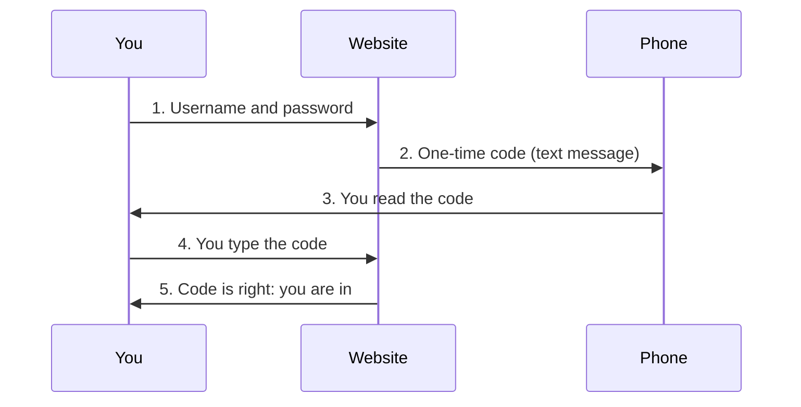

> **In one sentence:** Two-step verification asks for a second proof after your password, such as a one-time code or a security key, so that someone who knows your password still cannot log in.

## Why should I care?

You type your password, and then the website says: "We sent a code to your phone." You type the code, and only then are you in. That extra step is **two-step verification** (2SV).

In [[passwords]] you learned that passwords can be stolen or guessed. The UK's National Cyber Security Centre (NCSC) says two-step verification "helps to keep cyber criminals out of your accounts, even if they know your passwords".

It has several names. The NCSC says it "is also known as two-factor authentication (2FA) or multi-factor authentication (MFA)". **Authentication** means proving who you are.

## Analogy

The US Federal Trade Commission (FTC) compares it to "using two locks on your door". A thief with the key to one lock still cannot open the door.

**Where the analogy breaks down:** a door lock cannot be talked into opening. Online, a criminal can try to trick *you* into giving them the second "key". The FTC warns: "Scammers try to trick you into giving them your verification passcode."

## How it actually works

### Three kinds of proof

NIST, a US government agency that writes guidelines for logging in, lists three **authentication factors** (kinds of proof):

- **Something you know**, such as a password or a PIN (a short secret number).
- **Something you have**, such as a device. CISA, a US government security agency, gives the examples of "an authentication application or a confirmation text on your phone".
- **Something you are**, such as "a fingerprint or face scan", CISA says.

The FTC says two-step verification asks for proofs from "two of the three categories". So your password is one proof, and the second is of a different kind, such as something you have. CISA says: "Even if an unauthorized user steals your password, they won't be able to meet the second step requirement".

### Common kinds of second step

- **A code by text message or email.** The FTC says this **one-time code** is "only good for one log in and expires automatically".
- **An authenticator app.** An **app** is a program on your [[smartphone]]. CISA says these apps "generate a new code every 30 seconds". The NCSC says they work without "needing a mobile signal": the phone does not need the phone network.
- **A prompt.** The FTC says an authenticator app may send "a push notification" (a message that pops up) to your phone when someone tries to log in. The FTC says you "can approve or deny the request with a tap".
- **A security key.** The FTC says security keys "are physical devices". Some plug into the computer; others connect when you hold them close.

A fingerprint or face scan can be part of the second step too. NIST's guidelines say it should count only together with a device you have, such as your phone, never on its own.

Here is a login with a code by text message:

You may not be asked for the second step every time. The NCSC says you should usually be asked only when it really matters, such as "logging into an account from a new device, or changing your password". On a device you use often, you can look for an option such as "remember this browser".

### Some kinds are stronger

CISA lists the kinds from strongest to weakest: security key first, then authenticator apps, then fingerprint or face, and a code by text message or email last. CISA says the text or email code "provides the weakest protection". But CISA also says "Any MFA is better than none". (CISA gives the order; this page does not explain every reason for it.)

The difference is [[phishing-and-scams|phishing]]: a fake website or message that tricks you into giving away a secret. NIST says one-time codes are "not phishing-resistant". NIST explains that a code you type by hand is not tied to the website you are logging in to. So a fake website can ask for your code, and a criminal can type it into the real one.

A **phishing-resistant** method is one that a fake website cannot trick in this way. CISA says a security key gives "the best protection against phishing". (How it does this is beyond this page.)

### Backup codes

What if you lose your phone? The NCSC says some accounts "give you a list of backup codes when you switch on 2SV". Each code "will only work once", and the NCSC says to "store the codes somewhere safe". NIST calls them "one-time saved recovery codes". The NCSC also says many services let you set up more than one second step for this reason.

## How it came to be

The IETF is a group that, in its own words, produces "technical documents (RFCs) that define how Internet technology works in detail". In May 2011, it published RFC 6238, the "Time-Based One-Time Password" method. It describes codes that work only for a short time. They are made from the current time and a secret that your device and the website share. It recommends a new code every 30 seconds.

On 4 March 2019, W3C, a non-profit organization that develops "open standards" for the web, published **Web Authentication** (WebAuthn) as a W3C Recommendation. WebAuthn describes a way for websites to log users in "strongly". W3C says its Recommendations "are considered web standards".

## 🧪 Try it in your browser

You will only read here. Do not change any settings, and never type a password.

1. Open the NCSC page [Turn on 2-step verification (2SV)](https://www.ncsc.gov.uk/collection/top-tips-for-staying-secure-online/activate-2-step-verification-on-your-email).
2. Read the first paragraphs. **What you should see:** the other names for it, "two-factor authentication (2FA)" and "multi-factor authentication (MFA)".
3. Scroll down and look for the words "security settings". **What you should see:** the option to turn it on is "usually found in the security settings for the account".
4. Open the CISA page [Turn On MFA](https://www.cisa.gov/secure-our-world/turn-mfa) and scroll down. **What you should see:** short steps that say to look under your account profile, then select the security settings, turn on MFA, and choose a method. Only read them for now.

These steps work on a computer or a phone.

## Common misunderstandings

- **"With two-step verification, my password does not matter."** It still matters. A password is the first step. The NCSC says "even accounts protected with strong passwords will benefit" from two-step verification: you need both.
- **"A real company may ask me to read out my code."** The FTC says: "don't share your verification code with someone if you didn't contact them first."

## Recap

- Two-step verification asks for a second proof after your password, usually something you have, such as a phone or a security key.
- It helps even if your password is stolen. But never give your code to anyone: phishing can steal one-time codes.
- Security keys are the strongest kind CISA lists. Keep backup codes somewhere safe in case you lose your phone.

## Sources

- NCSC, Turn on 2-step verification (2SV): https://www.ncsc.gov.uk/collection/top-tips-for-staying-secure-online/activate-2-step-verification-on-your-email
- NCSC, Setting up 2-Step Verification (2SV): https://www.ncsc.gov.uk/guidance/setting-two-factor-authentication-2fa
- CISA, Turn On MFA: https://www.cisa.gov/secure-our-world/turn-mfa
- CISA, Require Multifactor Authentication: https://www.cisa.gov/secure-our-world/require-multifactor-authentication
- CISA, More than a Password: https://www.cisa.gov/mfa
- CISA, About CISA: https://www.cisa.gov/about
- FTC Consumer Advice, Use Two-Factor Authentication to Protect Your Accounts: https://consumer.ftc.gov/articles/use-two-factor-authentication-protect-your-accounts
- NIST CSRC Glossary, multifactor authentication: https://csrc.nist.gov/glossary/term/multi_factor_authentication
- NIST SP 800-63B-4, Digital Identity Guidelines: https://pages.nist.gov/800-63-4/sp800-63b.html
- NIST, About NIST: https://www.nist.gov/about-nist
- RFC 6238, TOTP: Time-Based One-Time Password Algorithm: https://www.rfc-editor.org/rfc/rfc6238
- IETF, Introduction to the IETF: https://www.ietf.org/about/introduction/
- W3C, Web Authentication Level 1: https://www.w3.org/TR/2019/REC-webauthn-1-20190304/
- W3C, About us: https://www.w3.org/about/
- W3C, Standards: https://www.w3.org/standards/
