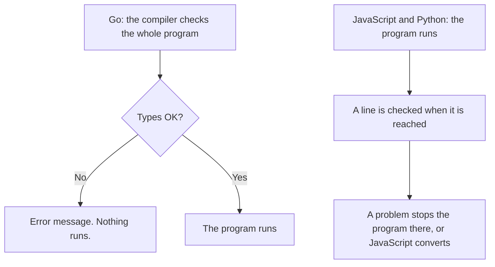

> **In one sentence:** Every value has a type, such as number or string. The type decides what you can do with the value.

## Why should I care?

In [[variables|Variables]], you met three kinds of value: numbers, strings and booleans. In [[lists-and-dictionaries|Lists and Dictionaries]], you met two more: lists and dictionaries. The kind of a value is called its **type**.

`"5"` is a string and `5` is a number, and they behave differently. This page shows how to ask a value its type, what happens when types mix, and how to convert a value.

## Analogy

Think of a phone with a calculator and a messages app. You can enter "5", then "+", then "1" in both. After you press "=", the calculator shows 6, because it works with numbers. The message shows the text you entered, "5+1", because it works with text.

A type is like the app: it decides what an action such as `+` does.

**Where the analogy breaks down:** on a phone, the screen shows which app you are in. In code, a variable's name does not show the type of its value. Each language on this page gives you a way to ask.

## How it actually works

### Every value has a type

A **type** is a kind of value. It decides which values are possible and what you can do with them, such as adding or joining. Go's specification and Python's documentation both describe types this way.

Here are the types you have met so far, and one more:

- number, such as `42`
- string, such as `"42"`
- boolean: true or false
- list
- dictionary
- in JavaScript and Python, a value that means "nothing here"

Each language has its own names for these types. (This is simplified: languages have more types.)

### Asking a value its type

The examples are in [[javascript|JavaScript]], [[python|Python]] and [[go-language|Go]]. You only need to read one tab.

<!-- tabs -->

### JavaScript

`typeof` gives the type of the value after it, as a string. You write it before a value. It works without round brackets.

```js
console.log(typeof 42);           // Shows: number
console.log(typeof "42");         // Shows: string
console.log(typeof true);         // Shows: boolean
console.log(typeof ["a", "b"]);   // Shows: object
console.log(typeof { Mira: 30 }); // Shows: object
console.log(typeof undefined);    // Shows: undefined
```

An array (a list) gives `object`, not `array`. MDN Web Docs, a website that documents web technologies, says arrays are "regular objects" in JavaScript. `undefined` is a value that means "no value here", and its type is also called `undefined`.

### Python

`type()` gives the type of the value inside its round brackets. `print()` shows it in the form `<class '...'>`, with the type's name between the quote marks. For now, read `class` here as "type".

```python
print(type(42))            # Shows: <class 'int'>
print(type(4.2))           # Shows: <class 'float'>
print(type("42"))          # Shows: <class 'str'>
print(type(True))          # Shows: <class 'bool'>
print(type(["a", "b"]))    # Shows: <class 'list'>
print(type({"Mira": 30}))  # Shows: <class 'dict'>
print(type(None))          # Shows: <class 'NoneType'>
```

Python has two types for numbers here: `int` for whole numbers, and `float` for numbers with a decimal point. `str` is a string. `bool` is a boolean: its only values are `True` and `False`. `None` is a value that means "no value here".

### Go

In Go, every variable has exactly one type, fixed before the program runs. To show a value's type, use `fmt.Printf`. It prints by following a pattern. The pattern is the string in quote marks that comes first. In the pattern, `%T` "shows the type of an item rather than its value", the `fmt` documentation says, and `\n` starts a new line. The value after the comma is the item.

```go
package main

import "fmt"

func main() {
	// %T shows the type of the value after the quote marks.
	fmt.Printf("%T\n", 42)                         // Shows: int
	fmt.Printf("%T\n", 4.2)                        // Shows: float64
	fmt.Printf("%T\n", "42")                       // Shows: string
	fmt.Printf("%T\n", true)                       // Shows: bool
	fmt.Printf("%T\n", []string{"a", "b"})         // Shows: []string
	fmt.Printf("%T\n", map[string]int{"Mira": 30}) // Shows: map[string]int
}
```

`int` holds whole numbers. `float64` is one of Go's types for numbers with a decimal point. A slice's type includes the type of its items, so `[]string` is a slice of strings. A map's type includes the types of its keys and values.

<!-- /tabs -->

### When types mix

What happens when you use `+` on a string and a number? Each language has its own answer.

<!-- tabs -->

### JavaScript

JavaScript turns one value into the other type, without asking you. With `+`, MDN says that if one side is a string, the other side is also converted to a string.

```js
const word = "5";
const number = 1;
console.log(word + number); // Shows: 51
```

MDN calls JavaScript **weakly typed**: it converts mismatched types "instead of throwing type errors". If you wanted to add, you get a wrong answer and no error message.

### Python

Python does not convert here. The line stops the program with an error message whose last line names a `TypeError`. Python's documentation says a `TypeError` happens when an operation, such as `+`, is used on "an object of inappropriate type". In Python, every value is called an object, so this means a value of the wrong type.

```python
word = "5"
number = 1
# A string and a number: this line stops with an error.
print(word + number)
```

In an example in Python's tutorial, the last line of the message is `TypeError: can only concatenate str (not "int") to str`. "Concatenate" means join. Python finds this mistake while the program runs.

### Go

Go does not convert here, and the program never starts. Go's specification says that here, the two sides of `+` must have identical types. Before a Go program runs, a **compiler** (a translator) turns it into a program the computer can run. The compiler refuses this code and shows an error message.

```go
package main

import "fmt"

func main() {
	word := "5"
	number := 1
	// A string and a number: the compiler refuses this line.
	// The compiler's message, from one try: invalid operation: word + number (mismatched types string and int)
	fmt.Println(word + number)
}
```

The compiler refuses the whole program, so nothing runs.

<!-- /tabs -->

### Converting between types

You can turn a value into another type yourself. This is called **converting**. A conversion can fail: the string `"five"` is not written as a number, so it does not become one.

<!-- tabs -->

### JavaScript

`Number()` turns a value into a number, and `String()` turns a value into a string.

```js
// Number() turns a string into a number.
console.log(Number("5") + 1); // Shows: 6
// String() turns a number into a string.
console.log(String(5) + 1);   // Shows: 51
// "five" is not written as a number, so this fails.
console.log(Number("five"));  // Shows: NaN
```

A string that fails to convert gives no error. It gives `NaN`, a value that MDN says represents "Not-A-Number".

### Python

`int()` turns a value into a whole number, and `str()` turns a value into a string.

```python
# int() turns a string into a whole number.
print(int("5") + 1)   # Shows: 6
# str() turns a number into a string.
print(str(5) + "1")   # Shows: 51
# "five" is not written as a number, so this line stops with an error.
print(int("five"))
```

A failed conversion stops the program with an error message that names a `ValueError`. Python's documentation says this happens when a value has "the right type but an inappropriate value": here, a string, but not one written as a whole number.

### Go

The `strconv` package converts between strings and other types. Its documentation describes "Atoi (string to int) and Itoa (int to string)". The `import` line now brings in two packages, grouped in round brackets.

```go
package main

import (
	"fmt"
	"strconv"
)

func main() {
	// Atoi turns a string into a whole number.
	// It gives back two values: the number and an error.
	n, err := strconv.Atoi("5")
	fmt.Println(n+1, err) // Shows: 6 <nil>

	// Itoa turns a whole number into a string.
	s := strconv.Itoa(5)
	fmt.Println(s + "1") // Shows: 51

	// "five" is not written as a number, so the conversion fails.
	n, err = strconv.Atoi("five")
	fmt.Println(n, err) // Shows: 0 strconv.Atoi: parsing "five": invalid syntax
}
```

`strconv.Atoi` gives back two values. `n, err :=` creates two variables to keep them. Later, `n, err =` has no colon, because the variables already exist. `err` is an error value that your program can check. Go does not stop: the next line still runs. When the conversion works, `err` is `nil`, which Go's specification uses to represent "no error". Here, when it fails, `n` is 0, and the message in `err` contains the words `invalid syntax`.

<!-- /tabs -->

### When are types checked?

**Type checking** means making sure that each value is used in a way its type allows. It can happen at two different moments:

- **Static type checking** looks at the program's text before it runs. Go works this way. Go's FAQ says Go programs are "compiled ahead of time": a **compiler**, a translator, prepares them before they run. A Go blog post says "Go is statically typed". Each variable has "exactly one type known and fixed at compile time", that is, when the compiler works.
- **Dynamic type checking** happens while the program runs. JavaScript and Python are **dynamically typed**: MDN says this of JavaScript, and Python's FAQ lists "dynamic typing" among Python's features. In JavaScript, MDN says, a variable can hold a string now and a number later.



(This is simplified.)

## How it came to be

Go's FAQ says its designers tried to combine "the ease of programming" of a dynamically typed language with "the efficiency and safety" of a statically typed one.

JavaScript has kept one surprise since its beginning. Asked for the type of `null`, a value that means "nothing", it answers `"object"`. MDN explains that the first version of JavaScript stored each value with a type tag, a number that marked its type. `null` got the tag used for objects.

## 🧪 Try it in your browser

These steps use JavaScript, the language the browser's console runs. In it, `typeof` gives the type of the value after it, and `Number()` turns a value into a number. `let` creates a variable, and `console.log` shows a value. You need a computer with Chrome, Edge or Firefox.

**Safety rule:** only enter code in the console that you understand or that comes from a source you trust. Never paste anything a stranger sends you. The lines below ask values their type, add and convert values, and create one variable.

1. Open [example.com](https://example.com).
   **What you should see:** a short page of text.
2. Open the **console**:
   - **Windows:** press `Ctrl` + `Shift` + `J` (in Firefox: `Ctrl` + `Shift` + `K`)
   - **Mac:** press `Cmd` + `Option` + `J` (in Firefox: `Cmd` + `Option` + `K`)
3. Click the line where you can type, below any messages. In each step below, enter the line yourself with the keyboard (some browsers may block pasting at first), then press `Enter`. The browser may show suggestions, and the line may look different while you write. Keep going.

   ```
   typeof 42
   ```

   **What you should see:** the word number. `typeof` gives a string.
4. Ask a string its type:

   ```
   typeof "42"
   ```

   **What you should see:** the word string.
5. Mix a string and a number:

   ```
   "5" + 1
   ```

   **What you should see:** the digits 51. The `1` was turned into a string.
6. Convert first, then add:

   ```
   Number("5") + 1
   ```

   **What you should see:** `6`.
7. Try a conversion that cannot work:

   ```
   Number("five")
   ```

   **What you should see:** `NaN`, which stands for "Not-A-Number".
8. Give one variable a value of another type:

   ```
   let age = "30"; console.log(typeof age); age = Number(age); console.log(typeof age)
   ```

   The `;` separates the commands, so this one line holds four commands.

   **What you should see:** the word `string`, then the word `number`. The console may also show `undefined`, because `console.log` gives back no result.

If you see an error message at any step, look for a typo. If that does not help, reload the page and start again from step 3.

**On a phone:** say out loud what JavaScript gives for `"2" + 2` and for `Number("2") + 2`. The answers are `22` and `4`.

## Common misunderstandings

- **"A dynamically typed language has no types."** No. In JavaScript and Python, every value still has a type. The types are checked while the program runs.
- **"If a Go program compiles, it has no errors."** No. The compiler finds type mistakes before the program runs. But Go's specification says other mistakes, such as reading a list item that does not exist, cause a "run-time panic" while the program runs.

## Recap

- Every value has a type, such as number, string, boolean, list or dictionary. The type decides what you can do with it.
- With `+` on a string and a number, JavaScript converts by itself, Python stops with an error while it runs, and Go refuses before it runs.
- You can convert a value to another type yourself, but a conversion can fail.

## Sources

- MDN Web Docs, JavaScript data types and data structures: https://developer.mozilla.org/en-US/docs/Web/JavaScript/Guide/Data_structures
- MDN Web Docs, typeof: https://developer.mozilla.org/en-US/docs/Web/JavaScript/Reference/Operators/typeof
- MDN Web Docs, Addition (+): https://developer.mozilla.org/en-US/docs/Web/JavaScript/Reference/Operators/Addition
- MDN Web Docs, Number() constructor: https://developer.mozilla.org/en-US/docs/Web/JavaScript/Reference/Global_Objects/Number/Number
- MDN Web Docs, Number: https://developer.mozilla.org/en-US/docs/Web/JavaScript/Reference/Global_Objects/Number
- MDN Web Docs, String() constructor: https://developer.mozilla.org/en-US/docs/Web/JavaScript/Reference/Global_Objects/String/String
- MDN Web Docs, NaN: https://developer.mozilla.org/en-US/docs/Web/JavaScript/Reference/Global_Objects/NaN
- MDN Web Docs, Static typing (glossary): https://developer.mozilla.org/en-US/docs/Glossary/Static_typing
- MDN Web Docs, Dynamic typing (glossary): https://developer.mozilla.org/en-US/docs/Glossary/Dynamic_typing
- MDN Web Docs, console.log(): https://developer.mozilla.org/en-US/docs/Web/API/console/log_static
- MDN Web Docs, eval(): https://developer.mozilla.org/en-US/docs/Web/JavaScript/Reference/Global_Objects/eval
- MDN Web Docs, About MDN: https://developer.mozilla.org/en-US/about
- Wikipedia, Type system: https://en.wikipedia.org/wiki/Type_system
- Python documentation, Built-in Functions: https://docs.python.org/3/library/functions.html
- Python documentation, Built-in Types: https://docs.python.org/3/library/stdtypes.html
- Python Language Reference, Data model: https://docs.python.org/3/reference/datamodel.html
- Python Tutorial, Errors and Exceptions: https://docs.python.org/3/tutorial/errors.html
- Python documentation, Built-in Exceptions: https://docs.python.org/3/library/exceptions.html
- Python documentation, General Python FAQ: https://docs.python.org/3/faq/general.html
- The Go Programming Language Specification: https://go.dev/ref/spec
- Go, Frequently Asked Questions (FAQ): https://go.dev/doc/faq
- The Go Programming Language, Effective Go: https://go.dev/doc/effective_go
- Go Packages, fmt: https://pkg.go.dev/fmt
- Go Packages, strconv: https://pkg.go.dev/strconv
- The Go Blog, The Laws of Reflection: https://go.dev/blog/laws-of-reflection
- MDN Web Docs, Statements and declarations: https://developer.mozilla.org/en-US/docs/Web/JavaScript/Reference/Statements
- MDN Web Docs, Lexical grammar: https://developer.mozilla.org/en-US/docs/Web/JavaScript/Reference/Lexical_grammar
- Microsoft Edge DevTools, Run JavaScript in the Console: https://learn.microsoft.com/en-us/microsoft-edge/devtools/console/console-javascript
- Chrome for Developers, Open Chrome DevTools: https://developer.chrome.com/docs/devtools/open
- Microsoft Edge DevTools, Keyboard shortcuts: https://learn.microsoft.com/en-us/microsoft-edge/devtools/shortcuts/
- Firefox DevTools User Docs, Web Console: https://firefox-source-docs.mozilla.org/devtools-user/web_console/index.html
- Chrome for Developers, What are self-XSS attacks?: https://developer.chrome.com/blog/self-xss
- Example Domain: https://example.com
