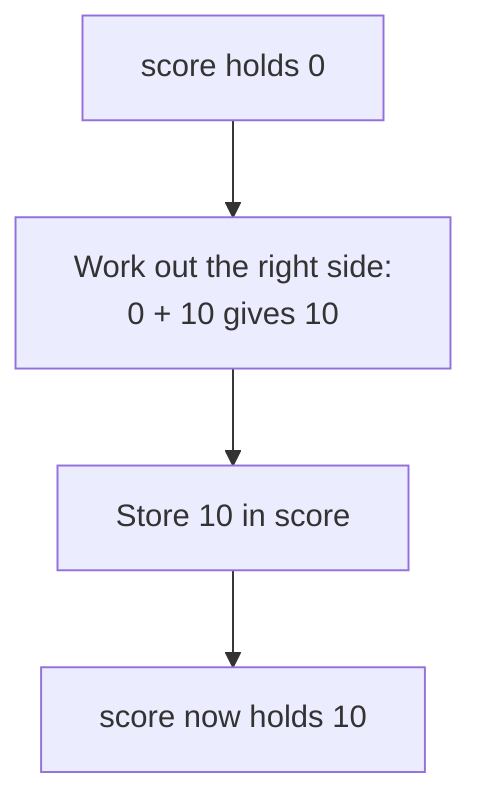

> **In one sentence:** A variable is a name for a value, so your program can keep that value, use it later and sometimes replace it.

## Why should I care?

In [[what-is-programming|What is Programming, Really?]], you showed numbers and text with `console.log`. But imagine a game that shows your score. The score grows while you play, so the program cannot write it down once and forget it. The program must keep the score somewhere, and it must be able to change it.

A variable is how a program does that.

## Analogy

Think of the contacts on a phone. You save a friend's number under the name "Sam". Later, you tap "Sam" and you never need to remember the digits. If Sam gets a new number, you change it in one place, and the name "Sam" still works.

A variable is like a contact: a **name**, with a **value** kept under that name.

**Where the analogy breaks down:** a contact can hold several numbers. A variable holds one value at a time, and that value can be a number, some text or something else. When you give a variable a new value, the old value is gone from that variable.

## How it actually works

### Values and their kinds

A **value** is one piece of information that a program works with. Each value has a kind. Here are three kinds:

- A **number**, such as `30` or `2.456`. The dot marks the decimal part. It has no quote marks.
- A **string**, which is a piece of text, such as `"Mira"`. It goes inside quote marks.
- A **boolean**, which has only two possible values: `true` or `false`.

(This is simplified. JavaScript has more kinds of value, but these three are enough for now.)

### Creating a variable with `let`

The word `let` creates a variable. After it comes the name, then `=`, then the value.

```js
// A number. It has no quote marks.
let score = 0;
// A string: text inside quote marks.
let playerName = "Mira";
// A boolean: only true or false.
let gameOver = false;

console.log(score);      // Shows: 0
console.log(playerName); // Shows: Mira
console.log(gameOver);   // Shows: false
```

`console.log(score)` has no quote marks around `score`, so JavaScript reads it as a variable name and shows the value inside. Numbers, `true` and `false` also have no quote marks, but they are written directly and are not names. With quote marks, `"false"` is a string.

### `=` does not mean "equal"

In code, `=` is called **assignment**. It means: work out the value on the right, then store it in the variable on the left.

```js
// Create the variable with let. It holds 0.
let score = 0;
// No let here: the variable already exists. Now it holds 10.
score = score + 10;

console.log(score); // Shows: 10
```

In code, `score = score + 10` is an instruction, and it runs in these steps:



### `const`: a name that keeps its value

The word `const` also creates a variable, but you cannot assign a new value to it afterward. You must give it a value in the same statement. MDN Web Docs, a website that documents web technologies, calls such a name a **constant**.

```js
// Create a variable with const. It holds 7.
const daysInWeek = 7;
console.log(daysInWeek); // Shows: 7

// Try to assign a new value. This line stops with an error.
daysInWeek = 8;
```

MDN's web development course gives this advice: "Use `const` when you can, and use `let` when you have to." You "have to" use `let` when the value must be replaced later, as with `score`. (This is simplified. Some larger kinds of value can change even under `const`; you will meet them in a later topic.)

### Choosing names

- A name can contain letters, digits, `_` and `$`. It cannot start with a digit, and it cannot contain a space.
- Capital letters matter: `myAge` and `myage` are two different variables.
- You cannot use words that belong to the language itself, such as `let` or `for`.
- For a name with several words, MDN suggests **lower camel case**: all lowercase at first, then a capital letter for each new word, as in `playerName`.
- Pick a name that describes the value. `score` tells a reader more than `s`.

### `+` on strings

With two numbers, `+` adds. With strings, `+` joins them. If one side is a string, the other side becomes a string too.

```js
const firstName = "Mira";
// + joins the three strings into one string.
const greeting = "Hello, " + firstName + "!";
console.log(greeting); // Shows: Hello, Mira!

console.log(5 + 1);   // Two numbers: Shows: 6
console.log("5" + 1); // A string and a number: Shows: 51
```

`+` adds no space by itself. That is why `"Hello, "` has a space before its closing quote mark.

## How it came to be

In [[programming-languages|Programming Languages]], you met Fortran. IBM says it debuted in 1957. Wikipedia names the original version of Fortran as the first important programming language to use the equals sign. There too, `=` assigns a value: the right side is worked out first, so `X = X + 2` increases `X` by 2.

JavaScript itself first had only one word for creating variables: `var`. Then `let` and `const` arrived. Both are in the 6th edition of ECMAScript, the standard version of [[javascript|JavaScript]], from June 2015. If you meet `var` in code, you can read it as "creates a variable". MDN calls the design of `var` "confusing and error-prone". It recommends `let` rather than `var` in your code.

## 🧪 Try it in your browser

You need a computer with Chrome, Edge or Firefox.

**Safety rule:** only type code in the console that you understand or that comes from a source you trust. Never paste anything a stranger sends you. The lines below only create and change variables, add or join values, and show results or expected errors in the console.

1. Open [example.com](https://example.com).
   **What you should see:** a short page of text.
2. Open the **console**:
   - **Windows:** press `Ctrl` + `Shift` + `J` (in Firefox: `Ctrl` + `Shift` + `K`)
   - **Mac:** press `Cmd` + `Option` + `J` (in Firefox: `Cmd` + `Option` + `K`)

   Ignore any messages already there.
3. Click the empty line at the bottom. **Type** this line yourself (some browsers may block pasting at first), then press `Enter`. The browser may show suggestions, and the line may look different while you type. Keep typing.

   ```
   let score = 0
   ```

   **What you should see:** creating a variable has no result of its own. The console may show `undefined`. As in What is Programming, Really?, it means there is no result to show, and it is normal. It does **not** mean that `score` holds `undefined`, as step 4 proves.
4. Type this line and press `Enter`:

   ```
   score
   ```

   **What you should see:** `0`, the value inside the variable.
5. Type this line and press `Enter`:

   ```
   score = score + 10
   ```

   **What you should see:** `10`. An assignment does have a result: the value that was assigned. So the console shows it.
6. Type this line and press `Enter`:

   ```
   const city = "Paris"
   ```

   **What you should see:** again, the console may show `undefined`.
7. Type this line and press `Enter`:

   ```
   console.log("Hello, " + city)
   ```

   **What you should see:** `Hello, Paris`. The console may also show `undefined`, because `console.log` gives back no result.
8. Now make a mistake on purpose. Type this line and press `Enter`:

   ```
   city = "Rome"
   ```

   **What you should see:** an error message with the word `TypeError`. This error is expected, because `city` was made with `const`.
9. Type this line and press `Enter`:

   ```
   "5" + 1
   ```

   **What you should see:** `51`. If it has quote marks around it, they mark a string.
10. Type this line and press `Enter`:

    ```
    5 + 1
    ```

    **What you should see:** `6`.
11. Type this line and press `Enter`:

    ```
    points
    ```

    **What you should see:** an error message with the words `ReferenceError` and `points is not defined`. You never created a variable with that name.

If you see an error message at any other step, look for a typo and type the line again. If that fails, reload the page and start again from step 3.

**On a phone:** read the first code example above, and say out loud what each `console.log` line shows.

## Common misunderstandings

- **"`"5"` and `5` are the same."** No. `"5"` is a string and `5` is a number. So `+` treats them differently, as steps 9 and 10 showed.
- **"A variable remembers how its value was worked out."** No. It keeps only the value. Changing `price` below does not change `total`:

  ```js
  let price = 10;
  // total gets the value 12. It does not remember the sum.
  let total = price + 2;
  price = 100;

  console.log(total); // Shows: 12
  ```

## Recap

- A variable is a name for a value. Three kinds of value are numbers, strings and booleans.
- `let` creates a variable that can be assigned a new value, and `const` creates one that cannot.
- `=` is assignment: it works out the right side and stores the result in the variable on the left.

## Sources

- MDN Web Docs, Storing the information you need — Variables: https://developer.mozilla.org/en-US/docs/Learn_web_development/Core/Scripting/Variables
- MDN Web Docs, JavaScript data types and data structures: https://developer.mozilla.org/en-US/docs/Web/JavaScript/Guide/Data_structures
- MDN Web Docs, Identifier (glossary): https://developer.mozilla.org/en-US/docs/Glossary/Identifier
- MDN Web Docs, let: https://developer.mozilla.org/en-US/docs/Web/JavaScript/Reference/Statements/let
- MDN Web Docs, const: https://developer.mozilla.org/en-US/docs/Web/JavaScript/Reference/Statements/const
- MDN Web Docs, Lexical grammar: https://developer.mozilla.org/en-US/docs/Web/JavaScript/Reference/Lexical_grammar
- MDN Web Docs, Assignment (=): https://developer.mozilla.org/en-US/docs/Web/JavaScript/Reference/Operators/Assignment
- MDN Web Docs, Expressions and operators: https://developer.mozilla.org/en-US/docs/Web/JavaScript/Guide/Expressions_and_operators
- MDN Web Docs, eval(): https://developer.mozilla.org/en-US/docs/Web/JavaScript/Reference/Global_Objects/eval
- MDN Web Docs, JavaScript (glossary): https://developer.mozilla.org/en-US/docs/Glossary/JavaScript
- MDN Web Docs, Addition (+): https://developer.mozilla.org/en-US/docs/Web/JavaScript/Reference/Operators/Addition
- MDN Web Docs, TypeError: invalid assignment to const: https://developer.mozilla.org/en-US/docs/Web/JavaScript/Reference/Errors/Invalid_const_assignment
- MDN Web Docs, ReferenceError: x is not defined: https://developer.mozilla.org/en-US/docs/Web/JavaScript/Reference/Errors/Not_defined
- MDN Web Docs, console.log(): https://developer.mozilla.org/en-US/docs/Web/API/console/log_static
- MDN Web Docs, About MDN: https://developer.mozilla.org/en-US/about
- Ecma International, ECMAScript 2015 Language Specification (6th edition, June 2015): https://262.ecma-international.org/6.0/
- Wikipedia, Equals sign: https://en.wikipedia.org/wiki/Equals_sign
- IBM, Fortran: https://www.ibm.com/history/fortran
- Microsoft Edge DevTools, Run JavaScript in the Console: https://learn.microsoft.com/en-us/microsoft-edge/devtools/console/console-javascript
- Chrome for Developers, Open Chrome DevTools: https://developer.chrome.com/docs/devtools/open
- Microsoft Edge DevTools, Keyboard shortcuts: https://learn.microsoft.com/en-us/microsoft-edge/devtools/shortcuts/
- Firefox DevTools User Docs, Web Console: https://firefox-source-docs.mozilla.org/devtools-user/web_console/index.html
- Chrome for Developers, What are self-XSS attacks?: https://developer.chrome.com/blog/self-xss
- Example Domain: https://example.com
