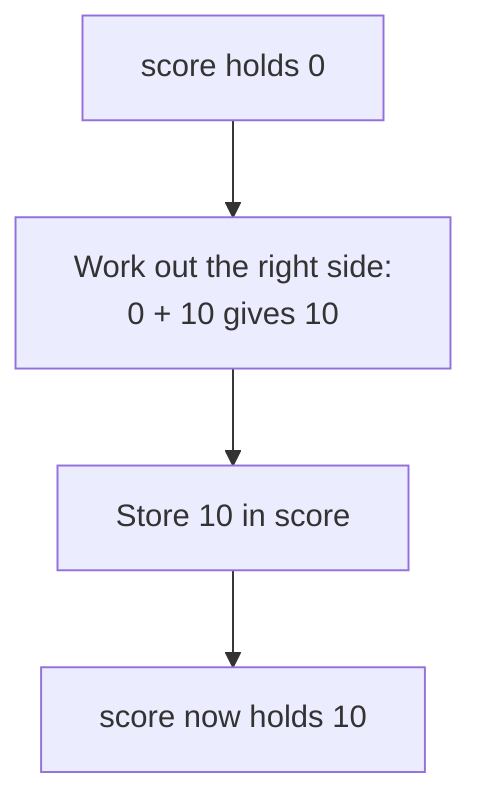

> **In one sentence:** A variable is a name for a value, so your program can keep that value, use it later and sometimes replace it.

## Why should I care?

In [[what-is-programming|What is Programming, Really?]], you showed numbers and text. But imagine a game that shows your score. The score grows while you play, so the program cannot write it down once and forget it. The program must keep the score somewhere, and it must be able to change it.

A variable is how a program does that.

## Analogy

Think of the contacts on a phone. You save a friend's number under the name "Sam". Later, you tap "Sam" and you never need to remember the digits. If Sam gets a new number, you change it in one place, and the name "Sam" still works.

A variable is like a contact: a **name**, with a **value** kept under that name.

**Where the analogy breaks down:** a contact can hold several numbers. A variable holds one value at a time, and that value can be a number, some text or something else. When you give a variable a new value, the old value is gone from that variable.

## How it actually works

### Values and their kinds

A **value** is one piece of information that a program works with. Each value has a kind. Here are three kinds:

- A **number**, such as `30` or `2.456`. It has no quote marks.
- A **string**, which is a piece of text, such as `"Mira"`. It goes inside quote marks.
- A **boolean**, which has only two possible values: true or false.

(This is simplified: languages have more kinds of value.)

### Creating a variable

This page shows three languages: [[javascript|JavaScript]], [[python|Python]] and [[go-language|Go]]. You only need to read one tab.

<!-- tabs -->

### JavaScript

The word `let` creates a variable. After it comes the name, then `=`, then the value.

```js
// A number. It has no quote marks.
let score = 0;
// A string: text inside quote marks.
let playerName = "Mira";
// A boolean: only true or false.
let gameOver = false;

console.log(score);      // Shows: 0
console.log(playerName); // Shows: Mira
console.log(gameOver);   // Shows: false
```

`console.log(score)` has no quote marks around `score`, so JavaScript reads it as a variable name and shows the value inside. Numbers and `false` are not names. With quote marks, `"false"` is a string.

For several words, MDN Web Docs, a website that documents web technologies, suggests **lower camel case**: a capital letter for each new word, as in `playerName`.

### Python

In Python, you create a variable by writing the name, then `=`, then the value.

```python
# A number. It has no quote marks.
score = 0
# A string: text inside quote marks.
player_name = "Mira"
# A boolean: only True or False, with a capital letter.
game_over = False

print(score)        # Shows: 0
print(player_name)  # Shows: Mira
print(game_over)    # Shows: False
```

- `#` starts a comment.
- `print()` writes the value inside its brackets. `print(score)` has no quote marks around `score`, so Python reads it as a variable name and shows the value inside.
- Python must see `True` and `False` spelled with a capital letter. With quote marks, `"False"` is a string.
- Start these lines at the left edge, with no spaces before them. In Python, **indentation** (spaces at the start of a line) groups lines together, so an extra space here gives an error message.

For a name with several words, Python's style guide, PEP 8, uses lowercase letters with `_` between the words, as in `player_name`.

### Go

The sign `:=` creates a variable and gives it a value. On its left comes the name, and on its right comes the value.

```go
package main

import "fmt"

func main() {
	// A number. It has no quote marks.
	score := 0
	// A string: text inside quote marks.
	playerName := "Mira"
	// A boolean: only true or false.
	gameOver := false

	fmt.Println(score)      // Shows: 0
	fmt.Println(playerName) // Shows: Mira
	fmt.Println(gameOver)   // Shows: false
}
```

- `//` starts a comment.
- `package main` and `func main() { }` are the frame of a Go program. `func` starts a **function**, a named piece of code. A function named `main` runs when you run the program, so these lines go between its `{ }`.
- `import "fmt"` brings in `fmt`, a package (a group of functions) that can print text. `fmt.Println(score)` has no quote marks around `score`, so Go reads it as a variable name and shows the value inside. With quote marks, `"false"` is a string.
- `:=` works only inside a function. `var score = 0` is a longer way to write the same thing.
- Go refuses to compile (translate) a program with a variable inside a function that is never used. So every variable here is printed.

For a name with several words, Go's convention is **mixedCaps**, as in `playerName`, not `_`. Start with a lowercase letter for now: in Go, a capital first letter has its own meaning, which this page does not cover.

<!-- /tabs -->

### `=` does not mean "equal"

In code, `=` is called **assignment**. It means: work out the value on the right, then store it in the variable on the left.

<!-- tabs -->

### JavaScript

```js
// Create the variable with let. It holds 0.
let score = 0;
// No let here: the variable already exists. Now it holds 10.
score = score + 10;

console.log(score); // Shows: 10
```

### Python

In Python, the same `=` creates a variable and gives it a new value.

```python
# Create the variable. It holds 0.
score = 0
# The same form again. The variable exists, so now it holds 10.
score = score + 10

print(score)  # Shows: 10
```

(This is simplified. Python's documentation says that `=` binds a name to a value.)

### Go

In Go, plain `=` is the assignment described above: it gives an existing variable a new value. `:=` does more, because it also creates the variable.

```go
package main

import "fmt"

func main() {
	// Create the variable with :=. It holds 0.
	score := 0
	// Plain = here: the variable already exists. Now it holds 10.
	score = score + 10

	fmt.Println(score) // Shows: 10
}
```

Each Go variable has one **type**, which decides the values it may hold. Here `score` holds whole numbers, so assigning it a string gives an error message.

<!-- /tabs -->

The line `score = score + 10` runs in these steps:



### A name that keeps its value

Some values should never change, such as the number of days in a week.

<!-- tabs -->

### JavaScript

The word `const` also creates a variable, but you cannot assign a new value to it afterward. You must give it a value in the same statement. MDN Web Docs calls such a name a **constant**.

```js
// Create a variable with const. It holds 7.
const daysInWeek = 7;
console.log(daysInWeek); // Shows: 7

// Try to assign a new value. This line stops with an error.
daysInWeek = 8;
```

MDN's advice: "Use `const` when you can, and use `let` when you have to." (This is simplified. Some larger kinds of value can change even under `const`; you will meet them in a later topic.)

### Python

A **constant** is a value that a program does not change during normal running. Python's style guide, PEP 8, says constants are usually "written in all capital letters with underscores separating words". Capital letters are a naming convention. Python does not stop you from changing the value.

```python
# Capital letters: the naming convention for a constant.
DAYS_IN_WEEK = 7
print(DAYS_IN_WEEK)  # Shows: 7

# Python allows this line, and gives no error.
DAYS_IN_WEEK = 8
print(DAYS_IN_WEEK)  # Shows: 8
```

### Go

The word `const` creates a **constant**, a name for a value that cannot change. In Go, a constant is not a variable.

```go
package main

import "fmt"

func main() {
	// Create a constant with const. It holds 7.
	const daysInWeek = 7
	fmt.Println(daysInWeek)

	// Try to assign a new value. The compiler refuses this line.
	daysInWeek = 8
}
```

This program never runs, so it does not show `7`. The compiler (the translator that prepares a Go program) stops with an error message. Without the last assignment, the program shows `7`.

<!-- /tabs -->

### Choosing names

- A name can contain letters, digits and `_`. (JavaScript also allows `$`.) It cannot start with a digit, and it cannot contain a space.
- Capital letters matter: `score` and `Score` are two different variables.
- You cannot use words that belong to the language itself, such as `for`.
- Pick a name that describes the value. `score` tells a reader more than `s`.

### `+` on strings

With two numbers, `+` adds. With strings, `+` joins them. With a string and a number, each language has its own rule.

<!-- tabs -->

### JavaScript

If one side is a string, the other side becomes a string too.

```js
const firstName = "Mira";
// + joins the three strings into one string.
const greeting = "Hello, " + firstName + "!";
console.log(greeting); // Shows: Hello, Mira!

console.log(5 + 1);   // Two numbers: Shows: 6
console.log("5" + 1); // A string and a number: Shows: 51
```

### Python

In Python, `+` cannot join a string and a number. The program stops with an error message that contains the word `TypeError`.

```python
first_name = "Mira"
# + joins the three strings into one string.
greeting = "Hello, " + first_name + "!"
print(greeting)  # Shows: Hello, Mira!

print(5 + 1)     # Two numbers: Shows: 6
print("5" + 1)   # A string and a number: this line stops with an error.
```

### Go

```go
package main

import "fmt"

func main() {
	firstName := "Mira"
	// + joins the three strings into one string.
	greeting := "Hello, " + firstName + "!"
	fmt.Println(greeting) // Shows: Hello, Mira!

	fmt.Println(5 + 1) // Two numbers: Shows: 6
}
```

Go cannot use `+` on a string and a number. If you add the line `fmt.Println("5" + 1)`, the compiler (the translator that prepares a Go program) refuses the whole program, and nothing runs.

<!-- /tabs -->

`+` adds no space by itself. That is why `"Hello, "` has a space before its closing quote mark.

## How it came to be

In [[programming-languages|Programming Languages]], you met Fortran. IBM says it debuted in 1957. Wikipedia names the original version of Fortran as the first important programming language to use the equals sign. There too, `=` assigns a value.

JavaScript first had only one word for creating variables: `var`. Its later words `let` and `const` also create variables. They are in the 6th edition of ECMAScript, the standard version of JavaScript, from June 2015.

## 🧪 Try it in your browser

These steps use JavaScript, because your browser's console runs JavaScript. There, `let` and `const` create variables, a `const` variable cannot get a new value, and `console.log` shows a value. You need a computer with Chrome, Edge or Firefox.

**Safety rule:** only type code in the console that you understand or that comes from a source you trust. Never paste anything a stranger sends you. The lines below only create and change variables, add or join values, and show results or expected errors in the console.

1. Open [example.com](https://example.com).
   **What you should see:** a short page of text.
2. Open the **console**:
   - **Windows:** press `Ctrl` + `Shift` + `J` (in Firefox: `Ctrl` + `Shift` + `K`)
   - **Mac:** press `Cmd` + `Option` + `J` (in Firefox: `Cmd` + `Option` + `K`)

   Ignore any messages already there.
3. Click the line where you can type, below any messages. **Type** this line yourself (some browsers may block pasting at first), then press `Enter`. The browser may show suggestions, and the line may look different while you type. Keep typing.

   ```
   let score = 0
   ```

   **What you should see:** creating a variable has no result of its own. The console may show `undefined`. As in What is Programming, Really?, it means there is no result to show, and it is normal. It does **not** mean that `score` holds `undefined`, as step 4 proves.
4. Type this line and press `Enter`:

   ```
   score
   ```

   **What you should see:** `0`, the value inside the variable.
5. Type this line and press `Enter`:

   ```
   score = score + 10
   ```

   **What you should see:** `10`. An assignment does have a result: the value that was assigned. So the console shows it.
6. Type this line and press `Enter`:

   ```
   const city = "Paris"
   ```

   **What you should see:** again, the console may show `undefined`.
7. Type this line and press `Enter`:

   ```
   console.log("Hello, " + city)
   ```

   **What you should see:** `Hello, Paris`. The console may also show `undefined`, because `console.log` gives back no result.
8. Now make a mistake on purpose. Type this line and press `Enter`:

   ```
   city = "Rome"
   ```

   **What you should see:** an error message with the word `TypeError`. This error is expected, because `city` was made with `const`.
9. Type this line and press `Enter`:

   ```
   "5" + 1
   ```

   **What you should see:** the digits 51. JavaScript turns the `1` into a string and joins them.
10. Type this line and press `Enter`:

    ```
    5 + 1
    ```

    **What you should see:** `6`.
11. Type this line and press `Enter`:

    ```
    points
    ```

    **What you should see:** an error message with the words `ReferenceError` and `points is not defined`. You never created a variable with that name.

If you see an error message at any other step, look for a typo and type the line again. If that fails, reload the page and start again from step 3.

**On a phone:** read the first code example above, in the tab you chose, and say out loud what each `Shows:` comment tells you.

## Common misunderstandings

- **"`"5"` and `5` are the same."** No. `"5"` is a string and `5` is a number. So `5 + 1` adds, but `"5" + 1` does not add.
- **"A variable remembers how its value was worked out."** No. It keeps only the value. If `total` gets `price + 2` while `price` is 10, `total` holds 12. Changing `price` later does not change `total`.

## Recap

- A variable is a name for a value. Three kinds of value are numbers, strings and booleans.
- You create a variable with `let` or `const` in JavaScript, `=` in Python, and `:=` in Go.
- `=` is assignment: it works out the right side and stores the result in the variable on the left.

## Sources

- MDN Web Docs, Storing the information you need — Variables: https://developer.mozilla.org/en-US/docs/Learn_web_development/Core/Scripting/Variables
- MDN Web Docs, JavaScript data types and data structures: https://developer.mozilla.org/en-US/docs/Web/JavaScript/Guide/Data_structures
- MDN Web Docs, Identifier (glossary): https://developer.mozilla.org/en-US/docs/Glossary/Identifier
- MDN Web Docs, let: https://developer.mozilla.org/en-US/docs/Web/JavaScript/Reference/Statements/let
- MDN Web Docs, const: https://developer.mozilla.org/en-US/docs/Web/JavaScript/Reference/Statements/const
- MDN Web Docs, Lexical grammar: https://developer.mozilla.org/en-US/docs/Web/JavaScript/Reference/Lexical_grammar
- MDN Web Docs, Assignment (=): https://developer.mozilla.org/en-US/docs/Web/JavaScript/Reference/Operators/Assignment
- MDN Web Docs, Expressions and operators: https://developer.mozilla.org/en-US/docs/Web/JavaScript/Guide/Expressions_and_operators
- MDN Web Docs, eval(): https://developer.mozilla.org/en-US/docs/Web/JavaScript/Reference/Global_Objects/eval
- MDN Web Docs, JavaScript (glossary): https://developer.mozilla.org/en-US/docs/Glossary/JavaScript
- MDN Web Docs, Addition (+): https://developer.mozilla.org/en-US/docs/Web/JavaScript/Reference/Operators/Addition
- MDN Web Docs, TypeError: invalid assignment to const: https://developer.mozilla.org/en-US/docs/Web/JavaScript/Reference/Errors/Invalid_const_assignment
- MDN Web Docs, ReferenceError: x is not defined: https://developer.mozilla.org/en-US/docs/Web/JavaScript/Reference/Errors/Not_defined
- MDN Web Docs, console.log(): https://developer.mozilla.org/en-US/docs/Web/API/console/log_static
- MDN Web Docs, About MDN: https://developer.mozilla.org/en-US/about
- Ecma International, ECMAScript 2015 Language Specification (6th edition, June 2015): https://262.ecma-international.org/6.0/
- Wikipedia, Equals sign: https://en.wikipedia.org/wiki/Equals_sign
- Wikipedia, Constant (computer programming): https://en.wikipedia.org/wiki/Constant_(computer_programming)
- IBM, Fortran: https://www.ibm.com/history/fortran
- Microsoft Edge DevTools, Run JavaScript in the Console: https://learn.microsoft.com/en-us/microsoft-edge/devtools/console/console-javascript
- Chrome for Developers, Open Chrome DevTools: https://developer.chrome.com/docs/devtools/open
- Microsoft Edge DevTools, Keyboard shortcuts: https://learn.microsoft.com/en-us/microsoft-edge/devtools/shortcuts/
- Firefox DevTools User Docs, Web Console: https://firefox-source-docs.mozilla.org/devtools-user/web_console/index.html
- Chrome for Developers, What are self-XSS attacks?: https://developer.chrome.com/blog/self-xss
- Example Domain: https://example.com
- Python Language Reference, Lexical analysis: https://docs.python.org/3/reference/lexical_analysis.html
- Python Language Reference, Simple statements: https://docs.python.org/3/reference/simple_stmts.html
- Python Tutorial, An Informal Introduction to Python: https://docs.python.org/3/tutorial/introduction.html
- Python Tutorial, Errors and Exceptions: https://docs.python.org/3/tutorial/errors.html
- Python documentation, Built-in Types: https://docs.python.org/3/library/stdtypes.html
- PEP 8, Style Guide for Python Code: https://peps.python.org/pep-0008/
- The Go Programming Language Specification: https://go.dev/ref/spec
- The Go Programming Language, Effective Go: https://go.dev/doc/effective_go
- Go, Frequently Asked Questions (FAQ): https://go.dev/doc/faq
- Go Tutorial, Get started with Go: https://go.dev/doc/tutorial/getting-started
- Go Packages, fmt: https://pkg.go.dev/fmt
- Go Packages, Command go: https://pkg.go.dev/cmd/go
