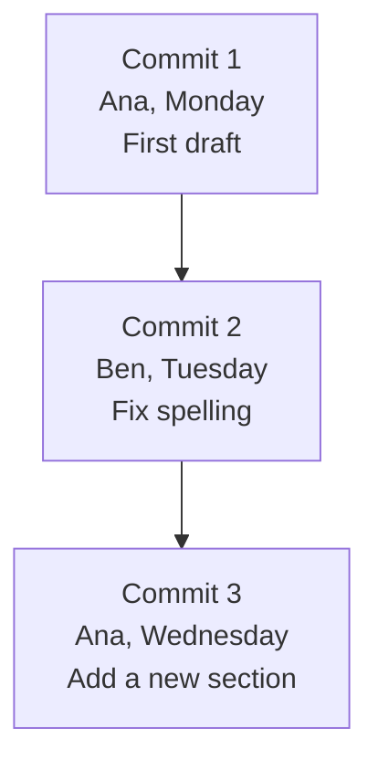

> **In one sentence:** Version control is a system that records changes to a set of files over time, so you can see who changed what and when, and get back an earlier version.

## Why should I care?

Have you ever saved a file as `essay.doc`, then `essay-final.doc`, then `essay-final-v2-REAL.doc`? Keeping copies is one way to save old versions.

Pro Git is a book about a tool called Git, and you can read it on git-scm.com. The book says that copying files into another folder is "very common because it is so simple, but it is also incredibly error prone" (likely to cause mistakes). You can forget which folder you are in, and write over the wrong file.

Programmers have a better way. GitHub's documentation says a version control system "tracks the history of changes as people and teams collaborate on projects together".

## Analogy

Think of a photo album for a project. Each time you finish a change, you take a photo of all your files. On the back, you write your name, the date, and a short note about the change. Later, you can turn back the pages and see how the project grew.

**Where the analogy breaks down:** a photo only lets you look. Pro Git says version control lets you "revert the entire project back to a previous state": it puts the old files back, so you can work with them again. It can also "compare changes over time".

## How it actually works

### It records changes

Pro Git gives this definition: "Version control is a system that records changes to a file or set of files over time so that you can recall specific versions later." A **version control system** is often shortened to **VCS**. The book uses program code as its example, but says this works with "nearly any type of file on a computer".

**Git** is one version control system. GitHub's documentation calls it "the most popular distributed version control system". (You will see below what "distributed" means.)

GitHub, a website that stores projects kept with Git, says the history tells you which changes were made, who made them, when, and why.

In Git, each saved version of the project is called a **commit**. To **commit** means to make a commit. Git gives each commit an ID, and the commit records when it was made and who made it. Each commit also needs a **commit message**: a short description of the changes.

In this made-up example, each commit comes after the one before it. (This is simplified: a history can also split into several lines of work.)

### The repository

A **repository** is a project together with its history. GitHub's documentation says a repository "contains all of your code, your files, and each file's revision history". Revision history means the record of all changes to a file.

With Git, a repository starts as a normal [[files-and-folders|folder]] of your project. GitHub's documentation says Git adds "a hidden subfolder" inside it, which holds the data that version control needs. You normally do not see it.

### Centralized and distributed

Where is the history kept? Pro Git describes several kinds of system. Here are two of them.

In a **centralized** system, one [[client-and-server|server]] holds the history. As a reminder, MDN Web Docs says a server is software or hardware "offering a service to a user". The other computers connect to it. Pro Git says these systems "have a single server that contains all the versioned files" (the files kept under version control).

The weak point is the server. Pro Git says: "If that server goes down for an hour, then during that hour nobody can collaborate at all or save versioned changes". (Goes down means stops working.) And if its disk breaks with no backup, the project's history can be lost.

In a **distributed** system, every person's computer has a full copy of the repository, "including its full history". A full copy of a repository is called a **clone**. Pro Git says: "Every clone is really a full backup of all the data."

A team that uses a distributed system can still share one copy on a server. Pro Git describes this case: if that server breaks, any clone "can be copied back up to the server to restore it". Pro Git also says that with Git, you can make commits on your own computer while you have no network connection.

Pro Git names CVS, Subversion and Perforce as centralized systems, and Git, Mercurial and Darcs as distributed ones.

## How it came to be

Wikipedia's article on version control says that a system for program code, the Source Code Control System (SCCS), was started in 1972. The Revision Control System (RCS) "followed in 1982".

Later came the Concurrent Versions System (CVS), and after it Subversion, Wikipedia says.

Git came in 2005, Pro Git says. Linux is an operating system, Stanford's computer course says. From 2002, the Linux project used a distributed system called BitKeeper, which a company made. In 2005, BitKeeper stopped being free of charge. So the Linux community, "in particular Linus Torvalds, the creator of Linux", built their own tool: Git.

## 🧪 Try it in your browser

You will look at the history of one file in a real repository: `git/git`, which holds Git's own code. GitHub's documentation says public repositories "are accessible to everyone on the internet", so you do not need an account. Use Chrome, Edge or Firefox on a computer. The pages may look different.

1. Copy this address into your browser's address bar, and open it: `https://github.com/git/git/commits/master/README.md`
   **What you should see:** the history of one file in the repository, named `README.md`: a list of commits. GitHub's documentation says a file's history "shows commits that affected that file". Look for each commit's message, who made it, and when.
2. Click the message text of one commit. The message is a link.
   **What you should see:** a page about that one commit. The changes may already be shown. GitHub's documentation says you can select a file there "to view its diff": the changes made to that file.
3. Use your browser's Back button to return. You are only reading: do not click buttons that change anything.

## Common misunderstandings

- **"Version control is only for program code."** No. Pro Git says it works with "nearly any type of file on a computer", such as images.
- **"Version control saves everything I type, all by itself."** No. In Git, you make each commit yourself. Pro Git warns that you can lose or spoil changes that you have not committed yet.
- **"Git and GitHub are the same thing."** No. Git is a version control system. GitHub is a website: its documentation says "GitHub hosts Git repositories".

## Recap

- Version control records changes to files over time: who changed what, when, and why. You can compare versions and go back to an earlier one.
- A repository is a project together with its history. In Git, each saved version is a commit, with a message.
- A centralized system keeps the history on one server. A distributed system, such as Git, gives everyone a full copy.

## Sources

- Pro Git, 1.1 Getting Started, About Version Control: https://git-scm.com/book/en/v2/Getting-Started-About-Version-Control
- Pro Git, 1.2 Getting Started, A Short History of Git: https://git-scm.com/book/en/v2/Getting-Started-A-Short-History-of-Git
- Pro Git, 1.3 Getting Started, What is Git?: https://git-scm.com/book/en/v2/Getting-Started-What-is-Git%3F
- GitHub Docs, About Git: https://docs.github.com/en/get-started/using-git/about-git
- GitHub Docs, About repositories: https://docs.github.com/en/repositories/creating-and-managing-repositories/about-repositories
- GitHub Docs, Commits: https://docs.github.com/en/pull-requests/committing-changes-to-your-project/creating-and-editing-commits/about-commits
- GitHub Docs, Comparing commits: https://docs.github.com/en/pull-requests/committing-changes-to-your-project/viewing-and-comparing-commits/differences-between-commit-views
- MDN Web Docs, Server (glossary): https://developer.mozilla.org/en-US/docs/Glossary/Server
- Stanford CS101, Running and Operating Systems: https://web.stanford.edu/class/cs101/software-1.html
- Wikipedia, Version control (history): https://en.wikipedia.org/wiki/Version_control
- GitHub, the git/git repository: https://github.com/git/git
- GitHub, git/git, History for README.md: https://github.com/git/git/commits/master/README.md
