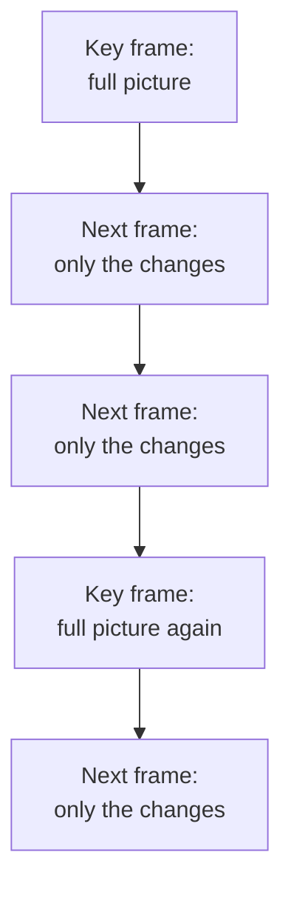

> **In one sentence:** A video is many still pictures, called frames, shown quickly one after another, plus sound; because this needs a huge number of bytes, video is compressed by storing mostly what changes from one frame to the next.

## Why should I care?

Video calls, films and short clips on your phone are all stored or sent as numbers, like a photo or a song.

In [[images-as-numbers]], a picture became a grid of pixels, with 3 numbers for each pixel. In [[sound-as-numbers]], sound became a list of measurements. A video uses both. This page shows how big that gets, and why [[compression]] is the main way to keep video small enough to store and send.

## Analogy

Think of a **flip book**: a small notebook with a drawing on every page. Each drawing is a little different from the one before. When you flip the pages fast with your thumb, the drawings seem to move.

A video works the same way. Each page is one still picture, called a **frame**. The computer shows the frames so fast that you see movement.

**Where the analogy breaks down:** in a flip book, every page is a full drawing. A compressed video file does not store every frame in full. For most frames, it stores only what changed since the frame before. Also, a flip book has no sound, and a video usually has a sound track too.

## How it actually works

### Frames and frames per second

A video is a row of frames. Each frame is a normal digital image: a grid of pixels.

The **frame rate** is how many frames are shown each second. It is written in **frames per second**, or **fps**. MDN Web Docs, a reference for web developers, gives these numbers:

- Below about **12 fps**, people no longer see the pictures as movement.
- From **24 fps** upward, movement generally looks smooth.
- **30 or 60 fps** is a good target.

Sound is stored next to the pictures. Before compression, it is a list of samples, as in [[sound-as-numbers]]. Like the pictures, it is usually compressed too.

### How big is a video without compression?

Let's count the bytes. Take a video that is **1920 pixels wide and 1080 pixels high**. MDN calls this size **high definition (HD)**. Use 3 bytes per pixel (red, green, blue) and 30 frames per second:

| Amount | How to count it | Bytes | About |
|---|---|---|---|
| 1 frame | 1920 × 1080 pixels × 3 bytes | 6,220,800 | 6.2 MB |
| 1 second | 6,220,800 × 30 frames | 186,624,000 | 187 MB |
| 1 minute | 186,624,000 × 60 seconds | 11,197,440,000 | 11.2 GB |
| 2-hour film | 186,624,000 × 7,200 seconds | 1,343,692,800,000 | 1.3 TB |

(MB, GB and TB are explained in [[data-size-units]].) A 2-hour film would need more than a terabyte.

And the sound? One second of CD-quality stereo sound is 44,100 samples × 2 bytes × 2 channels = 176,400 bytes. Next to 186,624,000 bytes of pictures, that is less than 0.1%. In a video, almost all of the bytes are pictures.

### Compression: keep what changes

So video is almost always compressed. MDN explains the main idea: video compression usually **compares frames, finds where they differ**, and stores enough information to change the previous frame into the next one.

Think of a person reading the news on TV, sitting still in front of a wall. From frame to frame, the wall stays the same. Only the mouth and eyes move. So the file stores only those differences.

Most video compression is also **lossy**: the video you watch is close to the original, but not exactly the same. MDN says there are currently no lossless video codecs commonly available in web browsers.

This causes a problem. Most frames are made by changing the frame before them. With lossy compression, each result is only close to the real frame. So small errors stay on the screen and can grow over time. To fix this, the file stores a full frame from time to time. This is called a **key frame**. MDN says key frames fix errors that are visible on the screen. They also make it faster to jump to another point in the video.



(This is simplified. Real video codecs use many more methods than this.)

### Codec and container

A **codec** is a method for compressing and decompressing video, or a program that does it. The name comes from "**co**der-**dec**oder". To **encode** means to turn the frames into the compressed form. To **decode** means to turn them back into frames that the screen can show. A common video codec is **H.264**, also called **AVC**.

A **container** is the file format that holds everything together: the video, the sound, and extra information about them, so they can be stored and played together. **MP4** is a common container. An MP4 file can hold video made with different codecs, such as H.264 or AV1 (another codec). Another container, made for the web, is **WebM**.

## How it came to be

- **1927 to 1930:** **24 frames per second** became the standard for sound film (film with a recorded sound track).
- **Early 1990s:** the **MPEG-1** video codec was first shown.
- **2003:** on 30 May, the ITU (International Telecommunication Union) approved the first version of the **H.264** standard. The same year, a new version of the **MP4** file format (version 2) was added.
- **2010:** **WebM** was introduced.

## 🧪 Try it in your browser

You will count the bytes of HD video in your browser's **console** (see [[browser-devtools]]).

**Safety rule:** only type code in the console that you understand or that comes from a source you trust. Never paste code that a stranger sends you. The lines here are safe: they only multiply numbers.

1. In Chrome, Edge or Firefox, open any ordinary web page, for example `https://example.com`.
2. Open the console:
   - **Windows:** press `Ctrl` + `Shift` + `J` (in Firefox: `Ctrl` + `Shift` + `K`)
   - **Mac:** press `Cmd` + `Option` + `J` (in Firefox: `Cmd` + `Option` + `K`)
3. You may see some messages already. That is normal. Click the empty line at the bottom. In the console, `*` means "multiply". **Type** this line yourself (some browsers block pasting in the console), then press `Enter`:

   ```
   1920 * 1080 * 3
   ```

   You should see `6220800`: the bytes in one HD frame.
4. Now multiply by 30 frames. Type this line and press `Enter`:

   ```
   1920 * 1080 * 3 * 30
   ```

   You should see `186624000`: about 187 MB for one second of video, before compression. Real video files are compressed, so they are much smaller than this.
5. When you are done, close the tab.

**On a phone:** use the calculator app. Multiply 1920 × 1080 × 3 × 30.

## Common misunderstandings

- **"A video file stores every frame as a full picture."** Usually not. Most frames store only the changes. Only key frames store the full picture.
- **"MP4 is a codec."** No. MP4 is a container, the box around the video and sound. The codec is the method used to compress what is inside.
- **"More frames per second costs nothing."** MDN says higher frame rates make compressed video files bigger.

## Recap

- A video is many still frames shown quickly, plus sound. From 24 frames per second upward, movement generally looks smooth.
- Without compression, one second of HD video is about 187 million bytes, so video is almost always compressed.
- Video compression stores full key frames from time to time, and mostly only the changes between frames. A codec does the compressing; a container, such as MP4, holds the video and sound together.

## Sources

- MDN Web Docs, Web video codec guide: https://developer.mozilla.org/en-US/docs/Web/Media/Guides/Formats/Video_codecs
- MDN Web Docs, Media container formats: https://developer.mozilla.org/en-US/docs/Web/Media/Guides/Formats/Containers
- MDN Web Docs, Codec: https://developer.mozilla.org/en-US/docs/Glossary/Codec
- MDN Web Docs, Digital audio concepts: https://developer.mozilla.org/en-US/docs/Web/Media/Guides/Formats/Audio_concepts
- Stanford CS101, Image Introduction: https://web.stanford.edu/class/cs101/image-1-introduction.html
- MDN Web Docs, Image file type and format guide: https://developer.mozilla.org/en-US/docs/Web/Media/Guides/Formats/Image_types
- Wikipedia, Frame rate (general background reference): https://en.wikipedia.org/wiki/Frame_rate
- ITU-T, Recommendation H.264: https://www.itu.int/rec/T-REC-H.264
- ITU-T, Recommendation H.264 (05/03): https://www.itu.int/rec/T-REC-H.264-200305-S
- Chrome for Developers, Open Chrome DevTools: https://developer.chrome.com/docs/devtools/open
- Microsoft Edge DevTools, Keyboard shortcuts: https://learn.microsoft.com/en-us/microsoft-edge/devtools/shortcuts/
- Firefox DevTools User Docs, Web Console: https://firefox-source-docs.mozilla.org/devtools-user/web_console/index.html
- Chrome for Developers, Self-XSS protection: https://developer.chrome.com/blog/self-xss
