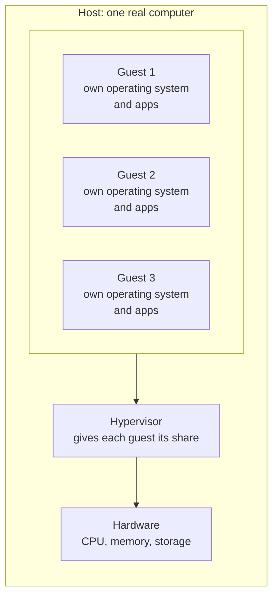

> **In one sentence:** A virtual machine is a computer made of software: a program called a hypervisor splits one real computer's CPU, memory and storage into shares, and each share runs its own operating system, kept apart from the others.

## Why should I care?

In [[cloud-computing|Cloud Computing]], you met the **virtual machine**: a computer made of software, running on a real computer. When you rent a computer from a cloud company (IaaS), you usually get one of these. (Some services rent whole physical servers instead.)

When you put your own website online, it may run on a virtual machine.

## Analogy

Think of an **apartment building**. One building holds many flats. Each flat has its own locked door and its own family. A building manager decides how much space each flat gets.

A virtual machine is like one flat. The real computer is the building. The hypervisor, explained below, is the manager.

**Where the analogy breaks down:** the walls of a building are fixed. Microsoft says virtual machines can be created, changed and deleted as needed, with no builders. Also, the walls between virtual machines are not physical. Software, helped by features of the CPU, keeps them apart.

## How it actually works

### Host, guest and hypervisor

The program that makes virtual machines is called a **hypervisor** (also "virtual machine monitor"). Wikipedia says it "creates and runs virtual machines".

The real computer is the **host**. (Here "host" is a noun: the real computer.) Each virtual machine on it is a **guest**. AWS (Amazon Web Services, a cloud company) says that "several guests can run on the host". Each guest has its own [[operating-system|operating system]], which "can be the same or different from the host operating system". AWS explains that some hypervisors run on the host's own operating system, like an app. Others run "directly on the computer hardware", as in this diagram.

### Sharing the parts

On the Cloud Computing page, you read that each virtual machine gets a part of the real computer's CPU, memory and storage. AWS says the hypervisor makes sure "that each virtual machine gets the allocated resources". **Resources** here means the computer's parts and their power.

Wikipedia says "the guest executes most instructions on the native hardware": on the host's own CPU.

### Kept apart

AWS says the hypervisor also makes sure that each virtual machine "does not interfere with the operation of other virtual machines". The hypervisor is designed so that one guest does not disturb another guest on the same host.

### Why cloud companies use them

An AWS paper about its own systems says that virtualization "allows very large servers to be subdivided" into many instances (virtual machines) used at the same time.

### A saved starting copy

A new virtual machine needs software to start with: an operating system and programs. AWS's virtualization page describes "virtual machine templates". A **template** is a saved starting setup. With it, you can "duplicate your infrastructure repeatedly and consistently": many machines that all begin the same.

## How AWS does it

AWS's service for virtual machines is **Amazon EC2** (Elastic Compute Cloud). AWS calls each virtual machine an **instance**: "a virtual server in the AWS Cloud". AWS's FAQ says EC2 "reduces the time required to obtain and boot new server instances to minutes". (To **boot** is to start up.)

- **Instance type:** the size. AWS says each type offers a different mix of CPU power, memory, network and storage. The CPU share is counted in **vCPUs** (virtual CPUs). AWS says that, on many instance types, one [[cpu|CPU]] core can run several "threads" (streams of instructions) at the same time, and "each thread is represented as a virtual CPU (vCPU)". Memory is counted in **GiB** (gibibytes). One GiB is 1,073,741,824 bytes: a little more than a GB (gigabyte), which is 1,000,000,000 bytes.
- **Amazon Machine Image (AMI):** the starting copy of the operating system and programs. AWS calls AMIs "preconfigured templates" that include "the operating system and additional software". You can launch many instances from one AMI.
- **Shared host:** AWS says EC2 gives some parts of the host, such as CPU and memory, to one instance only. Others, such as the network, are shared: several instances use them at the same time.
- **Nitro:** a system of hardware and software built by AWS. It includes a "lightweight" (small) hypervisor that shares out memory and the CPU. Some instance types, such as T2, use another hypervisor called Xen.

AWS's pricing page said in November 2026 that On-Demand Instances (with no long-term commitment) are paid "by the hour or second". Per-second billing was listed only for some operating systems, such as Windows and Ubuntu.

## How it came to be

In January 1967, IBM's CP-40 research system began "production use" (everyday use), says Wikipedia. It was one of the first hypervisors that let several operating systems run at the same time. The word "hypervisor" itself dates from about 1970.

On August 24, 2006, Amazon announced the first, test ("beta") version of Amazon EC2.

## 🧪 Try it in your browser

You will look at a real table of virtual machine sizes. You need no account. This only looks. A computer is best, because the tables are wide. On a phone, scroll the tables sideways.

1. In Chrome, Edge or Firefox, open `https://docs.aws.amazon.com/ec2/latest/instancetypes/gp.html`. The page heading is "Specifications for Amazon EC2 general purpose instances". AWS says general purpose instances "provide a balance of compute, memory, and networking resources": of CPU power, memory and network. The page may look different.
2. Scroll down to the table under **Instance family summary**. Find the row that starts with `M5`. Look at the **Hypervisor** column. In November 2026, it said `Nitro v2`: version 2 of the Nitro System. The `T2` row said `Xen`.
3. Near the top, under **Contents**, click **Performance specifications**. Or scroll down to that heading.
4. Find the rows `m5.large`, `m5.xlarge` and `m5.2xlarge`. AWS explains these names: the part before the dot is the **instance family** (`m` for general purpose, `5` for the generation). The part after the dot is the size. Look at the **Memory (GiB)** and **vCPUs** columns.

**What you should see:** in November 2026, `m5.large` had 8.00 GiB of memory and 2 vCPUs. `m5.xlarge` had 16.00 and 4. `m5.2xlarge` had 32.00 and 8. Each size is double the one before. Close the tab when you are done.

## Common misunderstandings

- **"A virtual machine is fake."** No. Most of its instructions run on a real CPU.
- **"Each virtual machine has its own physical computer."** No. Several guests can share one host, each with its own part of it.

## Recap

- A hypervisor runs on a real computer (the host) and creates virtual machines (guests), each with its own operating system.
- It gives each guest a share of the CPU, memory and storage, and keeps the guests from disturbing each other.
- On Amazon EC2, AWS's service for virtual machines, a virtual machine is called an instance: you choose its size (instance type) and its starting software (an AMI).

## Sources

- AWS, What is virtualization?: https://aws.amazon.com/what-is/virtualization/
- Wikipedia, Hypervisor (general background reference): https://en.wikipedia.org/wiki/Hypervisor
- Microsoft Azure, What is a virtual machine?: https://azure.microsoft.com/en-us/resources/cloud-computing-dictionary/what-is-a-virtual-machine
- AWS documentation, What is Amazon EC2?: https://docs.aws.amazon.com/AWSEC2/latest/UserGuide/concepts.html
- AWS documentation, Amazon EC2 instance types: https://docs.aws.amazon.com/ec2/latest/instancetypes/instance-types.html
- AWS documentation, Specifications for Amazon EC2 general purpose instances: https://docs.aws.amazon.com/ec2/latest/instancetypes/gp.html
- AWS documentation, CPU options for Amazon EC2 instances: https://docs.aws.amazon.com/AWSEC2/latest/UserGuide/instance-optimize-cpu.html
- AWS documentation, Amazon Machine Images in Amazon EC2: https://docs.aws.amazon.com/AWSEC2/latest/UserGuide/AMIs.html
- AWS documentation, Instances built on the AWS Nitro System: https://docs.aws.amazon.com/ec2/latest/instancetypes/ec2-nitro-instances.html
- AWS whitepaper, The components of the Nitro System: https://docs.aws.amazon.com/whitepapers/latest/security-design-of-aws-nitro-system/the-components-of-the-nitro-system.html
- AWS documentation, Amazon EC2 instance type naming conventions: https://docs.aws.amazon.com/ec2/latest/instancetypes/instance-type-names.html
- AWS, Amazon EC2 pricing: https://aws.amazon.com/ec2/pricing/
- AWS, Amazon EC2 FAQs: https://aws.amazon.com/ec2/faqs/
- AWS What's New, Announcing Amazon EC2 (beta): https://aws.amazon.com/about-aws/whats-new/2006/08/24/announcing-amazon-elastic-compute-cloud-amazon-ec2---beta/
- NIST, Prefixes for binary multiples: https://physics.nist.gov/cuu/Units/binary.html
