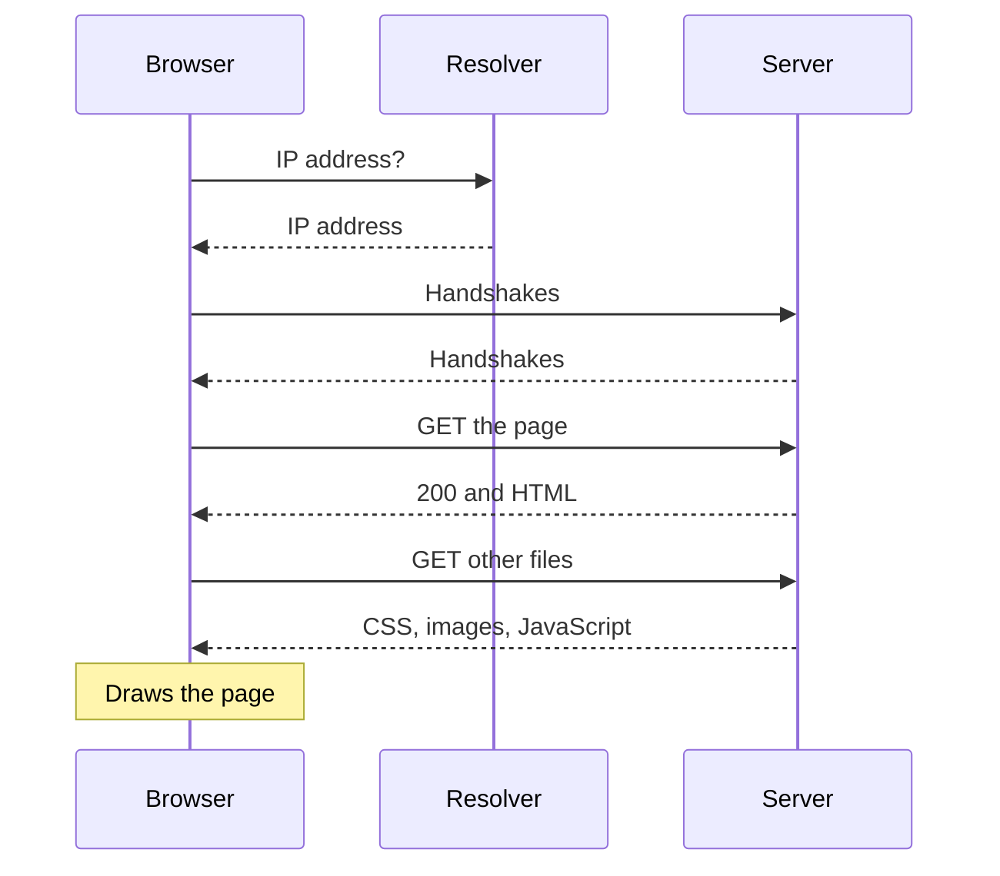

> **In one sentence:** When you type a URL and press Enter, your browser finds the server's address with DNS, opens a connection, asks for the page with HTTP, receives the files, and draws them on your screen.

## Why should I care?

You have done this thousands of times: type an address, press Enter, and a page appears. It feels like one action, but it is a chain of many small steps. Most of these steps are topics in this part of the course.

This page puts them all together.

## Analogy

Imagine you want to order a catalogue from a shop in another city, by post.

- You know the **shop's name**, but not its street address. So first you look it up in an **address book**.
- You **contact the shop** to check that it is open and ready. You also agree on a **secret code**, so nobody else can read your letters.
- You send an **order form**: "Please send me your catalogue."
- The shop replies **"OK, here it is"** and sends it in several small parcels.
- The catalogue says "see also: price list, pictures". So you **order those too**.
- When everything has arrived, you **put it all together** and read it.

**Where the analogy breaks down:** by post, this takes days. On the web, it usually happens in a moment. Also, your browser asks for many files at the same time, often from several different servers.

## How it actually works

Example: you type `https://en.wikipedia.org/wiki/Computer` and press Enter.

This simplified picture shows the steps below:

### 1. The browser reads the URL

Your [[web-browser|browser]] splits the [[url|URL]] into parts:

- `https` → use the secure version of HTTP
- `en.wikipedia.org` → the domain name of the server
- `/wiki/Computer` → which page you want from that server

### 2. Find the address (DNS)

Computers connect using IP addresses, not names. So the browser needs the IP address of `en.wikipedia.org`. If your computer looked it up recently, the answer may already be saved on your computer. Otherwise, it asks a resolver, which uses [[dns|DNS]] to find the address.

### 3. Open a connection

Now the browser knows where the server is. It opens a **connection** to it, following the rules of [[tcp-ip|TCP/IP]]. Here, a connection is not a cable. It is an agreement between two computers to send data to each other in an organized way. To start it, the two computers exchange a few short messages. This is called a **handshake**.

Because the URL starts with `https`, there is a **second handshake**. In it, the browser and the server agree on how to **encrypt** (scramble) everything they send, so that nobody in between can read or secretly change it. The browser also checks that the server really is `en.wikipedia.org`, and not a fake. This is what [[https|HTTPS]] adds.

(This is simplified. Some websites use a newer kind of connection, called QUIC.)

### 4. Ask for the page (HTTP request)

The browser sends an [[http|HTTP]] **request**. It says: "**GET** me `/wiki/Computer`, please." `GET` is the real name of this kind of request: it means "send me this".

### 5. The server answers (HTTP response)

The server finds the page and sends an HTTP **response**. Near its start is a **status code**. `200` means "OK, here it is". Then come some extra details, called **headers**, and then the content: an [[html|HTML]] file. HTML is the language that describes what is on a page: headings, text, links and pictures.

All the data, in both directions, travels across the internet split into small [[packets]]. Your computer puts the packets back together.

### 6. Get everything else

Inside the HTML file are references to other files that the page needs, for example "use the picture `logo.png`". As the browser reads the HTML, it finds these references and asks for:

- **CSS** files, which describe how the page looks
- **images**
- **JavaScript** files, which make the page react to you

For each file it does not already have saved, the browser repeats steps 4 and 5. If a file comes from a different domain name, it usually repeats steps 2 and 3 first. A single page often needs many files.

### 7. Draw the page

The browser turns all these files into what you see. In simplified form, the browser:

1. reads the HTML and works out all the parts of the page and how they fit together,
2. applies the CSS to decide how each part looks,
3. works out **where** each part goes on the screen and how big it is,
4. **paints** the result on your screen as **pixels** (tiny colored squares).

Images go in their places, and JavaScript can change the page as it runs. The next part teaches the three languages of web pages: HTML, CSS and JavaScript.

## How it came to be

The pieces of this chain were invented at different times:

- **IP**, the rules for addressing and moving packets, was published as a standard in 1981.
- **DNS** was described in 1983, when one shared list of names was getting too big and changing too often to manage.
- The **World Wide Web** was first proposed in 1989 by Tim Berners-Lee at **CERN**, a research laboratory. By the end of 1990, the first web server and the first browser were running there.

## 🧪 Try it in your browser

Let's watch steps 4, 5 and 6 happen. You need a computer with a keyboard for this, and these steps change nothing on your computer. You will use your browser's developer tools. (You will learn them properly in [[browser-devtools]].)

1. Open a new tab in Chrome, Edge or Firefox.
2. Open the developer tools: `F12` or `Ctrl` + `Shift` + `I` on Windows, `Cmd` + `Option` + `I` on Mac.
3. Click the **Network** tab. In Edge, if you do not see it, click the **More tools** button and choose **Network**. Open this tab **before** you load the page: the tools only record while they are open.
4. In the address bar, type `https://en.wikipedia.org/wiki/Computer` and press `Enter`. If the list stays empty, load the page again with the browser's reload button.
5. Watch the list fill up. **Most rows are files the browser asked for.** Many names look strange. You do not need to understand them.

Then:

- In the bar at the bottom of the panel, find the number before the word **requests**. That is how many requests the browser made.
- Click the **first row** (named `Computer`). This is the HTML page from step 5 of "How it actually works". A details area opens: click its **Headers** tab.
- Find the **status code**: `200`. (You might see `304` instead. It means "not changed, use the copy you already saved".)

Above the list are filter buttons, such as **JS** and **CSS**. Click one to see only that kind of file. Those files are from step 6 of "How it actually works".

## Common misunderstandings

- **"A web page arrives as one file."** No. The browser usually downloads many separate files and puts the page together itself.
- **"The website lives inside my browser."** No. The website lives on a server. Your browser downloads a copy of the files when you visit.

## Recap

- Typing a URL starts a chain: read the URL, find the address with DNS, connect (plus encryption for HTTPS), send an HTTP request, receive an HTTP response.
- The first file is HTML. It leads the browser to request more files: CSS, images and JavaScript.
- The browser then builds and paints the page.

## Sources

- MDN Web Docs, How the web works: https://developer.mozilla.org/en-US/docs/Learn_web_development/Getting_started/Web_standards/How_the_web_works
- MDN Web Docs, Populating the page: how browsers work: https://developer.mozilla.org/en-US/docs/Web/Performance/Guides/How_browsers_work
- MDN Web Docs, HTTPS: https://developer.mozilla.org/en-US/docs/Glossary/HTTPS
- Chrome for Developers, Inspect network activity: https://developer.chrome.com/docs/devtools/network
- Chrome for Developers, Open Chrome DevTools: https://developer.chrome.com/docs/devtools/open
- RFC 791, Internet Protocol (1981): https://datatracker.ietf.org/doc/rfc791/
- RFC 882, Domain Names: Concepts and Facilities (1983): https://datatracker.ietf.org/doc/rfc882/
- CERN, A short history of the Web: https://home.cern/science/computing/the-birth-of-the-web/short-history-web/
- Chrome for Developers, Network features reference: https://developer.chrome.com/docs/devtools/network/reference
- Microsoft Edge DevTools, Keyboard shortcuts: https://learn.microsoft.com/en-us/microsoft-edge/devtools/shortcuts/
- Firefox DevTools User Docs, Keyboard shortcuts: https://firefox-source-docs.mozilla.org/devtools-user/keyboard_shortcuts/index.html
- Firefox DevTools User Docs, Network request list: https://firefox-source-docs.mozilla.org/devtools-user/network_monitor/request_list/index.html
- Firefox DevTools User Docs, Network Monitor toolbar: https://firefox-source-docs.mozilla.org/devtools-user/network_monitor/toolbar/index.html
- RFC 8446, TLS 1.3: https://www.rfc-editor.org/rfc/rfc8446
- RFC 9113, HTTP/2 (connection reuse): https://www.rfc-editor.org/rfc/rfc9113
- MDN Web Docs, QUIC (glossary): https://developer.mozilla.org/en-US/docs/Glossary/QUIC
- MDN Web Docs, HTML: https://developer.mozilla.org/en-US/docs/Web/HTML
- MDN Web Docs, 304 Not Modified: https://developer.mozilla.org/en-US/docs/Web/HTTP/Reference/Status/304
- Firefox DevTools User Docs, index: https://firefox-source-docs.mozilla.org/devtools-user/index.html
- Firefox DevTools User Docs, Network Monitor: https://firefox-source-docs.mozilla.org/devtools-user/network_monitor/index.html
- Firefox DevTools User Docs, Network request details: https://firefox-source-docs.mozilla.org/devtools-user/network_monitor/request_details/index.html
- Microsoft Edge DevTools, Network tool: https://learn.microsoft.com/en-us/microsoft-edge/devtools/network/
- Stanford CS101, Image Introduction: https://web.stanford.edu/class/cs101/image-1-introduction.html
- Microsoft Edge DevTools, Network features reference: https://learn.microsoft.com/en-us/microsoft-edge/devtools/network/reference
