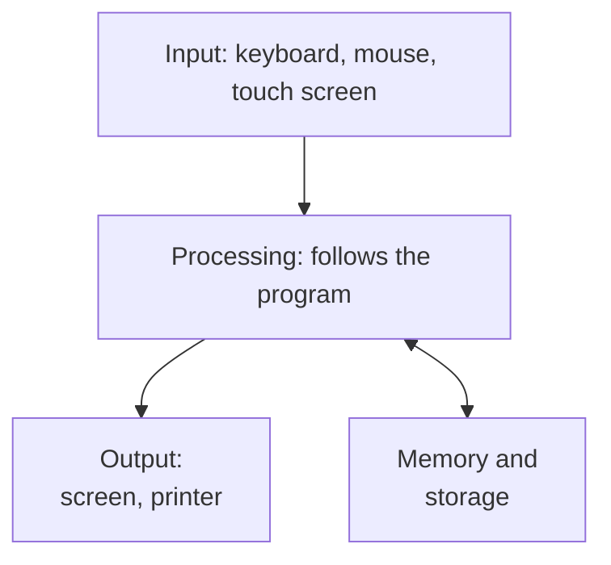

> **In one sentence:** A computer is a machine that follows a list of instructions, called a program, to take in information, work with it, keep it, and give back a result.

## Why should I care?

You are using a computer right now. If you read this on a laptop, that is a computer. If you read it on a phone, that is a computer too. Many smaller things also have a computer inside them: microwave ovens, remote controls, cameras and thermostats (the controls that keep a room warm or cool).

A programmer writes instructions for computers. So the first step is to know what a computer is and what it can do.

## Analogy

Think of a **cook** in a kitchen, following a **recipe**.

- The cook receives **ingredients**: flour, eggs, water.
- The cook follows the **recipe**, one step at a time: mix, heat, wait.
- The cook keeps the food in use on the **table**, and the rest in the **fridge** for later.
- At the end, the cook gives you a finished **dish**.

A computer is similar. It receives information, follows a list of instructions, keeps information, and gives back a result. The list of instructions is called a **program**, like the recipe.

**Where the analogy breaks down:** a cook understands the recipe. If a step is wrong ("add 100 eggs"), the cook notices and stops. A computer does not understand anything. It follows each instruction exactly, even a wrong one. Also, a recipe step like "make a sauce" is big. A computer's instructions are tiny, like "add two numbers", and a computer can follow billions of them every second.

## How it actually works

Every computer does four kinds of jobs:

1. **Input:** information goes **in**. You press a key, move a mouse, or touch a screen.
2. **Processing:** the computer **works with** the information by following instructions. For example, it adds numbers or compares two words.
3. **Storing:** the computer **keeps** information, so it can use it now or later.
4. **Output:** a result comes **out**. Letters appear on the screen, or a printer prints a page.

In this picture, information flows from input, through processing, to output. Processing also sends information to memory and storage, and gets it back:

The part that does the processing is called the **processor**, or **CPU** (short for Central Processing Unit). One computer course describes it this way: it "acts like a brain: follows the instructions in the code". (**Code** means the instructions of a program.) You will learn more in [[cpu]].

Each instruction is very small. The same course gives examples: "adding two numbers or testing if a number is equal to zero". A program such as the Firefox web browser is made of millions of these small instructions. When a computer follows a program's instructions, we say it **runs** the program. The course gives an example speed: 2 billion instructions per second.

How can adding numbers help with words? Inside a computer, each letter is stored as a number. So comparing two words is really comparing numbers. You will see how in [[text-as-numbers]].

A computer stores information in two places, like the cook's table and fridge:

- **Memory** (also called **RAM**, short for Random Access Memory) holds the program that is running and the information it is using right now. It is temporary: when the power is switched off, it is lost. You will learn more in [[ram]].
- **Storage** keeps information for a long time, as files and folders. It keeps them even when the power is switched off. See [[storage]].

Two more words you will see often:

- **Hardware** is the physical parts of a computer: the parts you can touch.
- **Software** is the programs that run on the computer. See [[software]].

The same course compares them to a piano (the hardware) and music (the software). One piano can play many songs. In the same way, one computer can run many different programs. For example, the same phone can run a camera program, a map program and a calculator program.

## How it came to be

For centuries, the word **"computer"** did not mean a machine. It meant a **person**. The Computer History Museum describes them as "low-paid clerks doing simple math" (clerks are office workers). According to the Oxford English Dictionary, the oldest known use of the word is in a book from 1613.

In the 1940s, people began to build **electronic computers**: machines made of electronic parts, which calculate much faster than a person. In the United States, a team of human computers set up and programmed one of these machines, called [[eniac|ENIAC]]. According to Penn Engineering, one ballistics calculation (working out the path of a bomb or missile) took 12 hours on a hand calculator. ENIAC could do it in 30 seconds.

In the following years, electronic computers took over the work of human computers. The word "computer" kept its old meaning, a person, until the middle of the 1900s. To read about the tools people used before electronic computers, see [[before-computers]].

## 🧪 Try it in your browser

You will watch your computer do all four jobs in a second or less.

1. Stay on this page.
2. On Windows and most other computers, press `Ctrl` + `F`. On a Mac, press `Command` (the `⌘` key) + `F`. This works in Chrome, Edge and Firefox. A small search box opens. On a phone in Chrome, tap the menu with three dots, then **Find in page**.
3. Type the word `computer` into the box.
4. Press `Enter`. (On a phone, tap the search button.)

**What you should see:** your browser jumps to a place where the word "computer" appears on this page, and highlights it with a colour. Depending on your browser, it may also highlight the other places, and show a number: how many times it found the word.

**What happened:**

- **Input:** you typed a word.
- **Storing:** the text of this page was already kept in your computer's memory.
- **Processing:** following the browser program's instructions, your computer looked through all the text on the page for your word.
- **Output:** the highlighted words appeared on your screen.

## Common misunderstandings

- **"A computer is a box on a desk."** No. Laptops, phones and tablets are computers too. Small computers also run inside microwave ovens, remote controls, cameras and thermostats.
- **"Computers think for themselves."** No. A computer follows instructions that people wrote. One computer course says a computer "requires a human to tell it what to do". It is fast, not wise.
- **"A computer can only do one kind of job."** No. The same computer can run many different programs, like one piano playing many songs. A computer can even run several programs at the same time.

## Recap

- A computer is a machine that follows a program: a list of very small instructions.
- Every computer does four jobs: input, processing, storing and output.
- The word "computer" first meant a person who did calculations. Electronic computers took over that work in the middle of the 1900s.

## Sources

- Wikipedia, Computer: https://en.wikipedia.org/wiki/Computer
- Stanford CS101, Computer Hardware: https://web.stanford.edu/class/cs101/hardware-1.html
- Stanford CS101, Introduction to Code: https://web.stanford.edu/class/cs101/code-1-introduction.html
- Stanford CS101, Running and Operating Systems: https://web.stanford.edu/class/cs101/software-1.html
- Stanford CS101, Bits and Bytes: https://web.stanford.edu/class/cs101/bits-bytes.html
- Computer History Museum, Revolution: Human Computers: https://www.computerhistory.org/revolution/calculators/1/65
- Computer History Museum blog, Hidden Figures No Longer (Caroline Evans, 2017): https://computerhistory.org/blog/hidden-figures-no-longer/
- Penn Engineering, Celebrating Penn Engineering History: ENIAC: https://www.engineering.upenn.edu/about/history-heritage/eniac/
- Google Chrome Help, Find a word on a web page: https://support.google.com/chrome/answer/95440
- Google Chrome Help, Find a word on a web page (Android): https://support.google.com/chrome/answer/95440?co=GENIE.Platform%3DAndroid
- Microsoft Support, Microsoft Edge keyboard shortcuts: https://support.microsoft.com/en-us/help/4531783/microsoft-edge-keyboard-shortcuts
- Mozilla Support, Keyboard shortcuts for Firefox: https://support.mozilla.org/en-US/kb/keyboard-shortcuts-perform-firefox-tasks-quickly
