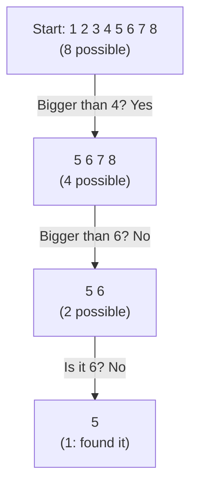

> **In one sentence:** Information is what answers a question you had: it tells you which of the possible answers is the true one.

## Why should I care?

You use information all day. A message from a friend or the time on a clock tells you something you did not know before.

Computers work with information all the time: they store it and send it from place to place. So before you learn how computers work, it helps to know what information is. The next pages in this guide, about numbers and bits, all build on this idea.

## Analogy

Imagine you and a friend make an agreement before you leave home. "If the light in my window is **on**, I am home. If it is **off**, I am out."

Later, your friend walks past your window. Before they look, they do not know if you are home. There are two possible answers. They see that the light is on. Now they know the answer. The light gave them information.

Notice two things:

- The light only works because you **agreed on its meaning** first. A stranger sees a light, not a message.
- The light is useful only because it **could have been on or off**. If the light were always on, it would tell your friend nothing.

**Where the analogy breaks down:** one light can answer only a question with two possible answers. A question like "Which day will you come home?" has more answers. One light is not enough for that. You would need more lights, or another kind of **signal** (a sign that carries a message, like a light, a sound or a hand wave). Also, a real light can be left on by mistake.

## How it actually works

### Information removes uncertainty

Before you get a message, you are **uncertain**: more than one answer is possible. The message tells you which answer is true. So **information is what removes uncertainty**.

This also means that if you are already sure of the answer, there is no uncertainty left to remove. So the message gives you no new information. That is why a light that is always on tells your friend nothing.

### More possible answers means more information

A coin toss has **2** possible results: heads or tails. A dice roll has **6** possible results. Learning the result of the dice roll gives you more information than learning the result of the coin toss, because more answers were possible. (This assumes every result is equally likely, as with a fair coin and a fair dice.)

You can find any answer with yes-or-no questions. Each good question cuts the possible answers in half. Say a friend thinks of a number from 1 to 8:

Information can be measured this way. The standard unit of information is called the **[[bit]]**. One bit is the information that cuts the uncertainty in half, like the answer to one of the questions above. So finding a number from 1 to 8 took **3 bits**: three answers.

A bit has two possible values, like the light's on and off, or yes and no. We write them as **1** and **0**. You will meet bits again soon.

### The same information can take many forms

"I am home" can be spoken out loud, written on paper, typed in a chat app, or shown with a light. The **form** is different each time. The **information**, the answer to "Are you home?", stays the same.

Putting information into a form that can be sent or stored is called **encoding**. To get the information back, the receiver must know what the form means. That is why you and your friend agreed on the light's meaning.

### Inside a computer

Computers store information as bits: 0s and 1s. Text, pictures and sound are all stored as long rows of 0s and 1s. Later pages show how: [[text-as-numbers|text as numbers]], [[images-as-numbers|images as numbers]] and [[sound-as-numbers|sound as numbers]].

## How it came to be

The science of **measuring** information is called **information theory**. Harry Nyquist and Ralph Hartley made early contributions to it in the 1920s. But this area of science was founded mainly by the work of Claude Shannon in the 1940s.

In **1948**, Shannon published a paper called **"A Mathematical Theory of Communication"** in the *Bell System Technical Journal*, a journal (a magazine for research papers). He wrote it at Bell Laboratories in New Jersey, which he had joined in 1941.

Early in the paper, he wrote: "the fundamental problem of communication is that of reproducing at one point either exactly or approximately a message selected at another point." In plain words: how do you get a message from one place to another, so that it arrives exactly or nearly the same?

Shannon's key idea was that the amount of information in a message can be measured in bits: in 1s and 0s. His theory also made it possible to store pictures, voices and other kinds of information as bits in computers.

## 🧪 Try it in your browser

You will see the same words in two different forms. You need a computer with a keyboard for this.

1. In Chrome, Edge or Firefox, open this page: `https://info.cern.ch/hypertext/WWW/TheProject.html`. It is a page from the first website. CERN, the physics laboratory where the web was born, keeps it online.
2. Look at the page. You will see a large heading, **World Wide Web**, and some text below it. The page looks very plain. That is normal.
3. Now show the page's **source**. Your browser receives each web page as code, called the **source**. The browser turns that code into the page you see.
   - **Windows:** press `Ctrl` + `U` (Chrome, Edge and Firefox).
   - **Mac:** in Chrome, press `Cmd` + `Option` + `U`. In Firefox, press `Cmd` + `U`. (Edge's official shortcut list for Mac does not include this shortcut. Use Chrome or Firefox for this step.)
4. The source opens, often in a new tab. It shows text with many marks in angle brackets, like `
`. In the first ten lines, find this: `<H1>World Wide Web</H1>`. More text may follow it on the same line.

**What you saw:** the same words, "World Wide Web", in two forms. On the page, they are a big heading. In the source, they sit between `<H1>` and `</H1>`. Those marks tell the browser: "this is a heading". The information is the same. Only the form changed.

And inside your computer, both forms are stored as bits: 0s and 1s.

## Common misunderstandings

- **"Information means words."** No. A light, a picture, a sound or a pattern can also carry information.
- **"Computers store letters as letters and pictures as pictures."** No. Inside a computer, text and pictures are stored as bits: 0s and 1s. The computer turns them back into letters or pictures when it shows them to you.

## Recap

- Information answers a question: it tells you which of the possible answers is true, and so removes uncertainty.
- The same information can take many forms. Computers store all of it as 0s and 1s.
- In 1948, Claude Shannon's paper showed how to measure information. His work founded information theory.

## Sources

- Wikipedia, Information: https://en.wikipedia.org/wiki/Information
- MIT News, Professor Emeritus Claude Shannon, founder of digital communications, dies at 84 (2001): https://news.mit.edu/2001/shannon
- Computer History Museum, A Mathematical Theory of Communication: https://www.computerhistory.org/chess/doc-431614f68e1be/
- CERN, info.cern.ch, home of the first website: https://info.cern.ch/
- CERN, The World Wide Web project (preserved early web page): https://info.cern.ch/hypertext/WWW/TheProject.html
- Google Chrome Help, Chrome keyboard shortcuts: https://support.google.com/chrome/answer/157179?hl=en
- Microsoft Support, Keyboard shortcuts in Microsoft Edge: https://support.microsoft.com/en-us/microsoft-edge/keyboard-shortcuts-in-microsoft-edge-50d3edab-30d9-c7e4-21ce-37fe2713cfad
- Firefox Source Docs, View Source: https://firefox-source-docs.mozilla.org/devtools-user/view_source/index.html
- MDN Web Docs, Populating the page: how browsers work: https://developer.mozilla.org/en-US/docs/Web/Performance/Guides/How_browsers_work
- MDN Web Docs, The h1 to h6 elements: https://developer.mozilla.org/en-US/docs/Web/HTML/Reference/Elements/Heading_Elements
