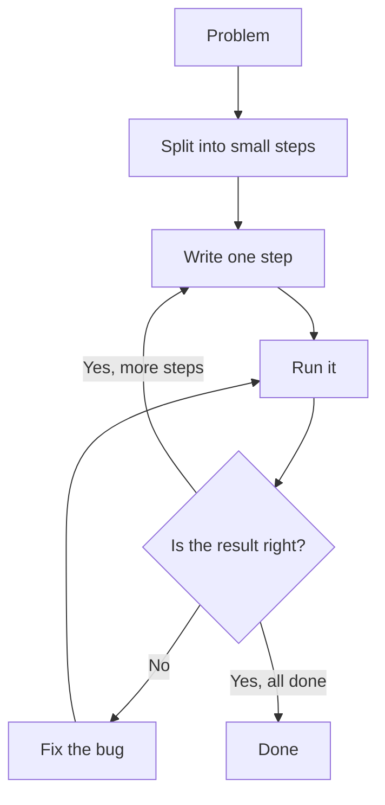

> **In one sentence:** Programming means writing exact instructions for a computer, then running and fixing them, because a computer follows what you wrote, not what you meant.

## Why should I care?

In the programming book *Think Python*, Allen B. Downey says that every program you have used, "no matter how complicated", is made of a few basic kinds of instructions. This topic shows such instructions, using the console you met in [[javascript|JavaScript]].

## Analogy

Imagine a recipe written for a helper who has never cooked. The helper does each step exactly as written, in the order written. If the recipe forgets "add water", the helper adds no water.

The recipe is your program. The helper is the computer.

**Where the analogy breaks down:** a real helper can think, and can stop to ask about a strange step. A computer does not ask. It carries out what you wrote, even when the result is wrong.

## How it actually works

### A program is a list of exact instructions

*Think Python* says a **program** is "a sequence of instructions that specifies how to perform a computation". A computation means working something out, for example with numbers or text.

The instructions must be exact. The book says programming languages "mean exactly what they say".

### Statements run one after another

MDN Web Docs, a website about web technologies, says that in JavaScript, "instructions are called statements". So a **statement** is one instruction.

MDN says the browser "generally runs" JavaScript "in order, from top to bottom". (This is simplified. Code can also check conditions and repeat steps.)

A program with three statements:

```js
console.log("First");
console.log("Second");
console.log("Third");
```

`console.log(...)` shows a message in the console. This program shows:

```
First
Second
Third
```

If you swap the first two lines, "Second" appears first.

A semicolon (`;`) ends each statement above. It is optional when a statement is on its own line. Two statements on one line must have a semicolon between them.

### What console.log can show

`console.log` can show text in quote marks, exactly as written. It can also show numbers and the answers to calculations, such as `2 + 3`.

```js
console.log("Hello");
console.log(42);
console.log(2 + 3);
```

This shows:

```
Hello
42
5
```

### What the console shows

When you type a line into the console and press `Enter`, up to three things appear. An error message may appear instead of a result.

1. Your typed line stays on the screen.
2. Any output from the line appears, such as a `console.log` message.
3. The result of the line appears, or `undefined` when there is no result to show. `console.log` gives back no result, so the console may also show `undefined` after its message. This is normal. It is not an error.

This is why `(2 + 3) * 4` showed `20` in [[programming-languages|Programming Languages]]. Showing the result of each typed line is a feature of the console.

### Comments are notes for people

A **comment** is a note in your code. The browser ignores comments. They explain the code to programmers, including you. In JavaScript, a one-line comment starts with `//`.

```js
// This whole line is a comment. The computer skips it.
console.log("Hello"); // This part is a comment too.
```

This program shows only `Hello`.

### Bugs and debugging

*Think Python* says: "Programmers make mistakes." A mistake in a program is called a **bug**. Finding and correcting bugs is called **debugging**.

Suppose you want to show the answer to 2 + 3, and you write this:

```js
console.log("2 + 3");
```

The program runs and shows `2 + 3`, not `5`. You added quote marks, so the computer treated it as text. MDN says a bug like this, usually with no error message, is often harder to fix than a mistake that stops the program with a message.

To fix it, remove the quote marks:

```js
console.log(2 + 3);
```

### The work: split, write, run, fix

*Think Python* describes programming as breaking a large task into "smaller and smaller subtasks", until each is simple enough for one basic instruction. It suggests testing "only a small amount of code at a time".

Say you must show the cost of 3 notebooks, at 4 coins each. Split it into two steps. The `*` symbol means "multiply".

```js
// Step 1: say what the answer is about.
console.log("Cost of 3 notebooks:");
// Step 2: work out 3 times 4, and show the answer.
console.log(3 * 4);
```

This shows:

```
Cost of 3 notebooks:
12
```

Repeat for each step:



## How it came to be

In 1843, [[babbage-and-lovelace|Ada Lovelace]] published notes about the Analytical Engine, a machine designed by Charles Babbage and never finished. The Computer History Museum says they included "the first published description of a stepwise sequence of operations for solving certain mathematical problems". (Stepwise means step by step.) It adds that she is often called "the first programmer", and that biographers debate how much of the work was her own.

The word "bug" also means an insect, and a moth is an insect. The museum says that on 9 September 1947, a team found a moth caught inside the Harvard Mark II computer. They taped it into its logbook, and one of them wrote: "First actual case of bug being found." The word "bug" for a fault is older than this moth. In an 1878 letter, Thomas Edison wrote of bugs, "as such little faults and difficulties are called". [[grace-hopper-and-compilers|Grace Hopper and the First Compilers]] has more.

## 🧪 Try it in your browser

You need a computer with Chrome, Edge or Firefox. In the console, `Enter` runs the line, so these programs are one line each. Longer programs can be kept in files.

**Safety rule:** only type code in the console that you understand or that comes from a source you trust. Never paste anything a stranger sends you.

1. Open `https://example.com`.
   **What you should see:** a short page of text.
2. Open the console:
   - **Windows:** press `Ctrl` + `Shift` + `J` (in Firefox: `Ctrl` + `Shift` + `K`)
   - **Mac:** press `Cmd` + `Option` + `J` (in Firefox: `Cmd` + `Option` + `K`)
3. Click the line where you can type, below any messages. **Type** this line yourself (some browsers may block pasting at first), then press `Enter`:

   ```
   console.log("Hello")
   ```

   **What you should see:** `Hello` below your line. The console may also show `undefined`, here and in the steps below. The browser may show suggestions, and the line may look different while you type. Keep typing.
4. Type this new line and press `Enter`:

   ```
   console.log(2 + 3)
   ```

   **What you should see:** `5`.
5. Type this new line and press `Enter`. Its quote marks are the bug from above:

   ```
   console.log("2 + 3")
   ```

   **What you should see:** `2 + 3`.
6. Type this new line and press `Enter`. It has two statements, with a semicolon between them:

   ```
   console.log("First"); console.log("Second")
   ```

   **What you should see:** `First`, then `Second` below it.
7. Type this new line and press `Enter`. It ends with a comment:

   ```
   console.log("Seen") // console.log("Not seen")
   ```

   **What you should see:** your typed line stays, with `Not seen` in it. Below it, the only output is `Seen`. Everything after `//` was ignored.
8. Type this new line and press `Enter`. It has a mistake on purpose: `log` is spelled wrong.

   ```
   console.lgo("Hello")
   ```

   **What you should see:** an error message that contains `console.lgo is not a function`. This bug stops the line with a message, unlike the bug in step 5. You will learn what "function" means later. Type the line again with `log`, and it works. You have debugged your first program.

**On a phone:** read steps 3 to 7, and say what each line will show.

## Common misunderstandings

- **"Programming is only about typing code."** *Think Python* calls problem solving the "single most important skill for a computer scientist".
- **"No error message means the program is right."** No. MDN describes logic errors: the program "runs successfully but gives incorrect results".

## Recap

- A program is a list of exact instructions, called statements. The computer follows them literally, generally from top to bottom.
- `console.log` shows things in the console, and comments are notes the computer ignores.
- A bug is a mistake in a program. The work is to split a problem into steps, then write, run and fix them.

## Sources

- Allen B. Downey, Think Python, 2nd edition, The way of the program (chapter 1): https://greenteapress.com/thinkpython2/html/thinkpython2002.html
- Allen B. Downey, Think Python, 2nd edition, Fruitful functions (chapter 6): https://greenteapress.com/thinkpython2/html/thinkpython2007.html
- Green Tea Press, Think Python, 2nd edition: https://greenteapress.com/wp/think-python-2e/
- MDN Web Docs, Grammar and types: https://developer.mozilla.org/en-US/docs/Web/JavaScript/Guide/Grammar_and_types
- MDN Web Docs, What is JavaScript?: https://developer.mozilla.org/en-US/docs/Learn_web_development/Core/Scripting/What_is_JavaScript
- MDN Web Docs, console.log(): https://developer.mozilla.org/en-US/docs/Web/API/console/log_static
- MDN Web Docs, What went wrong? Troubleshooting JavaScript: https://developer.mozilla.org/en-US/docs/Learn_web_development/Core/Scripting/What_went_wrong
- MDN Web Docs, TypeError: "x" is not a function: https://developer.mozilla.org/en-US/docs/Web/JavaScript/Reference/Errors/Not_a_function
- MDN Web Docs, Addition (+): https://developer.mozilla.org/en-US/docs/Web/JavaScript/Reference/Operators/Addition
- MDN Web Docs, Multiplication (*): https://developer.mozilla.org/en-US/docs/Web/JavaScript/Reference/Operators/Multiplication
- MDN Web Docs, undefined: https://developer.mozilla.org/en-US/docs/Web/JavaScript/Reference/Global_Objects/undefined
- MDN Web Docs, About MDN: https://developer.mozilla.org/en-US/about
- Computer History Museum, This Day in History, September 9: https://www.computerhistory.org/tdih/september/9/
- Computer History Museum, Babbage Engine, Ada Lovelace: https://www.computerhistory.org/babbage/adalovelace/
- Computer History Museum, Babbage Engine, The Engines: https://www.computerhistory.org/babbage/engines/
- Science Museum Group Collection, Babbage's Analytical Engine, 1834-1871 (Trial model): https://collection.sciencemuseumgroup.org.uk/objects/co62245
- Wikipedia, Analytical engine: https://en.wikipedia.org/wiki/Analytical_engine
- Chrome for Developers, Open Chrome DevTools: https://developer.chrome.com/docs/devtools/open
- Microsoft Edge DevTools, Keyboard shortcuts: https://learn.microsoft.com/en-us/microsoft-edge/devtools/shortcuts/
- Firefox DevTools User Docs, Web Console: https://firefox-source-docs.mozilla.org/devtools-user/web_console/index.html
- Chrome for Developers, What are self-XSS attacks?: https://developer.chrome.com/blog/self-xss
- Alexander B. Magoun and Paul Israel, IEEE Spectrum, Did You Know? Edison Coined the Term "Bug": https://spectrum.ieee.org/did-you-know-edison-coined-the-term-bug
- Example Domain: https://example.com
- Wordorigins.org, bug: https://wordorigins.org/big-list-entries/bug
- Wikipedia, Moth: https://en.wikipedia.org/wiki/Moth
- Chrome for Developers, Run JavaScript in the Console: https://developer.chrome.com/docs/devtools/console/javascript
- Microsoft Edge DevTools, Run JavaScript in the Console: https://learn.microsoft.com/en-us/microsoft-edge/devtools/console/console-javascript
- Firefox DevTools User Docs, JavaScript input interpreter: https://firefox-source-docs.mozilla.org/devtools-user/web_console/the_command_line_interpreter/index.html
