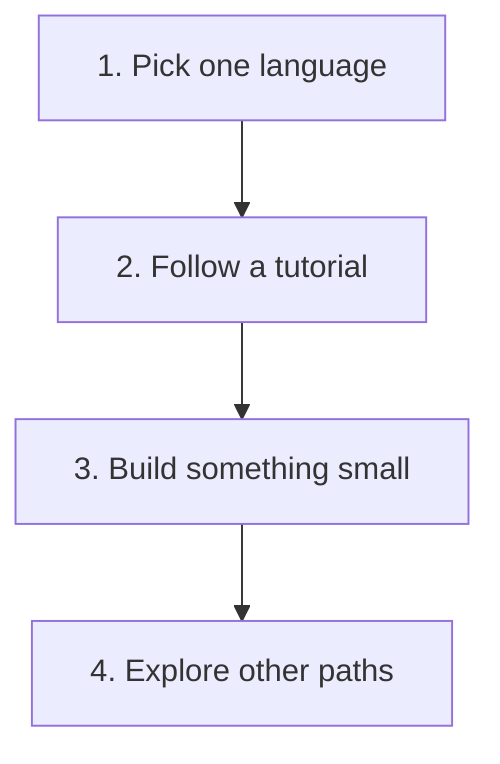

> **In one sentence:** After First Steps in Code, choose one language, follow a tutorial for it, and build something small of your own.

## Why should I care?

You have reached the last page of First Steps in Code. In [[how-to-learn-programming|How to Learn Programming]], you learned how to keep learning on your own. This page helps you decide what to learn with those skills.

MDN Web Docs, a website that documents web technologies, has a page of learning advice. It says to begin with "a single sentence that says what you want to achieve". It adds: "You should be ambitious but also realistic." One of its examples is: "I want to learn enough to build a website for my local amateur tennis club." Write your own sentence before you choose anything below.

## Analogy

Think of learning music. You have learned to read notes and keep a rhythm. Next, you choose one instrument. You work through a method book: a lesson book made for that instrument. Then you play a short tune of your own.

Here, the notes and rhythm are ideas such as variables and loops. The instrument is one programming language. The method book is a tutorial for that language. The tune is a small program you write yourself.

**Where the analogy breaks down:** a method book cannot hear you play. Some tutorials can run your code for you. MDN's course has a **Play** button that opens an example in the MDN Playground. A Tour of Go has a **Run** button. The Python Tutorial works differently: you try its examples with Python on your own computer.

## How it actually works

There are four steps, one for each heading below. Steps 1 to 3 come from the learning advice on MDN and from each tutorial's own pages.

### Step 1: Pick one language

MDN's advice says that once you know your goal, "it is a good idea to research what you'll need to achieve the goal." The tabs below say what each language is used for, from its own makers or from MDN. They do not rank the languages.

If your goal fits more than one language, this page does not choose for you. Many pages in this path, such as [[loops|Loops]], showed the same idea in JavaScript, Python and Go, side by side.

You only need to read one tab.

<!-- tabs -->

### JavaScript

MDN says [[javascript|JavaScript]] is "most well-known as the scripting language for Web pages". It lets you "create dynamically updating content": web pages that change in the browser while you look at them. MDN also says that many places outside the browser use it, such as [[nodejs|Node.js]].

Websites also have code on the **server**, the computer that sends the pages. MDN says server-side code "can be written in any number of programming languages". Its examples include Python and JavaScript (Node.js).

### Python

[[python|Python]]'s website says: "Python is used in many application domains." (An application domain is an area of work.) It lists six areas. Five of them are:

- Web and Internet Development
- Scientific and Numeric
- Education
- Software Development
- Business Applications

Python's tutorial opens with an example of a reason to learn it. You may want a computer to do a task for you, such as renaming "a bunch of photo files".

For websites, MDN names Python as an example of a language for code on the **server**, the computer that sends the pages.

### Go

[[go-language|Go]]'s website lists four kinds of use. Two of them are:

- Command-line Interfaces (CLIs): programs you use by typing commands, each command one line of text
- Web Development

Websites also have code on the **server**, the computer that sends the pages. Go's web development page says Go comes with a web server.

<!-- /tabs -->

### Step 2: Follow a tutorial

You met these tutorials in How to Learn Programming. Each one is published on the same website as documentation for its language. Here is where to begin in yours.

<!-- tabs -->

### JavaScript

The tutorial for JavaScript is **MDN Learn web development**. Its JavaScript part is the module **Dynamic scripting with JavaScript**. That module says you need no "previous JavaScript knowledge". It also asks you to know [[html|HTML]] and "the basic fundamentals of CSS" first. MDN says HTML gives web content its structure, and [[css|CSS]] applies styling, such as colors and fonts.

### Python

The official tutorial is **The Python Tutorial**, on docs.python.org. Its opening tip says plainly that it is for programmers new to Python, "**not** *beginners* who are new to programming". It "expects you to have a basic understanding of programming in general". This path covered basic ideas such as variables, loops and functions.

The tutorial says: "It helps to have a Python interpreter handy for hands-on experience". It adds that its examples are self-contained, so it "can be read off-line as well". To run the examples yourself, you need Python on your computer. The official setup instructions are in [Python Setup and Usage](https://docs.python.org/3/using/index.html), with one part for each kind of computer. For Windows, it says to use the Python install manager, from python.org/downloads or the Microsoft Store app. For macOS, Python's makers provide an installer package for each new release. The tutorial's chapter 2, "Using the Python Interpreter", shows how to start Python.

When you meet a word you do not know, the tutorial suggests Python's [Glossary](https://docs.python.org/3/glossary.html): "The Glossary is also worth going through." (A glossary is a list of words and their meanings.)

If you want to ask about your code, Python's help page says the Python Help category of discuss.python.org "hosts usage questions and answers from the Python community".

### Go

Go's documentation page lists several tutorials. This page points you to one of them, **A Tour of Go**, listed under Getting Started. The tour is a web page. Its own text says it is built on the Go Playground. The Go Playground's page says it "runs on go.dev's servers". So your code is sent to Go's servers and runs there, not in your browser. Do not type private information into it.

<!-- /tabs -->

### Step 3: Build something small of your own

When you use a solution from somewhere else, MDN advises: "Ideally, learn from the solution and then write your own version."

Choose something small that moves you toward your goal sentence. How small? One challenge in MDN's course is "a fun app that generates random silly stories". One exercise in A Tour of Go uses a loop to find the number which, times itself, comes closest to your number. An early example in The Python Tutorial prints the numbers of the Fibonacci series below 10: from the third number on, each number is the sum of the two before it. MDN suggests writing "some sub-goals below your main goal" to keep track of where you are. One of its example sub-goals is "Example website project built by next April".

When a piece feels too hard, MDN says to "break it down into multiple smaller problems or chunks". It also says: "Keep practicing."

### Step 4: Other paths on this site

This site has two other paths:

- [First Chapter: From Zero to Your Own Website](/path/first-chapter) explains computers, networks and the web. If you skipped any of it, it is there for you. It includes pages such as [[web-hosting|Web Hosting]].
- [More to Explore](/path/more-to-explore) has topics to read in any order. Its sections are Staying Safe Online, Everyday Internet, Modern Computing and History, and How Busy Websites Keep Up. One example is [[open-source|Open Source Software]].

## How it came to be

Each tutorial has its own history.

- **MDN**, home of Learn web development, began in 2005 under the name DevMo. In 2010 it was renamed Mozilla Developer Network (MDN).
- **The Python Tutorial** is part of Python's documentation. That documentation is "an entirely volunteer effort", like Python itself. It thanks Fred L. Drake, Jr., "author of much of the content".
- **A Tour of Go** was announced on the Go Blog by Andrew Gerrand on 4 October 2011, as "a guided tour of the Go programming language you can run from your browser". (The code itself runs on Go's servers.)

## 🧪 Try it in your browser

You will find the first lesson of a tutorial for your language. You only read pages; you change nothing. Use Chrome, Edge or Firefox. Follow the tab for your language.

<!-- tabs -->

### JavaScript

1. Open [MDN: Dynamic scripting with JavaScript](https://developer.mozilla.org/en-US/docs/Learn_web_development/Core/Scripting).
   **What you should see:** a page with the heading **Dynamic scripting with JavaScript**.
2. Find the heading **Prerequisites** and read the text under it.
   **What you should see:** it says you need no previous JavaScript knowledge, but you should know HTML and the basics of CSS.
3. Find the heading **Tutorials and challenges**. Click the first link in the list, **What is JavaScript?**
   **What you should see:** a page with the heading **What is JavaScript?** Its first sentence is "Welcome to the MDN beginner's JavaScript course!" This is the first lesson.

### Python

1. Open [The Python Tutorial](https://docs.python.org/3/tutorial/index.html).
   **What you should see:** the heading **The Python Tutorial**, and a tip that says the tutorial is for programmers who are new to Python, not beginners who are new to programming.
2. Scroll down to the list of chapters.
   **What you should see:** the first chapter is **1. Whetting Your Appetite**.
3. Click **1. Whetting Your Appetite**.
   **What you should see:** a page with that heading. It begins: "If you do much work on computers, eventually you find that there's some task you'd like to automate." This is the first lesson.

### Go

1. Open [Go: Documentation](https://go.dev/doc/).
   **What you should see:** a heading **Getting Started**, with a list of parts under it. Scroll down: **A Tour of Go** is lower in that list.
2. Read the text under **A Tour of Go**.
   **What you should see:** it says the tour is "An interactive introduction to Go in four sections".
3. In that text, click the link **take the tour online**.
   **What you should see:** the first page of A Tour of Go. The tour's own text says this first part explains "how to navigate the different lessons and how to run code". It also tells you to click its **Run** button. This is the first lesson.

<!-- /tabs -->

## Common misunderstandings

- **"I must finish the whole tutorial before I build anything."** No. MDN's advice says to write your own version of what you learn. MDN's course has "Challenges" along the way, which test your ability "to create a complete website or program of some kind". Each section of A Tour of Go ends with exercises. The Python Tutorial suggests trying its examples with Python for "hands-on experience".
- **"My first project must be big to count."** No. MDN says a goal should be "ambitious but also realistic". It also suggests sub-goals, and breaking a hard problem into smaller ones.

## Recap

- Write your goal in one sentence, then pick one language that fits it.
- Follow a tutorial for that language: MDN Learn web development, The Python Tutorial, or A Tour of Go.
- Build something small of your own, in small pieces, and keep practicing.

## Sources

- MDN Web Docs, Research and learning: https://developer.mozilla.org/en-US/docs/Learn_web_development/Getting_started/Soft_skills/Research_and_learning
- MDN Web Docs, Learn web development: https://developer.mozilla.org/en-US/docs/Learn_web_development
- MDN Web Docs, Dynamic scripting with JavaScript: https://developer.mozilla.org/en-US/docs/Learn_web_development/Core/Scripting
- MDN Web Docs, What is JavaScript?: https://developer.mozilla.org/en-US/docs/Learn_web_development/Core/Scripting/What_is_JavaScript
- MDN Web Docs, JavaScript: https://developer.mozilla.org/en-US/docs/Web/JavaScript
- MDN Web Docs, About MDN: https://developer.mozilla.org/en-US/about
- The Python Tutorial: https://docs.python.org/3/tutorial/index.html
- The Python Tutorial, Whetting Your Appetite: https://docs.python.org/3/tutorial/appetite.html
- Python documentation, About this documentation: https://docs.python.org/3/about.html
- Python.org, Applications for Python: https://www.python.org/about/apps/
- Go, Documentation: https://go.dev/doc/
- Go, Use Cases: https://go.dev/solutions/use-cases
- A Tour of Go: https://go.dev/tour/
- A Tour of Go source text, welcome.article: https://github.com/golang/website/blob/master/_content/tour/welcome.article
- The Go Blog, Learn Go from your browser: https://go.dev/blog/tour
- MDN Web Docs, Introduction to the server side: https://developer.mozilla.org/en-US/docs/Learn_web_development/Extensions/Server-side/First_steps/Introduction
- Go, Web Development: https://go.dev/solutions/webdev
- Wikipedia, Command-line interface: https://en.wikipedia.org/wiki/Command-line_interface
- Python documentation, Python Setup and Usage: https://docs.python.org/3/using/index.html
- The Python Tutorial, Using the Python Interpreter: https://docs.python.org/3/tutorial/interpreter.html
- Python documentation, Glossary: https://docs.python.org/3/glossary.html
- The Go Playground: https://go.dev/play/
- A Tour of Go source text, flowcontrol.article: https://github.com/golang/website/blob/master/_content/tour/flowcontrol.article
- MDN Web Docs, Challenge: Silly story generator: https://developer.mozilla.org/en-US/docs/Learn_web_development/Core/Scripting/Silly_story_generator
- Python documentation, Using Python on Windows: https://docs.python.org/3/using/windows.html
- Python documentation, Using Python on macOS: https://docs.python.org/3/using/mac.html
- Python.org, Python Help: https://www.python.org/about/help/
- The Python Tutorial, An Informal Introduction to Python: https://docs.python.org/3/tutorial/introduction.html
