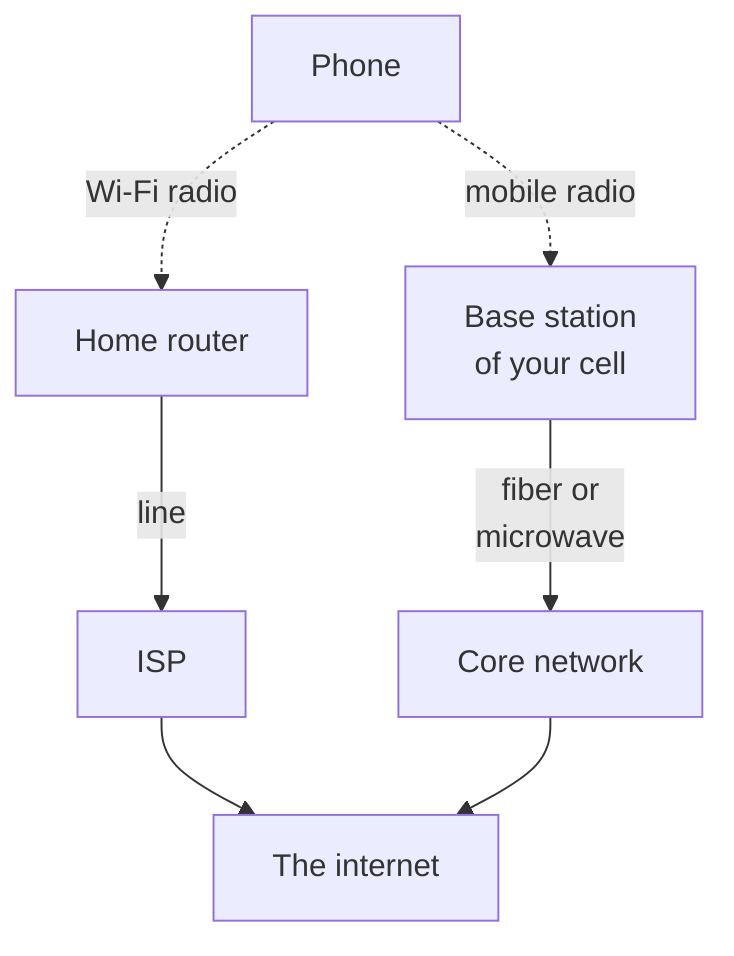

> **In one sentence:** Wi-Fi and mobile networks connect your device to a network by radio waves: Wi-Fi through a nearby access point, such as your home router, and a mobile network through the base station of your cell.

## Why should I care?

Your phone has no cable, but it can load web pages. At home, it often uses **Wi-Fi**. On the street or on a bus, it uses a **mobile network**, often called "mobile data".

Look at the top of a [[smartphone]] screen. You will often see a Wi-Fi symbol, or letters such as "4G" or "5G". These tell you which of the two networks your phone is using right now.

## Analogy

Think of **lamps**. Wi-Fi is like one lamp that lights only the room around it. A mobile network is like the street lamps of a city. Each street lamp is like one base station. It lights a small area, and together the lamps cover the streets.

**Where the analogy breaks down:** a lamp only sends light. A radio connection goes both ways: your phone also sends signals back. Radio waves can partly pass through walls. And street lamps do not work together, but a mobile network passes your connection from one area to the next while you move.

## How it actually works

### Radio is used for the first link

In [[what-is-a-network]], you saw that devices can connect by cable or by **radio waves**. Wi-Fi and mobile networks both use radio. They use it for the first link: the one between your device and the network. After that, your [[packets]] usually travel through cables and routers.



### Wi-Fi

Wi-Fi is a family of rules ([[protocols]]) for connecting devices by radio. They are based on a standard called **IEEE 802.11**, from the IEEE Standards Association, a group that writes technical standards. A device that gives Wi-Fi to other devices is an **access point**.

For example, a **wireless router** is a [[router]] that is also an access point. Microsoft explains: "With a wireless router, you can connect PCs to your network using radio signals instead of wires."

Wi-Fi reaches only nearby devices. Microsoft says: "The fewer the walls and other obstacles the better."

Wi-Fi uses a few **frequency bands**, named in gigahertz (GHz). Think of each band as a separate set of radio channels. The most common are 2.4 GHz and 5 GHz, and newer equipment also uses 6 GHz. Microsoft says 2.4 GHz is "better at going through obstacles (for example, walls)".

### Mobile networks

NTT DOCOMO, a mobile network company in Japan, explains how a mobile network covers a large area: in a "cellular mobile communications system, the service area is divided into many small areas called cells." Each cell has a **base station**: radio equipment with **antennas**, which, Ericsson says, "transmit electrical signals into radio waves".

*Diagram: a simple model of an area divided into six-sided cells, like a honeycomb. Each cell has one base station (B) in the middle.*

```
      ___       ___
     /   \_____/   \
     \ B /     \ B /
     /   \  B  /   \
     \___/     \___/
     /   \_____/   \
     \ B /     \ B /
      \_/       \_/
```

For planning, DOCOMO says six-sided cells (hexagons) have "proved effective". A cellular system uses its limited radio frequencies again in many cells. This lets it cover a very large area "with only a small number of frequency bandwidths".


Your phone talks by radio to the base station of its cell. Ericsson, a maker of this equipment, says the radio network links phones "to the **core network**". It adds that the link from the base stations to the core network is "typically" "fiber or wireless microwave links". (You met optical fiber in the lesson on networks.) From there, your data reaches the internet.

### Moving from cell to cell

What happens when you move during a call? DOCOMO explains: "the radio channel is switched over automatically to the appropriate cell during the call." This is called **handover**.

## How it came to be

You do not need to remember these names and dates.

The engineering history site ETHW says cellular service "had been conceived" (first imagined) "in 1947 by Donald H. Ring at Bell Labs". In his plan, neighboring cells used different frequencies, and calls could switch to the next cell "as a vehicle moved down the road". But at that time, the idea "could not be put into practice". Later, a Bell Labs team rediscovered it and developed it "as a network of hexagonal cells".

Mobile networks have grown in **generations**. The "G" in 5G means "generation". The International Telecommunication Union (ITU), a United Nations agency, calls 5G "the fifth generation of mobile technologies".

Wi-Fi is younger. The first IEEE 802.11 standard was approved on June 26, 1997. In 1999, several companies formed the group now called the Wi-Fi Alliance. In 2000, it adopted "Wi-Fi" as "the proper name for its technical work". "Wi-Fi" is a trademark of the Wi-Fi Alliance.

## 🧪 Try it in your browser

Find out which network a phone is using. No smartphone? Read the pages only.

1. Open Apple's page [Learn the meaning of iPhone status icons](https://support.apple.com/guide/iphone/learn-the-meaning-of-iphone-status-icons-iphef7bb57dc/ios).
2. Scroll down to the part called **Connectivity**. On a computer, you can press `Ctrl` + `F` (Mac: `Cmd` + `F`) and type `Connectivity` to find it. Apple may change the page; if you do not find that word, search for `Wi-Fi` instead.
3. **What you should see:** a row for **Wi-Fi**: "iPhone is connected to the internet over a Wi-Fi network." Further down, a row for **5G** says your carrier's 5G network is available, and supported models can connect to the internet over it. (A **carrier** is the mobile network company.)
4. For Android, open Samsung's page [What do the different indicator icons mean on your Galaxy phone?](https://www.samsung.com/uk/support/mobile-devices/what-do-the-different-indicator-icons-mean-on-your-galaxy-phone/). Under **Network status icons**, find "Wi-Fi connected" and "5G network connected". Icons vary by phone model.
5. Now look at the very top of your own phone's screen. Only look; do not change any setting. Compare the icons with the pages. You may also see other letters, or both icons at once: look them up too.

## Common misunderstandings

- **"Wi-Fi and the internet are the same thing."** No. Wi-Fi only connects your device to a nearby access point. Samsung even has an icon for "Connected to Wi-Fi network however, unable to access the internet".
- **"5 GHz Wi-Fi is 5G."** No. 5 GHz is a Wi-Fi frequency band. 5G is the fifth generation of mobile networks. They only share the number.
- **"Wi-Fi stands for Wireless Fidelity."** This is not certain. One encyclopedia says it is "disputed" whether the name is short for "Wireless Fidelity".

## Recap

- Wi-Fi and mobile networks use radio waves for the first link, between your device and the network. After that, cables and routers usually carry your packets.
- Wi-Fi connects nearby devices to an access point, such as your home router. It is based on the IEEE 802.11 standard.
- A mobile network divides the land into cells, each with a base station. When you move during a call, handover switches your phone to the next cell.

## Sources

- IEEE Standards Association, IEEE 802.11-1997: https://standards.ieee.org/standard/802_11-1997.html
- Wi-Fi Alliance, History: https://www.wi-fi.org/who-we-are/history
- Microsoft Support, Set up a wireless network: https://support.microsoft.com/en-us/windows/set-up-a-wireless-network-97914e31-3aa4-406d-cef6-f1629e2c3721
- Microsoft Support, Wi-Fi and your home layout: https://support.microsoft.com/windows/wi-fi-and-your-home-layout-e1ed42e7-a3c5-d1be-2abb-e8fad00ad32a
- Apple Support, Recommended settings for Wi-Fi routers and access points: https://support.apple.com/en-us/102766
- NTT DOCOMO, About DOCOMO: https://www.docomo.ne.jp/english/corporate/about/
- NTT DOCOMO, Cellular Mobile Communication System, 1. Outline: https://www.docomo.ne.jp/english/corporate/technology/rd/tech/network/cellular/01/index.html
- NTT DOCOMO, Cellular Mobile Communication System, 2. Technology: https://www.docomo.ne.jp/english/corporate/technology/rd/tech/network/cellular/02/index.html
- NTT DOCOMO, Cellular Mobile Communication System, 4. Hand-Over: https://www.docomo.ne.jp/english/corporate/technology/rd/tech/network/cellular/04/index.html
- Ericsson, Radio Access Network (RAN): https://www.ericsson.com/en/ran
- Engineering and Technology History Wiki, The Foundations of Mobile and Cellular Telephony: https://ethw.org/The_Foundations_of_Mobile_and_Cellular_Telephony
- ITU, 5G, fifth generation of mobile technologies: https://www.itu.int/en/mediacentre/backgrounders/Pages/5G-fifth-generation-of-mobile-technologies.aspx
- ITU, About ITU: https://www.itu.int/en/about/Pages/default.aspx
- Apple Support, Learn the meaning of iPhone status icons: https://support.apple.com/guide/iphone/learn-the-meaning-of-iphone-status-icons-iphef7bb57dc/ios
- Samsung Support, What do the different indicator icons mean on your Galaxy phone?: https://www.samsung.com/uk/support/mobile-devices/what-do-the-different-indicator-icons-mean-on-your-galaxy-phone/
- Wikipedia, Wi-Fi (general background reference): https://en.wikipedia.org/wiki/Wi-Fi
